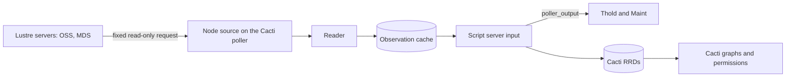

<!-- translations:start -->
[English](README.md) | [简体中文](docs/i18n/zh-CN/README.md) | [हिन्दी](docs/i18n/hi-IN/README.md) | [Español (España)](docs/i18n/es-ES/README.md) | [Español (Latinoamérica)](docs/i18n/es-419/README.md) | [العربية (السعودية)](docs/i18n/ar-SA/README.md) | [Afrikaans](docs/i18n/af-ZA/README.md) | [አማርኛ](docs/i18n/am-ET/README.md) | [العربية (مصر)](docs/i18n/ar-EG/README.md) | [العربية (المغرب)](docs/i18n/ar-MA/README.md) | [বাংলা](docs/i18n/bn-BD/README.md) | [Deutsch](docs/i18n/de-DE/README.md) | [فارسی](docs/i18n/fa-IR/README.md) | [Filipino](docs/i18n/fil-PH/README.md) | [Français](docs/i18n/fr-FR/README.md) | [Français (Maroc)](docs/i18n/fr-MA/README.md) | [Français (Sénégal)](docs/i18n/fr-SN/README.md) | [Hausa](docs/i18n/ha-NG/README.md) | [עברית](docs/i18n/he-IL/README.md) | [Bahasa Indonesia](docs/i18n/id-ID/README.md) | [Igbo](docs/i18n/ig-NG/README.md) | [Italiano](docs/i18n/it-IT/README.md) | [日本語](docs/i18n/ja-JP/README.md) | [한국어](docs/i18n/ko-KR/README.md) | [Malagasy](docs/i18n/mg-MG/README.md) | [मराठी](docs/i18n/mr-IN/README.md) | [Bahasa Melayu](docs/i18n/ms-MY/README.md) | [Nederlands](docs/i18n/nl-NL/README.md) | [Polski](docs/i18n/pl-PL/README.md) | [Português (Brasil)](docs/i18n/pt-BR/README.md) | [Русский](docs/i18n/ru-RU/README.md) | [Kinyarwanda](docs/i18n/rw-RW/README.md) | [Soomaali](docs/i18n/so-SO/README.md) | [Svenska](docs/i18n/sv-SE/README.md) | [Kiswahili](docs/i18n/sw-KE/README.md) | [தமிழ்](docs/i18n/ta-IN/README.md) | [తెలుగు](docs/i18n/te-IN/README.md) | [ไทย](docs/i18n/th-TH/README.md) | [Türkçe](docs/i18n/tr-TR/README.md) | [Українська](docs/i18n/uk-UA/README.md) | [اردو](docs/i18n/ur-PK/README.md) | [Tiếng Việt](docs/i18n/vi-VN/README.md) | [isiXhosa](docs/i18n/xh-ZA/README.md) | [Yorùbá](docs/i18n/yo-NG/README.md) | [繁體中文](docs/i18n/zh-TW/README.md) | [isiZulu](docs/i18n/zu-ZA/README.md)
<!-- translations:end -->

# plugin_pfs

A Cacti 1.2 plugin that brings parallel filesystem health and load into Cacti: capacity and fill imbalance across targets, per-target throughput, and metadata operation rates. Lustre is the first backend. GPFS (IBM Storage Scale) and BeeGFS follow behind a backend interface. The data lands in ordinary Cacti devices, data sources, and graphs, so Thold and Maint alert on and suppress it unchanged.

> **Status: milestone 4, code complete for phase 1, not released.** Milestones 2 (foundation), 3 (Lustre observation), and 4 (alerting and release preparation) are done on `main` or in review. The plugin installs, upgrades, and uninstalls through Cacti's plugin API and refuses PHP below 8.2. A background reader on each poller reads Lustre servers over SSH through a fixed forced-command script ([node/pfs-read.sh](node/pfs-read.sh)) and caches inventory, condition, capacity, and counters with their freshness. Each filesystem becomes a Cacti device with OST and MDT data queries, five overview graphs, per-target graphs on demand, and a summary data source for Thold. Thold v1.8.2 and Maint v1.3, unchanged, alert on and suppress the summary gauges in the end-to-end run; Thold thresholds on counters are not supported with Thold 1.8.2 ([docs/alerting.md](docs/alerting.md)). Every test so far runs on fixture node output in a disposable Cacti: the plugin has not run against a real Lustre node. Still open before a release: pilots on real filesystems ([pilot plan](docs/pilot-plan.md)), the external security review ([self-review](docs/security-review.md)), and scale measurements on documented hardware ([scale](docs/research/scale.md)). Version 0.1.0 is prepared in `INFO` and [CHANGELOG.md](CHANGELOG.md) but not tagged.

## Access roles

| Realm | Access |
| --- | --- |
| Parallel Filesystem View | Existing monitoring pages. |
| Parallel Filesystem Operator | Monitoring plus the Operations page and personal triage acknowledgments. |
| Parallel Filesystem Admin | Operator access plus the existing configuration and administrative actions. |

After copying upgrade files, open the Plugins page as an administrator to register
the new realm. Assign the Operator realm explicitly under **Configuration > Users** or user groups.
Upgrades retain the existing View and Admin realm IDs and grants. Admin access
inherits Operator access, and Operator access inherits View access on each request;
this does not add stored grants to users or groups. Plugin settings also require
Parallel Filesystem Admin access in addition to Cacti's Settings permission.

Cacti device permissions still limit the rows and actions available to each user; unmapped objects require an administrator.
Credentials, configuration, mapping, deletion and other administrative changes
remain in the administrative pages. Acknowledgments last only in the current
user's session, for at most one hour and only while the same observation remains
fresh. New or changed observations invalidate them. They never mark a failed
measurement healthy or suppress alerts.

## Why

When a shared filesystem is slow, the evidence is spread across servers. Lustre keeps its counters per node: `lctl get_param` reports values "on the local node", so each object storage server (OSS) and metadata server (MDS) holds only its own targets' numbers. An operator investigating a slow filesystem needs three answers from different places:

- **Is one target filling while others are empty?** Fill imbalance changes where new files land and when a single target runs out of space.
- **Which targets or operations are busy?** Per-target byte counters and per-MDT operation counters show whether load is data-bound or metadata-bound.
- **Is the monitoring itself current?** A flat graph is only reassuring if the plugin could see the servers.

Cacti graphs hosts and thresholds values with Thold, and the Cacti GitHub organization has no repository for Lustre, GPFS, or BeeGFS monitoring (searched 2026-11-14). The plugin closes that gap by reading allowlisted, read-only values from the storage nodes and representing each filesystem as a Cacti device whose targets are the indexes of a data query. It reuses Cacti's graphing, permissions, remote data collectors, Thold, and Maint rather than building parallel versions of them.

## Planned scope

| Phase | Scope | Milestones |
|---|---|---|
| 0, research | Release matrix, node access decision, upstream behavior confirmation, counter and failover behavior, scale measurements | [M1](https://github.com/somethingwithproof/plugin_pfs/milestone/1) |
| 1, observe | Lustre inventory, capacity and fill, OST throughput, MDT operation rates, graphs, Thold alerting, Maint suppression, health page | [M2](https://github.com/somethingwithproof/plugin_pfs/milestone/2), [M3](https://github.com/somethingwithproof/plugin_pfs/milestone/3), [M4](https://github.com/somethingwithproof/plugin_pfs/milestone/4) |
| 2, depth | Cacti remote data collectors, job-level and client-level views within a bounded object count | [M5](https://github.com/somethingwithproof/plugin_pfs/milestone/5) |
| 3, backends | GPFS (IBM Storage Scale) and BeeGFS backends | [M6](https://github.com/somethingwithproof/plugin_pfs/milestone/6) |

Out of scope: any write, clear, reset, or tuning operation on a node or filesystem; a plugin-owned alerting engine; a custom daemon or network protocol; per-job data sources; changes to Cacti core, Thold, or Maint.

## Compatibility targets

| Component | Target |
|---|---|
| Cacti | 1.2.31 or later, no core patches |
| PHP | 8.2 or later; `setup.php` stays parseable on 8.0 so an unsupported runtime gets a refusal instead of a broken Cacti UI |
| Lustre | Release lines to be fixed by milestone 1; source and manuals checked so far are at 2.17.0 |
| GPFS, BeeGFS | Phase 3; releases to be fixed by research |
| Thold, Maint | No changes required |

## Design

- [docs/PLAN.md](docs/PLAN.md) is the full plan: architecture, upstream facts it depends on (with sources and what is still unverified), counter semantics, state model, security boundaries, performance arithmetic, testing, and risks.
- [docs/operator-guide.md](docs/operator-guide.md) covers install, the graphs and values, upgrade, backup and restore, uninstall, and troubleshooting; [docs/alerting.md](docs/alerting.md) covers Thold and Maint.
- [docs/node-setup.md](docs/node-setup.md) describes how to prepare a Lustre server and a poller for the reader.
- [docs/decisions/](docs/decisions/) holds architecture decision records for choices already made.
- [docs/REQUIREMENTS.md](docs/REQUIREMENTS.md) maps every requirement ID to its issue.

## How work is tracked

- **Milestones** follow the plan's milestones. Each has an epic issue listing its sub-issues and exit evidence.
- **Issues** are typed by label: `type: requirement`, `type: research`, `type: decision`, `type: epic`. Requirement issues state numbered, testable requirements (`REQ-AREA-NNN`) and acceptance criteria.
- **Labels** also carry `area:`, `phase:`, `priority:`, and `status:`. See [CONTRIBUTING.md](CONTRIBUTING.md#labels).
- The [project board](https://github.com/users/somethingwithproof/projects/11) shows all issues across milestones.

## Contributing

Read [CONTRIBUTING.md](CONTRIBUTING.md). Commits need a DCO sign-off. Design discussion happens on issues; open decisions carry the `type: decision` label.

## Security

Report vulnerabilities privately; see [SECURITY.md](SECURITY.md).

## License

GNU General Public License v2.0, the same license as Cacti and its plugins. See [LICENSE](LICENSE).
