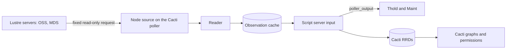

# plugin_pfs

A Cacti 1.2 plugin that brings parallel filesystem health and load into Cacti: capacity and fill imbalance across targets, per-target throughput, and metadata operation rates. Lustre is the first backend. GPFS (IBM Storage Scale) and BeeGFS follow behind a backend interface. The data lands in ordinary Cacti devices, data sources, and graphs, so Thold and Maint alert on and suppress it unchanged.

> **Status: in development, no release yet.** Milestones 2 (foundation) and 3 (Lustre observation) are merged on `main`. The code installs, upgrades, and uninstalls through Cacti's plugin API and refuses PHP below 8.2. It keeps a registry of filesystems, nodes, and the networks each poller may reach. A background reader on each poller reads its Lustre nodes over SSH through a fixed forced-command script ([node/pfs-read.sh](node/pfs-read.sh)) and caches target inventory, condition, capacity, and counter values with their freshness, plus a per-filesystem summary. Each filesystem becomes a Cacti device with two script server data queries (OSTs and MDTs), the "Parallel Filesystem" device, data, and graph templates, five overview graphs, and per-target graphs on demand. Counters are DERIVE data sources that read unknown across a reset. The view page follows Cacti's device permissions. Thold rate alerts (high thresholds only) and Maint suppression are not yet validated; that is milestone 4. Milestone 1 research is written up from documentation and source; checks that need a real file system are still open, and the plugin has not run against a real Lustre node: the end-to-end run uses fixture node output. The rest of this README describes the design, not shipped behavior.

## Why

When a shared filesystem is slow, the evidence is spread across servers. Lustre keeps its counters per node: `lctl get_param` reports values "on the local node", so each object storage server (OSS) and metadata server (MDS) holds only its own targets' numbers. An operator investigating a slow filesystem needs three answers from different places:

- **Is one target filling while others are empty?** Fill imbalance changes where new files land and when a single target runs out of space.
- **Which targets or operations are busy?** Per-target byte counters and per-MDT operation counters show whether load is data-bound or metadata-bound.
- **Is the monitoring itself current?** A flat graph is only reassuring if the plugin could see the servers.

Cacti graphs hosts and thresholds values with Thold, and the Cacti GitHub organization has no repository for Lustre, GPFS, or BeeGFS monitoring (searched 2026-11-14). The plugin closes that gap by reading allowlisted, read-only values from the storage nodes and representing each filesystem as a Cacti device whose targets are the indexes of a data query. It reuses Cacti's graphing, permissions, remote data collectors, Thold, and Maint rather than building parallel versions of them.

## Planned scope

| Phase | Scope | Milestones |
|---|---|---|
| 0, research | Release matrix, node access decision, upstream behavior confirmation, counter and failover behavior, scale measurements | [M1](https://github.com/somethingwithproof/plugin_pfs/milestone/1) |
| 1, observe | Lustre inventory, capacity and fill, OST throughput, MDT operation rates, graphs, Thold alerting, Maint suppression, health page | [M2](https://github.com/somethingwithproof/plugin_pfs/milestone/2), [M3](https://github.com/somethingwithproof/plugin_pfs/milestone/3), [M4](https://github.com/somethingwithproof/plugin_pfs/milestone/4) |
| 2, depth | Cacti remote data collectors, job-level and client-level views within a bounded object count | [M5](https://github.com/somethingwithproof/plugin_pfs/milestone/5) |
| 3, backends | GPFS (IBM Storage Scale) and BeeGFS backends | [M6](https://github.com/somethingwithproof/plugin_pfs/milestone/6) |

Out of scope: any write, clear, reset, or tuning operation on a node or filesystem; a plugin-owned alerting engine; a custom daemon or network protocol; per-job data sources; changes to Cacti core, Thold, or Maint.

## Compatibility targets

| Component | Target |
|---|---|
| Cacti | 1.2.31 or later, no core patches |
| PHP | 8.2 or later; `setup.php` stays parseable on 8.0 so an unsupported runtime gets a refusal instead of a broken Cacti UI |
| Lustre | Release lines to be fixed by milestone 1; source and manuals checked so far are at 2.17.0 |
| GPFS, BeeGFS | Phase 3; releases to be fixed by research |
| Thold, Maint | No changes required |

## Design

- [docs/PLAN.md](docs/PLAN.md) is the full plan: architecture, upstream facts it depends on (with sources and what is still unverified), counter semantics, state model, security boundaries, performance arithmetic, testing, and risks.
- [docs/node-setup.md](docs/node-setup.md) describes how to prepare a Lustre server and a poller for the reader.
- [docs/decisions/](docs/decisions/) holds architecture decision records for choices already made.
- [docs/REQUIREMENTS.md](docs/REQUIREMENTS.md) maps every requirement ID to its issue.

## How work is tracked

- **Milestones** follow the plan's milestones. Each has an epic issue listing its sub-issues and exit evidence.
- **Issues** are typed by label: `type: requirement`, `type: research`, `type: decision`, `type: epic`. Requirement issues state numbered, testable requirements (`REQ-AREA-NNN`) and acceptance criteria.
- **Labels** also carry `area:`, `phase:`, `priority:`, and `status:`. See [CONTRIBUTING.md](CONTRIBUTING.md#labels).
- The [project board](https://github.com/users/somethingwithproof/projects/11) shows all issues across milestones.

## Contributing

Read [CONTRIBUTING.md](CONTRIBUTING.md). Commits need a DCO sign-off. Design discussion happens on issues; open decisions carry the `type: decision` label.

## Security

Report vulnerabilities privately; see [SECURITY.md](SECURITY.md).

## License

GNU General Public License v2.0, the same license as Cacti and its plugins. See [LICENSE](LICENSE).
