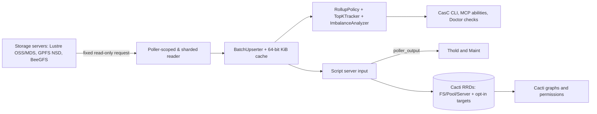

<!-- translations:start -->
[English](README.md) | [简体中文](docs/i18n/zh-CN/README.md) | [हिन्दी](docs/i18n/hi-IN/README.md) | [Español (España)](docs/i18n/es-ES/README.md) | [Español (Latinoamérica)](docs/i18n/es-419/README.md) | [العربية (السعودية)](docs/i18n/ar-SA/README.md) | [Afrikaans](docs/i18n/af-ZA/README.md) | [አማርኛ](docs/i18n/am-ET/README.md) | [العربية (مصر)](docs/i18n/ar-EG/README.md) | [العربية (المغرب)](docs/i18n/ar-MA/README.md) | [Български](docs/i18n/bg-BG/README.md) | [বাংলা](docs/i18n/bn-BD/README.md) | [Bosanski](docs/i18n/bs-BA/README.md) | [Deutsch](docs/i18n/de-DE/README.md) | [Ελληνικά](docs/i18n/el-GR/README.md) | [فارسی](docs/i18n/fa-IR/README.md) | [Filipino](docs/i18n/fil-PH/README.md) | [Français](docs/i18n/fr-FR/README.md) | [Français (Maroc)](docs/i18n/fr-MA/README.md) | [Français (Sénégal)](docs/i18n/fr-SN/README.md) | [Hausa](docs/i18n/ha-NG/README.md) | [עברית](docs/i18n/he-IL/README.md) | [Hrvatski](docs/i18n/hr-HR/README.md) | [Bahasa Indonesia](docs/i18n/id-ID/README.md) | [Igbo](docs/i18n/ig-NG/README.md) | [Italiano](docs/i18n/it-IT/README.md) | [日本語](docs/i18n/ja-JP/README.md) | [ქართული](docs/i18n/ka-GE/README.md) | [한국어](docs/i18n/ko-KR/README.md) | [Latviešu](docs/i18n/lv-LV/README.md) | [Malagasy](docs/i18n/mg-MG/README.md) | [मराठी](docs/i18n/mr-IN/README.md) | [Bahasa Melayu](docs/i18n/ms-MY/README.md) | [Nederlands](docs/i18n/nl-NL/README.md) | [Polski](docs/i18n/pl-PL/README.md) | [Português (Brasil)](docs/i18n/pt-BR/README.md) | [Português (Portugal)](docs/i18n/pt-PT/README.md) | [Русский](docs/i18n/ru-RU/README.md) | [Kinyarwanda](docs/i18n/rw-RW/README.md) | [Soomaali](docs/i18n/so-SO/README.md) | [Српски](docs/i18n/sr-RS/README.md) | [Svenska](docs/i18n/sv-SE/README.md) | [Kiswahili](docs/i18n/sw-KE/README.md) | [தமிழ்](docs/i18n/ta-IN/README.md) | [తెలుగు](docs/i18n/te-IN/README.md) | [ไทย](docs/i18n/th-TH/README.md) | [Türkçe](docs/i18n/tr-TR/README.md) | [Українська](docs/i18n/uk-UA/README.md) | [اردو](docs/i18n/ur-PK/README.md) | [Tiếng Việt](docs/i18n/vi-VN/README.md) | [isiXhosa](docs/i18n/xh-ZA/README.md) | [Yorùbá](docs/i18n/yo-NG/README.md) | [繁體中文](docs/i18n/zh-TW/README.md) | [isiZulu](docs/i18n/zu-ZA/README.md)
<!-- translations:end -->

# plugin_pfs

A Cacti 1.2 plugin that brings parallel filesystem health, capacity, fill imbalance, per-target throughput, and metadata operation rates into Cacti across Lustre, IBM Storage Scale (GPFS), and BeeGFS behind a unified `Backend` interface. Each filesystem maps to an ordinary Cacti device with data queries, overview and on-demand target graphs, and summary gauges so Thold and Maint alert on and suppress them unchanged.

> **Status: phases 1 through 3 and exascale scaling primitives implemented in code, not yet released.** Foundation, Lustre observation, alerting and Maint suppression, GPFS and BeeGFS read-only drivers, OST/MDT imbalance analysis with Maint integration, remote data collector scoping (`replicate_out`, `remote_agent`), 100+ PB / exascale scaling primitives (`FramedReportParser`, Schema v4 `value_kib`, `RollupPolicy`, `TopKTracker`, `ShardAssigner`, `BatchUpserter`), the CasC operator CLI (`cli/pfs.php`), and ecosystem hooks (`abilities_register`, `doctor_register_checks`, `casc_register_providers`) are implemented and verified with unit, security, and disposable-Cacti integration tests. All runs so far use fixture node output rather than live Lustre, GPFS, or BeeGFS hardware. Still open before tagging a release: pilots on real filesystems ([pilot plan](docs/pilot-plan.md)), an external security review ([self-review](docs/security-review.md)), and scale measurements on documented hardware ([scale](docs/research/scale.md)). Version 0.1.0 is prepared in `INFO` and [CHANGELOG.md](CHANGELOG.md) but not tagged.

## Access roles

| Realm | Access |
| --- | --- |
| Parallel Filesystem View | Existing monitoring pages. |
| Parallel Filesystem Operator | Monitoring plus the Operations page and personal triage acknowledgments. |
| Parallel Filesystem Admin | Operator access plus the existing configuration and administrative actions. |

After copying upgrade files, open the Plugins page as an administrator to register
the new realm. Assign the Operator realm explicitly under **Configuration > Users** or user groups.
Upgrades retain the existing View and Admin realm IDs and grants. Admin access
inherits Operator access, and Operator access inherits View access on each request;
this does not add stored grants to users or groups. Plugin settings also require
Parallel Filesystem Admin access in addition to Cacti's Settings permission.

Cacti device permissions still limit the rows and actions available to each user; unmapped objects require an administrator.
Credentials, configuration, mapping, deletion and other administrative changes
remain in the administrative pages. Acknowledgments last only in the current
user's session, for at most one hour and only while the same observation remains
fresh. New or changed observations invalidate them. They never mark a failed
measurement healthy or suppress alerts.

## Why

When a shared filesystem is slow, the evidence is spread across servers. Lustre keeps its counters per node: `lctl get_param` reports values "on the local node", so each object storage server (OSS) and metadata server (MDS) holds only its own targets' numbers. An operator investigating a slow filesystem needs three answers from different places:

- **Is one target filling while others are empty?** Fill imbalance changes where new files land and when a single target runs out of space.
- **Which targets or operations are busy?** Per-target byte counters and per-MDT operation counters show whether load is data-bound or metadata-bound.
- **Is the monitoring itself current?** A flat graph is only reassuring if the plugin could see the servers.

Cacti graphs hosts and thresholds values with Thold, and the Cacti GitHub organization has no repository for Lustre, GPFS, or BeeGFS monitoring (searched 2026-11-14). The plugin closes that gap by reading allowlisted, read-only values from the storage nodes and representing each filesystem as a Cacti device whose targets are the indexes of a data query. It reuses Cacti's graphing, permissions, remote data collectors, Thold, and Maint rather than building parallel versions of them.

## Planned scope

| Phase | Scope | Status | Milestones |
|---|---|---|---|
| 0, research | Release matrix, node access decision, upstream behavior confirmation, counter and failover behavior, scale measurements | Complete | [M1](https://github.com/somethingwithproof/plugin_pfs/milestone/1) |
| 1, observe | Lustre inventory, capacity and fill, OST/MDT imbalance (`lib/ImbalanceAnalyzer.php`), Maint integration (`lib/HealthPage.php`), OST throughput, MDT operation rates, graphs, Thold alerting, health page | Implemented (fixture-tested) | [M2](https://github.com/somethingwithproof/plugin_pfs/milestone/2), [M3](https://github.com/somethingwithproof/plugin_pfs/milestone/3), [M4](https://github.com/somethingwithproof/plugin_pfs/milestone/4) |
| 2, remote and scale | Poller-scoped remote collection (`lib/Reader.php`, `lib/ReplicationRepository.php`, `replicate_out`, `remote_agent`), 100+ PB scaling primitives (64-bit KiB hygiene + Schema v4 `value_kib`, `lib/RollupPolicy.php`, `lib/TopKTracker.php`, `lib/ShardAssigner.php` + `poller_pfs.php --shard=K/N`, `lib/BatchUpserter.php`), CasC CLI (`cli/pfs.php`), MCP/Doctor/CasC hooks | Implemented (unit and CI integration tested) | [M5](https://github.com/somethingwithproof/plugin_pfs/milestone/5) |
| 3, backends | Read-only IBM Storage Scale (GPFS) (`lib/GpfsBackend.php`) and BeeGFS (`lib/BeegfsBackend.php`) drivers registered in `BackendRegistry::production()` | Implemented (unit-tested) | [M6](https://github.com/somethingwithproof/plugin_pfs/milestone/6) |

Key implemented operator and scaling primitives:

- **Multi-filesystem read-only drivers:** `LustreBackend`, `GpfsBackend` (framed `mmpmon` `fs_io_s`/`io_s` only with `reset` banned, `mmdf` pool capacity/states, and waiter summaries), and `BeegfsBackend` (BeeGFS 7.4 and 8.x storage/metadata targets with exact byte-to-KiB conversion, reachability/consistency condition mapping, and per-interval gauge semantics) sharing `lib/FramedReportParser.php`.
- **Imbalance, headroom, and Maint awareness:** `lib/ImbalanceAnalyzer.php` computes OST/MDT fill ratios, spread, population standard deviation imbalance index, headroom, 1-interval freshness enforcement (`missing_targets`), per-target status flags, and bounded Top-K skewed targets. `HealthPage` (`pfs_health.php`) and `CascProvider::health()` surface Cacti `Maint` maintenance windows and suppress active failure warnings during scheduled maintenance.
- **100+ PB and exascale scaling** ([docs/architecture/exascale-scaling.md](docs/architecture/exascale-scaling.md)): exact decimal byte-to-KiB conversion (`FramedReportParser::bytesToKibInt()`) verified at 500 PB and 2 EB alongside `BIGINT UNSIGNED value_kib` columns (Schema v4); hierarchical `Filesystem -> Pool -> Storage Server` RRD rollups with bounded opt-in/hot/skewed target promotion (`lib/RollupPolicy.php`); bounded $O(K)$ Top-K skewed targets and pre-aggregated heavy job/client summaries (`lib/TopKTracker.php`, never creating per-client devices or RRDs); deterministic CRC32 collector sharding (`lib/ShardAssigner.php`, `php plugins/pfs/poller_pfs.php [--poller=N] [--shard=K/N] [--force] [--debug]`); and 500-row batched SQL upserts plus keyset pagination (`lib/BatchUpserter.php`, `CacheRepository::upsertObservationsBatch()`, `TargetRepository::forFilesystemPage()`).
- **Operator CasC CLI and ecosystem hooks:** `cli/pfs.php` supports `export [--format=yaml|xml]`, `validate <file> [--format=yaml|xml]`, `plan <file> [--format=yaml|xml] [--output=text|json]`, `apply <file> --confirm=<PLAN_HASH> [--format=yaml|xml]`, and `health [--format=text|json]` with zero external Composer dependencies. `setup.php` and `lib/EcosystemIntegration.php` register `abilities_register` (`pfs-list-filesystems`, `pfs-get-imbalance`, `pfs-get-health`; read-only, gated on `Parallel Filesystem View` and Cacti device permissions), `doctor_register_checks` (`pfs_schema`, `pfs_reader_freshness`, `pfs_capacity_imbalance`), `casc_register_providers`, `replicate_out`, and `remote_agent`.

Out of scope: any write, clear, reset, or tuning operation on a node or filesystem; a plugin-owned alerting engine; a custom daemon or network protocol; per-job or per-client Cacti devices/RRDs; changes to Cacti core, Thold, or Maint.

## Compatibility targets

| Component | Target |
|---|---|
| Cacti | 1.2.31 or later, no core patches |
| PHP | 8.2 or later; `setup.php`, `poller_pfs.php`, and `cli/pfs.php` stay parseable on 8.0 so an unsupported runtime gets a refusal instead of a broken Cacti UI |
| Lustre | Source and manuals checked at 2.17.0; fixture-tested |
| GPFS, BeeGFS | IBM Storage Scale (GPFS) 5.x `mmpmon`/`mmdf` and BeeGFS 7.4 / 8.x read-only drivers implemented and fixture-tested |
| Thold, Maint | Thold 1.8.2 and Maint 1.3, unchanged |

## Design

- [docs/architecture/exascale-scaling.md](docs/architecture/exascale-scaling.md) documents the two-tier 100+ PB / exascale telemetry architecture (Cacti/`plugin_pfs` server + rollup + Top-K tier paired with out-of-band LDMS/Darshan/TOKIO client telemetry) and its academic literature context.
- [docs/PLAN.md](docs/PLAN.md) is the full plan: architecture, upstream facts it depends on (with sources and what is still unverified), counter semantics, state model, security boundaries, performance arithmetic, testing, and risks.
- [docs/operator-guide.md](docs/operator-guide.md) covers install, the graphs and values, upgrade, backup and restore, uninstall, and troubleshooting; [docs/alerting.md](docs/alerting.md) covers Thold and Maint.
- [docs/node-setup.md](docs/node-setup.md) describes how to prepare a Lustre server and a poller for the reader.
- [docs/decisions/](docs/decisions/) holds architecture decision records for choices already made.
- [docs/REQUIREMENTS.md](docs/REQUIREMENTS.md) maps every requirement ID to its issue.

## How work is tracked

- **Milestones** follow the plan's milestones. Each has an epic issue listing its sub-issues and exit evidence.
- **Issues** are typed by label: `type: requirement`, `type: research`, `type: decision`, `type: epic`. Requirement issues state numbered, testable requirements (`REQ-AREA-NNN`) and acceptance criteria.
- **Labels** also carry `area:`, `phase:`, `priority:`, and `status:`. See [CONTRIBUTING.md](CONTRIBUTING.md#labels).
- The [project board](https://github.com/users/somethingwithproof/projects/11) shows all issues across milestones.

## Contributing

Read [CONTRIBUTING.md](CONTRIBUTING.md). Commits need a DCO sign-off. Design discussion happens on issues; open decisions carry the `type: decision` label.

## Security

Report vulnerabilities privately; see [SECURITY.md](SECURITY.md).

## License

GNU General Public License v2.0, the same license as Cacti and its plugins. See [LICENSE](LICENSE).
