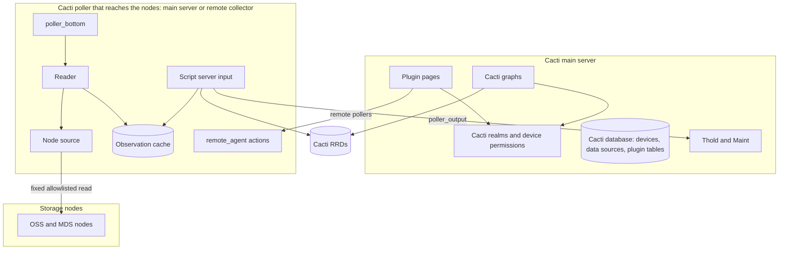

# Cacti 1.2 Parallel Filesystem Plugin Plan

Status: proposal, revision 1 (2026-11-14). Nothing described here as a plugin capability exists yet. Statements about Lustre, GPFS, BeeGFS, RRDtool, Cacti core, Thold, and Maint describe upstream behavior and cite the source that was checked, at a pinned tag or commit where one exists. Anything that could not be verified is listed under [Assumptions to confirm](#assumptions-to-confirm) and tracked as a research issue; the design does not treat it as fact. Owner and estimates are not assigned; milestone 1 produces the estimates.

`plugin_pfs` brings parallel filesystem health and load into Cacti 1.2 as ordinary Cacti devices, data sources, and graphs: capacity and fill imbalance across targets, per-target throughput, and metadata operation rates. Lustre is the phase 1 backend. GPFS (IBM Storage Scale) and BeeGFS follow behind a backend interface.

## Why this plugin

When a shared filesystem is slow, the evidence is scattered. Lustre counters live on the node that serves each target, so no single node can tell an operator that one object storage target (OST) is nearly full while its neighbors are empty, or that one metadata target (MDT) is handling most of a metadata-heavy workload. Three gaps follow:

1. **No filesystem view in Cacti.** Cacti graphs hosts and thresholds values with Thold, but nothing in the Cacti GitHub organization understands targets, fill imbalance, or per-target counters (searched 2026-11-14 for Lustre, GPFS, BeeGFS, and "parallel filesystem").
2. **Per-node data.** The same filesystem's numbers sit on dozens or hundreds of servers, so comparing targets means collecting from all of them.
3. **No path into Cacti alerting.** Thold and Maint act on Cacti data sources and devices. Filesystem alerts today are configured and suppressed elsewhere.

The plugin reads allowlisted, read-only values from the storage nodes and represents each filesystem as a Cacti device whose targets are the indexes of a data query. It reuses Cacti's graphing, permissions, remote data collectors, Thold, and Maint. It does not change the filesystem, and it is not a replacement for vendor management tools.

## Goals and non-goals

**Goals**

- Capacity, fill, and imbalance per target and per filesystem, reconciled with `lfs df` for Lustre.
- Per-target throughput and per-MDT operation rates that distinguish a reset from a lull and a missing target from zero.
- Cacti device and graph permissions on everything, with no plugin-specific permission layer for graphs.
- Alerting and maintenance through Thold and Maint, so one notification path covers SNMP and filesystem data.
- Read-only operation against existing filesystems, with the least privilege each read needs.
- Remote collection through Cacti remote data collectors, not a new network service.
- No required Cacti core patches.

**Non-goals**

- Any write, clear, reset, or tuning operation on a node or filesystem.
- A plugin-owned incident, escalation, or notification engine.
- A custom network protocol, daemon, or credential store.
- Per-job or per-client data sources at scale. Job and client views are bounded tables (phase 2).
- Replacing vendor tools for filesystem administration.

## Release phases

Each phase ships to users. Later phases are re-estimated after the phase before them.

| Phase | Label | Scope | Depends on |
|---|---|---|---|
| 0 | Research | Release matrix, node access decision, upstream behavior confirmation, counter and failover behavior, scale measurements (milestone 1) | Nothing |
| 1 | Planned | Lustre observation: inventory, devices, capacity and fill, OST throughput, MDT operation rates, graphs, summary data sources for Thold, Maint suppression, health page | Phase 0 |
| 2 | Planned | Cacti remote data collectors, job-level and client-level views within a bounded object count | Phase 1, security review |
| 3 | Planned | GPFS (IBM Storage Scale) and BeeGFS backends | Phase 1, privilege decision |
| - | Research | Quota usage, LNet metrics, a slow-filesystem triage view | Demand after phase 1 |

## Compatibility

**Cacti.** Minimum Cacti release is 1.2.31, with no core patches (ADR 0007). The plugin uses only APIs present in that release. These symbols exist in the stated files at tag `release/1.2.31` (checked 2026-11-14); milestone 1 confirms their signatures and semantics and records differences on `1.2.x`:

- Plugin lifecycle and hooks: `api_plugin_register_hook()`, `api_plugin_register_realm()`, `api_plugin_db_table_create()`, `api_plugin_db_changes_remove()` ([lib/plugins.php](https://github.com/Cacti/cacti/blob/release/1.2.31/lib/plugins.php)).
- Devices: `api_device_save()` ([lib/api_device.php](https://github.com/Cacti/cacti/blob/release/1.2.31/lib/api_device.php)).
- Templates: `import_xml_data()` ([lib/import.php](https://github.com/Cacti/cacti/blob/release/1.2.31/lib/import.php)).
- Background work: `exec_background()` and `register_process_start()` ([lib/poller.php](https://github.com/Cacti/cacti/blob/release/1.2.31/lib/poller.php)).
- Remote collectors: `call_remote_data_collector()` ([lib/functions.php](https://github.com/Cacti/cacti/blob/release/1.2.31/lib/functions.php)) and the `remote_agent` hook ([remote_agent.php](https://github.com/Cacti/cacti/blob/release/1.2.31/remote_agent.php)).

**PHP.** The plugin requires PHP 8.2 or later (ADR 0006). The `1.2.x` branch declares `"php": ">=8.2"` and pins Composer resolution to `platform.php: 8.2.0` ([branch composer.json](https://github.com/Cacti/cacti/blob/1.2.x/composer.json), Cacti/cacti#8569, merged). Tag `release/1.2.31` still declares `>=8.0` ([release composer.json](https://github.com/Cacti/cacti/blob/release/1.2.31/composer.json)). Because Cacti includes plugin files on every request, a parse error breaks the whole UI, so:

- `setup.php`, `INFO`, and every file Cacti includes before the version check use only PHP 8.0 syntax.
- `plugin_pfs_check_config()` and `plugin_pfs_install()` refuse to proceed when `version_compare(PHP_VERSION, '8.2.0', '<')`, with a message naming the required version.
- Hook shims return early under the same condition, before the autoloader is registered.
- CI lints `setup.php` and the shim files under PHP 8.0.

Code loaded after the check may use PHP features through 8.2, and nothing from 8.3 or later. Properties are always declared, because PHP 8.2 deprecates dynamic properties. PHPStan runs at `phpVersion` 8.2. No upper PHP bound is declared; the CI matrix defines the tested ceiling.

**Lustre.** The Lustre GitHub mirror has release tags `v2_15_8`, `v2_16_1`, and `v2_17_0` (checked 2026-11-14; the mirror may lag releases). The man pages and source this plan cites are at `v2_17_0`; the man pages are not present at the earlier tags in the mirror, and behavior on 2.15 and 2.16 is unconfirmed. Conference release updates indicate that 2.15.x remains widely deployed and that 2.16 is not a long-term support line ([LUG 2026 community release update](https://www.opensfs.org/wp-content/uploads/01-Community-Release-Update-LUG-2026-FINAL.pdf), search snippet only, not read in full). Milestone 1 fixes the matrix, with ldiskfs and ZFS backends, combined MGS/MDS nodes, and multiple MDTs, and drops any line no vendor supports.

**Plugin metadata.** `INFO` declares `compat = 1.2.31`. Capabilities need confirmation. At `release/1.2.31`, `api_plugin_run_plugin_hook()` on a remote collector requires `remote_collect` for `poller_output` and `poller_top`, but `remote_poller` for `poller_bottom` ([lib/plugins.php](https://github.com/Cacti/cacti/blob/release/1.2.31/lib/plugins.php)), while servcheck's `INFO` at `main` declares only `online_view:1, online_mgmt:1, offline_view:0, offline_mgmt:0, remote_collect:1`. The plan therefore assumes a declaration of `remote_collect:1, remote_poller:1` and tests it in milestone 1.

## Upstream behavior the design depends on

Each row is a milestone 1 test, because a change in any of them changes the design. "Checked" means the cited source was read on 2026-11-14.

**Lustre, tag `v2_17_0` (commit `4b0407a48e9e5b7f17877e8868080e9f40c238c6`)**

| Fact | Consequence | Source |
|---|---|---|
| `lctl get_param` returns values "on the local node". Names are dot-separated components with glob wildcards, usually `obd_name.obd_instance.parameter_name`. Many parameters are readable by a regular user, "some of them are accessible only by the root user". | Each OSS and MDS holds only its own targets' counters, so collection is per node. Privilege is per parameter, and needs a per-parameter table. | [lctl-get_param.8](https://github.com/lustre/lustre-release/blob/v2_17_0/Documentation/man8/lctl-get_param.8) |
| A stats file prints `snapshot_time`, then per counter `<name> <count> samples [<unit>]` followed, for min/max/sum counters, by min, max, sum, and sometimes sum of squares. A counter with zero samples prints no line. `start_time` and `elapsed_time` print only when a global switch (`obd_enable_stats_header`) is on. | Absent lines mean zero samples only if the read succeeded. Header availability varies, so reset detection cannot depend on it. | [lprocfs_status.c](https://github.com/lustre/lustre-release/blob/v2_17_0/lustre/obdclass/lprocfs_status.c) (`lprocfs_stats_seq_show`, `lprocfs_stats_header`) |
| Any write to a stats file calls `lprocfs_stats_clear()`, which zeros counts, sums, and minimums and resets the start time. | Counters can reset outside the plugin's control. The plugin never writes to a stats file. | `lprocfs_status.c` (`lprocfs_stats_seq_write`, `lprocfs_stats_clear`) |
| OST (OFD) stats include `read_bytes` and `write_bytes` (byte counters with min, max, and sum) and latency counters `read`, `write`, `getattr`, `setattr`, `punch`, `sync`, `destroy`, `create`, `statfs`, `get_info`, `set_info`. | Per-OST byte and operation counters exist as named counters. Units of the latency counters are unconfirmed. | [lproc_ofd.c](https://github.com/lustre/lustre-release/blob/v2_17_0/lustre/ofd/lproc_ofd.c) (`ofd_stats_counter_init`) |
| The MDT default operation names include `open`, `close`, `mknod`, `link`, `unlink`, `mkdir`, `rmdir`, `rename`, `getattr`, `setattr`, `getxattr`, `setxattr`, `statfs`, `sync`, `samedir_rename`, and `crossdir_rename`; more counters are added after the defaults. | A fixed per-release allowlist of operations is feasible. | [mdt_lproc.c](https://github.com/lustre/lustre-release/blob/v2_17_0/lustre/mdt/mdt_lproc.c) (`mdt_stats` names) |
| Generic read-only target attributes `blocksize`, `filestotal`, `filesfree`, `kbytestotal`, `kbytesfree`, `kbytesavail`, `maxbytes`, and `statfs_state` are defined for OBD devices. `kbytestotal` is the statfs block count scaled to KiB. | Capacity gauges exist per target. Which parameter prefix (`osd-*`, `obdfilter`) serves them on each node type is unconfirmed. | `lprocfs_status.c` (`obd_def_attrs`) |
| Job stats are disabled by default (`obd_jobid_var` starts as the disable value). The job ID is read from an environment variable named by `jobid_var`, or set per session. The output is YAML-like: `job_stats:` then `- job_id:`, `snapshot_time`, `start_time`, `elapsed_time`, and counters. A `job_cleanup_interval` parameter removes idle jobs. | Job IDs are strings chosen by user jobs: untrusted and unbounded. Job views must be bounded and escaped. | [jobid.c](https://github.com/lustre/lustre-release/blob/v2_17_0/lustre/obdclass/jobid.c), [lprocfs_jobstats.c](https://github.com/lustre/lustre-release/blob/v2_17_0/lustre/obdclass/lprocfs_jobstats.c), `mdt_lproc.c` |
| `lfs df` reports each MDT and OST of each Lustre filesystem mounted on that node, with a `filesystem_summary` line, and optional status flags `D` (degraded), `N` (no-create), `R` (read-only), `S` (out of space), `I` (out of inodes). Options include `--lazy` (do not contact targets not currently connected), `--verbose` (show deactivated targets), `-i`, `--pool`, `--ost`, `--mdt`, `--only-summary`, `--no-header`, and `--output`. The man page documents no JSON option. | Capacity can come from a client mount, and `--lazy` bounds blocking on an offline target. Text parsing is required. Option availability on 2.15 and 2.16 is unconfirmed. | [lfs-df.1](https://github.com/lustre/lustre-release/blob/v2_17_0/Documentation/man1/lfs-df.1) |
| An OFD parameter `recovery_status` exists. | Recovery state may be observable per target during failover. | `lproc_ofd.c` |

**lustre_exporter** ([GSI-HPC/lustre_exporter](https://github.com/GSI-HPC/lustre_exporter), tag `v2.1.9`, commit `871b35d12efd1479f1f36c542dc67bf44b1ef871`; files below read on `master`)

| Fact | Consequence | Source |
|---|---|---|
| It is a Prometheus exporter. The default listener is `:9169` and the default path `/metrics`. Collectors `ost`, `mdt`, `mgs`, `mds`, `client`, `generic`, `lnet`, and `health` each take `disabled`, `core`, or `extended`. | A scrape-based node source needs one HTTP GET per server and an open port. | `lustre_exporter.go`, README |
| Its source tables read capacity (`kbytes*`) from `osd-*/*-OST*` and `osd-*/*-MDT*`, `stats` and `job_stats` from the obdfilter and MDT directories, and expose names such as `read_bytes_total`, `write_bytes_total`, `capacity_kibibytes`, `free_kibibytes`, and `job_stats_total`, in the `lustre` namespace. | The values the plan needs exist in this exporter. Label names are unconfirmed. | `sources/procfs.go`, `sources/sysfs.go` |
| LNET metrics read DebugFS and need root or a DebugFS mount other users can access; the service unit runs as `prometheus` by default. | LNET data conflicts with the least-privilege rule. It is research. | README |
| The README's version table lists only Lustre 2.12 with tag v2.1.6, while releases through v2.1.9 (2026-03-31) exist and the `VERSION` file reads `2.1.10_dirty`. License GPL-3.0. | Release coverage is unclear and is a research item. | README, GitHub releases |

**RRDtool**

| Fact | Consequence | Source |
|---|---|---|
| COUNTER "assumes that the counter never decreases, except when a counter overflows" and corrects 32-bit and 64-bit overflows. DERIVE "works exactly like COUNTER but without overflow checks"; for counters that do not reset at 32 or 64 bits, use DERIVE with a minimum of 0. Values outside the min and max range become unknown. | A reset in a DERIVE data source with minimum 0 yields an unknown interval instead of a false spike. | [rrdcreate](https://oss.oetiker.ch/rrdtool/doc/rrdcreate.en.html) |

**Cacti core 1.2.31** (files at `release/1.2.31`)

| Fact | Consequence | Source |
|---|---|---|
| `process_poller_output()` feeds completed values to RRDs and then calls `api_plugin_hook_function('poller_output', ...)`. Thold registers `thold_poller_output` on that hook. | Only polled data sources reach Thold. | `lib/poller.php`; plugin_thold `setup.php` (line 78, `develop` at `dc76952`) |
| `poller.php` runs `api_plugin_hook('poller_bottom')` at the end of each cycle. | The reader can start from `poller_bottom`. | `poller.php` |
| On a remote collector (`poller_id > 1`), hooks run only when `INFO` capabilities match: `remote_collect` for `poller_output` and `poller_top`, `remote_poller` for `poller_bottom`. | See Compatibility; capability declaration is a research item. | `lib/plugins.php` (`api_plugin_run_plugin_hook`, `api_plugin_status_run`) |
| The script server includes the requested PHP file and calls the function. It refuses PHP internal functions and functions whose source file is outside the Cacti base path, and answers `U` when the function does not exist. | The input function must be a plugin function inside the Cacti tree, and failures degrade to unknown. | `script_server.php` |
| A script server data query XML in `resource/script_server/` declares `script_server`, `arg_index`, `arg_query`, `arg_get`, `arg_num_indexes`, `index_order`, and input and output fields. | Targets can be the indexes of a data query. | `resource/script_server/host_disk.xml` |
| Data source types are `GAUGE`, `COUNTER`, `DERIVE`, and others in `$data_source_types`. | Templates can use DERIVE. | `include/global_arrays.php` |
| `remote_agent.php` authorizes a caller by matching its address (or resolved name) to an enabled poller's hostname, then dispatches unknown actions to plugins through the `remote_agent` hook. | The main server can call plugin actions on a collector. The authorization is address-based, not cryptographic. | `remote_agent.php` |
| `thold` and `servcheck` `INFO` declare `remote_collect:1`; `maint` declares `remote_collect:0`. | Thold and servcheck declare collector support; Maint does not. How that affects this plugin is a milestone 1 question. | `INFO` files at each plugin's default branch (`dc76952`, `10ab7ac`, `9422c7a`) |

**GPFS (IBM Storage Scale 5.2.3 documentation)**

| Fact | Consequence | Source |
|---|---|---|
| `mmpmon` "must be run by a user with root authority, on the node for which you want statistics." Options include `-p` (machine-parseable output), `-r` (repeat count), `-d` (delay, milliseconds), `-t` (daemon timeout), `-i` (input file). Requests include `fs_io_s` ("I/O statistics per mounted file system"), `io_s` ("for the entire node"), and `reset` ("Resets statistics to zero"). | Statistics are per node and need root there. The plugin must never call `reset`, which would disturb other consumers. | [mmpmon command](https://www.ibm.com/docs/en/storage-scale/5.2.3?topic=reference-mmpmon-command) |

**BeeGFS (official release notes)**

| Fact | Consequence | Source |
|---|---|---|
| BeeGFS 8.0.0 "Replaces the `beegfs-ctl` command-line interface with a new `beegfs` tool"; `mon` is listed among the server services. | A BeeGFS backend needs a per-release read path. | [8.0 release notes](https://doc.beegfs.io/8.0/release_notes.html) |
| BeeGFS 8.4 mentions exporting metrics and structured logs through the OpenTelemetry Protocol to backends including Prometheus and Telegraf/InfluxDB, and a `beegfs stats client` command. | A product-native export may be a safer read path. | [8.4 release notes](https://doc.beegfs.io/8.4/release_notes.html) |

## Assumptions to confirm

These are used in the design but were not verified. Each is a milestone 1 research issue and none is stated as fact elsewhere in this plan.

| Assumption | Research issue |
|---|---|
| The paths, stats format, clear semantics, and header fields above hold on Lustre 2.15.x and 2.16.x. | Research: confirm the Lustre parameter paths and formats on supported releases |
| Used percentage can be defined to agree with `lfs df`, and `lfs df` options exist on older releases. | Research: define used percentage and reconcile it with lfs df |
| lustre_exporter covers the supported releases and exposes the needed labels, with acceptable privileges and authentication. | Research: evaluate lustre_exporter as a node source |
| A fixed, argument-free read script can enforce least privilege per node type. | Research: node privileges and a restricted read path |
| DERIVE with minimum 0 is enough for counter resets, or the reader needs its own rule. | Research: counter reset, clear, and gap behavior |
| Thold can alert on rates from counter data sources. | Research: how Thold evaluates counter-derived data sources |
| Poller cost and Cacti row counts are acceptable at 500 and 2,000 targets. | Research: poller cost and Cacti row counts at 500 and 2,000 targets |
| A target reports consistently across failover, and an authoritative node can be chosen. | Research: target identity across failover and server moves |
| The INFO capabilities that make the reader and the script server input run on a collector. | Research: confirm the Cacti core behavior the design depends on |
| `mmpmon` output keywords and cumulative semantics; a read path that avoids root. | Research: confirm mmpmon behavior on Storage Scale releases |
| BeeGFS server statistics commands, flags, and counter semantics per release. | Research: confirm BeeGFS statistics read paths |

## Architecture

A Cacti poller that can reach a filesystem's nodes does all node work. The main server never contacts a node (ADR 0004).

| Component | Responsibility | Interfaces | Failure behavior |
|---|---|---|---|
| Plugin pages | Filesystems, nodes, targets, health, settings | Cacti page framework, csrf-magic, realms | Show cached data with its age; never block on a node |
| Reader | Read every registered node once per cycle, parse, update cache and health | `poller_bottom`, `exec_background()`, `register_process_start()`, filtered by `poller_id` | One instance per poller; time budget and concurrency limit; failed nodes keep their previous observation times |
| Node source | Carry one allowlisted read from a node to the reader | Product-neutral interface; access method decided in milestone 1 | Timeout, size limit, or error means a failed read, never zeros |
| Backend | Know a product: declared values, parsing, targets | Backend interface (ADR 0003) | Unparsable value is unknown |
| Script server input | Return summary and per-target values from the cache | Cacti script server | `U` when stale or missing; `age` always numeric |
| Cacti graphs | Capacity, imbalance, throughput, and operation graphs | Graph templates shipped as template XML | Standard Cacti behavior for gaps |
| `remote_agent` actions (phase 2) | Inventory and health from a collector | `remote_agent` hook, `call_remote_data_collector()` | Collector unreachable means data shows as stale, never healthy |

### Which host collects

| Value | Where it is available | Collected by |
|---|---|---|
| OST capacity, OST byte and operation counters | The OSS that serves the OST (`lctl get_param` is local) | Reader, from each OSS |
| MDT capacity and operation counters, MDS job stats | The MDS that serves the MDT | Reader, from each MDS |
| Filesystem-wide `lfs df` view | Any node that mounts the filesystem (client) | Reader, from a registered client or from servers' own values |
| Client-side throughput | The client (`llite` and related parameters) | Phase 2, selected clients only |
| GPFS counters | The node whose statistics are wanted, as root | Phase 3, through a fixed wrapper |
| BeeGFS server statistics | Management or admin tooling per release | Phase 3, per research |

### Topologies

1. **Cacti poller with a route to all nodes** (phase 1). One reader on the main poller.
2. **Segmented storage network** (phase 2). A Cacti remote data collector sits on the storage management network and runs the reader. Summary values reach the main server through the normal poller output path.
3. **Several filesystems, several pollers** (phase 2). Each filesystem records its poller; each reader handles only its own.

## Backend and node source interfaces

Two boundaries (ADR 0003):

- **Backend.** For a product, it declares each value it produces (kind: gauge or cumulative counter; unit; which node roles report it), the fixed allowlist of reads it needs, and how to turn node output into observations. It has no write operation. Lustre is first; a stub second backend passes the same contract suite from the start.
- **Node source.** It carries one allowlisted read and returns bytes. It enforces connect and total timeouts and a maximum response size, and knows nothing about Lustre.

**Access method (open).** How a node source reaches a server is the largest trust decision, tracked as a decision issue with these options, each constrained by ADR 0008:

| Option | Strength | Cost |
|---|---|---|
| Scrape a Prometheus-format exporter on each server | Cacti makes only an HTTP GET; no shell access to the server. An unauthenticated listener exposes metrics to anyone on the network | A third-party component on every server; release coverage unconfirmed; an open port |
| Restricted SSH forced command running a fixed script | No extra daemon | Cacti holds a key; the script is a privileged-adjacent component to maintain |
| Capacity only, from a client mount (`lfs df --lazy`) | No access to servers | No server counters |
| Site-written file drop on shared storage | No network credential | Freshness and ownership become the site's problem |

## Cacti objects

| Object | Created from | Notes |
|---|---|---|
| Device | "Parallel Filesystem" device template, assigned to the poller that reads the nodes | One device per filesystem is proposed; existing devices can be mapped. Created only on administrator confirmation |
| Target data sources | Script server data query over targets | Targets (OST, MDT) are the data query indexes; Cacti's own workflow creates data sources and graphs |
| Summary data source | "Parallel Filesystem Summary" data template using a script server input | Polled; reaches Thold through `poller_output` |
| Graphs | Graph templates for capacity and fill, imbalance, per-target capacity, per-OST throughput, per-MDT operation rates | Placed in graph trees and protected by graph permissions |

Templates ship as Cacti template XML, imported with `import_xml_data()` at install and upgrade and matched by hash so re-import updates rather than duplicates. The data query XML is installed under `resource/script_server/`. Whether one device per filesystem or one per server host is right depends on failover evidence, because a target that moves between servers should not move its history.

## Counter semantics

Lustre stats counters are cumulative since initialization or the last clear (see the upstream table). The design follows from that (ADR 0005):

- Cumulative counters (byte sums, sample counts, operation counts) are stored raw as DERIVE with minimum 0. RRDtool computes the rate, and a decrease becomes an unknown interval.
- The reader also detects a decrease and publishes unknown for that interval. A reset followed by a value larger than the last pre-reset value (a long outage, then heavy traffic) cannot be seen by a minimum of 0 alone.
- Capacity and inode counts are GAUGE.
- A counter line that is absent from a stats file that was read successfully means zero samples on `v2_17_0`. The plugin applies that reading only after milestone 1 confirms it on each release. A failed read is unknown.
- A filesystem aggregate across targets is unknown for any interval in which a contributing target is missing or reset. A partial sum would draw an outage as a throughput drop. The number of contributors is published beside the aggregate.
- The plugin never clears a counter. GPFS `reset` and Lustre stats writes affect every other consumer on that node.

## Measurement state

| Dimension | States | Evidence |
|---|---|---|
| Freshness | Current, delayed, stale, never observed | Observation time against the expected interval |
| Collection | Completed, partial, failed, unknown | Reader result per node |
| Target condition | In service, degraded, read-only, no-create, out of space, inactive, unknown | Status flags the source exposes (for Lustre, `lfs df` flags or server parameters, as confirmed). No flag means unknown, never healthy |
| Counter continuity | Continuous, reset detected | Counter decrease or new start time |
| Administrative | Enabled, disabled, archived | Plugin records |
| Maintenance | In maintenance, not in maintenance | Maint, on the device |

Each cached observation carries observation time, ingestion time, source node, and expected interval. A page refresh never counts as a measurement. When two nodes report the same target (failover), the reader applies the authoritative-node rule from the failover research and records which node supplied each value.

## Graphs

- **Filesystem overview.** Used percentage (maximum, mean, minimum) and spread across OSTs, with a count of missing targets.
- **Per-target capacity.** Used and available per OST and MDT, plus inodes.
- **Throughput.** Per-OST read and write bytes per second; the aggregate follows the unknown rule above.
- **Metadata.** Per-MDT operations per second by allowlisted operation.

Gaps show as gaps. Whether per-target graphs are created for every OST by default is an open decision; the proposal is a small default set with per-target graphs created through the data query on demand, because hundreds of OSTs would multiply graph rows and an overview graph with hundreds of series is unreadable. A `graph_buttons` link joins a device's other graphs to its filesystem graphs.

## Alerting and maintenance

The "Parallel Filesystem Summary" data source returns, from the reader's cache:

| Value | Meaning | Missing or stale data |
|---|---|---|
| `fill_max_pct` | Maximum OST used percentage | `U` |
| `fill_spread_pct` | Maximum minus minimum OST used percentage | `U` |
| `targets_missing` | Targets in inventory with no recent observation | `U` |
| `targets_unhealthy` | Targets with a non-healthy condition flag | `U` |
| `age` | Seconds since the oldest contributing observation | Always numeric once observed |

Thold thresholds and Maint device schedules apply with no change to either plugin (ADR 0002).

Stated limits:

- **Sampling alignment.** Cacti polls on its own interval and the reader reads nodes on its own. Thold durations should be at least one poll interval.
- **Rates.** Whether Thold can alert on rates from DERIVE data sources is open. Until the research answers, only capacity, imbalance, target count, and staleness alerts are planned.
- **Resets.** A counter reset yields one unknown interval, which does not trigger a threshold.
- **Summary only.** Alerts see the summary and per-target gauges, not distributions.

Alternatives considered:

| Option | Why not chosen |
|---|---|
| Plugin-owned incident engine | Duplicates Thold and Maint and adds a third notification path |
| Thold reading the cache directly | Would be a Thold redesign |
| Writing values into Cacti RRDs outside the poller | Bypasses the poller and conflicts with boost |

**Maintenance.** Device maintenance works through Maint with no change. Measurements continue during maintenance; only notifications are suppressed.

## Remote operation (phase 2)

When nodes are reachable only from a Cacti remote data collector, that collector runs the reader and the script server input (ADR 0004):

- Plugin configuration tables replicate to collectors through the `replicate_out` hook.
- The reader on each poller handles only filesystems whose `poller_id` matches.
- The reader writes the observation cache to the collector's local database. Summary values reach the main server through the normal poller output path.
- The main server fetches inventory and health on demand through read-only `remote_agent` actions.
- Credentials for node access replicate only to the collector that needs them, and the review checks that no collector receives another's.

`remote_agent` authorizes callers by address. Documentation requires https for collector communication and a restricted network path between pollers. Job and client views (phase 2) are bounded tables, not data sources: the number of retained jobs and registered clients is capped and documented, job IDs are length-limited and escaped, and the plugin reads job stats only where the site has enabled them.

## Other backends (phase 3)

**GPFS (IBM Storage Scale).** The backend reads `fs_io_s` and `io_s` from `mmpmon -p` on each node. IBM documents root authority on the node, so the read path is a fixed wrapper on the node, never root on the Cacti host. The plugin never issues `reset`. Output keywords have no definition on the cited page; meanings come from further research, not from the keyword names. Counter semantics (cumulative since last reset or daemon start) are assumed until confirmed.

**BeeGFS.** The read path depends on the release: `beegfs-ctl` before 8.0, the `beegfs` tool from 8.0, and an OpenTelemetry export mentioned for 8.4. Flags and fields of the server statistics commands are not in the official pages checked and are research. Counter semantics are confirmed per release before any value is treated as cumulative.

Both backends pass the shared contract suite and need no change to the Lustre backend.

## Code structure

Plugin code is object-oriented wherever Cacti's plugin contract allows it. No maintained Cacti plugin ships a class layout to copy yet, so milestone 2 defines the layout.

**Where procedural code remains.** Cacti calls plugins by function name, so these entry points stay procedural. Each is a thin shim, parseable on PHP 8.0, that checks the PHP version, validates input, and hands off to a class:

- `setup.php` lifecycle functions: `plugin_pfs_install()`, `plugin_pfs_uninstall()`, `plugin_pfs_version()`, `plugin_pfs_check_config()`, `plugin_pfs_upgrade()`.
- Hook callbacks: `config_arrays`, `config_settings`, `draw_navigation_text`, `poller_bottom`, `replicate_out`, `remote_agent`, `graph_buttons`, `api_device_save`, `device_remove`, `device_action_array`, `device_action_prepare`, `device_action_execute`.
- Page scripts such as `pfs.php`, which include Cacti's authentication, read request variables through the validated request helpers, and call a page class.
- The script server input function and the reader CLI entry point.

**Layout.**

- Classes live under the `Cacti\Pfs` namespace, one class per file, loaded by a small `spl_autoload_register()` loader registered only after the PHP version check. No Composer runtime dependency.
- Settings use the `config_settings` hook. Logging uses `cacti_log()` with a `PFS` tag. Forms rely on Cacti's csrf-magic.
- Strings use the `pfs` text domain, with a `locales/` directory and POT file.
- Realms: two, "Parallel Filesystem View" and "Parallel Filesystem Admin".

**Planned classes.** Names are illustrative; milestone 2 settles the final set.

| Kind | Examples | Notes |
|---|---|---|
| Value objects | `Filesystem`, `Target`, `Node`, `Observation` | `readonly` classes built by named constructors such as `Target::fromRow()` |
| Enums | `TargetType`, `Freshness`, `Condition`, `ValueKind` | String-backed; stored as `varchar` values, never as list positions |
| Backend | `Backend` interface, `LustreBackend`, `BackendRegistry` | No write operation |
| Node sources | `NodeSource` interface and implementations chosen by the access decision | Enforce timeouts and size limits; never build commands from operator input |
| Repositories | `FilesystemRepository`, `TargetRepository`, `ObservationRepository` | The only classes that issue SQL, always through prepared helpers; take an explicit connection so remote collector code chooses local or main |
| Cacti object services | `DeviceProvisioner`, `TemplateInstaller` | Call Cacti APIs; never write Cacti tables directly |
| Services | `FreshnessEvaluator`, `ResetDetector`, `ImbalanceCalculator`, `InventoryReconciler` | Return decisions as objects; a separate runner applies side effects |
| Infrastructure | `Clock` with system and fixed implementations | Injected wherever time matters, so tests are deterministic |

**Rules.**

- Dependencies come in through constructors. No service locators and no static state, apart from Cacti's globals, which only shims touch.
- Interfaces exist only at real boundaries: node source, backend, database, clock, filesystem, and remote collectors.
- `fromRow()` is the only place loose database values are normalized, with tests on empty strings, `NULL`, and malformed values, because Cacti stores many values as loose strings.
- PHPStan runs on the class tree with Cacti core on its scan path.

## Storage, jobs, upgrades, and recovery

Plugin tables hold filesystems, nodes, targets, mappings, observation cache, and health. They are created and upgraded with Cacti's tracked plugin table API, and the stored plugin version changes only after a migration succeeds. The plugin is never a writer to a node or filesystem.

The reader runs from `poller_bottom` through `exec_background()` as one `register_process_start()` process per poller, with a time budget and a concurrency limit. Runs are idempotent: an interrupted run leaves the cache consistent and the next run continues. A failed node keeps its previous observation time, so staleness is visible.

Disabling the plugin stops jobs and leaves nodes untouched. Uninstalling offers an export, asks whether to drop plugin tables, and asks whether to delete plugin-created devices; it never contacts a node. Backup documentation covers the Cacti database, node access configuration, and the RRD directory. A restore test is part of release qualification.

## Performance

Capacity is stated in targets. The arithmetic below is illustrative and unmeasured; milestone 1 measures at 500 and 2,000 targets on documented hardware.

At 2,000 OST-like targets, with nine values per target (five capacity and inode gauges, plus read and write byte sums and sample counts) and a 300-second poll interval:

- 18,000 values per poll, about 60 per second on average, in 2,000 RRD files.
- About 18,000 `data_template_rrd` rows. Per-OST graphs of about three items each would add about 2,000 graphs and 6,000 graph item rows, which is why the default graph set is small.
- With 16 targets per server (an assumption, not a measurement), about 125 node reads per cycle. At two seconds per read and a concurrency of eight, a cycle takes about 30 seconds of reader time, well inside 300 seconds if the assumptions hold.
- One script server call per field is 18,000 calls per cycle; whether one call can return several fields is a milestone 1 question.

Engineering targets, to be measured, not yet demonstrated:

- Overview page under two seconds at 2,000 targets.
- Cacti's device, data source, and graph pages stay within normal response time at that row count.
- No page request contacts a node or reads more than a bounded number of RRD files.
- The reader stays within its time budget at 2,000 targets.
- The summary input answers in under 50 ms per call against a 2,000-target cache.

The setup screen shows the object count a bulk import would add before it runs.

## Security

| Boundary | Control |
|---|---|
| Browser to Cacti | Cacti session, csrf-magic, plugin realms, device and graph permissions, prepared queries, contextual escaping |
| Cacti to nodes | Read-only, fixed allowlisted requests, no operator or request value in a command or path, connect and total timeouts, response size limit, least privilege per parameter, no root on the Cacti host (ADR 0008) |
| Node output to Cacti | Untrusted input: strict parser with limits; target names validated against the expected pattern; job IDs, which users control through environment variables, length-limited and escaped; no node string in an RRD path or SQL text |
| Credentials | Not stored in plain text, not logged, not passed as process arguments; the storage method is reviewed in the phase 1 security review |
| Main server to remote collector (phase 2) | Cacti's `remote_agent` authorization and the configured https scheme; actions are read-only and validate every parameter |
| Privileged nodes (phase 3) | A fixed wrapper that prints one allowlisted output; the plugin never holds root on a storage node |

A compromised node can return hostile data, so parsing and escaping are the controls, not trust in the node. Phase 1, phase 2, and phase 3 each need a security review before release.

## Testing

- **Fixtures.** Captured outputs per Lustre release and backend for normal operation, a full OST, an empty OST, a missing target, a degraded target, a cleared stats file, a module reload, a failover pair, truncated and oversized output, and hostile strings.
- **Matrix.** Fixture parsing for each Lustre release; Cacti 1.2.31 and current `1.2.x` on every PHP minor in the CI matrix; entry points linted under PHP 8.0.
- **Reconciliation.** Capacity values agree with `lfs df` on a live test filesystem.
- **Counters.** Sequences through DERIVE data sources with minimum 0, including a reset followed by a larger value.
- **Contract.** A stub second backend passes the backend contract suite.
- **Permissions.** Every page, graph, and data source as an administrator, a scoped user, a user whose access was just revoked, and a user with no access.
- **Remote.** Collector offline, recovery mode, replication after reconnect.
- **Failure scenarios before each phase release:** node down, node slow, truncated output, target failover, stats cleared, module reload, clock skew between hosts, full disk on the Cacti host, interrupted reader, duplicate reader start, interrupted upgrade.
- **Harness.** Use the harness maintained Cacti plugins use, and confirm the choice with maintainers before adding test or CI infrastructure.

## Milestones

| Milestone | Phase | Deliverables | Exit evidence |
|---|---|---|---|
| 1. Compatibility and evidence | 0 | Release matrix, access decision, confirmation of every fact table row, counter and failover behavior, scale measurements, estimates | Every row confirmed or corrected; access method decided with evidence |
| 2. Foundation | 1 | PHP guard, install and upgrade, realms, settings, class layout, backend and node source interfaces, inventory, reader, state model, health page, test harness | Fresh install and upgrade at 1.2.31; install refused cleanly on PHP 8.1; unauthorized access rejected |
| 3. Lustre observation | 1 | Template XML, devices, data query, capacity and fill, OST throughput, MDT operation rates, graphs, input handling, permission suite | Resets and missing targets produce unknown values; hostile strings neutralized; permission suite passes |
| 4. Alerting and phase 1 release | 1 | Summary data sources, Thold and Maint validation, scale measurements, documentation, packaging, restore test, failure qualification, security review, pilots | Thold fires and recovers; Maint suppresses; security review complete; pilots reported |
| 5. Remote collectors and Lustre depth | 2 | `replicate_out`, `remote_agent` actions, job and client views, security review | Offline, recovery, and failover scenarios correct; views stay within the bound |
| 6. Other backends | 3 | GPFS and BeeGFS backends, privilege review | Contract tests pass on fixtures; privilege models reviewed |

## Open decisions

| Decision | Options | Needed before | Decided by |
|---|---|---|---|
| How Cacti reaches Lustre server nodes | Exporter scrape; restricted SSH command; client mount for capacity only; file drop | Milestone 2 node source | Milestone 1 evidence |
| Thold on counters | DERIVE data sources directly; plugin-computed rate gauges; no rate alerts in phase 1 | Milestone 3 summary data source | Milestone 1 Thold research |
| Repository and name | `Cacti/plugin_pfs`, `Cacti/plugin_lustre`, or community plugin | Before any code is published | Cacti maintainers |
| Test harness | Whatever maintained plugins use | Milestone 2 | Cacti maintainers |
| Filesystem device model | One device per filesystem; per server host; per target | Milestone 3 | Failover and cost evidence |
| Default graph set | Overview plus on-demand per-target; per-target for all; plugin view | Milestone 3 | Cost evidence |
| Job views | Bounded top-N table; prefix aggregation; external store | Phase 2 | Research and pilots |
| Observed clients | Named and sampled clients; server-side per-export statistics; all clients | Phase 2 | Access decision |
| Privilege model for GPFS and BeeGFS | Fixed node wrapper; product-native export; direct shell | Phase 3 | Security review |

## Risks

| Risk | Effect | Mitigation |
|---|---|---|
| The needed parameters require root on servers | Sites refuse to grant access, or the plugin widens privilege | Per-parameter privilege table; fixed wrapper; exclude parameters that need more |
| A third-party exporter is unmaintained or lacks a release | Node source breaks on newer Lustre | Access decision weighs it; the node source interface allows a replacement |
| Counter resets distort rates | False spikes or false drops | DERIVE with minimum 0, reader reset detection, unknown aggregates |
| Row counts slow Cacti at 2,000 targets | Poor experience for all Cacti users | Small default graph set; measure at milestone 1; document a supported target count |
| Failover duplicates or splits a target's history | Wrong capacity or rates | Device per filesystem; authoritative-node rule; failover fixtures |
| Hostile or oversized node output | Injection, resource use | Strict parsing, limits, escaping, security review |
| Address-based `remote_agent` authorization | A host sharing a poller's address can call actions | https, restricted poller network, read-only actions |
| Capability declaration does not run the reader on a collector | Phase 2 fails late | Tested in milestone 1 |
| Volunteer capacity | Later phases stall | Each phase ships on its own |

## Research

Not scheduled; revisited after phase 1:

- Quota usage per user, group, and project, with bounded cardinality.
- LNet and network metrics, given that the exporter's LNET collector needs DebugFS access.
- A slow-filesystem triage view that combines per-target rate, imbalance, metadata rate, and per-job activity.
- Other filesystems behind the backend interface.

## Upstream process

This repository holds the proposal and tracks its requirements as GitHub issues and milestones. Before code is proposed for the Cacti organization, open an issue there describing the problem, the phase plan, and the open decisions, and ask maintainers about the repository, name, device model, and test harness. No Thold or Maint change is needed.
