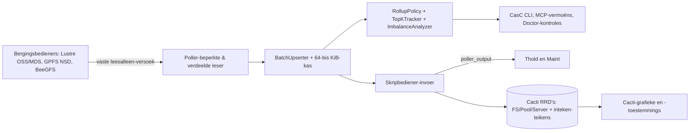

<!-- Source: README.md; SHA256: e88d6875d113220a91cfc0a9d230c829a78477b17e6aa7e44dda38c9591c86ad -->

<!-- translations:start -->
[English](../../../README.md) | [简体中文](../zh-CN/README.md) | [हिन्दी](../hi-IN/README.md) | [Español (España)](../es-ES/README.md) | [Español (Latinoamérica)](../es-419/README.md) | [العربية (السعودية)](../ar-SA/README.md) | [Afrikaans](README.md) | [አማርኛ](../am-ET/README.md) | [العربية (مصر)](../ar-EG/README.md) | [العربية (المغرب)](../ar-MA/README.md) | [বাংলা](../bn-BD/README.md) | [Bosanski](../bs-BA/README.md) | [Deutsch](../de-DE/README.md) | [فارسی](../fa-IR/README.md) | [Filipino](../fil-PH/README.md) | [Français](../fr-FR/README.md) | [Français (Maroc)](../fr-MA/README.md) | [Français (Sénégal)](../fr-SN/README.md) | [Hausa](../ha-NG/README.md) | [עברית](../he-IL/README.md) | [Hrvatski](../hr-HR/README.md) | [Bahasa Indonesia](../id-ID/README.md) | [Igbo](../ig-NG/README.md) | [Italiano](../it-IT/README.md) | [日本語](../ja-JP/README.md) | [한국어](../ko-KR/README.md) | [Malagasy](../mg-MG/README.md) | [मराठी](../mr-IN/README.md) | [Bahasa Melayu](../ms-MY/README.md) | [Nederlands](../nl-NL/README.md) | [Polski](../pl-PL/README.md) | [Português (Brasil)](../pt-BR/README.md) | [Русский](../ru-RU/README.md) | [Kinyarwanda](../rw-RW/README.md) | [Soomaali](../so-SO/README.md) | [Српски](../sr-RS/README.md) | [Svenska](../sv-SE/README.md) | [Kiswahili](../sw-KE/README.md) | [தமிழ்](../ta-IN/README.md) | [తెలుగు](../te-IN/README.md) | [ไทย](../th-TH/README.md) | [Türkçe](../tr-TR/README.md) | [Українська](../uk-UA/README.md) | [اردو](../ur-PK/README.md) | [Tiếng Việt](../vi-VN/README.md) | [isiXhosa](../xh-ZA/README.md) | [Yorùbá](../yo-NG/README.md) | [繁體中文](../zh-TW/README.md) | [isiZulu](../zu-ZA/README.md)
<!-- translations:end -->

# plugin_pfs

'n Cacti 1.2-inprop wat die gesondheid, kapasiteit, vulwanbalans, deurset per teiken en metadata-bewerkingskoerse van parallelle lêerstelsels na Cacti bring oor Lustre, IBM Storage Scale (GPFS) en BeeGFS agter 'n verenigde `Backend`-koppelvlak. Elke lêerstelsel karteer na 'n gewone Cacti-toestel met datanavrae, oorsig- en op-aanvraag-teikengrafieke en opsommingsmeters, sodat Thold en Maint onveranderd daarop waarsku en dit onderdruk.

> **Status: fases 1 tot 3 en eksaskaal-skaalprimitiewe in kode geïmplementeer, nog nie vrygestel nie.** Grondslag, Lustre-waarneming, waarskuwing en Maint-onderdrukking, GPFS- en BeeGFS-leesalleen-drywers, OST/MDT-wanbalansontleding met Maint-integrasie, afgeleë data-insamelaaromvangbepaling (`replicate_out`, `remote_agent`), 100+ PB / eksaskaal-skaalprimitiewe (`FramedReportParser`, Schema v4 `value_kib`, `RollupPolicy`, `TopKTracker`, `ShardAssigner`, `BatchUpserter`), die CasC-operateur-CLI (`cli/pfs.php`) en ekosisteemhake (`abilities_register`, `doctor_register_checks`, `casc_register_providers`) is geïmplementeer en geverifieer met eenheids-, sekuriteits- en weggooibare-Cacti-integrasietoetse. Alle lopies tot dusver gebruik toetsdata-knooppuntafvoer eerder as regte Lustre-, GPFS- of BeeGFS-hardeware. Nog oop voor die merk van 'n vrystelling: loodsprojekte op regte lêerstelsels ([loodsplan](../../pilot-plan.md)), 'n eksterne sekuriteitsoorsig ([selfoorsig](../../security-review.md)) en skaalmetings op gedokumenteerde hardeware ([skaal](../../research/scale.md)). Weergawe 0.1.0 is voorberei in `INFO` en [CHANGELOG.md](../../../CHANGELOG.md), maar nie gemerk nie.

## Toegangsrolle

| Gebied | Toegang |
| --- | --- |
| Parallel Filesystem View | Bestaande moniteringsbladsye. |
| Parallel Filesystem Operator | Monitering plus die Bedrywighede-bladsy en persoonlike siftingsbevestigings. |
| Parallel Filesystem Admin | Operateurtoegang plus die bestaande konfigurasie- en administratiewe aksies. |

Nadat opgraderingslêers gekopieer is, maak die Plugins-bladsy as 'n administrateur oop
om die nuwe gebied te registreer. Ken die Operator-gebied eksplisiet toe onder **Configuration > Users** of gebruikersgroepe.
Opgraderings behou die bestaande View- en Admin-gebied-ID's en -toekennings. Admin-toegang
erf Operator-toegang, en Operator-toegang erf View-toegang met elke versoek;
dit voeg nie gestoorde toekennings by gebruikers of groepe nie. Inpropinstellings vereis ook
Parallel Filesystem Admin-toegang benewens Cacti se Settings-toestemming.

Cacti-toesteltoestemmings beperk steeds die rye en aksies wat vir elke gebruiker beskikbaar is; ongekarteerde objekte vereis 'n administrateur.
Geloofsbriewe, konfigurasie, kartering, skrapping en ander administratiewe veranderinge
bly in die administratiewe bladsye. Bevestigings duur slegs in die huidige
gebruiker se sessie, vir hoogstens een uur en slegs terwyl dieselfde waarneming vars
bly. Nuwe of veranderde waarnemings maak dit ongeldig. Dit merk nooit 'n mislukte
meting as gesond nie en onderdruk nooit waarskuwings nie.

## Waarom

Wanneer 'n gedeelde lêerstelsel stadig is, is die bewyse oor bedieners versprei. Lustre hou sy tellers per knooppunt: `lctl get_param` rapporteer waardes "op die plaaslike knooppunt", so elke objekbergingsbediener (OSS) en metadatabediener (MDS) hou slegs sy eie teikens se syfers. 'n Operateur wat 'n stadige lêerstelsel ondersoek, benodig drie antwoorde uit verskillende plekke:

- **Vul een teiken terwyl ander leeg is?** Vulwanbalans verander waar nuwe lêers beland en wanneer 'n enkele teiken se spasie opraak.
- **Watter teikens of bewerkings is besig?** Greep-tellers per teiken en bewerkingstellers per MDT wys of die lading data-gebonde of metadata-gebonde is.
- **Is die monitering self op datum?** 'n Plat grafiek is slegs gerusstellend as die inprop die bedieners kon sien.

Cacti maak grafieke van gashere en stel drempels op waardes met Thold, en die Cacti GitHub-organisasie het geen bewaarplek vir Lustre-, GPFS- of BeeGFS-monitering nie (gesoek 2026-11-14). Die inprop vul daardie gaping deur toelaatlys-beperkte, leesalleen-waardes vanaf die bergingsknooppunte te lees en elke lêerstelsel as 'n Cacti-toestel voor te stel wie se teikens die indekse van 'n datanavraag is. Dit hergebruik Cacti se grafieke, toestemmings, afgeleë data-insamelaars, Thold en Maint eerder as om parallelle weergawes daarvan te bou.

## Beplande omvang

| Fase | Omvang | Status | Mylpale |
|---|---|---|---|
| 0, navorsing | Vrystellingsmatriks, knooppunttoegangsbesluit, bevestiging van stroomop-gedrag, teller- en oorskakelingsgedrag, skaalmetings | Voltooi | [M1](https://github.com/somethingwithproof/plugin_pfs/milestone/1) |
| 1, waarneming | Lustre-inventaris, kapasiteit en vulling, OST/MDT-wanbalans (`lib/ImbalanceAnalyzer.php`), Maint-integrasie (`lib/HealthPage.php`), OST-deurset, MDT-bewerkingskoerse, grafieke, Thold-waarskuwing, gesondheidsbladsy | Geïmplementeer (toetsdata-getoets) | [M2](https://github.com/somethingwithproof/plugin_pfs/milestone/2), [M3](https://github.com/somethingwithproof/plugin_pfs/milestone/3), [M4](https://github.com/somethingwithproof/plugin_pfs/milestone/4) |
| 2, afgeleë en skaal | Poller-beperkte afgeleë insameling (`lib/Reader.php`, `lib/ReplicationRepository.php`, `replicate_out`, `remote_agent`), 100+ PB skaalprimitiewe (64-bis KiB-higiëne + Schema v4 `value_kib`, `lib/RollupPolicy.php`, `lib/TopKTracker.php`, `lib/ShardAssigner.php` + `poller_pfs.php --shard=K/N`, `lib/BatchUpserter.php`), CasC-CLI (`cli/pfs.php`), MCP/Doctor/CasC-hake | Geïmplementeer (eenheids- en CI-integrasietoetse) | [M5](https://github.com/somethingwithproof/plugin_pfs/milestone/5) |
| 3, agterende | Leesalleen IBM Storage Scale (GPFS) (`lib/GpfsBackend.php`) en BeeGFS (`lib/BeegfsBackend.php`) drywers geregistreer in `BackendRegistry::production()` | Geïmplementeer (eenheidsgetoets) | [M6](https://github.com/somethingwithproof/plugin_pfs/milestone/6) |

Belangrikste geïmplementeerde operateur- en skaalprimitiewe:

- **Veelvuldige lêerstelsel leesalleen-drywers:** `LustreBackend`, `GpfsBackend` (slegs geraamde `mmpmon` `fs_io_s`/`io_s` met `reset` verbied, `mmdf` poelkapasiteit/-toestande en wagteropsommings), en `BeegfsBackend` (BeeGFS 7.4 en 8.x bergings-/metadatateikens met presiese greep-na-KiB-omskakeling, bereikbaarheid-/konsekwentheidstoestandkartering en per-interval-metersemantiek) wat `lib/FramedReportParser.php` deel.
- **Wanbalans, vryruimte en Maint-bewustheid:** `lib/ImbalanceAnalyzer.php` bereken OST/MDT-vulverhoudings, verspreiding, populasie-standaardafwyking-wanbalansindeks, vryruimte, 1-interval-varsheidshandhawing (`missing_targets`), per-teiken-statusvlae en begrensde Top-K skewe teikens. `HealthPage` (`pfs_health.php`) en `CascProvider::health()` vertoon Cacti `Maint`-instandhoudingsvensters en onderdruk aktiewe falingwaarskuwings tydens geskeduleerde instandhouding.
- **100+ PB en eksaskaal-skalering** ([docs/architecture/exascale-scaling.md](../../architecture/exascale-scaling.md)): presiese desimale greep-na-KiB-omskakeling (`FramedReportParser::bytesToKibInt()`) geverifieer teen 500 PB en 2 EB saam met `BIGINT UNSIGNED value_kib`-kolomme (Schema v4); hiërargiese `Filesystem -> Pool -> Storage Server` RRD-opsommings met begrensde inteken-/warm-/skewe-teikenbevordering (`lib/RollupPolicy.php`); begrensde $O(K)$ Top-K skewe teikens en vooraf-saamgevoegde swaar taak-/kliëntopsommings (`lib/TopKTracker.php`, wat nooit per-kliënt-toestelle of RRD's skep nie); deterministiese CRC32-insamelaarverdeling (`lib/ShardAssigner.php`, `php plugins/pfs/poller_pfs.php [--poller=N] [--shard=K/N] [--force] [--debug]`); en 500-ry bondel-SQL-opdaterings plus sleutelstel-paginering (`lib/BatchUpserter.php`, `CacheRepository::upsertObservationsBatch()`, `TargetRepository::forFilesystemPage()`).
- **Operateur CasC-CLI en ekosisteemhake:** `cli/pfs.php` ondersteun `export [--format=yaml|xml]`, `validate <file> [--format=yaml|xml]`, `plan <file> [--format=yaml|xml] [--output=text|json]`, `apply <file> --confirm=<PLAN_HASH> [--format=yaml|xml]`, en `health [--format=text|json]` met nul eksterne Composer-afhanklikhede. `setup.php` en `lib/EcosystemIntegration.php` registreer `abilities_register` (`pfs-list-filesystems`, `pfs-get-imbalance`, `pfs-get-health`; leesalleen, beperk op `Parallel Filesystem View` en Cacti-toesteltoestemmings), `doctor_register_checks` (`pfs_schema`, `pfs_reader_freshness`, `pfs_capacity_imbalance`), `casc_register_providers`, `replicate_out` en `remote_agent`.

Buite omvang: enige skryf-, skoonmaak-, terugstel- of instellingsbewerking op 'n knooppunt of lêerstelsel; 'n inprop-beheerde waarskuwingsenjin; 'n pasgemaakte bedryfsdiens of netwerkprotokol; per-taak- of per-kliënt-Cacti-toestelle/-RRD's; veranderinge aan Cacti-kern, Thold of Maint.

## Versoenbaarheidsteikens

| Komponent | Teiken |
|---|---|
| Cacti | 1.2.31 of later, geen kernlappe nie |
| PHP | 8.2 of later; `setup.php`, `poller_pfs.php` en `cli/pfs.php` bly ontleedbaar op 8.0 sodat 'n nie-ondersteunde looptyd 'n weiering kry in plaas van 'n stukkende Cacti-UI |
| Lustre | Bronkode en handleidings nagegaan by 2.17.0; toetsdata-getoets |
| GPFS, BeeGFS | IBM Storage Scale (GPFS) 5.x `mmpmon`/`mmdf` en BeeGFS 7.4 / 8.x leesalleen-drywers geïmplementeer en toetsdata-getoets |
| Thold, Maint | Thold 1.8.2 en Maint 1.3, onveranderd |

## Ontwerp

- [docs/architecture/exascale-scaling.md](../../architecture/exascale-scaling.md) dokumenteer die tweevlak 100+ PB / eksaskaal-telemetrie-argitektuur (Cacti/`plugin_pfs`-bediener + opsomming + Top-K-vlak gepaard met buite-band LDMS/Darshan/TOKIO-kliënttelemetrie) en sy akademiese literatuurkonteks.
- [docs/PLAN.md](../../PLAN.md) is die volledige plan: argitektuur, stroomop-feite waarop dit steun (met bronne en wat nog ongeverifieer is), tellersemantiek, toestandmodel, sekuriteitsgrense, werkverrigtingsrekenkunde, toetsing en risiko's.
- [docs/operator-guide.md](../../operator-guide.md) dek installasie, die grafieke en waardes, opgradering, rugsteun en herstel, deïnstallasie en foutsporing; [docs/alerting.md](../../alerting.md) dek Thold en Maint.
- [docs/node-setup.md](../../node-setup.md) beskryf hoe om 'n Lustre-bediener en 'n poller vir die leser voor te berei.
- [docs/decisions/](../../decisions) bevat argitektuurbesluitrekords vir keuses wat reeds gemaak is.
- [docs/REQUIREMENTS.md](../../REQUIREMENTS.md) karteer elke vereiste-ID na sy kwessie.

## Hoe werk nagespoor word

- **Mylpale** volg die plan se mylpale. Elkeen het 'n epiese kwessie wat sy subkwessies en uitgangsbewyse lys.
- **Kwessies** word volgens etiket getipeer: `type: requirement`, `type: research`, `type: decision`, `type: epic`. Vereiste-kwessies stel genommerde, toetsbare vereistes (`REQ-AREA-NNN`) en aanvaardingskriteria.
- **Etikette** dra ook `area:`, `phase:`, `priority:` en `status:`. Sien [CONTRIBUTING.md](../../../CONTRIBUTING.md#labels).
- Die [projekbord](https://github.com/users/somethingwithproof/projects/11) wys alle kwessies oor mylpale heen.

## Bydraes

Lees [CONTRIBUTING.md](../../../CONTRIBUTING.md). Kommits benodig 'n DCO-aftekening. Ontwerpbespreking vind op kwessies plaas; oop besluite dra die `type: decision`-etiket.

## Sekuriteit

Meld kwesbaarhede privaat aan; sien [SECURITY.md](../../../SECURITY.md).

## Lisensie

GNU General Public License v2.0, dieselfde lisensie as Cacti en sy inproppe. Sien [LICENSE](../../../LICENSE).
