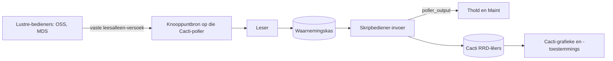

<!-- Source: README.md; SHA256: 40f2c5a5e9be97e4bd2b05a9ebab2a77de51de3af1b1c21dbeb5ee7f936cdd3b -->

<!-- translations:start -->
[English](../../../README.md) | [简体中文](../zh-CN/README.md) | [हिन्दी](../hi-IN/README.md) | [Español (España)](../es-ES/README.md) | [Español (Latinoamérica)](../es-419/README.md) | [العربية (السعودية)](../ar-SA/README.md) | [Afrikaans](README.md) | [አማርኛ](../am-ET/README.md) | [العربية (مصر)](../ar-EG/README.md) | [العربية (المغرب)](../ar-MA/README.md) | [বাংলা](../bn-BD/README.md) | [Bosanski](../bs-BA/README.md) | [Deutsch](../de-DE/README.md) | [فارسی](../fa-IR/README.md) | [Filipino](../fil-PH/README.md) | [Français](../fr-FR/README.md) | [Français (Maroc)](../fr-MA/README.md) | [Français (Sénégal)](../fr-SN/README.md) | [Hausa](../ha-NG/README.md) | [עברית](../he-IL/README.md) | [Hrvatski](../hr-HR/README.md) | [Bahasa Indonesia](../id-ID/README.md) | [Igbo](../ig-NG/README.md) | [Italiano](../it-IT/README.md) | [日本語](../ja-JP/README.md) | [한국어](../ko-KR/README.md) | [Malagasy](../mg-MG/README.md) | [मराठी](../mr-IN/README.md) | [Bahasa Melayu](../ms-MY/README.md) | [Nederlands](../nl-NL/README.md) | [Polski](../pl-PL/README.md) | [Português (Brasil)](../pt-BR/README.md) | [Русский](../ru-RU/README.md) | [Kinyarwanda](../rw-RW/README.md) | [Soomaali](../so-SO/README.md) | [Српски](../sr-RS/README.md) | [Svenska](../sv-SE/README.md) | [Kiswahili](../sw-KE/README.md) | [தமிழ்](../ta-IN/README.md) | [తెలుగు](../te-IN/README.md) | [ไทย](../th-TH/README.md) | [Türkçe](../tr-TR/README.md) | [Українська](../uk-UA/README.md) | [اردو](../ur-PK/README.md) | [Tiếng Việt](../vi-VN/README.md) | [isiXhosa](../xh-ZA/README.md) | [Yorùbá](../yo-NG/README.md) | [繁體中文](../zh-TW/README.md) | [isiZulu](../zu-ZA/README.md)
<!-- translations:end -->

# plugin_pfs

'n Cacti 1.2-inprop wat die gesondheid en lading van parallelle lêerstelsels na Cacti bring: kapasiteit en vulwanbalans oor teikens, deurset per teiken en metadata-bewerkingskoerse. Lustre is die eerste agterend. GPFS (IBM Storage Scale) en BeeGFS volg agter 'n agterend-koppelvlak. Die data beland in gewone Cacti-toestelle, -databronne en -grafieke, sodat Thold en Maint onveranderd daarop waarsku en dit onderdruk.

> **Status: mylpaal 4, kode voltooi vir fase 1, nie vrygestel nie.** Mylpale 2 (grondslag), 3 (Lustre-waarneming) en 4 (waarskuwing en vrystellingsvoorbereiding) is afgehandel op `main` of onder hersiening. Die inprop installeer, gradeer op en deïnstalleer deur Cacti se inprop-API en weier PHP onder 8.2. 'n Agtergrondleser op elke poller lees Lustre-bedieners oor SSH deur 'n vaste geforseerde-bevelskrip ([node/pfs-read.sh](../../../node/pfs-read.sh)) en kas inventaris, toestand, kapasiteit en tellers saam met hul varsheid. Elke lêerstelsel word 'n Cacti-toestel met OST- en MDT-datanavrae, vyf oorsiggrafieke, grafieke per teiken op aanvraag en 'n opsommingsdatabron vir Thold. Thold v1.8.2 en Maint v1.3, onveranderd, waarsku oor en onderdruk die opsommingsmeters in die end-tot-end-lopie; Thold-drempels op tellers word nie met Thold 1.8.2 ondersteun nie ([docs/alerting.md](../../alerting.md)). Elke toets tot dusver loop op toetsdata-knooppuntafvoer in 'n weggooibare Cacti: die inprop het nog nie teen 'n regte Lustre-knooppunt geloop nie. Nog oop voor 'n vrystelling: loodsprojekte op regte lêerstelsels ([loodsplan](../../pilot-plan.md)), die eksterne sekuriteitsoorsig ([selfoorsig](../../security-review.md)) en skaalmetings op gedokumenteerde hardeware ([skaal](../../research/scale.md)). Weergawe 0.1.0 is voorberei in `INFO` en [CHANGELOG.md](../../../CHANGELOG.md), maar nie gemerk nie.

## Toegangsrolle

| Gebied | Toegang |
| --- | --- |
| Parallel Filesystem View | Bestaande moniteringsbladsye. |
| Parallel Filesystem Operator | Monitering plus die Bedrywighede-bladsy en persoonlike siftingsbevestigings. |
| Parallel Filesystem Admin | Operateurtoegang plus die bestaande konfigurasie- en administratiewe aksies. |

Nadat opgraderingslêers gekopieer is, maak die Plugins-bladsy as 'n administrateur oop
om die nuwe gebied te registreer. Ken die Operator-gebied eksplisiet toe onder **Configuration > Users** of gebruikersgroepe.
Opgraderings behou die bestaande View- en Admin-gebied-ID's en -toekennings. Admin-toegang
erf Operator-toegang, en Operator-toegang erf View-toegang met elke versoek;
dit voeg nie gestoorde toekennings by gebruikers of groepe nie. Inpropinstellings vereis ook
Parallel Filesystem Admin-toegang benewens Cacti se Settings-toestemming.

Cacti-toesteltoestemmings beperk steeds die rye en aksies wat vir elke gebruiker beskikbaar is; ongekarteerde objekte vereis 'n administrateur.
Geloofsbriewe, konfigurasie, kartering, skrapping en ander administratiewe veranderinge
bly in die administratiewe bladsye. Bevestigings duur slegs in die huidige
gebruiker se sessie, vir hoogstens een uur en slegs terwyl dieselfde waarneming vars
bly. Nuwe of veranderde waarnemings maak dit ongeldig. Dit merk nooit 'n mislukte
meting as gesond nie en onderdruk nooit waarskuwings nie.

## Waarom

Wanneer 'n gedeelde lêerstelsel stadig is, is die bewyse oor bedieners versprei. Lustre hou sy tellers per knooppunt: `lctl get_param` rapporteer waardes "op die plaaslike knooppunt", so elke objekbergingsbediener (OSS) en metadatabediener (MDS) hou slegs sy eie teikens se syfers. 'n Operateur wat 'n stadige lêerstelsel ondersoek, benodig drie antwoorde uit verskillende plekke:

- **Vul een teiken terwyl ander leeg is?** Vulwanbalans verander waar nuwe lêers beland en wanneer 'n enkele teiken se spasie opraak.
- **Watter teikens of bewerkings is besig?** Greep-tellers per teiken en bewerkingstellers per MDT wys of die lading data-gebonde of metadata-gebonde is.
- **Is die monitering self op datum?** 'n Plat grafiek is slegs gerusstellend as die inprop die bedieners kon sien.

Cacti maak grafieke van gashere en stel drempels op waardes met Thold, en die Cacti GitHub-organisasie het geen bewaarplek vir Lustre-, GPFS- of BeeGFS-monitering nie (gesoek 2026-11-14). Die inprop vul daardie gaping deur toelaatlys-beperkte, leesalleen-waardes vanaf die bergingsknooppunte te lees en elke lêerstelsel as 'n Cacti-toestel voor te stel wie se teikens die indekse van 'n datanavraag is. Dit hergebruik Cacti se grafieke, toestemmings, afgeleë data-insamelaars, Thold en Maint eerder as om parallelle weergawes daarvan te bou.

## Beplande omvang

| Fase | Omvang | Mylpale |
|---|---|---|
| 0, navorsing | Vrystellingsmatriks, knooppunttoegangsbesluit, bevestiging van stroomop-gedrag, teller- en oorskakelingsgedrag, skaalmetings | [M1](https://github.com/somethingwithproof/plugin_pfs/milestone/1) |
| 1, waarneming | Lustre-inventaris, kapasiteit en vulling, OST-deurset, MDT-bewerkingskoerse, grafieke, Thold-waarskuwing, Maint-onderdrukking, gesondheidsbladsy | [M2](https://github.com/somethingwithproof/plugin_pfs/milestone/2), [M3](https://github.com/somethingwithproof/plugin_pfs/milestone/3), [M4](https://github.com/somethingwithproof/plugin_pfs/milestone/4) |
| 2, diepte | Cacti afgeleë data-insamelaars, taakvlak- en kliëntvlak-aansigte binne 'n begrensde objektelling | [M5](https://github.com/somethingwithproof/plugin_pfs/milestone/5) |
| 3, agterende | GPFS- (IBM Storage Scale) en BeeGFS-agterende | [M6](https://github.com/somethingwithproof/plugin_pfs/milestone/6) |

Buite omvang: enige skryf-, skoonmaak-, terugstel- of instellingsbewerking op 'n knooppunt of lêerstelsel; 'n inprop-beheerde waarskuwingsenjin; 'n pasgemaakte bedryfsdiens of netwerkprotokol; databronne per taak; veranderinge aan Cacti-kern, Thold of Maint.

## Versoenbaarheidsteikens

| Komponent | Teiken |
|---|---|
| Cacti | 1.2.31 of later, geen kernlappe nie |
| PHP | 8.2 of later; `setup.php` bly ontleedbaar op 8.0 sodat 'n nie-ondersteunde looptyd 'n weiering kry in plaas van 'n stukkende Cacti-UI |
| Lustre | Vrystellingslyne word deur mylpaal 1 vasgestel; bronkode en handleidings wat tot dusver nagegaan is, is by 2.17.0 |
| GPFS, BeeGFS | Fase 3; vrystellings word deur navorsing vasgestel |
| Thold, Maint | Geen veranderinge nodig nie |

## Ontwerp

- [docs/PLAN.md](../../PLAN.md) is die volledige plan: argitektuur, stroomop-feite waarop dit steun (met bronne en wat nog ongeverifieer is), tellersemantiek, toestandmodel, sekuriteitsgrense, werkverrigtingsrekenkunde, toetsing en risiko's.
- [docs/operator-guide.md](../../operator-guide.md) dek installasie, die grafieke en waardes, opgradering, rugsteun en herstel, deïnstallasie en foutsporing; [docs/alerting.md](../../alerting.md) dek Thold en Maint.
- [docs/node-setup.md](../../node-setup.md) beskryf hoe om 'n Lustre-bediener en 'n poller vir die leser voor te berei.
- [docs/decisions/](../../decisions) bevat argitektuurbesluitrekords vir keuses wat reeds gemaak is.
- [docs/REQUIREMENTS.md](../../REQUIREMENTS.md) karteer elke vereiste-ID na sy kwessie.

## Hoe werk nagespoor word

- **Mylpale** volg die plan se mylpale. Elkeen het 'n epiese kwessie wat sy subkwessies en uitgangsbewyse lys.
- **Kwessies** word volgens etiket getipeer: `type: requirement`, `type: research`, `type: decision`, `type: epic`. Vereiste-kwessies stel genommerde, toetsbare vereistes (`REQ-AREA-NNN`) en aanvaardingskriteria.
- **Etikette** dra ook `area:`, `phase:`, `priority:` en `status:`. Sien [CONTRIBUTING.md](../../../CONTRIBUTING.md#labels).
- Die [projekbord](https://github.com/users/somethingwithproof/projects/11) wys alle kwessies oor mylpale heen.

## Bydraes

Lees [CONTRIBUTING.md](../../../CONTRIBUTING.md). Kommits benodig 'n DCO-aftekening. Ontwerpbespreking vind op kwessies plaas; oop besluite dra die `type: decision`-etiket.

## Sekuriteit

Meld kwesbaarhede privaat aan; sien [SECURITY.md](../../../SECURITY.md).

## Lisensie

GNU General Public License v2.0, dieselfde lisensie as Cacti en sy inproppe. Sien [LICENSE](../../../LICENSE).
