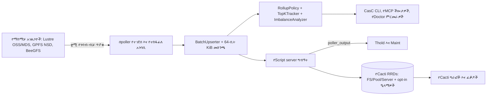

<!-- Source: README.md; SHA256: e88d6875d113220a91cfc0a9d230c829a78477b17e6aa7e44dda38c9591c86ad -->

<!-- translations:start -->
[English](../../../README.md) | [简体中文](../zh-CN/README.md) | [हिन्दी](../hi-IN/README.md) | [Español (España)](../es-ES/README.md) | [Español (Latinoamérica)](../es-419/README.md) | [العربية (السعودية)](../ar-SA/README.md) | [Afrikaans](../af-ZA/README.md) | [አማርኛ](README.md) | [العربية (مصر)](../ar-EG/README.md) | [العربية (المغرب)](../ar-MA/README.md) | [বাংলা](../bn-BD/README.md) | [Bosanski](../bs-BA/README.md) | [Deutsch](../de-DE/README.md) | [فارسی](../fa-IR/README.md) | [Filipino](../fil-PH/README.md) | [Français](../fr-FR/README.md) | [Français (Maroc)](../fr-MA/README.md) | [Français (Sénégal)](../fr-SN/README.md) | [Hausa](../ha-NG/README.md) | [עברית](../he-IL/README.md) | [Hrvatski](../hr-HR/README.md) | [Bahasa Indonesia](../id-ID/README.md) | [Igbo](../ig-NG/README.md) | [Italiano](../it-IT/README.md) | [日本語](../ja-JP/README.md) | [한국어](../ko-KR/README.md) | [Malagasy](../mg-MG/README.md) | [मराठी](../mr-IN/README.md) | [Bahasa Melayu](../ms-MY/README.md) | [Nederlands](../nl-NL/README.md) | [Polski](../pl-PL/README.md) | [Português (Brasil)](../pt-BR/README.md) | [Русский](../ru-RU/README.md) | [Kinyarwanda](../rw-RW/README.md) | [Soomaali](../so-SO/README.md) | [Српски](../sr-RS/README.md) | [Svenska](../sv-SE/README.md) | [Kiswahili](../sw-KE/README.md) | [தமிழ்](../ta-IN/README.md) | [తెలుగు](../te-IN/README.md) | [ไทย](../th-TH/README.md) | [Türkçe](../tr-TR/README.md) | [Українська](../uk-UA/README.md) | [اردو](../ur-PK/README.md) | [Tiếng Việt](../vi-VN/README.md) | [isiXhosa](../xh-ZA/README.md) | [Yorùbá](../yo-NG/README.md) | [繁體中文](../zh-TW/README.md) | [isiZulu](../zu-ZA/README.md)
<!-- translations:end -->

# plugin_pfs

የትይዩ ፋይል ሲስተሞችን ጤንነት፣ አቅም፣ የሙሌት አለመመጣጠን፣ በየዒላማው ያለውን የውሂብ ማስተላለፊያ መጠን እና የሜታዳታ ክንዋኔ መጠኖችን ከተዋሃደ የ`Backend` በይነገጽ በስተጀርባ በLustre፣ IBM Storage Scale (GPFS) እና BeeGFS ላይ ወደ Cacti የሚያመጣ የCacti 1.2 ተሰኪ ነው። እያንዳንዱ ፋይል ሲስተም የውሂብ መጠይቆች፣ የአጠቃላይ እይታና በፍላጎት የሚፈጠሩ የዒላማ ግራፎች፣ እና የማጠቃለያ መለኪያዎች ወዳሉት መደበኛ የCacti መሣሪያ ስለሚዛመድ፣ Thold እና Maint ምንም ለውጥ ሳይደረግባቸው ማንቂያዎችን ይሰጣሉ እንዲሁም ያፍናሉ።

> **ሁኔታ፦ ከደረጃ 1 እስከ 3 እና የexascale ማስፋፊያ መሠረታዊ አካላት በኮድ ውስጥ ተተግብረዋል፣ ገና አልተለቀቁም።** መሠረቱ፣ የLustre ምልከታ፣ ማንቂያና የMaint ማፈኛ፣ የGPFS እና BeeGFS ለንባብ-ብቻ ነጂዎች፣ ከMaint ውህደት ጋር የOST/MDT አለመመጣጠን ትንተና፣ የርቀት ውሂብ ሰብሳቢ ወሰን (`replicate_out`፣ `remote_agent`)፣ የ100+ PB / exascale ማስፋፊያ መሠረታዊ አካላት (`FramedReportParser`፣ Schema v4 `value_kib`፣ `RollupPolicy`፣ `TopKTracker`፣ `ShardAssigner`፣ `BatchUpserter`)፣ የCasC ኦፕሬተር CLI (`cli/pfs.php`) እና የሥነ-ምህዳር መንጠቆዎች (`abilities_register`፣ `doctor_register_checks`፣ `casc_register_providers`) ተተግብረው በዩኒት፣ በደህንነት እና በሚጣል Cacti የውህደት ሙከራዎች ተረጋግጠዋል። እስካሁን የተደረጉት ሁሉም ሙከራዎች በእውነተኛ የLustre፣ GPFS ወይም BeeGFS ሃርድዌር ፋንታ የfixture node ውጤትን ይጠቀማሉ። ልቀትን ከመለየት (tag) በፊት ገና ያልተጠናቀቁት፦ በእውነተኛ ፋይል ሲስተሞች ላይ የሙከራ ትግበራዎች ([የሙከራ እቅድ](../../pilot-plan.md))፣ የውጭ ደህንነት ግምገማ ([የራስ ግምገማ](../../security-review.md)) እና በተሰነደ ሃርድዌር ላይ የመጠን መለኪያዎች ([የመጠን መለኪያ](../../research/scale.md)) ናቸው። ስሪት 0.1.0 በ`INFO` እና [CHANGELOG.md](../../../CHANGELOG.md) ውስጥ ተዘጋጅቷል ነገር ግን ገና tag አልተደረገም።

## የመዳረሻ ሚናዎች

| ክልል | መዳረሻ |
| --- | --- |
| የትይዩ ፋይል ሲስተም እይታ | ነባር የክትትል ገጾች። |
| የትይዩ ፋይል ሲስተም ኦፕሬተር | ክትትል፣ በተጨማሪም የኦፕሬሽንስ ገጽ እና የግል የማጣሪያ ማረጋገጫዎች። |
| የትይዩ ፋይል ሲስተም አስተዳዳሪ | የኦፕሬተር መዳረሻ፣ በተጨማሪም ነባር የማዋቀሪያ እና የአስተዳደር እርምጃዎች። |

የማሻሻያ ፋይሎችን ከቀዱ በኋላ፣ አዲሱን ክልል ለመመዝገብ እንደ አስተዳዳሪ ሆነው የተሰኪዎች ገጽን ይክፈቱ።
የኦፕሬተር ክልልን በ**ውቅር > ተጠቃሚዎች** ወይም በተጠቃሚ ቡድኖች ስር በግልጽ ይመድቡ።
ማሻሻያዎች ነባር የእይታ እና የአስተዳዳሪ ክልል መለያዎችን እና ፈቃዶችን ይጠብቃሉ። የአስተዳዳሪ መዳረሻ
በእያንዳንዱ ጥያቄ ላይ የኦፕሬተር መዳረሻን ይወርሳል፣ የኦፕሬተር መዳረሻም የእይታ መዳረሻን ይወርሳል፤
ይህ ለተጠቃሚዎች ወይም ለቡድኖች የተከማቹ ፈቃዶችን አይጨምርም። የተሰኪ ቅንብሮችም ከCacti የቅንብሮች
ፈቃድ በተጨማሪ የትይዩ ፋይል ሲስተም አስተዳዳሪ መዳረሻን ይፈልጋሉ።

የCacti መሣሪያ ፈቃዶች አሁንም ለእያንዳንዱ ተጠቃሚ የሚገኙትን ረድፎች እና እርምጃዎች ይገድባሉ፤ ያልተገናኙ ነገሮች አስተዳዳሪን ይፈልጋሉ።
ምስክርነቶች፣ ውቅር፣ ትስስር፣ ስረዛ እና ሌሎች የአስተዳደር ለውጦች
በአስተዳደር ገጾች ውስጥ ይቆያሉ። ማረጋገጫዎች የሚቆዩት በአሁኑ የተጠቃሚ ክፍለ-ጊዜ
ውስጥ ብቻ፣ ቢበዛ ለአንድ ሰዓት እና ተመሳሳዩ ምልከታ ወቅታዊ ሆኖ እስከቆየ
ድረስ ብቻ ነው። አዲስ ወይም የተለወጡ ምልከታዎች ውድቅ ያደርጓቸዋል። የከሸፈ
መለኪያን ጤናማ ብለው በፍጹም አይሰይሙም ወይም ማንቂያዎችን አያፍኑም።

## ለምን አስፈለገ

የተጋራ ፋይል ሲስተም ሲዘገይ፣ ማስረጃው በተለያዩ አገልጋዮች ላይ ተበታትኖ ይገኛል። Lustre ቆጣሪዎቹን በየnode ያስቀምጣል፦ `lctl get_param` እሴቶችን «በአካባቢያዊው node ላይ» ሪፖርት ያደርጋል፣ ስለዚህ እያንዳንዱ የነገር ማከማቻ አገልጋይ (OSS) እና የሜታዳታ አገልጋይ (MDS) የራሱን ዒላማዎች ቁጥሮች ብቻ ይይዛል። የዘገየ ፋይል ሲስተምን የሚመረምር ኦፕሬተር ከተለያዩ ቦታዎች ሦስት መልሶችን ይፈልጋል፦

- **አንዱ ዒላማ ሲሞላ ሌሎቹ ባዶ ናቸው?** የሙሌት አለመመጣጠን አዳዲስ ፋይሎች የት እንደሚቀመጡ እና አንድ ነጠላ ዒላማ መቼ ቦታ እንደሚያልቅበት ይለውጣል።
- **የትኞቹ ዒላማዎች ወይም ክንዋኔዎች ስራ በዝቶባቸዋል?** የየዒላማው የባይት ቆጣሪዎች እና የየMDT የክንዋኔ ቆጣሪዎች ጫናው በውሂብ ወይም በሜታዳታ ላይ የተመሰረተ መሆኑን ያሳያሉ።
- **ክትትሉ ራሱ ወቅታዊ ነው?** ጠፍጣፋ ግራፍ የሚያረጋጋው ተሰኪው አገልጋዮቹን ማየት የቻለ ከሆነ ብቻ ነው።

Cacti አስተናጋጆችን በግራፍ ያሳያል እና እሴቶችን በThold ገደብ ይሰጣል፣ እንዲሁም የCacti GitHub ድርጅት ለLustre፣ GPFS ወይም BeeGFS ክትትል ምንም ማከማቻ የለውም (በ2026-11-14 ተፈልጓል)። ተሰኪው ከማከማቻ nodeዎች በፍቃድ ዝርዝር የተካተቱ፣ ለንባብ-ብቻ የሆኑ እሴቶችን በማንበብ እና እያንዳንዱን ፋይል ሲስተም ዒላማዎቹ የውሂብ መጠይቅ ኢንዴክሶች የሆኑበት የCacti መሣሪያ አድርጎ በመወከል ይህንን ክፍተት ይሞላል። የራሱን ተጓዳኝ ስሪቶች ከመገንባት ይልቅ የCactiን ግራፍ ማሳያ፣ ፈቃዶች፣ የርቀት ውሂብ ሰብሳቢዎች፣ Thold እና Maintን መልሶ ይጠቀማል።

## የታቀደ ወሰን

| ደረጃ | ወሰን | ሁኔታ | ምዕራፎች |
|---|---|---|---|
| 0፣ ምርምር | የልቀት ማትሪክስ፣ የnode መዳረሻ ውሳኔ፣ የupstream ባህሪ ማረጋገጫ፣ የቆጣሪ እና failover ባህሪ፣ የመጠን መለኪያዎች | ተጠናቋል | [M1](https://github.com/somethingwithproof/plugin_pfs/milestone/1) |
| 1፣ ምልከታ | የLustre ዝርዝር፣ አቅም እና ሙሌት፣ የOST/MDT አለመመጣጠን (`lib/ImbalanceAnalyzer.php`)፣ የMaint ውህደት (`lib/HealthPage.php`)፣ የOST የውሂብ ማስተላለፊያ መጠን፣ የMDT ክንዋኔ መጠኖች፣ ግራፎች፣ የThold ማንቂያ፣ የጤንነት ገጽ | ተተግብሯል (በfixture ተፈትኗል) | [M2](https://github.com/somethingwithproof/plugin_pfs/milestone/2), [M3](https://github.com/somethingwithproof/plugin_pfs/milestone/3), [M4](https://github.com/somethingwithproof/plugin_pfs/milestone/4) |
| 2፣ የርቀት እና መጠን | በpoller የተገደበ የርቀት ስብሰባ (`lib/Reader.php`, `lib/ReplicationRepository.php`, `replicate_out`, `remote_agent`)፣ የ100+ PB ማስፋፊያ መሠረታዊ አካላት (የ64-ቢት KiB ንጽህና + Schema v4 `value_kib`፣ `lib/RollupPolicy.php`፣ `lib/TopKTracker.php`፣ `lib/ShardAssigner.php` + `poller_pfs.php --shard=K/N`፣ `lib/BatchUpserter.php`)፣ CasC CLI (`cli/pfs.php`)፣ MCP/Doctor/CasC መንጠቆዎች | ተተግብሯል (በዩኒት እና CI ውህደት ተፈትኗል) | [M5](https://github.com/somethingwithproof/plugin_pfs/milestone/5) |
| 3፣ backends | በ`BackendRegistry::production()` ውስጥ የተመዘገቡ ለንባብ-ብቻ IBM Storage Scale (GPFS) (`lib/GpfsBackend.php`) እና BeeGFS (`lib/BeegfsBackend.php`) ነጂዎች | ተተግብሯል (በዩኒት ተፈትኗል) | [M6](https://github.com/somethingwithproof/plugin_pfs/milestone/6) |

ቁልፍ የተተገበሩ የኦፕሬተር እና የማስፋፊያ መሠረታዊ አካላት፦

- **የብዙ ፋይል ሲስተም ለንባብ-ብቻ ነጂዎች፦** `LustreBackend`፣ `GpfsBackend` (`reset` የታገደበት framed `mmpmon` `fs_io_s`/`io_s` ብቻ፣ የ`mmdf` ገንዳ አቅም/ሁኔታዎች፣ እና የwaiter ማጠቃለያዎች)፣ እና `BeegfsBackend` (ትክክለኛ የባይት-ወደ-KiB ልወጣ፣ የተደራሽነት/ወጥነት ሁኔታ ካርታ ስራ እና በየክፍለ-ጊዜው የgauge ትርጉም ያላቸው የBeeGFS 7.4 እና 8.x ማከማቻ/ሜታዳታ ዒላማዎች) `lib/FramedReportParser.php`ን ይጋራሉ።
- **አለመመጣጠን፣ ክፍት ቦታ እና የMaint ግንዛቤ፦** `lib/ImbalanceAnalyzer.php` የOST/MDT ሙሌት ጥምርታዎችን፣ ስርጭትን፣ የሕዝብ መደበኛ መዛባት አለመመጣጠን መረጃ ጠቋሚን፣ ክፍት ቦታን፣ የ1-ክፍለ-ጊዜ ወቅታዊነት ማስከበርን (`missing_targets`)፣ የየዒላማውን ሁኔታ ባንዲራዎች እና የተገደቡ Top-K የተዛቡ ዒላማዎችን ያሰላል። `HealthPage` (`pfs_health.php`) እና `CascProvider::health()` የCacti `Maint` የጥገና መስኮቶችን ያሳያሉ እና በተያዘ ጥገና ወቅት ንቁ የብልሽት ማስጠንቀቂያዎችን ያፍናሉ።
- **100+ PB እና exascale ማስፋፊያ** ([docs/architecture/exascale-scaling.md](../../architecture/exascale-scaling.md))፦ ከ`BIGINT UNSIGNED value_kib` ዓምዶች (Schema v4) ጋር በ500 PB እና 2 EB ላይ የተረጋገጠ ትክክለኛ አሥርዮሽ ባይት-ወደ-KiB ልወጣ (`FramedReportParser::bytesToKibInt()`)፤ በተገደበ opt-in/ሞቃት/የተዛባ ዒላማ ማሳደግ ተዋረዳዊ `Filesystem -> Pool -> Storage Server` RRD ማጠቃለያዎች (`lib/RollupPolicy.php`)፤ የተገደቡ $O(K)$ Top-K የተዛቡ ዒላማዎች እና አስቀድመው የተጠቃለሉ ከባድ የሥራ/ደንበኛ ማጠቃለያዎች (`lib/TopKTracker.php`፣ ለእያንዳንዱ ደንበኛ መሣሪያዎችን ወይም RRDዎችን በፍጹም አይፈጥርም)፤ ወጥ CRC32 ሰብሳቢ ክፍፍል (`lib/ShardAssigner.php`፣ `php plugins/pfs/poller_pfs.php [--poller=N] [--shard=K/N] [--force] [--debug]`)፤ እና 500-ረድፍ ባች SQL upsertዎች ከkeyset pagination ጋር (`lib/BatchUpserter.php`፣ `CacheRepository::upsertObservationsBatch()`፣ `TargetRepository::forFilesystemPage()`)።
- **የኦፕሬተር CasC CLI እና የሥነ-ምህዳር መንጠቆዎች፦** `cli/pfs.php` ያለ ምንም ውጫዊ የComposer ጥገኝነት `export [--format=yaml|xml]`፣ `validate <file> [--format=yaml|xml]`፣ `plan <file> [--format=yaml|xml] [--output=text|json]`፣ `apply <file> --confirm=<PLAN_HASH> [--format=yaml|xml]` እና `health [--format=text|json]`ን ይደግፋል። `setup.php` እና `lib/EcosystemIntegration.php` `abilities_register` (`pfs-list-filesystems`፣ `pfs-get-imbalance`፣ `pfs-get-health`፤ ለንባብ-ብቻ፣ በ`Parallel Filesystem View` እና በCacti የመሣሪያ ፈቃዶች የተገደበ)፣ `doctor_register_checks` (`pfs_schema`፣ `pfs_reader_freshness`፣ `pfs_capacity_imbalance`)፣ `casc_register_providers`፣ `replicate_out` እና `remote_agent`ን ይመዘግባሉ።

ከወሰን ውጭ የሆኑ፦ በnode ወይም በፋይል ሲስተም ላይ ማንኛውም የመጻፍ፣ የማጽዳት፣ ዳግም የማስጀመር ወይም የማስተካከል ክንዋኔ፤ በተሰኪው ባለቤትነት የሚተዳደር የማንቂያ ሞተር፤ ብጁ daemon ወይም የአውታረ መረብ ፕሮቶኮል፤ የየሥራ ወይም የየደንበኛ የCacti መሣሪያዎች/RRDዎች፤ በCacti ኮር፣ Thold ወይም Maint ላይ የሚደረጉ ለውጦች።

## የተኳኋኝነት ዒላማዎች

| አካል | ዒላማ |
|---|---|
| Cacti | 1.2.31 ወይም ከዚያ በኋላ፣ ምንም የኮር ማሻሻያ የለም |
| PHP | 8.2 ወይም ከዚያ በኋላ፤ የማይደገፍ runtime የተበላሸ የCacti UI ከመፍጠር ይልቅ ውድቅ እንዲደረግ `setup.php`፣ `poller_pfs.php` እና `cli/pfs.php` በ8.0 ላይ ሊተነተኑ የሚችሉ ሆነው ይቆያሉ |
| Lustre | ምንጭ ኮድ እና መመሪያዎች በ2.17.0 ላይ ተረጋግጠዋል፤ በfixture ተፈትኗል |
| GPFS, BeeGFS | IBM Storage Scale (GPFS) 5.x `mmpmon`/`mmdf` እና BeeGFS 7.4 / 8.x ለንባብ-ብቻ ነጂዎች ተተግብረው በfixture ተፈትነዋል |
| Thold, Maint | Thold 1.8.2 እና Maint 1.3፣ ምንም ለውጥ የለም |

## ንድፍ

- [docs/architecture/exascale-scaling.md](../../architecture/exascale-scaling.md) ባለሁለት-ደረጃ 100+ PB / exascale የቴሌሜትሪ አርክቴክቸርን (ከውጭ-ባንድ LDMS/Darshan/TOKIO የደንበኛ ቴሌሜትሪ ጋር የተጣመረ Cacti/`plugin_pfs` አገልጋይ + ማጠቃለያ + Top-K ደረጃ) እና የአካዳሚክ ጽሑፍ አውዱን ይሰነዳል።
- [docs/PLAN.md](../../PLAN.md) ሙሉው እቅድ ነው፦ አርክቴክቸር፣ የሚመረኮዝባቸው የupstream እውነታዎች (ከምንጮቻቸው እና ገና ካልተረጋገጡት ጋር)፣ የቆጣሪ ትርጉሞች፣ የሁኔታ ሞዴል፣ የደህንነት ወሰኖች፣ የአፈጻጸም ስሌት፣ ሙከራ እና ስጋቶች።
- [docs/operator-guide.md](../../operator-guide.md) መጫንን፣ ግራፎችን እና እሴቶችን፣ ማሻሻልን፣ መጠባበቂያ እና መልሶ ማግኘትን፣ ማራገፍን እና መላ መፈለግን ይሸፍናል፤ [docs/alerting.md](../../alerting.md) ደግሞ Thold እና Maintን ይሸፍናል።
- [docs/node-setup.md](../../node-setup.md) የLustre አገልጋይን እና pollerን ለአንባቢው እንዴት ማዘጋጀት እንደሚቻል ያብራራል።
- [docs/decisions/](../../decisions) ቀደም ብለው ለተወሰኑ ምርጫዎች የአርክቴክቸር ውሳኔ መዝገቦችን ይይዛል።
- [docs/REQUIREMENTS.md](../../REQUIREMENTS.md) እያንዳንዱን የመስፈርት መለያ ከissueው ጋር ያገናኛል።

## ሥራ እንዴት እንደሚከታተል

- **ምዕራፎች** የእቅዱን ምዕራፎች ይከተላሉ። እያንዳንዱ ንዑስ-issueዎቹን እና የመውጫ ማስረጃዎችን የሚዘረዝር epic issue አለው።
- **Issues** በመለያ ተከፋፍለዋል፦ `type: requirement`፣ `type: research`፣ `type: decision`፣ `type: epic`። የመስፈርት issueዎች ቁጥር የተሰጣቸው፣ ሊሞከሩ የሚችሉ መስፈርቶችን (`REQ-AREA-NNN`) እና የመቀበያ መስፈርቶችን ይገልጻሉ።
- **መለያዎች** እንዲሁ `area:`፣ `phase:`፣ `priority:` እና `status:`ን ይይዛሉ። [CONTRIBUTING.md](../../../CONTRIBUTING.md#labels)ን ይመልከቱ።
- [የፕሮጀክት ሰሌዳው](https://github.com/users/somethingwithproof/projects/11) በሁሉም ምዕራፎች ውስጥ ያሉትን ሁሉንም issueዎች ያሳያል።

## አስተዋጽኦ ማድረግ

[CONTRIBUTING.md](../../../CONTRIBUTING.md)ን ያንብቡ። Commitዎች የDCO sign-off ያስፈልጋቸዋል። የንድፍ ውይይት በissueዎች ላይ ይካሄዳል፤ ክፍት ውሳኔዎች `type: decision` መለያን ይይዛሉ።

## ደህንነት

ተጋላጭነቶችን በግል ሪፖርት ያድርጉ፤ [SECURITY.md](../../../SECURITY.md)ን ይመልከቱ።

## ፈቃድ

GNU General Public License v2.0፣ ከCacti እና ከተሰኪዎቹ ጋር ተመሳሳይ ፈቃድ። [LICENSE](../../../LICENSE)ን ይመልከቱ።
