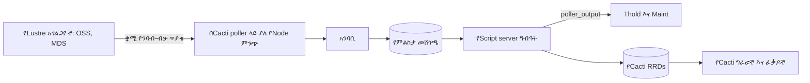

<!-- Source: README.md; SHA256: 40f2c5a5e9be97e4bd2b05a9ebab2a77de51de3af1b1c21dbeb5ee7f936cdd3b -->

<!-- translations:start -->
[English](../../../README.md) | [简体中文](../zh-CN/README.md) | [हिन्दी](../hi-IN/README.md) | [Español (España)](../es-ES/README.md) | [Español (Latinoamérica)](../es-419/README.md) | [العربية (السعودية)](../ar-SA/README.md) | [Afrikaans](../af-ZA/README.md) | [አማርኛ](README.md) | [العربية (مصر)](../ar-EG/README.md) | [العربية (المغرب)](../ar-MA/README.md) | [বাংলা](../bn-BD/README.md) | [Bosanski](../bs-BA/README.md) | [Deutsch](../de-DE/README.md) | [فارسی](../fa-IR/README.md) | [Filipino](../fil-PH/README.md) | [Français](../fr-FR/README.md) | [Français (Maroc)](../fr-MA/README.md) | [Français (Sénégal)](../fr-SN/README.md) | [Hausa](../ha-NG/README.md) | [עברית](../he-IL/README.md) | [Hrvatski](../hr-HR/README.md) | [Bahasa Indonesia](../id-ID/README.md) | [Igbo](../ig-NG/README.md) | [Italiano](../it-IT/README.md) | [日本語](../ja-JP/README.md) | [한국어](../ko-KR/README.md) | [Malagasy](../mg-MG/README.md) | [मराठी](../mr-IN/README.md) | [Bahasa Melayu](../ms-MY/README.md) | [Nederlands](../nl-NL/README.md) | [Polski](../pl-PL/README.md) | [Português (Brasil)](../pt-BR/README.md) | [Русский](../ru-RU/README.md) | [Kinyarwanda](../rw-RW/README.md) | [Soomaali](../so-SO/README.md) | [Српски](../sr-RS/README.md) | [Svenska](../sv-SE/README.md) | [Kiswahili](../sw-KE/README.md) | [தமிழ்](../ta-IN/README.md) | [తెలుగు](../te-IN/README.md) | [ไทย](../th-TH/README.md) | [Türkçe](../tr-TR/README.md) | [Українська](../uk-UA/README.md) | [اردو](../ur-PK/README.md) | [Tiếng Việt](../vi-VN/README.md) | [isiXhosa](../xh-ZA/README.md) | [Yorùbá](../yo-NG/README.md) | [繁體中文](../zh-TW/README.md) | [isiZulu](../zu-ZA/README.md)
<!-- translations:end -->

# plugin_pfs

የትይዩ ፋይል ሲስተም ጤንነትን እና ጫናን ወደ Cacti የሚያመጣ የCacti 1.2 ተሰኪ፦ በዒላማዎች መካከል ያለውን አቅም እና የሙሌት አለመመጣጠን፣ በየዒላማው ያለውን የውሂብ ማስተላለፊያ መጠን፣ እና የሜታዳታ ክንዋኔ መጠኖችን ያሳያል። Lustre የመጀመሪያው backend ነው። GPFS (IBM Storage Scale) እና BeeGFS በbackend በይነገጽ ይከተላሉ። ውሂቡ በመደበኛ የCacti መሣሪያዎች፣ የውሂብ ምንጮች እና ግራፎች ውስጥ ስለሚገባ፣ Thold እና Maint ምንም ለውጥ ሳይደረግባቸው ማንቂያዎችን ይሰጣሉ እንዲሁም ያፍናሉ።

> **ሁኔታ፦ ምዕራፍ 4፣ ለደረጃ 1 ኮዱ ተጠናቅቋል፣ ገና አልተለቀቀም።** ምዕራፍ 2 (መሠረት)፣ 3 (የLustre ምልከታ) እና 4 (ማንቂያ እና የልቀት ዝግጅት) በ`main` ላይ ተጠናቅቀዋል ወይም በግምገማ ላይ ናቸው። ተሰኪው በCacti የተሰኪ API አማካኝነት ይጫናል፣ ይሻሻላል እና ይራገፋል፣ እንዲሁም ከ8.2 በታች የሆነ PHPን አይቀበልም። በእያንዳንዱ poller ላይ ያለ የጀርባ አንባቢ በቋሚ forced-command ስክሪፕት ([node/pfs-read.sh](../../../node/pfs-read.sh)) በኩል በSSH የLustre አገልጋዮችን ያነብባል እና ዝርዝር፣ ሁኔታ፣ አቅም እና ቆጣሪዎችን ከወቅታዊነታቸው ጋር በመሸጎጫ ውስጥ ያስቀምጣል። እያንዳንዱ ፋይል ሲስተም የOST እና MDT የውሂብ መጠይቆች፣ አምስት የአጠቃላይ እይታ ግራፎች፣ በፍላጎት የሚፈጠሩ የየዒላማ ግራፎች፣ እና ለThold የሚሆን የማጠቃለያ የውሂብ ምንጭ ያለው የCacti መሣሪያ ይሆናል። Thold v1.8.2 እና Maint v1.3 ያለምንም ለውጥ በሙሉ ሂደት ሙከራ ውስጥ በማጠቃለያ መለኪያዎች ላይ ማንቂያ ያሰማሉ እንዲሁም ያፍናሉ፤ በቆጣሪዎች ላይ የThold ገደቦች በThold 1.8.2 አይደገፉም ([docs/alerting.md](../../alerting.md))። እስካሁን የተደረገው እያንዳንዱ ሙከራ በሚጣል Cacti ውስጥ በfixture node ውጤት ላይ የተካሄደ ነው፦ ተሰኪው በእውነተኛ የLustre node ላይ ገና አልሰራም። ከመለቀቁ በፊት ገና ያልተጠናቀቁት፦ በእውነተኛ ፋይል ሲስተሞች ላይ የሙከራ ትግበራዎች ([የሙከራ እቅድ](../../pilot-plan.md))፣ የውጭ ደህንነት ግምገማ ([የራስ ግምገማ](../../security-review.md)) እና በተሰነደ ሃርድዌር ላይ የመጠን መለኪያዎች ([የመጠን መለኪያ](../../research/scale.md)) ናቸው። ስሪት 0.1.0 በ`INFO` እና [CHANGELOG.md](../../../CHANGELOG.md) ውስጥ ተዘጋጅቷል ነገር ግን ገና tag አልተደረገም።

## የመዳረሻ ሚናዎች

| ክልል | መዳረሻ |
| --- | --- |
| የትይዩ ፋይል ሲስተም እይታ | ነባር የክትትል ገጾች። |
| የትይዩ ፋይል ሲስተም ኦፕሬተር | ክትትል፣ በተጨማሪም የኦፕሬሽንስ ገጽ እና የግል የማጣሪያ ማረጋገጫዎች። |
| የትይዩ ፋይል ሲስተም አስተዳዳሪ | የኦፕሬተር መዳረሻ፣ በተጨማሪም ነባር የማዋቀሪያ እና የአስተዳደር እርምጃዎች። |

የማሻሻያ ፋይሎችን ከቀዱ በኋላ፣ አዲሱን ክልል ለመመዝገብ እንደ አስተዳዳሪ ሆነው የተሰኪዎች ገጽን ይክፈቱ።
የኦፕሬተር ክልልን በ**ውቅር > ተጠቃሚዎች** ወይም በተጠቃሚ ቡድኖች ስር በግልጽ ይመድቡ።
ማሻሻያዎች ነባር የእይታ እና የአስተዳዳሪ ክልል መለያዎችን እና ፈቃዶችን ይጠብቃሉ። የአስተዳዳሪ መዳረሻ
በእያንዳንዱ ጥያቄ ላይ የኦፕሬተር መዳረሻን ይወርሳል፣ የኦፕሬተር መዳረሻም የእይታ መዳረሻን ይወርሳል፤
ይህ ለተጠቃሚዎች ወይም ለቡድኖች የተከማቹ ፈቃዶችን አይጨምርም። የተሰኪ ቅንብሮችም ከCacti የቅንብሮች
ፈቃድ በተጨማሪ የትይዩ ፋይል ሲስተም አስተዳዳሪ መዳረሻን ይፈልጋሉ።

የCacti መሣሪያ ፈቃዶች አሁንም ለእያንዳንዱ ተጠቃሚ የሚገኙትን ረድፎች እና እርምጃዎች ይገድባሉ፤ ያልተገናኙ ነገሮች አስተዳዳሪን ይፈልጋሉ።
ምስክርነቶች፣ ውቅር፣ ትስስር፣ ስረዛ እና ሌሎች የአስተዳደር ለውጦች
በአስተዳደር ገጾች ውስጥ ይቆያሉ። ማረጋገጫዎች የሚቆዩት በአሁኑ የተጠቃሚ ክፍለ-ጊዜ
ውስጥ ብቻ፣ ቢበዛ ለአንድ ሰዓት እና ተመሳሳዩ ምልከታ ወቅታዊ ሆኖ እስከቆየ
ድረስ ብቻ ነው። አዲስ ወይም የተለወጡ ምልከታዎች ውድቅ ያደርጓቸዋል። የከሸፈ
መለኪያን ጤናማ ብለው በፍጹም አይሰይሙም ወይም ማንቂያዎችን አያፍኑም።

## ለምን አስፈለገ

የተጋራ ፋይል ሲስተም ሲዘገይ፣ ማስረጃው በተለያዩ አገልጋዮች ላይ ተበታትኖ ይገኛል። Lustre ቆጣሪዎቹን በየnode ያስቀምጣል፦ `lctl get_param` እሴቶችን «በአካባቢያዊው node ላይ» ሪፖርት ያደርጋል፣ ስለዚህ እያንዳንዱ የነገር ማከማቻ አገልጋይ (OSS) እና የሜታዳታ አገልጋይ (MDS) የራሱን ዒላማዎች ቁጥሮች ብቻ ይይዛል። የዘገየ ፋይል ሲስተምን የሚመረምር ኦፕሬተር ከተለያዩ ቦታዎች ሦስት መልሶችን ይፈልጋል፦

- **አንዱ ዒላማ ሲሞላ ሌሎቹ ባዶ ናቸው?** የሙሌት አለመመጣጠን አዳዲስ ፋይሎች የት እንደሚቀመጡ እና አንድ ነጠላ ዒላማ መቼ ቦታ እንደሚያልቅበት ይለውጣል።
- **የትኞቹ ዒላማዎች ወይም ክንዋኔዎች ስራ በዝቶባቸዋል?** የየዒላማው የባይት ቆጣሪዎች እና የየMDT የክንዋኔ ቆጣሪዎች ጫናው በውሂብ ወይም በሜታዳታ ላይ የተመሰረተ መሆኑን ያሳያሉ።
- **ክትትሉ ራሱ ወቅታዊ ነው?** ጠፍጣፋ ግራፍ የሚያረጋጋው ተሰኪው አገልጋዮቹን ማየት የቻለ ከሆነ ብቻ ነው።

Cacti አስተናጋጆችን በግራፍ ያሳያል እና እሴቶችን በThold ገደብ ይሰጣል፣ እንዲሁም የCacti GitHub ድርጅት ለLustre፣ GPFS ወይም BeeGFS ክትትል ምንም ማከማቻ የለውም (በ2026-11-14 ተፈልጓል)። ተሰኪው ከማከማቻ nodeዎች በፍቃድ ዝርዝር የተካተቱ፣ ለንባብ-ብቻ የሆኑ እሴቶችን በማንበብ እና እያንዳንዱን ፋይል ሲስተም ዒላማዎቹ የውሂብ መጠይቅ ኢንዴክሶች የሆኑበት የCacti መሣሪያ አድርጎ በመወከል ይህንን ክፍተት ይሞላል። የራሱን ተጓዳኝ ስሪቶች ከመገንባት ይልቅ የCactiን ግራፍ ማሳያ፣ ፈቃዶች፣ የርቀት ውሂብ ሰብሳቢዎች፣ Thold እና Maintን መልሶ ይጠቀማል።

## የታቀደ ወሰን

| ደረጃ | ወሰን | ምዕራፎች |
|---|---|---|
| 0፣ ምርምር | የልቀት ማትሪክስ፣ የnode መዳረሻ ውሳኔ፣ የupstream ባህሪ ማረጋገጫ፣ የቆጣሪ እና failover ባህሪ፣ የመጠን መለኪያዎች | [M1](https://github.com/somethingwithproof/plugin_pfs/milestone/1) |
| 1፣ ምልከታ | የLustre ዝርዝር፣ አቅም እና ሙሌት፣ የOST የውሂብ ማስተላለፊያ መጠን፣ የMDT ክንዋኔ መጠኖች፣ ግራፎች፣ የThold ማንቂያ፣ የMaint ማፈኛ፣ የጤንነት ገጽ | [M2](https://github.com/somethingwithproof/plugin_pfs/milestone/2), [M3](https://github.com/somethingwithproof/plugin_pfs/milestone/3), [M4](https://github.com/somethingwithproof/plugin_pfs/milestone/4) |
| 2፣ ጥልቀት | የCacti የርቀት ውሂብ ሰብሳቢዎች፣ በተገደበ የነገር ብዛት ውስጥ የሥራ-ደረጃ እና የደንበኛ-ደረጃ እይታዎች | [M5](https://github.com/somethingwithproof/plugin_pfs/milestone/5) |
| 3፣ backends | የGPFS (IBM Storage Scale) እና የBeeGFS backends | [M6](https://github.com/somethingwithproof/plugin_pfs/milestone/6) |

ከወሰን ውጭ የሆኑ፦ በnode ወይም በፋይል ሲስተም ላይ ማንኛውም የመጻፍ፣ የማጽዳት፣ ዳግም የማስጀመር ወይም የማስተካከል ክንዋኔ፤ በተሰኪው ባለቤትነት የሚተዳደር የማንቂያ ሞተር፤ ብጁ daemon ወይም የአውታረ መረብ ፕሮቶኮል፤ የየሥራ የውሂብ ምንጮች፤ በCacti ኮር፣ Thold ወይም Maint ላይ የሚደረጉ ለውጦች።

## የተኳኋኝነት ዒላማዎች

| አካል | ዒላማ |
|---|---|
| Cacti | 1.2.31 ወይም ከዚያ በኋላ፣ ምንም የኮር ማሻሻያ የለም |
| PHP | 8.2 ወይም ከዚያ በኋላ፤ የማይደገፍ runtime የተበላሸ የCacti UI ከመፍጠር ይልቅ ውድቅ እንዲደረግ `setup.php` በ8.0 ላይ ሊተነተን የሚችል ሆኖ ይቆያል |
| Lustre | በምዕራፍ 1 የሚወሰኑ የልቀት መስመሮች፤ እስካሁን የተፈተሹት ምንጭ ኮድ እና መመሪያዎች በ2.17.0 ላይ ናቸው |
| GPFS, BeeGFS | ደረጃ 3፤ ልቀቶች በምርምር ይወሰናሉ |
| Thold, Maint | ምንም ለውጥ አያስፈልግም |

## ንድፍ

- [docs/PLAN.md](../../PLAN.md) ሙሉው እቅድ ነው፦ አርክቴክቸር፣ የሚመረኮዝባቸው የupstream እውነታዎች (ከምንጮቻቸው እና ገና ካልተረጋገጡት ጋር)፣ የቆጣሪ ትርጉሞች፣ የሁኔታ ሞዴል፣ የደህንነት ወሰኖች፣ የአፈጻጸም ስሌት፣ ሙከራ እና ስጋቶች።
- [docs/operator-guide.md](../../operator-guide.md) መጫንን፣ ግራፎችን እና እሴቶችን፣ ማሻሻልን፣ መጠባበቂያ እና መልሶ ማግኘትን፣ ማራገፍን እና መላ መፈለግን ይሸፍናል፤ [docs/alerting.md](../../alerting.md) ደግሞ Thold እና Maintን ይሸፍናል።
- [docs/node-setup.md](../../node-setup.md) የLustre አገልጋይን እና pollerን ለአንባቢው እንዴት ማዘጋጀት እንደሚቻል ያብራራል።
- [docs/decisions/](../../decisions) ቀደም ብለው ለተወሰኑ ምርጫዎች የአርክቴክቸር ውሳኔ መዝገቦችን ይይዛል።
- [docs/REQUIREMENTS.md](../../REQUIREMENTS.md) እያንዳንዱን የመስፈርት መለያ ከissueው ጋር ያገናኛል።

## ሥራ እንዴት እንደሚከታተል

- **ምዕራፎች** የእቅዱን ምዕራፎች ይከተላሉ። እያንዳንዱ ንዑስ-issueዎቹን እና የመውጫ ማስረጃዎችን የሚዘረዝር epic issue አለው።
- **Issues** በመለያ ተከፋፍለዋል፦ `type: requirement`፣ `type: research`፣ `type: decision`፣ `type: epic`። የመስፈርት issueዎች ቁጥር የተሰጣቸው፣ ሊሞከሩ የሚችሉ መስፈርቶችን (`REQ-AREA-NNN`) እና የመቀበያ መስፈርቶችን ይገልጻሉ።
- **መለያዎች** እንዲሁ `area:`፣ `phase:`፣ `priority:` እና `status:`ን ይይዛሉ። [CONTRIBUTING.md](../../../CONTRIBUTING.md#labels)ን ይመልከቱ።
- [የፕሮጀክት ሰሌዳው](https://github.com/users/somethingwithproof/projects/11) በሁሉም ምዕራፎች ውስጥ ያሉትን ሁሉንም issueዎች ያሳያል።

## አስተዋጽኦ ማድረግ

[CONTRIBUTING.md](../../../CONTRIBUTING.md)ን ያንብቡ። Commitዎች የDCO sign-off ያስፈልጋቸዋል። የንድፍ ውይይት በissueዎች ላይ ይካሄዳል፤ ክፍት ውሳኔዎች `type: decision` መለያን ይይዛሉ።

## ደህንነት

ተጋላጭነቶችን በግል ሪፖርት ያድርጉ፤ [SECURITY.md](../../../SECURITY.md)ን ይመልከቱ።

## ፈቃድ

GNU General Public License v2.0፣ ከCacti እና ከተሰኪዎቹ ጋር ተመሳሳይ ፈቃድ። [LICENSE](../../../LICENSE)ን ይመልከቱ።
