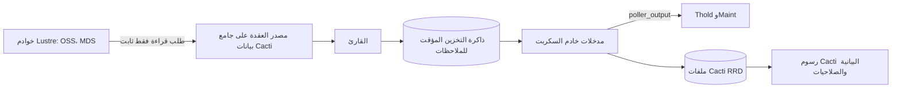

<!-- Source: README.md; SHA256: e88d6875d113220a91cfc0a9d230c829a78477b17e6aa7e44dda38c9591c86ad -->

<!-- translations:start -->
[English](../../../README.md) | [简体中文](../zh-CN/README.md) | [हिन्दी](../hi-IN/README.md) | [Español (España)](../es-ES/README.md) | [Español (Latinoamérica)](../es-419/README.md) | [العربية (السعودية)](../ar-SA/README.md) | [Afrikaans](../af-ZA/README.md) | [አማርኛ](../am-ET/README.md) | [العربية (مصر)](README.md) | [العربية (المغرب)](../ar-MA/README.md) | [বাংলা](../bn-BD/README.md) | [Bosanski](../bs-BA/README.md) | [Deutsch](../de-DE/README.md) | [فارسی](../fa-IR/README.md) | [Filipino](../fil-PH/README.md) | [Français](../fr-FR/README.md) | [Français (Maroc)](../fr-MA/README.md) | [Français (Sénégal)](../fr-SN/README.md) | [Hausa](../ha-NG/README.md) | [עברית](../he-IL/README.md) | [Hrvatski](../hr-HR/README.md) | [Bahasa Indonesia](../id-ID/README.md) | [Igbo](../ig-NG/README.md) | [Italiano](../it-IT/README.md) | [日本語](../ja-JP/README.md) | [한국어](../ko-KR/README.md) | [Malagasy](../mg-MG/README.md) | [मराठी](../mr-IN/README.md) | [Bahasa Melayu](../ms-MY/README.md) | [Nederlands](../nl-NL/README.md) | [Polski](../pl-PL/README.md) | [Português (Brasil)](../pt-BR/README.md) | [Русский](../ru-RU/README.md) | [Kinyarwanda](../rw-RW/README.md) | [Soomaali](../so-SO/README.md) | [Српски](../sr-RS/README.md) | [Svenska](../sv-SE/README.md) | [Kiswahili](../sw-KE/README.md) | [தமிழ்](../ta-IN/README.md) | [తెలుగు](../te-IN/README.md) | [ไทย](../th-TH/README.md) | [Türkçe](../tr-TR/README.md) | [Українська](../uk-UA/README.md) | [اردو](../ur-PK/README.md) | [Tiếng Việt](../vi-VN/README.md) | [isiXhosa](../xh-ZA/README.md) | [Yorùbá](../yo-NG/README.md) | [繁體中文](../zh-TW/README.md) | [isiZulu](../zu-ZA/README.md)
<!-- translations:end -->

# plugin_pfs

إضافة لـ Cacti 1.2 تنقل حالة أنظمة الملفات المتوازية وحِمل التشغيل إلى داخل Cacti: السعة وعدم توازن الامتلاء عبر الأهداف (targets)، ومعدل النقل لكل هدف، ومعدلات عمليات البيانات الوصفية (metadata). يُعد Lustre أول واجهة خلفية (backend) مدعومة، وتتبعه كل من GPFS (IBM Storage Scale) وBeeGFS عبر واجهة خلفية موحدة. تصل البيانات إلى أجهزة Cacti ومصادر البيانات والرسوم البيانية الاعتيادية، بحيث تستمر إضافتا Thold وMaint في إطلاق التنبيهات وكتمها دون أي تعديل عليهما.

> **الحالة: المرحلة الرئيسية 4 (Milestone 4)، اكتمل الكود الخاص بالمرحلة الأولى، ولم يُطرح الإصدار بعد.** اكتملت المراحل الرئيسية 2 (الأساس)، و3 (مراقبة Lustre)، و4 (التنبيهات وتجهيز الإصدار) على فرع `main` أو هي قيد المراجعة. تدعم الإضافة التثبيت والترقية وإزالة التثبيت عبر واجهة برمجة إضافات Cacti، وترفض العمل على إصدارات PHP الأقل من 8.2. يقرأ قارئ يعمل في الخلفية على كل جامع بيانات (poller) خوادم Lustre عبر SSH من خلال سكربت ثابت بأمر مفروض ([node/pfs-read.sh](../../../node/pfs-read.sh))، ويخزن مؤقتًا بيانات الجرد والحالة والسعة والعدادات مع توقيت حداثتها. يتحول كل نظام ملفات إلى جهاز Cacti مزوّد باستعلامات بيانات OST وMDT، وخمسة رسوم بيانية للنظرة العامة، ورسوم بيانية لكل هدف عند الطلب، ومصدر بيانات ملخص لإضافة Thold. تقوم إضافتا Thold v1.8.2 وMaint v1.3، دون أي تعديل، بإطلاق التنبيهات وكتمها على المقاييس الملخصة في التشغيل الشامل (end-to-end)؛ ولا تدعم Thold 1.8.2 تعيين عتبات التنبيه على العدادات ([docs/alerting.md](../../alerting.md)). جميع الاختبارات حتى الآن أجريت على مخرجات عقد تجريبية ثابتة داخل بيئة Cacti مؤقتة: ولم تعمل الإضافة بعد على عقدة Lustre حقيقية. ما زالت هناك خطوات مفتوحة قبل الإصدار: التشغيل التجريبي على أنظمة ملفات حقيقية ([خطة التجربة التشغيلية](../../pilot-plan.md))، والمراجعة الأمنية الخارجية ([المراجعة الذاتية](../../security-review.md))، وقياسات التوسع على عتاد موثق ([قياسات التوسع](../../research/scale.md)). تم تجهيز الإصدار 0.1.0 في ملف `INFO` وفي [CHANGELOG.md](../../../CHANGELOG.md) لكن لم يتم وسمه (tag) بعد.

## أدوار الوصول

| النطاق (Realm) | الصلاحيات |
| --- | --- |
| عرض نظام الملفات المتوازي (`Parallel Filesystem View`) | صفحات المراقبة الحالية. |
| مشغّل نظام الملفات المتوازي (`Parallel Filesystem Operator`) | المراقبة بالإضافة إلى صفحة العمليات وإقرارات الفرز الشخصية (triage acknowledgments). |
| مسؤول نظام الملفات المتوازي (`Parallel Filesystem Admin`) | صلاحيات المشغّل بالإضافة إلى صفحات الإعدادات الحالية والإجراءات الإدارية. |

بعد نسخ ملفات الترقية، افتح صفحة الإضافات (Plugins) بصفتك مسؤولًا لتسجيل
النطاق الجديد. خصّص نطاق المشغّل صراحةً من خلال **Configuration > Users** أو مجموعات المستخدمين.
تحتفظ الترقيات بمعرّفات ومنح نطاقي العرض (View) والمسؤول (Admin) الحالية. يرث وصول
المسؤول وصول المشغّل، ويرث وصول المشغّل وصول العرض مع كل طلب؛
ولا يضيف هذا منحًا مخزنة للمستخدمين أو المجموعات. كما تتطلب إعدادات الإضافة
صلاحية مسؤول نظام الملفات المتوازي بالإضافة إلى صلاحية الإعدادات (Settings) الخاصة بـ Cacti.

تظل صلاحيات الأجهزة في Cacti تقيّد الصفوف والإجراءات المتاحة لكل مستخدم؛ وتتطلب الكائنات غير المربوطة تدخل المسؤول.
تبقى بيانات الاعتماد والإعدادات والربط والحذف وغيرها من التغييرات الإدارية
ضمن الصفحات الإدارية. وتدوم الإقرارات في جلسة المستخدم الحالية فقط،
لمدة ساعة واحدة بحد أقصى وطالما بقيت الملاحظة نفسها حديثة. وتُبطِل الملاحظات الجديدة أو المتغيرة هذه الإقرارات.
كما أنها لا تجعل القياس الفاشل يبدو سليمًا ولا تكتم التنبيهات أبدًا.

## الدافع

عندما يصبح نظام ملفات مشترك بطيئًا، تكون الأدلة موزعة عبر الخوادم. يحتفظ Lustre بعداداته على مستوى كل عقدة: إذ يُبلغ الأمر `lctl get_param` عن القيم "على العقدة المحلية"، لذا يحتفظ كل خادم تخزين كائنات (OSS) وخادم بيانات وصفية (MDS) بأرقام أهدافه فقط. ويحتاج المشغّل الذي يحقق في بطء نظام الملفات إلى ثلاث إجابات من أماكن مختلفة:

- **هل يمتلئ أحد الأهداف بينما تبقى الأهداف الأخرى فارغة؟** يغيّر عدم توازن الامتلاء مكان وضع الملفات الجديدة وتوقيت نفاد المساحة في هدف واحد.
- **ما الأهداف أو العمليات المزدحمة؟** تُظهر عدادات البايت لكل هدف وعدادات العمليات لكل MDT ما إذا كان الحِمل ناتجًا عن نقل البيانات أم عن البيانات الوصفية.
- **هل المراقبة نفسها محدثة؟** لا يكون الرسم البياني المستقر مطمئنًا إلا إذا كانت الإضافة قادرة فعلًا على رؤية الخوادم.

يرسم Cacti بيانات المضيفين ويضع عتبات للقيم عبر Thold، ولا تحتوي منظمة Cacti على GitHub على مستودع لمراقبة Lustre أو GPFS أو BeeGFS (وفقًا لبحث بتاريخ 2026-11-14). وتسد الإضافة هذه الفجوة من خلال قراءة قيم مسموح بها وللقراءة فقط من عقد التخزين، وتمثيل كل نظام ملفات كجهاز Cacti تكون أهدافه هي فهارس استعلام بيانات (data query). وبذلك تعيد استخدام قدرات Cacti في الرسم البياني، والصلاحيات، وجامعي البيانات عن بُعد، وThold، وMaint بدلًا من بناء نسخ موازية لها.

## النطاق المخطط

| المرحلة | النطاق | المراحل الرئيسية |
|---|---|---|
| 0، البحث | مصفوفة الإصدارات، قرار الوصول إلى العقد، تأكيد سلوك المنبع (upstream)، سلوك العدادات وتجاوز الفشل، قياسات التوسع | [M1](https://github.com/somethingwithproof/plugin_pfs/milestone/1) |
| 1، المراقبة | جرد Lustre، السعة والامتلاء، معدل نقل OST، معدلات عمليات MDT، الرسوم البيانية، تنبيهات Thold، كتم Maint، صفحة الحالة | [M2](https://github.com/somethingwithproof/plugin_pfs/milestone/2)، [M3](https://github.com/somethingwithproof/plugin_pfs/milestone/3)، [M4](https://github.com/somethingwithproof/plugin_pfs/milestone/4) |
| 2، التعمق | جامعو بيانات Cacti عن بُعد، عروض على مستوى المهام (job-level) والعملاء (client-level) ضمن عدد محدود من الكائنات | [M5](https://github.com/somethingwithproof/plugin_pfs/milestone/5) |
| 3، الواجهات الخلفية | واجهتا GPFS (IBM Storage Scale) وBeeGFS | [M6](https://github.com/somethingwithproof/plugin_pfs/milestone/6) |

خارج النطاق: أي عملية كتابة أو مسح أو إعادة ضبط أو ضبط أداء على عقدة أو نظام ملفات؛ محرك تنبيهات مملوك للإضافة؛ خدمة خلفية (daemon) أو بروتوكول شبكة مخصص؛ مصادر بيانات لكل مهمة؛ أو أي تعديلات على نواة Cacti أو Thold أو Maint.

## أهداف التوافق

| المكوّن | الهدف |
|---|---|
| Cacti | 1.2.31 أو أحدث، بدون تعديلات (patches) على النواة |
| PHP | 8.2 أو أحدث؛ يظل ملف `setup.php` قابلًا للتحليل على 8.0 بحيث يحصل وقت التشغيل غير المدعوم على رسالة رفض بدلًا من تعطل واجهة Cacti |
| Lustre | خطوط الإصدار التي ستُحدد في المرحلة الرئيسية 1؛ المصادر والأدلة التي تم التحقق منها حتى الآن عند الإصدار 2.17.0 |
| GPFS، BeeGFS | المرحلة 3؛ ستُحدد الإصدارات بناءً على البحث |
| Thold، Maint | لا يتطلبان أي تعديلات |

## التصميم

- [docs/PLAN.md](../../PLAN.md) هي الخطة الكاملة: البنية المعمارية، وحقائق المنبع التي تعتمد عليها (مع المصادر وما لم يُتحقق منه بعد)، ودلالات العدادات، ونموذج الحالة، والحدود الأمنية، وحسابات الأداء، والاختبار، والمخاطر.
- [docs/operator-guide.md](../../operator-guide.md) يغطي التثبيت، والرسوم البيانية والقيم، والترقية، والنسخ الاحتياطي والاستعادة، وإزالة التثبيت، واستكشاف الأخطاء وإصلاحها؛ بينما يغطي [docs/alerting.md](../../alerting.md) إضافتي Thold وMaint.
- [docs/node-setup.md](../../node-setup.md) يوضح كيفية تجهيز خادم Lustre وجامع بيانات (poller) لعمل القارئ.
- [docs/decisions/](../../decisions) يضم سجلات القرارات المعمارية (ADRs) للخيارات التي تم حسمها بالفعل.
- [docs/REQUIREMENTS.md](../../REQUIREMENTS.md) يربط كل معرّف متطلب (requirement ID) بالبلاغ (issue) الخاص به.

## آلية تتبع العمل

- **المراحل الرئيسية (Milestones)** تتبع مراحل الخطة. ولكل منها بلاغ رئيسي (epic issue) يسرد البلاغات الفرعية وأدلة الإتمام.
- **البلاغات (Issues)** مصنّفة بالتسميات: `type: requirement`، و`type: research`، و`type: decision`، و`type: epic`. وتنص بلاغات المتطلبات على متطلبات مرقّمة وقابلة للاختبار (`REQ-AREA-NNN`) ومعايير القبول.
- **التسميات (Labels)** تحمل أيضًا البادئات `area:` و`phase:` و`priority:` و`status:`. راجع [CONTRIBUTING.md](../../../CONTRIBUTING.md#labels).
- تعرض [لوحة المشروع](https://github.com/users/somethingwithproof/projects/11) جميع البلاغات عبر المراحل الرئيسية.

## المساهمة

اقرأ [CONTRIBUTING.md](../../../CONTRIBUTING.md). تتطلب الإيداعات (commits) توقيع DCO (`sign-off`). وتجري نقاشات التصميم ضمن البلاغات؛ وتحمل القرارات المفتوحة التسمية `type: decision`.

## الأمان

أبلغ عن الثغرات الأمنية بشكل خاص؛ راجع [SECURITY.md](../../../SECURITY.md).

## الترخيص

رخصة جنو العمومية الإصدار 2.0 (GNU General Public License v2.0)، وهي الرخصة نفسها المستخدمة في Cacti وإضافاته. راجع [LICENSE](../../../LICENSE).
