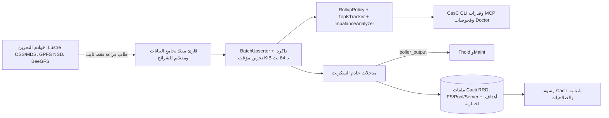

<!-- Source: README.md; SHA256: e88d6875d113220a91cfc0a9d230c829a78477b17e6aa7e44dda38c9591c86ad -->

<!-- translations:start -->
[English](../../../README.md) | [简体中文](../zh-CN/README.md) | [हिन्दी](../hi-IN/README.md) | [Español (España)](../es-ES/README.md) | [Español (Latinoamérica)](../es-419/README.md) | [العربية (السعودية)](../ar-SA/README.md) | [Afrikaans](../af-ZA/README.md) | [አማርኛ](../am-ET/README.md) | [العربية (مصر)](README.md) | [العربية (المغرب)](../ar-MA/README.md) | [বাংলা](../bn-BD/README.md) | [Bosanski](../bs-BA/README.md) | [Deutsch](../de-DE/README.md) | [فارسی](../fa-IR/README.md) | [Filipino](../fil-PH/README.md) | [Français](../fr-FR/README.md) | [Français (Maroc)](../fr-MA/README.md) | [Français (Sénégal)](../fr-SN/README.md) | [Hausa](../ha-NG/README.md) | [עברית](../he-IL/README.md) | [Hrvatski](../hr-HR/README.md) | [Bahasa Indonesia](../id-ID/README.md) | [Igbo](../ig-NG/README.md) | [Italiano](../it-IT/README.md) | [日本語](../ja-JP/README.md) | [한국어](../ko-KR/README.md) | [Malagasy](../mg-MG/README.md) | [मराठी](../mr-IN/README.md) | [Bahasa Melayu](../ms-MY/README.md) | [Nederlands](../nl-NL/README.md) | [Polski](../pl-PL/README.md) | [Português (Brasil)](../pt-BR/README.md) | [Русский](../ru-RU/README.md) | [Kinyarwanda](../rw-RW/README.md) | [Soomaali](../so-SO/README.md) | [Српски](../sr-RS/README.md) | [Svenska](../sv-SE/README.md) | [Kiswahili](../sw-KE/README.md) | [தமிழ்](../ta-IN/README.md) | [తెలుగు](../te-IN/README.md) | [ไทย](../th-TH/README.md) | [Türkçe](../tr-TR/README.md) | [Українська](../uk-UA/README.md) | [اردو](../ur-PK/README.md) | [Tiếng Việt](../vi-VN/README.md) | [isiXhosa](../xh-ZA/README.md) | [Yorùbá](../yo-NG/README.md) | [繁體中文](../zh-TW/README.md) | [isiZulu](../zu-ZA/README.md)
<!-- translations:end -->

# plugin_pfs

إضافة لـ Cacti 1.2 تنقل حالة أنظمة الملفات المتوازية وسعتها وعدم توازن الامتلاء ومعدل النقل لكل هدف ومعدلات عمليات البيانات الوصفية إلى Cacti عبر Lustre وIBM Storage Scale (GPFS) وBeeGFS خلف واجهة `Backend` موحدة. يُمثَّل كل نظام ملفات كجهاز Cacti اعتيادي مزوّد باستعلامات بيانات ورسوم بيانية عامة ورسوم أهداف عند الطلب ومقاييس ملخصة بحيث تستمر إضافتا Thold وMaint في إطلاق التنبيهات وكتمها دون أي تعديل.

> **الحالة: المراحل من 1 إلى 3 وأوليات التوسع لمستوى الإكساسكيل منفذة في الشيفرة، ولم تُطرح بعد.** الأساس، ومراقبة Lustre، والتنبيه وكتم Maint، ومشغّلات القراءة فقط لـ GPFS وBeeGFS، وتحليل عدم توازن OST/MDT مع تكامل Maint، وتحديد نطاق جامع البيانات عن بُعد (`replicate_out`، `remote_agent`)، وأوليات التوسع لأكثر من 100 PB / الإكساسكيل (`FramedReportParser`، المخطط v4 `value_kib`، `RollupPolicy`، `TopKTracker`، `ShardAssigner`، `BatchUpserter`)، وواجهة سطر أوامر المشغّل CasC (`cli/pfs.php`)، وخطافات المنظومة (`abilities_register`، `doctor_register_checks`، `casc_register_providers`) كلها منفذة ومُتحقق منها باختبارات الوحدة والأمان واختبارات التكامل على بيئة Cacti مؤقتة. جميع التشغيلات حتى الآن تستخدم مخرجات عقد تجريبية بدلًا من عتاد Lustre أو GPFS أو BeeGFS حقيقي. ما زال مفتوحًا قبل وسم الإصدار: التشغيل التجريبي على أنظمة ملفات حقيقية ([خطة التجربة التشغيلية](../../pilot-plan.md))، والمراجعة الأمنية الخارجية ([المراجعة الذاتية](../../security-review.md))، وقياسات التوسع على عتاد موثق ([قياسات التوسع](../../research/scale.md)). تم تجهيز الإصدار 0.1.0 في ملف `INFO` وفي [CHANGELOG.md](../../../CHANGELOG.md) لكنه لم يُوسم بعد.

## أدوار الوصول

| النطاق (Realm) | الصلاحيات |
| --- | --- |
| عرض نظام الملفات المتوازي (`Parallel Filesystem View`) | صفحات المراقبة الحالية. |
| مشغّل نظام الملفات المتوازي (`Parallel Filesystem Operator`) | المراقبة بالإضافة إلى صفحة العمليات وإقرارات الفرز الشخصية (triage acknowledgments). |
| مسؤول نظام الملفات المتوازي (`Parallel Filesystem Admin`) | صلاحيات المشغّل بالإضافة إلى صفحات الإعدادات الحالية والإجراءات الإدارية. |

بعد نسخ ملفات الترقية، افتح صفحة الإضافات (Plugins) بصفتك مسؤولًا لتسجيل
النطاق الجديد. خصّص نطاق المشغّل صراحةً من خلال **Configuration > Users** أو مجموعات المستخدمين.
تحتفظ الترقيات بمعرّفات ومنح نطاقي العرض (View) والمسؤول (Admin) الحالية. يرث وصول
المسؤول وصول المشغّل، ويرث وصول المشغّل وصول العرض مع كل طلب؛
ولا يضيف هذا منحًا مخزنة للمستخدمين أو المجموعات. كما تتطلب إعدادات الإضافة
صلاحية مسؤول نظام الملفات المتوازي بالإضافة إلى صلاحية الإعدادات (Settings) الخاصة بـ Cacti.

تظل صلاحيات الأجهزة في Cacti تقيّد الصفوف والإجراءات المتاحة لكل مستخدم؛ وتتطلب الكائنات غير المربوطة تدخل المسؤول.
تبقى بيانات الاعتماد والإعدادات والربط والحذف وغيرها من التغييرات الإدارية
ضمن الصفحات الإدارية. وتدوم الإقرارات في جلسة المستخدم الحالية فقط،
لمدة ساعة واحدة بحد أقصى وطالما بقيت الملاحظة نفسها حديثة. وتُبطِل الملاحظات الجديدة أو المتغيرة هذه الإقرارات.
كما أنها لا تجعل القياس الفاشل يبدو سليمًا ولا تكتم التنبيهات أبدًا.

## الدافع

عندما يصبح نظام ملفات مشترك بطيئًا، تكون الأدلة موزعة عبر الخوادم. يحتفظ Lustre بعداداته على مستوى كل عقدة: إذ يُبلغ الأمر `lctl get_param` عن القيم "على العقدة المحلية"، لذا يحتفظ كل خادم تخزين كائنات (OSS) وخادم بيانات وصفية (MDS) بأرقام أهدافه فقط. ويحتاج المشغّل الذي يحقق في بطء نظام الملفات إلى ثلاث إجابات من أماكن مختلفة:

- **هل يمتلئ أحد الأهداف بينما تبقى الأهداف الأخرى فارغة؟** يغيّر عدم توازن الامتلاء مكان وضع الملفات الجديدة وتوقيت نفاد المساحة في هدف واحد.
- **ما الأهداف أو العمليات المزدحمة؟** تُظهر عدادات البايت لكل هدف وعدادات العمليات لكل MDT ما إذا كان الحِمل ناتجًا عن نقل البيانات أم عن البيانات الوصفية.
- **هل المراقبة نفسها محدثة؟** لا يكون الرسم البياني المستقر مطمئنًا إلا إذا كانت الإضافة قادرة فعلًا على رؤية الخوادم.

يرسم Cacti بيانات المضيفين ويضع عتبات للقيم عبر Thold، ولا تحتوي منظمة Cacti على GitHub على مستودع لمراقبة Lustre أو GPFS أو BeeGFS (وفقًا لبحث بتاريخ 2026-11-14). وتسد الإضافة هذه الفجوة من خلال قراءة قيم مسموح بها وللقراءة فقط من عقد التخزين، وتمثيل كل نظام ملفات كجهاز Cacti تكون أهدافه هي فهارس استعلام بيانات (data query). وبذلك تعيد استخدام قدرات Cacti في الرسم البياني، والصلاحيات، وجامعي البيانات عن بُعد، وThold، وMaint بدلًا من بناء نسخ موازية لها.

## النطاق المخطط

| المرحلة | النطاق | الحالة | المراحل الرئيسية |
|---|---|---|---|
| 0، البحث | مصفوفة الإصدارات، قرار الوصول إلى العقد، تأكيد سلوك المنبع (upstream)، سلوك العدادات وتجاوز الفشل، قياسات التوسع | مكتملة | [M1](https://github.com/somethingwithproof/plugin_pfs/milestone/1) |
| 1، المراقبة | جرد Lustre، السعة والامتلاء، عدم توازن OST/MDT (`lib/ImbalanceAnalyzer.php`)، تكامل Maint (`lib/HealthPage.php`)، معدل نقل OST، معدلات عمليات MDT، الرسوم البيانية، تنبيهات Thold، صفحة الحالة | منفذة (مختبرة بعينات تجريبية) | [M2](https://github.com/somethingwithproof/plugin_pfs/milestone/2)، [M3](https://github.com/somethingwithproof/plugin_pfs/milestone/3)، [M4](https://github.com/somethingwithproof/plugin_pfs/milestone/4) |
| 2، البعيد والتوسع | الجمع البعيد على مستوى جامع البيانات (`lib/Reader.php`، `lib/ReplicationRepository.php`، `replicate_out`، `remote_agent`)، أوليات التوسع لأكثر من 100 PB (ضبط KiB بـ 64 بت + المخطط v4 `value_kib`، `lib/RollupPolicy.php`، `lib/TopKTracker.php`، `lib/ShardAssigner.php` + `poller_pfs.php --shard=K/N`، `lib/BatchUpserter.php`)، واجهة سطر أوامر CasC (`cli/pfs.php`)، خطافات MCP/Doctor/CasC | منفذة (مختبرة بالوحدة والتكامل في CI) | [M5](https://github.com/somethingwithproof/plugin_pfs/milestone/5) |
| 3، الواجهات الخلفية | مشغّلات القراءة فقط لـ IBM Storage Scale (GPFS) (`lib/GpfsBackend.php`) وBeeGFS (`lib/BeegfsBackend.php`) المسجلة في `BackendRegistry::production()` | منفذة (مختبرة بالوحدة) | [M6](https://github.com/somethingwithproof/plugin_pfs/milestone/6) |

أهم أوليات التشغيل والتوسع المنفذة:

- **مشغّلات قراءة فقط متعددة الأنظمة:** `LustreBackend` و`GpfsBackend` (`mmpmon` `fs_io_s`/`io_s` المؤطّر فقط مع حظر `reset`، وسعة/حالات تجمعات `mmdf` وملخصات المنتظرين) و`BeegfsBackend` (أهداف التخزين والبيانات الوصفية لـ BeeGFS 7.4 و8.x مع تحويل دقيق من بايت إلى KiB وتعيين حالات الوصول والاتساق ودلالات القياس لكل فترة) تشترك في `lib/FramedReportParser.php`.
- **عدم التوازن والهامش المتاح والوعي بـ Maint:** يحسب `lib/ImbalanceAnalyzer.php` نسب امتلاء OST/MDT والتشتت ومؤشر عدم توازن الانحراف المعياري للمجتمع والهامش المتاح وفرض حداثة فترة واحدة (`missing_targets`) وأعلام حالة كل هدف وأعلى K أهداف منحرفة محدودة. ويعرض `HealthPage` (`pfs_health.php`) و`CascProvider::health()` نوافذ صيانة `Maint` في Cacti ويكتمان تحذيرات الأعطال النشطة أثناء الصيانة المجدولة.
- **التوسع لأكثر من 100 PB والإكساسكيل** ([docs/architecture/exascale-scaling.md](../../architecture/exascale-scaling.md)): التحويل العشري الدقيق من بايت إلى KiB (`FramedReportParser::bytesToKibInt()`) المُتحقق منه عند 500 PB و2 EB إلى جانب أعمدة `BIGINT UNSIGNED value_kib` (المخطط v4)؛ وتجميعات RRD الهرمية `Filesystem -> Pool -> Storage Server` مع ترقية محدودة للأهداف الاختيارية أو الساخنة أو المنحرفة (`lib/RollupPolicy.php`)؛ وأهداف Top-K المنحرفة المحدودة بتعقيد $O(K)$ وملخصات المهام/العملاء الثقيلة المجمّعة مسبقًا (`lib/TopKTracker.php`، دون إنشاء أجهزة أو ملفات RRD لكل عميل)؛ وتقسيم جامعي البيانات الحتمي عبر CRC32 (`lib/ShardAssigner.php`، `php plugins/pfs/poller_pfs.php [--poller=N] [--shard=K/N] [--force] [--debug]`)؛ وإدراجات SQL الدفعية من 500 صف مع ترقيم الصفحات بالمفاتيح (`lib/BatchUpserter.php`، `CacheRepository::upsertObservationsBatch()`، `TargetRepository::forFilesystemPage()`).
- **واجهة CasC للمشغّل وخطافات المنظومة:** يدعم `cli/pfs.php` الأوامر `export [--format=yaml|xml]` و`validate <file> [--format=yaml|xml]` و`plan <file> [--format=yaml|xml] [--output=text|json]` و`apply <file> --confirm=<PLAN_HASH> [--format=yaml|xml]` و`health [--format=text|json]` بدون أي تبعيات Composer خارجية. ويسجل `setup.php` و`lib/EcosystemIntegration.php` كلًا من `abilities_register` (`pfs-list-filesystems`، `pfs-get-imbalance`، `pfs-get-health`؛ للقراءة فقط، ومقيدة بصلاحية `Parallel Filesystem View` وصلاحيات أجهزة Cacti) و`doctor_register_checks` (`pfs_schema`، `pfs_reader_freshness`، `pfs_capacity_imbalance`) و`casc_register_providers` و`replicate_out` و`remote_agent`.

خارج النطاق: أي عملية كتابة أو مسح أو إعادة ضبط أو ضبط أداء على عقدة أو نظام ملفات؛ محرك تنبيهات مملوك للإضافة؛ خدمة خلفية (daemon) أو بروتوكول شبكة مخصص؛ أجهزة أو ملفات RRD في Cacti لكل مهمة أو لكل عميل؛ أو أي تعديلات على نواة Cacti أو Thold أو Maint.

## أهداف التوافق

| المكوّن | الهدف |
|---|---|
| Cacti | 1.2.31 أو أحدث، بدون تعديلات (patches) على النواة |
| PHP | 8.2 أو أحدث؛ يظل `setup.php` و`poller_pfs.php` و`cli/pfs.php` قابلة للتحليل على 8.0 بحيث يحصل وقت التشغيل غير المدعوم على رسالة رفض بدلًا من تعطل واجهة Cacti |
| Lustre | تم فحص المصدر والأدلة عند الإصدار 2.17.0؛ مختبر بعينات تجريبية |
| GPFS، BeeGFS | مشغّلات القراءة فقط لـ IBM Storage Scale (GPFS) 5.x `mmpmon`/`mmdf` وBeeGFS 7.4 / 8.x منفذة ومختبرة بعينات تجريبية |
| Thold، Maint | Thold 1.8.2 وMaint 1.3، بدون أي تعديلات |

## التصميم

- يوثق [docs/architecture/exascale-scaling.md](../../architecture/exascale-scaling.md) بنية القياس عن بُعد ذات الطبقتين لـ 100+ PB / الإكساسكيل (طبقة خادم Cacti/`plugin_pfs` + التجميع + Top-K مقترنة بقياس عملاء خارج النطاق عبر LDMS/Darshan/TOKIO) وسياقها في الأدبيات الأكاديمية.
- [docs/PLAN.md](../../PLAN.md) هي الخطة الكاملة: البنية المعمارية، وحقائق المنبع التي تعتمد عليها (مع المصادر وما لم يُتحقق منه بعد)، ودلالات العدادات، ونموذج الحالة، والحدود الأمنية، وحسابات الأداء، والاختبار، والمخاطر.
- [docs/operator-guide.md](../../operator-guide.md) يغطي التثبيت، والرسوم البيانية والقيم، والترقية، والنسخ الاحتياطي والاستعادة، وإزالة التثبيت، واستكشاف الأخطاء وإصلاحها؛ بينما يغطي [docs/alerting.md](../../alerting.md) إضافتي Thold وMaint.
- [docs/node-setup.md](../../node-setup.md) يوضح كيفية تجهيز خادم Lustre وجامع بيانات (poller) لعمل القارئ.
- [docs/decisions/](../../decisions) يضم سجلات القرارات المعمارية (ADRs) للخيارات التي تم حسمها بالفعل.
- [docs/REQUIREMENTS.md](../../REQUIREMENTS.md) يربط كل معرّف متطلب (requirement ID) بالبلاغ (issue) الخاص به.

## آلية تتبع العمل

- **المراحل الرئيسية (Milestones)** تتبع مراحل الخطة. ولكل منها بلاغ رئيسي (epic issue) يسرد البلاغات الفرعية وأدلة الإتمام.
- **البلاغات (Issues)** مصنّفة بالتسميات: `type: requirement`، و`type: research`، و`type: decision`، و`type: epic`. وتنص بلاغات المتطلبات على متطلبات مرقّمة وقابلة للاختبار (`REQ-AREA-NNN`) ومعايير القبول.
- **التسميات (Labels)** تحمل أيضًا البادئات `area:` و`phase:` و`priority:` و`status:`. راجع [CONTRIBUTING.md](../../../CONTRIBUTING.md#labels).
- تعرض [لوحة المشروع](https://github.com/users/somethingwithproof/projects/11) جميع البلاغات عبر المراحل الرئيسية.

## المساهمة

اقرأ [CONTRIBUTING.md](../../../CONTRIBUTING.md). تتطلب الإيداعات (commits) توقيع DCO (`sign-off`). وتجري نقاشات التصميم ضمن البلاغات؛ وتحمل القرارات المفتوحة التسمية `type: decision`.

## الأمان

أبلغ عن الثغرات الأمنية بشكل خاص؛ راجع [SECURITY.md](../../../SECURITY.md).

## الترخيص

رخصة جنو العمومية الإصدار 2.0 (GNU General Public License v2.0)، وهي الرخصة نفسها المستخدمة في Cacti وإضافاته. راجع [LICENSE](../../../LICENSE).
