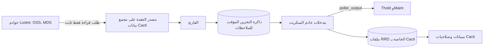

<!-- Source: README.md; SHA256: 40f2c5a5e9be97e4bd2b05a9ebab2a77de51de3af1b1c21dbeb5ee7f936cdd3b -->

<!-- translations:start -->
[English](../../../README.md) | [简体中文](../zh-CN/README.md) | [हिन्दी](../hi-IN/README.md) | [Español (España)](../es-ES/README.md) | [Español (Latinoamérica)](../es-419/README.md) | [العربية (السعودية)](../ar-SA/README.md) | [Afrikaans](../af-ZA/README.md) | [አማርኛ](../am-ET/README.md) | [العربية (مصر)](../ar-EG/README.md) | [العربية (المغرب)](README.md) | [বাংলা](../bn-BD/README.md) | [Bosanski](../bs-BA/README.md) | [Deutsch](../de-DE/README.md) | [فارسی](../fa-IR/README.md) | [Filipino](../fil-PH/README.md) | [Français](../fr-FR/README.md) | [Français (Maroc)](../fr-MA/README.md) | [Français (Sénégal)](../fr-SN/README.md) | [Hausa](../ha-NG/README.md) | [עברית](../he-IL/README.md) | [Hrvatski](../hr-HR/README.md) | [Bahasa Indonesia](../id-ID/README.md) | [Igbo](../ig-NG/README.md) | [Italiano](../it-IT/README.md) | [日本語](../ja-JP/README.md) | [한국어](../ko-KR/README.md) | [Malagasy](../mg-MG/README.md) | [मराठी](../mr-IN/README.md) | [Bahasa Melayu](../ms-MY/README.md) | [Nederlands](../nl-NL/README.md) | [Polski](../pl-PL/README.md) | [Português (Brasil)](../pt-BR/README.md) | [Русский](../ru-RU/README.md) | [Kinyarwanda](../rw-RW/README.md) | [Soomaali](../so-SO/README.md) | [Српски](../sr-RS/README.md) | [Svenska](../sv-SE/README.md) | [Kiswahili](../sw-KE/README.md) | [தமிழ்](../ta-IN/README.md) | [తెలుగు](../te-IN/README.md) | [ไทย](../th-TH/README.md) | [Türkçe](../tr-TR/README.md) | [Українська](../uk-UA/README.md) | [اردو](../ur-PK/README.md) | [Tiếng Việt](../vi-VN/README.md) | [isiXhosa](../xh-ZA/README.md) | [Yorùbá](../yo-NG/README.md) | [繁體中文](../zh-TW/README.md) | [isiZulu](../zu-ZA/README.md)
<!-- translations:end -->

# plugin_pfs

إضافة لـ Cacti 1.2 تتيح إدماج حالة أنظمة الملفات المتوازية وحمولتها داخل Cacti: السعة وعدم توازن الامتلاء عبر الأهداف، والإنتاجية لكل هدف، ومعدلات عمليات البيانات الوصفية (metadata). يُعد Lustre أول خلفية (backend) مدعومة، وتليه خلفيتا GPFS (IBM Storage Scale) وBeeGFS عبر واجهة خلفيات موحدة. وتصل البيانات إلى أجهزة Cacti العادية، ومصادر البيانات، والمبيانات، بحيث تتولى إضافتا Thold وMaint التنبيه بشأنها وكتم التنبيهات دون أي تعديل عليهما.

> **الحالة: المعلم 4، الشيفرة مكتملة للمرحلة 1، ولم يُطلق الإصدار بعد.** تم إنجاز المعالم 2 (الأساس)، و3 (مراقبة Lustre)، و4 (التنبيه والتحضير للإطلاق) على الفرع `main` أو هي قيد المراجعة. تدعم الإضافة التثبيت والترقية وإزالة التثبيت عبر واجهة برمجة إضافات Cacti وترفض أي إصدار PHP أقل من 8.2. يقوم قارئ في الخلفية على كل مجمّع بيانات (poller) بقراءة خوادم Lustre عبر SSH من خلال سكربت أمر مفروض ثابت ([node/pfs-read.sh](../../../node/pfs-read.sh))، ويخزن الجرد والحالة والسعة والعدادات مؤقتاً مع حداثة بياناتها. يصبح كل نظام ملفات جهازاً داخل Cacti مع استعلامات بيانات OST وMDT، وخمسة مبيانات للنظرة العامة، ومبيانات لكل هدف عند الطلب، ومصدر بيانات ملخص لإضافة Thold. وتقوم إضافتا Thold v1.8.2 وMaint v1.3، دون تعديل، بالتنبيه على المقاييس الملخصة وكتمها في التشغيل الشامل (end-to-end)؛ غير أن عتبات Thold على العدادات غير مدعومة مع Thold 1.8.2 ([docs/alerting.md](../../alerting.md)). جميع الاختبارات حتى الآن تُنفذ على مخرجات عقد تجريبية (fixtures) ضمن بيئة Cacti مؤقتة: لم يسبق تشغيل الإضافة على عقدة Lustre حقيقية. وما زال مفتوحاً قبل الإطلاق: التجارب الميدانية على أنظمة ملفات حقيقية ([خطة التجريب الميداني](../../pilot-plan.md))، والمراجعة الأمنية الخارجية ([المراجعة الذاتية](../../security-review.md))، وقياسات قابلية التوسع على عتاد موثق ([قياسات قابلية التوسع](../../research/scale.md)). تم تحضير الإصدار 0.1.0 في `INFO` و[CHANGELOG.md](../../../CHANGELOG.md) لكنه لم يُوسَم (tag) بعد.

## أدوار الوصول

| النطاق | صلاحية الوصول |
| --- | --- |
| عرض نظام الملفات المتوازي (Parallel Filesystem View) | صفحات المراقبة الحالية. |
| مشغل نظام الملفات المتوازي (Parallel Filesystem Operator) | المراقبة بالإضافة إلى صفحة العمليات وإقرارات الفرز الشخصية (personal triage acknowledgments). |
| مدير نظام الملفات المتوازي (Parallel Filesystem Admin) | صلاحية المشغل بالإضافة إلى الإعدادات الحالية والإجراءات الإدارية. |

بعد نسخ ملفات الترقية، افتح صفحة الإضافات بصفتك مديراً لتسجيل
النطاق الجديد. وامنح نطاق المشغل (Operator) صراحةً ضمن **Configuration > Users** أو مجموعات المستخدمين.
تحافظ الترقيات على معرفات ومنح نطاقي العرض (View) والمدير (Admin) الحالية. يرث وصول المدير
وصول المشغل، ويرث وصول المشغل وصول العرض في كل طلب؛
ولا يضيف ذلك منحاً مخزنة إلى المستخدمين أو المجموعات. كما تتطلب إعدادات الإضافة
وصول Parallel Filesystem Admin بالإضافة إلى صلاحية الإعدادات (Settings) في Cacti.

تظل صلاحيات أجهزة Cacti تحد من الصفوف والإجراءات المتاحة لكل مستخدم؛ وتتطلب الكائنات غير المربوطة تدخل المدير.
وتبقى بيانات الاعتماد والإعدادات والربط والحذف وغيرها من التغييرات الإدارية
في الصفحات الإدارية. تدوم الإقرارات في جلسة المستخدم
الحالي فقط، لمدة ساعة واحدة كحد أقصى وفقط ما دامت الملاحظة نفسها
حديثة. وتبطلها أي ملاحظات جديدة أو متغيرة، كما أنها لا تجعل أبداً القياس الفاشل
سليماً ولا تكتم التنبيهات.

## لماذا هذه الإضافة

عندما يصبح نظام ملفات مشترك بطيئاً، تكون الأدلة موزعة عبر الخوادم. يحتفظ Lustre بعداداته على مستوى كل عقدة: يُبلغ الأمر `lctl get_param` عن القيم «على العقدة المحلية»، ولذلك يمتلك كل خادم تخزين كائنات (OSS) وخادم بيانات وصفية (MDS) أرقام أهدافه فقط. ويحتاج المشغل الذي يحقق في بطء نظام الملفات إلى ثلاث إجابات من أماكن مختلفة:

- **هل يمتلئ أحد الأهداف بينما تبقى أخرى فارغة؟** يغيّر عدم توازن الامتلاء مكان استقرار الملفات الجديدة وتوقيت نفاد المساحة في هدف واحد.
- **ما الأهداف أو العمليات المشغولة؟** تُظهر عدادات البايتات لكل هدف وعدادات العمليات لكل MDT ما إذا كان الحمل ناتجاً عن البيانات أم عن البيانات الوصفية.
- **هل المراقبة نفسها محدثة؟** لا يكون المبيان المستقر مطمئناً إلا إذا كانت الإضافة قادرة على رؤية الخوادم.

يرسم Cacti مبيانات المضيفات ويحدد عتبات القيم عبر Thold، ولا تتوفر لدى منظمة Cacti على GitHub أي مستودع لمراقبة Lustre أو GPFS أو BeeGFS (تم البحث في 2026-11-14). تسد هذه الإضافة تلك الفجوة عبر قراءة قيم مسموح بها وللقراءة فقط من عقد التخزين وتمثيل كل نظام ملفات كجهاز Cacti تكون أهدافه فهارس لاستعلام بيانات. وهي تعيد استخدام مبيانات Cacti، وصلاحياته، ومجمعات البيانات البعيدة، وThold، وMaint بدلاً من بناء بدائل موازية لها.

## النطاق المخطط له

| المرحلة | النطاق | المعالم |
|---|---|---|
| 0، البحث | مصفوفة الإصدارات، قرار الوصول إلى العقد، تأكيد سلوك المنبع (upstream)، سلوك العدادات وتجاوز الفشل، قياسات قابلية التوسع | [M1](https://github.com/somethingwithproof/plugin_pfs/milestone/1) |
| 1، المراقبة | جرد Lustre، السعة والامتلاء، إنتاجية OST، معدلات عمليات MDT، المبيانات، تنبيهات Thold، كتم Maint، صفحة الحالة الصحية | [M2](https://github.com/somethingwithproof/plugin_pfs/milestone/2), [M3](https://github.com/somethingwithproof/plugin_pfs/milestone/3), [M4](https://github.com/somethingwithproof/plugin_pfs/milestone/4) |
| 2، التعمق | مجمعات البيانات البعيدة في Cacti، عروض على مستوى المهام (job-level) والعملاء (client-level) ضمن عدد محدود من الكائنات | [M5](https://github.com/somethingwithproof/plugin_pfs/milestone/5) |
| 3، الخلفيات | خلفيات GPFS (IBM Storage Scale) وBeeGFS | [M6](https://github.com/somethingwithproof/plugin_pfs/milestone/6) |

خارج النطاق: أي عملية كتابة أو مسح أو إعادة ضبط أو توليف (tuning) على عقدة أو نظام ملفات؛ أو محرك تنبيهات مملوك للإضافة؛ أو خدمة خفية (daemon) مخصصة أو بروتوكول شبكة مخصص؛ أو مصادر بيانات لكل مهمة؛ أو تعديلات على نواة Cacti أو Thold أو Maint.

## أهداف التوافق

| المكون | الهدف |
|---|---|
| Cacti | 1.2.31 أو أحدث، دون أي رقع (patches) للنواة |
| PHP | 8.2 أو أحدث؛ يبقى الملف `setup.php` قابلاً للتحليل على PHP 8.0 بحيث تحصل بيئة التشغيل غير المدعومة على رفض واضح بدلاً من تعطّل واجهة Cacti |
| Lustre | خطوط الإصدارات التي سيحددها المعلم 1؛ المصادر والأدلة التي تم التحقق منها حتى الآن عند الإصدار 2.17.0 |
| GPFS, BeeGFS | المرحلة 3؛ ستُحدد الإصدارات بناءً على البحث |
| Thold, Maint | لا تتطلب أي تغييرات |

## التصميم

- يضم [docs/PLAN.md](../../PLAN.md) الخطة الكاملة: البنية المعمارية، وحقائق المنبع التي تعتمد عليها (مع المصادر وما لم يُتحقق منه بعد)، ودلالات العدادات، ونموذج الحالة، والحدود الأمنية، وحسابات الأداء، والاختبار، والمخاطر.
- يغطي [docs/operator-guide.md](../../operator-guide.md) التثبيت، والمبيانات والقيم، والترقية، والنسخ الاحتياطي والاستعادة، وإزالة التثبيت، واستكشاف الأخطاء وإصلاحها؛ كما يغطي [docs/alerting.md](../../alerting.md) إضافتي Thold وMaint.
- يصف [docs/node-setup.md](../../node-setup.md) كيفية تهيئة خادم Lustre ومجمع بيانات لعمل القارئ.
- يحتوي [docs/decisions/](../../decisions) على سجلات القرارات المعمارية للخيارات المتخذة بالفعل.
- يربط [docs/REQUIREMENTS.md](../../REQUIREMENTS.md) كل معرف متطلب بقضيته (issue) المقابلة.

## كيفية تتبع العمل

- **المعالم (Milestones)** تتبع معالم الخطة. ولكل معلم قضية رئيسية (epic) تسرد قضاياه الفرعية وأدلة الإنجاز.
- **القضايا (Issues)** مصنفة حسب التسمية: `type: requirement`، و`type: research`، و`type: decision`، و`type: epic`. وتنص قضايا المتطلبات على متطلبات مرقمة وقابلة للاختبار (`REQ-AREA-NNN`) ومعايير قبول.
- **التسميات (Labels)** تحمل أيضاً `area:` و`phase:` و`priority:` و`status:`. راجع [CONTRIBUTING.md](../../../CONTRIBUTING.md#labels).
- تعرض [لوحة المشروع](https://github.com/users/somethingwithproof/projects/11) جميع القضايا عبر المعالم.

## المساهمة

اقرأ [CONTRIBUTING.md](../../../CONTRIBUTING.md). تتطلب الإيداعات (commits) توقيع DCO sign-off. تجري مناقشات التصميم في القضايا؛ وتحمل القرارات المفتوحة التسمية `type: decision`.

## الأمان

أبلغ عن الثغرات الأمنية بشكل خاص؛ راجع [SECURITY.md](../../../SECURITY.md).

## الترخيص

رخصة GNU العمومية الإصدار 2.0 (GNU General Public License v2.0)، وهي نفس رخصة Cacti وإضافاته. راجع [LICENSE](../../../LICENSE).
