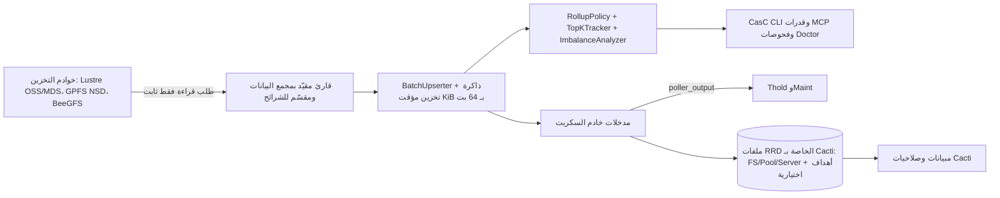

<!-- Source: README.md; SHA256: e88d6875d113220a91cfc0a9d230c829a78477b17e6aa7e44dda38c9591c86ad -->

<!-- translations:start -->
[English](../../../README.md) | [简体中文](../zh-CN/README.md) | [हिन्दी](../hi-IN/README.md) | [Español (España)](../es-ES/README.md) | [Español (Latinoamérica)](../es-419/README.md) | [العربية (السعودية)](../ar-SA/README.md) | [Afrikaans](../af-ZA/README.md) | [አማርኛ](../am-ET/README.md) | [العربية (مصر)](../ar-EG/README.md) | [العربية (المغرب)](README.md) | [Български](../bg-BG/README.md) | [বাংলা](../bn-BD/README.md) | [Bosanski](../bs-BA/README.md) | [Deutsch](../de-DE/README.md) | [Ελληνικά](../el-GR/README.md) | [فارسی](../fa-IR/README.md) | [Filipino](../fil-PH/README.md) | [Français](../fr-FR/README.md) | [Français (Maroc)](../fr-MA/README.md) | [Français (Sénégal)](../fr-SN/README.md) | [Hausa](../ha-NG/README.md) | [עברית](../he-IL/README.md) | [Hrvatski](../hr-HR/README.md) | [Bahasa Indonesia](../id-ID/README.md) | [Igbo](../ig-NG/README.md) | [Italiano](../it-IT/README.md) | [日本語](../ja-JP/README.md) | [ქართული](../ka-GE/README.md) | [한국어](../ko-KR/README.md) | [Latviešu](../lv-LV/README.md) | [Malagasy](../mg-MG/README.md) | [मराठी](../mr-IN/README.md) | [Bahasa Melayu](../ms-MY/README.md) | [Nederlands](../nl-NL/README.md) | [Polski](../pl-PL/README.md) | [Português (Brasil)](../pt-BR/README.md) | [Português (Portugal)](../pt-PT/README.md) | [Русский](../ru-RU/README.md) | [Kinyarwanda](../rw-RW/README.md) | [Soomaali](../so-SO/README.md) | [Српски](../sr-RS/README.md) | [Svenska](../sv-SE/README.md) | [Kiswahili](../sw-KE/README.md) | [தமிழ்](../ta-IN/README.md) | [తెలుగు](../te-IN/README.md) | [ไทย](../th-TH/README.md) | [Türkçe](../tr-TR/README.md) | [Українська](../uk-UA/README.md) | [اردو](../ur-PK/README.md) | [Tiếng Việt](../vi-VN/README.md) | [isiXhosa](../xh-ZA/README.md) | [Yorùbá](../yo-NG/README.md) | [繁體中文](../zh-TW/README.md) | [isiZulu](../zu-ZA/README.md)
<!-- translations:end -->

# plugin_pfs

إضافة لـ Cacti 1.2 تنقل صحة أنظمة الملفات المتوازية وسعتها وعدم توازن الامتلاء والإنتاجية لكل هدف ومعدلات عمليات البيانات الوصفية إلى Cacti عبر Lustre وIBM Storage Scale (GPFS) وBeeGFS خلف واجهة `Backend` موحدة. يُربط كل نظام ملفات بجهاز Cacti عادي مع استعلامات بيانات، ومبيانات للنظرة العامة وأخرى لكل هدف عند الطلب، ومؤشرات قياس ملخصة بحيث تتولى إضافتا Thold وMaint التنبيه بشأنها وكتم التنبيهات دون أي تعديل عليهما.

> **الحالة: المراحل من 1 إلى 3 وأوليات التوسع لمستوى الإكساسكيل منفذة في الشيفرة، ولم يُطلق الإصدار بعد.** تم تنفيذ الأساس، ومراقبة Lustre، والتنبيه وكتم Maint، ومشغّلات القراءة فقط لـ GPFS وBeeGFS، وتحليل عدم توازن OST/MDT مع تكامل Maint، وتحديد نطاق مجمّع البيانات البعيد (`replicate_out`، `remote_agent`)، وأوليات التوسع لأكثر من 100 PB / الإكساسكيل (`FramedReportParser`، المخطط v4 `value_kib`، `RollupPolicy`، `TopKTracker`، `ShardAssigner`، `BatchUpserter`)، وواجهة سطر أوامر المشغل CasC (`cli/pfs.php`)، وخطافات المنظومة (`abilities_register`، `doctor_register_checks`، `casc_register_providers`)، والتحقق منها باختبارات الوحدة والأمان واختبارات التكامل على بيئة Cacti مؤقتة. جميع التشغيلات حتى الآن تعتمد على مخرجات عقد تجريبية بدلًا من عتاد Lustre أو GPFS أو BeeGFS حقيقي. وما زال مفتوحًا قبل وسم الإصدار: التجارب الميدانية على أنظمة ملفات حقيقية ([خطة التجريب الميداني](../../pilot-plan.md))، والمراجعة الأمنية الخارجية ([المراجعة الذاتية](../../security-review.md))، وقياسات قابلية التوسع على عتاد موثق ([قياسات قابلية التوسع](../../research/scale.md)). تم تحضير الإصدار 0.1.0 في `INFO` و[CHANGELOG.md](../../../CHANGELOG.md) لكنه لم يُوسم بعد.

## أدوار الوصول

| النطاق | صلاحية الوصول |
| --- | --- |
| عرض نظام الملفات المتوازي (Parallel Filesystem View) | صفحات المراقبة الحالية. |
| مشغل نظام الملفات المتوازي (Parallel Filesystem Operator) | المراقبة بالإضافة إلى صفحة العمليات وإقرارات الفرز الشخصية (personal triage acknowledgments). |
| مدير نظام الملفات المتوازي (Parallel Filesystem Admin) | صلاحية المشغل بالإضافة إلى الإعدادات الحالية والإجراءات الإدارية. |

بعد نسخ ملفات الترقية، افتح صفحة الإضافات بصفتك مديراً لتسجيل
النطاق الجديد. وامنح نطاق المشغل (Operator) صراحةً ضمن **Configuration > Users** أو مجموعات المستخدمين.
تحافظ الترقيات على معرفات ومنح نطاقي العرض (View) والمدير (Admin) الحالية. يرث وصول المدير
وصول المشغل، ويرث وصول المشغل وصول العرض في كل طلب؛
ولا يضيف ذلك منحاً مخزنة إلى المستخدمين أو المجموعات. كما تتطلب إعدادات الإضافة
وصول Parallel Filesystem Admin بالإضافة إلى صلاحية الإعدادات (Settings) في Cacti.

تظل صلاحيات أجهزة Cacti تحد من الصفوف والإجراءات المتاحة لكل مستخدم؛ وتتطلب الكائنات غير المربوطة تدخل المدير.
وتبقى بيانات الاعتماد والإعدادات والربط والحذف وغيرها من التغييرات الإدارية
في الصفحات الإدارية. تدوم الإقرارات في جلسة المستخدم
الحالي فقط، لمدة ساعة واحدة كحد أقصى وفقط ما دامت الملاحظة نفسها
حديثة. وتبطلها أي ملاحظات جديدة أو متغيرة، كما أنها لا تجعل أبداً القياس الفاشل
سليماً ولا تكتم التنبيهات.

## لماذا هذه الإضافة

عندما يصبح نظام ملفات مشترك بطيئاً، تكون الأدلة موزعة عبر الخوادم. يحتفظ Lustre بعداداته على مستوى كل عقدة: يُبلغ الأمر `lctl get_param` عن القيم «على العقدة المحلية»، ولذلك يمتلك كل خادم تخزين كائنات (OSS) وخادم بيانات وصفية (MDS) أرقام أهدافه فقط. ويحتاج المشغل الذي يحقق في بطء نظام الملفات إلى ثلاث إجابات من أماكن مختلفة:

- **هل يمتلئ أحد الأهداف بينما تبقى أخرى فارغة؟** يغيّر عدم توازن الامتلاء مكان استقرار الملفات الجديدة وتوقيت نفاد المساحة في هدف واحد.
- **ما الأهداف أو العمليات المشغولة؟** تُظهر عدادات البايتات لكل هدف وعدادات العمليات لكل MDT ما إذا كان الحمل ناتجاً عن البيانات أم عن البيانات الوصفية.
- **هل المراقبة نفسها محدثة؟** لا يكون المبيان المستقر مطمئناً إلا إذا كانت الإضافة قادرة على رؤية الخوادم.

يرسم Cacti مبيانات المضيفات ويحدد عتبات القيم عبر Thold، ولا تتوفر لدى منظمة Cacti على GitHub أي مستودع لمراقبة Lustre أو GPFS أو BeeGFS (تم البحث في 2026-11-14). تسد هذه الإضافة تلك الفجوة عبر قراءة قيم مسموح بها وللقراءة فقط من عقد التخزين وتمثيل كل نظام ملفات كجهاز Cacti تكون أهدافه فهارس لاستعلام بيانات. وهي تعيد استخدام مبيانات Cacti، وصلاحياته، ومجمعات البيانات البعيدة، وThold، وMaint بدلاً من بناء بدائل موازية لها.

## النطاق المخطط له

| المرحلة | النطاق | الحالة | المعالم |
|---|---|---|---|
| 0، البحث | مصفوفة الإصدارات، قرار الوصول إلى العقد، تأكيد سلوك المنبع (upstream)، سلوك العدادات وتجاوز الفشل، قياسات قابلية التوسع | مكتملة | [M1](https://github.com/somethingwithproof/plugin_pfs/milestone/1) |
| 1، المراقبة | جرد Lustre، السعة والامتلاء، عدم توازن OST/MDT (`lib/ImbalanceAnalyzer.php`)، تكامل Maint (`lib/HealthPage.php`)، إنتاجية OST، معدلات عمليات MDT، المبيانات، تنبيهات Thold، صفحة الحالة الصحية | منفذة (مختبرة بعينات تجريبية) | [M2](https://github.com/somethingwithproof/plugin_pfs/milestone/2), [M3](https://github.com/somethingwithproof/plugin_pfs/milestone/3), [M4](https://github.com/somethingwithproof/plugin_pfs/milestone/4) |
| 2، البعيد والتوسع | الجمع البعيد على مستوى مجمّع البيانات (`lib/Reader.php`، `lib/ReplicationRepository.php`، `replicate_out`، `remote_agent`)، أوليات التوسع لأكثر من 100 PB (ضبط KiB بـ 64 بت + المخطط v4 `value_kib`، `lib/RollupPolicy.php`، `lib/TopKTracker.php`، `lib/ShardAssigner.php` + `poller_pfs.php --shard=K/N`، `lib/BatchUpserter.php`)، واجهة سطر أوامر CasC (`cli/pfs.php`)، خطافات MCP/Doctor/CasC | منفذة (مختبرة بالوحدة والتكامل في CI) | [M5](https://github.com/somethingwithproof/plugin_pfs/milestone/5) |
| 3، الخلفيات | مشغّلات القراءة فقط لـ IBM Storage Scale (GPFS) (`lib/GpfsBackend.php`) وBeeGFS (`lib/BeegfsBackend.php`) المسجلة في `BackendRegistry::production()` | منفذة (مختبرة بالوحدة) | [M6](https://github.com/somethingwithproof/plugin_pfs/milestone/6) |

أهم أوليات التشغيل وقابلية التوسع المنفذة:

- **مشغّلات قراءة فقط متعددة الأنظمة:** `LustreBackend` و`GpfsBackend` (`mmpmon` `fs_io_s`/`io_s` المؤطّر فقط مع حظر `reset`، وسعة/حالات تجمعات `mmdf` وملخصات المنتظرين) و`BeegfsBackend` (أهداف التخزين والبيانات الوصفية لـ BeeGFS 7.4 و8.x مع تحويل دقيق من بايت إلى KiB وتعيين حالات القابلية للوصول والاتساق ودلالات القياس لكل فترة) تشترك في `lib/FramedReportParser.php`.
- **عدم التوازن والهامش المتاح والوعي بـ Maint:** يحسب `lib/ImbalanceAnalyzer.php` نسب امتلاء OST/MDT والتشتت ومؤشر عدم توازن الانحراف المعياري للمجتمع والهامش المتاح وفرض حداثة فترة واحدة (`missing_targets`) وأعلام حالة كل هدف وأعلى K أهداف منحرفة محدودة. ويعرض `HealthPage` (`pfs_health.php`) و`CascProvider::health()` نوافذ صيانة `Maint` في Cacti ويكبتان تحذيرات الأعطال النشطة أثناء الصيانة المجدولة.
- **التوسع لأكثر من 100 PB والإكساسكيل** ([docs/architecture/exascale-scaling.md](../../architecture/exascale-scaling.md)): التحويل العشري الدقيق من بايت إلى KiB (`FramedReportParser::bytesToKibInt()`) المُتحقق منه عند 500 PB و2 EB إلى جانب أعمدة `BIGINT UNSIGNED value_kib` (المخطط v4)؛ وتجميعات RRD الهرمية `Filesystem -> Pool -> Storage Server` مع ترقية محدودة للأهداف الاختيارية أو الساخنة أو المنحرفة (`lib/RollupPolicy.php`)؛ وأهداف Top-K المنحرفة المحدودة بتعقيد $O(K)$ وملخصات المهام/العملاء الثقيلة المجمّعة مسبقًا (`lib/TopKTracker.php`، دون إنشاء أجهزة أو ملفات RRD لكل عميل)؛ وتقسيم مجمّعات البيانات الحتمي عبر CRC32 (`lib/ShardAssigner.php`، `php plugins/pfs/poller_pfs.php [--poller=N] [--shard=K/N] [--force] [--debug]`)؛ وإدراجات SQL الدفعية من 500 صف مع ترقيم الصفحات بالمفاتيح (`lib/BatchUpserter.php`، `CacheRepository::upsertObservationsBatch()`، `TargetRepository::forFilesystemPage()`).
- **واجهة CasC للمشغل وخطافات المنظومة:** يدعم `cli/pfs.php` الأوامر `export [--format=yaml|xml]` و`validate <file> [--format=yaml|xml]` و`plan <file> [--format=yaml|xml] [--output=text|json]` و`apply <file> --confirm=<PLAN_HASH> [--format=yaml|xml]` و`health [--format=text|json]` دون أي تبعيات Composer خارجية. ويسجل `setup.php` و`lib/EcosystemIntegration.php` كلًا من `abilities_register` (`pfs-list-filesystems`، `pfs-get-imbalance`، `pfs-get-health`؛ للقراءة فقط، ومقيدة بصلاحية `Parallel Filesystem View` وصلاحيات أجهزة Cacti) و`doctor_register_checks` (`pfs_schema`، `pfs_reader_freshness`، `pfs_capacity_imbalance`) و`casc_register_providers` و`replicate_out` و`remote_agent`.

خارج النطاق: أي عملية كتابة أو مسح أو إعادة ضبط أو توليف (tuning) على عقدة أو نظام ملفات؛ أو محرك تنبيهات مملوك للإضافة؛ أو خدمة خفية (daemon) مخصصة أو بروتوكول شبكة مخصص؛ أو أجهزة أو ملفات RRD في Cacti لكل مهمة أو لكل عميل؛ أو تعديلات على نواة Cacti أو Thold أو Maint.

## أهداف التوافق

| المكون | الهدف |
|---|---|
| Cacti | 1.2.31 أو أحدث، دون أي رقع (patches) للنواة |
| PHP | 8.2 أو أحدث؛ يبقى `setup.php` و`poller_pfs.php` و`cli/pfs.php` قابلة للتحليل على PHP 8.0 بحيث تحصل بيئة التشغيل غير المدعومة على رفض واضح بدلًا من تعطّل واجهة Cacti |
| Lustre | تم فحص الشيفرة والأدلة عند الإصدار 2.17.0؛ مختبر بعينات تجريبية |
| GPFS, BeeGFS | مشغّلات القراءة فقط لـ IBM Storage Scale (GPFS) 5.x `mmpmon`/`mmdf` وBeeGFS 7.4 / 8.x منفذة ومختبرة بعينات تجريبية |
| Thold, Maint | Thold 1.8.2 وMaint 1.3، دون أي تغييرات |

## التصميم

- يوثّق [docs/architecture/exascale-scaling.md](../../architecture/exascale-scaling.md) معمارية القياس عن بُعد ذات الطبقتين لـ 100+ PB / الإكساسكيل (طبقة خادم Cacti/`plugin_pfs` + التجميع + Top-K مقترنة بقياس عملاء خارج النطاق عبر LDMS/Darshan/TOKIO) وسياقها في الأدبيات الأكاديمية.
- يضم [docs/PLAN.md](../../PLAN.md) الخطة الكاملة: البنية المعمارية، وحقائق المنبع التي تعتمد عليها (مع المصادر وما لم يُتحقق منه بعد)، ودلالات العدادات، ونموذج الحالة، والحدود الأمنية، وحسابات الأداء، والاختبار، والمخاطر.
- يغطي [docs/operator-guide.md](../../operator-guide.md) التثبيت، والمبيانات والقيم، والترقية، والنسخ الاحتياطي والاستعادة، وإزالة التثبيت، واستكشاف الأخطاء وإصلاحها؛ كما يغطي [docs/alerting.md](../../alerting.md) إضافتي Thold وMaint.
- يصف [docs/node-setup.md](../../node-setup.md) كيفية تهيئة خادم Lustre ومجمع بيانات لعمل القارئ.
- يحتوي [docs/decisions/](../../decisions) على سجلات القرارات المعمارية للخيارات المتخذة بالفعل.
- يربط [docs/REQUIREMENTS.md](../../REQUIREMENTS.md) كل معرف متطلب بقضيته (issue) المقابلة.

## كيفية تتبع العمل

- **المعالم (Milestones)** تتبع معالم الخطة. ولكل معلم قضية رئيسية (epic) تسرد قضاياه الفرعية وأدلة الإنجاز.
- **القضايا (Issues)** مصنفة حسب التسمية: `type: requirement`، و`type: research`، و`type: decision`، و`type: epic`. وتنص قضايا المتطلبات على متطلبات مرقمة وقابلة للاختبار (`REQ-AREA-NNN`) ومعايير قبول.
- **التسميات (Labels)** تحمل أيضاً `area:` و`phase:` و`priority:` و`status:`. راجع [CONTRIBUTING.md](../../../CONTRIBUTING.md#labels).
- تعرض [لوحة المشروع](https://github.com/users/somethingwithproof/projects/11) جميع القضايا عبر المعالم.

## المساهمة

اقرأ [CONTRIBUTING.md](../../../CONTRIBUTING.md). تتطلب الإيداعات (commits) توقيع DCO sign-off. تجري مناقشات التصميم في القضايا؛ وتحمل القرارات المفتوحة التسمية `type: decision`.

## الأمان

أبلغ عن الثغرات الأمنية بشكل خاص؛ راجع [SECURITY.md](../../../SECURITY.md).

## الترخيص

رخصة GNU العمومية الإصدار 2.0 (GNU General Public License v2.0)، وهي نفس رخصة Cacti وإضافاته. راجع [LICENSE](../../../LICENSE).
