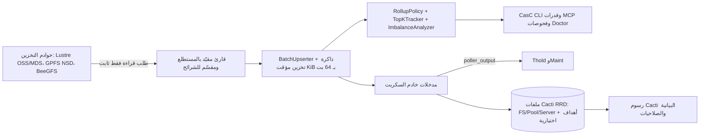

<!-- Source: README.md; SHA256: e88d6875d113220a91cfc0a9d230c829a78477b17e6aa7e44dda38c9591c86ad -->

<!-- translations:start -->
[English](../../../README.md) | [简体中文](../zh-CN/README.md) | [हिन्दी](../hi-IN/README.md) | [Español (España)](../es-ES/README.md) | [Español (Latinoamérica)](../es-419/README.md) | [العربية (السعودية)](README.md) | [Afrikaans](../af-ZA/README.md) | [አማርኛ](../am-ET/README.md) | [العربية (مصر)](../ar-EG/README.md) | [العربية (المغرب)](../ar-MA/README.md) | [বাংলা](../bn-BD/README.md) | [Bosanski](../bs-BA/README.md) | [Deutsch](../de-DE/README.md) | [فارسی](../fa-IR/README.md) | [Filipino](../fil-PH/README.md) | [Français](../fr-FR/README.md) | [Français (Maroc)](../fr-MA/README.md) | [Français (Sénégal)](../fr-SN/README.md) | [Hausa](../ha-NG/README.md) | [עברית](../he-IL/README.md) | [Hrvatski](../hr-HR/README.md) | [Bahasa Indonesia](../id-ID/README.md) | [Igbo](../ig-NG/README.md) | [Italiano](../it-IT/README.md) | [日本語](../ja-JP/README.md) | [한국어](../ko-KR/README.md) | [Malagasy](../mg-MG/README.md) | [मराठी](../mr-IN/README.md) | [Bahasa Melayu](../ms-MY/README.md) | [Nederlands](../nl-NL/README.md) | [Polski](../pl-PL/README.md) | [Português (Brasil)](../pt-BR/README.md) | [Русский](../ru-RU/README.md) | [Kinyarwanda](../rw-RW/README.md) | [Soomaali](../so-SO/README.md) | [Српски](../sr-RS/README.md) | [Svenska](../sv-SE/README.md) | [Kiswahili](../sw-KE/README.md) | [தமிழ்](../ta-IN/README.md) | [తెలుగు](../te-IN/README.md) | [ไทย](../th-TH/README.md) | [Türkçe](../tr-TR/README.md) | [Українська](../uk-UA/README.md) | [اردو](../ur-PK/README.md) | [Tiếng Việt](../vi-VN/README.md) | [isiXhosa](../xh-ZA/README.md) | [Yorùbá](../yo-NG/README.md) | [繁體中文](../zh-TW/README.md) | [isiZulu](../zu-ZA/README.md)
<!-- translations:end -->

# plugin_pfs

ملحق لـ Cacti 1.2 يجلب صحة أنظمة الملفات المتوازية وسعتها وعدم توازن الامتلاء والإنتاجية لكل هدف ومعدلات عمليات البيانات الوصفية إلى Cacti عبر Lustre وIBM Storage Scale (GPFS) وBeeGFS خلف واجهة `Backend` موحدة. يُربط كل نظام ملفات بجهاز Cacti عادي مع استعلامات بيانات ورسوم عامة ورسوم أهداف عند الطلب ومقاييس ملخصة بحيث ينبّه Thold ويكبت Maint دون تعديل.

> **الحالة: المراحل 1 إلى 3 وأوليات التوسع إلى مستوى الإكساسكيل منفذة برمجيًا، ولم تُصدر بعد.** الأساس، وملاحظة Lustre، والتنبيه وكبت Maint، ومشغّلات القراءة فقط لـ GPFS وBeeGFS، وتحليل عدم توازن OST/MDT مع تكامل Maint، وتحديد نطاق المجمّع البعيد (`replicate_out`، `remote_agent`)، وأوليات التوسع لأكثر من 100 PB / الإكساسكيل (`FramedReportParser`، المخطط v4 `value_kib`، `RollupPolicy`، `TopKTracker`، `ShardAssigner`، `BatchUpserter`)، وواجهة سطر أوامر المشغّل CasC (`cli/pfs.php`)، وخطافات المنظومة (`abilities_register`، `doctor_register_checks`، `casc_register_providers`) كلها منفذة ومُتحقق منها باختبارات الوحدة والأمان واختبارات التكامل على Cacti مؤقت. تعتمد جميع الاختبارات حتى الآن على مخرجات عقد تجريبية بدلًا من عتاد Lustre أو GPFS أو BeeGFS فعلي. ما زال مفتوحًا قبل وسم الإصدار: تجارب على أنظمة ملفات حقيقية ([خطة التجربة](../../pilot-plan.md))، ومراجعة أمنية خارجية ([المراجعة الذاتية](../../security-review.md))، وقياسات الحجم على عتاد موثّق ([الحجم](../../research/scale.md)). الإصدار 0.1.0 مُعد في `INFO` و[CHANGELOG.md](../../../CHANGELOG.md) لكن دون وسم إصدار.

## أدوار الوصول

| المجال | الوصول |
| --- | --- |
| Parallel Filesystem View | صفحات المراقبة الحالية. |
| Parallel Filesystem Operator | المراقبة إضافةً إلى صفحة العمليات وإقرارات الفرز الشخصية. |
| Parallel Filesystem Admin | وصول Operator إضافةً إلى الإعداد والإجراءات الإدارية الحالية. |

بعد نسخ ملفات الترقية، افتح صفحة الملحقات كمسؤول لتسجيل المجال الجديد. عيّن مجال Operator صراحةً ضمن **الإعداد > المستخدمون** أو مجموعات المستخدمين. تحتفظ الترقيات بمعرّفات مجالي View وAdmin ومنحهما الحاليين. يرث Admin وصول Operator، ويرث Operator وصول View في كل طلب؛ ولا يضيف ذلك منحًا مخزنة للمستخدمين أو المجموعات. تتطلب إعدادات الملحق وصول Parallel Filesystem Admin إضافةً إلى صلاحية Settings في Cacti.

تظل صلاحيات أجهزة Cacti تحدّ الصفوف والإجراءات المتاحة لكل مستخدم؛ وتتطلب الكائنات غير المربوطة مسؤولًا. تبقى بيانات الاعتماد والإعداد والربط والحذف والتغييرات الإدارية الأخرى في الصفحات الإدارية. تستمر الإقرارات في جلسة المستخدم الحالي فقط، لمدة ساعة كحد أقصى وطالما بقيت الملاحظة نفسها حديثة. تبطلها الملاحظات الجديدة أو المتغيرة. لا تجعل القياس الفاشل سليمًا ولا تكبت التنبيهات مطلقًا.

## الدافع

عندما يبطؤ نظام ملفات مشترك تتوزع الأدلة بين الخوادم. يحتفظ Lustre بعداداته لكل عقدة: يبلّغ `lctl get_param` قيم «العقدة المحلية»، لذا لا يملك كل خادم تخزين كائنات (OSS) وخادم بيانات وصفية (MDS) إلا أرقام أهدافه. يحتاج المشغّل إلى ثلاثة أجوبة من مواضع مختلفة:

- **هل يمتلئ هدف بينما غيره فارغ؟** يغيّر عدم التوازن موضع الملفات الجديدة ووقت نفاد مساحة هدف واحد.
- **ما الأهداف أو العمليات المشغولة؟** تبيّن عدادات البايت لكل هدف وعمليات كل MDT هل يرتبط الحمل بالبيانات أو بالبيانات الوصفية.
- **هل المراقبة نفسها حديثة؟** لا يطمئن الرسم المسطح إلا إذا استطاع الملحق رؤية الخوادم.

يرسم Cacti المضيفين ويضع عتبات القيم بـThold، ولا تملك مؤسسة Cacti على GitHub مستودعًا لمراقبة Lustre أو GPFS أو BeeGFS (بحث بتاريخ 2026-11-14). يسد الملحق الفجوة بقراءة قيم مسموحة للقراءة فقط من عقد التخزين، وتمثيل كل نظام كجهاز Cacti تكون أهدافه فهارس استعلام بيانات. يعيد استخدام رسوم Cacti وصلاحياته ومجمّعاته البعيدة وThold وMaint بدل بناء نسخ موازية.

## النطاق المخطط

| المرحلة | النطاق | الحالة | المعالم |
|---|---|---|---|
| 0، البحث | مصفوفة الإصدارات وقرار وصول العقد وتأكيد سلوك المشاريع الأصلية وسلوك العدادات وتجاوز الفشل وقياس الحجم | مكتملة | [M1](https://github.com/somethingwithproof/plugin_pfs/milestone/1) |
| 1، الملاحظة | جرد Lustre وسعته وامتلاؤه، عدم توازن OST/MDT (`lib/ImbalanceAnalyzer.php`)، تكامل Maint (`lib/HealthPage.php`)، إنتاجية OST ومعدلات MDT والرسوم وتنبيه Thold وصفحة الصحة | منفذة (مختبرة بعينات تجريبية) | [M2](https://github.com/somethingwithproof/plugin_pfs/milestone/2)، [M3](https://github.com/somethingwithproof/plugin_pfs/milestone/3)، [M4](https://github.com/somethingwithproof/plugin_pfs/milestone/4) |
| 2، البعيد والتوسع | الجمع البعيد على مستوى المستطلع (`lib/Reader.php`، `lib/ReplicationRepository.php`، `replicate_out`، `remote_agent`)، أوليات التوسع لأكثر من 100 PB (ضبط KiB بـ 64 بت + المخطط v4 `value_kib`، `lib/RollupPolicy.php`، `lib/TopKTracker.php`، `lib/ShardAssigner.php` + `poller_pfs.php --shard=K/N`، `lib/BatchUpserter.php`)، واجهة سطر أوامر CasC (`cli/pfs.php`)، خطافات MCP/Doctor/CasC | منفذة (مختبرة بالوحدة والتكامل في CI) | [M5](https://github.com/somethingwithproof/plugin_pfs/milestone/5) |
| 3، الواجهات الخلفية | مشغّلات القراءة فقط لـ IBM Storage Scale (GPFS) (`lib/GpfsBackend.php`) وBeeGFS (`lib/BeegfsBackend.php`) المسجلة في `BackendRegistry::production()` | منفذة (مختبرة بالوحدة) | [M6](https://github.com/somethingwithproof/plugin_pfs/milestone/6) |

أبرز أوليات التشغيل والتوسع المنفذة:

- **مشغّلات قراءة فقط متعددة الأنظمة:** `LustreBackend` و`GpfsBackend` (`mmpmon` `fs_io_s`/`io_s` المؤطّر فقط مع حظر `reset`، وسعة/حالات تجمعات `mmdf` وملخصات المنتظرين) و`BeegfsBackend` (أهداف التخزين والبيانات الوصفية لـ BeeGFS 7.4 و8.x مع تحويل دقيق من بايت إلى KiB وتعيين حالات الوصول والاتساق ودلالات القياس لكل فترة) تشترك في `lib/FramedReportParser.php`.
- **عدم التوازن والهامش المتاح والوعي بـ Maint:** يحسب `lib/ImbalanceAnalyzer.php` نسب امتلاء OST/MDT والتباين ومؤشر عدم توازن الانحراف المعياري للمجتمع والهامش المتاح وفرض حداثة فترة واحدة (`missing_targets`) وأعلام حالة كل هدف وأعلى K أهداف منحرفة محدودة. ويعرض `HealthPage` (`pfs_health.php`) و`CascProvider::health()` نوافذ صيانة `Maint` في Cacti ويكبتان تحذيرات الأعطال النشطة أثناء الصيانة المجدولة.
- **التوسع لأكثر من 100 PB والإكساسكيل** ([docs/architecture/exascale-scaling.md](../../architecture/exascale-scaling.md)): التحويل العشري الدقيق من بايت إلى KiB (`FramedReportParser::bytesToKibInt()`) المُتحقق منه عند 500 PB و2 EB إلى جانب أعمدة `BIGINT UNSIGNED value_kib` (المخطط v4)؛ وتجميعات RRD الهرمية `Filesystem -> Pool -> Storage Server` مع ترقية محدودة للأهداف الاختيارية أو الساخنة أو المنحرفة (`lib/RollupPolicy.php`)؛ وأهداف Top-K المنحرفة المحدودة بتعقيد $O(K)$ وملخصات المهام/العملاء الثقيلة المجمّعة مسبقًا (`lib/TopKTracker.php`، دون إنشاء أجهزة أو RRD لكل عميل)؛ وتقسيم المجمّعات الحتمي عبر CRC32 (`lib/ShardAssigner.php`، `php plugins/pfs/poller_pfs.php [--poller=N] [--shard=K/N] [--force] [--debug]`)؛ وإدراجات SQL الدفعية من 500 صف مع ترقيم الصفحات بالمفاتيح (`lib/BatchUpserter.php`، `CacheRepository::upsertObservationsBatch()`، `TargetRepository::forFilesystemPage()`).
- **واجهة CasC للمشغّل وخطافات المنظومة:** يدعم `cli/pfs.php` الأوامر `export [--format=yaml|xml]` و`validate <file> [--format=yaml|xml]` و`plan <file> [--format=yaml|xml] [--output=text|json]` و`apply <file> --confirm=<PLAN_HASH> [--format=yaml|xml]` و`health [--format=text|json]` دون أي تبعيات Composer خارجية. ويسجل `setup.php` و`lib/EcosystemIntegration.php` كلًا من `abilities_register` (`pfs-list-filesystems`، `pfs-get-imbalance`، `pfs-get-health`؛ للقراءة فقط، ومقيدة بصلاحية `Parallel Filesystem View` وصلاحيات أجهزة Cacti) و`doctor_register_checks` (`pfs_schema`، `pfs_reader_freshness`، `pfs_capacity_imbalance`) و`casc_register_providers` و`replicate_out` و`remote_agent`.

خارج النطاق: أي كتابة أو مسح أو إعادة ضبط أو ضبط أداء لعقدة أو نظام ملفات؛ محرك تنبيه خاص؛ خدمة خلفية أو بروتوكول مخصص؛ أجهزة أو ملفات RRD في Cacti لكل مهمة أو لكل عميل؛ تغييرات في نواة Cacti أو Thold أو Maint.

## أهداف التوافق

| المكوّن | الهدف |
|---|---|
| Cacti | 1.2.31 أو أحدث، دون ترقيعات للنواة |
| PHP | 8.2 أو أحدث؛ يبقى `setup.php` و`poller_pfs.php` و`cli/pfs.php` قابلة للتحليل على 8.0 كي يُرفض وقت التشغيل غير المدعوم بدل تعطيل الواجهة |
| Lustre | فُحصت الشيفرة والأدلة عند 2.17.0؛ مختبر بعينات تجريبية |
| GPFS وBeeGFS | مشغّلات القراءة فقط لـ IBM Storage Scale (GPFS) 5.x `mmpmon`/`mmdf` وBeeGFS 7.4 / 8.x منفذة ومختبرة بعينات تجريبية |
| Thold وMaint | Thold 1.8.2 وMaint 1.3، دون تعديل |

## التصميم

- يوثّق [docs/architecture/exascale-scaling.md](../../architecture/exascale-scaling.md) معمارية القياس عن بُعد ذات الطبقتين لأكثر من 100 PB / الإكساسكيل (طبقة خادم Cacti/`plugin_pfs` + التجميع + Top-K مقترنة بقياس عملاء خارج النطاق عبر LDMS/Darshan/TOKIO) وسياقها في الأدبيات الأكاديمية.
- [docs/PLAN.md](../../PLAN.md) الخطة الكاملة: المعمارية والحقائق المعتمدة من المشاريع الأصلية (بمصادرها وما لم يتحقق بعد) ودلالات العدادات ونموذج الحالة وحدود الأمان وحسابات الأداء والاختبار والمخاطر.
- يغطي [docs/operator-guide.md](docs/operator-guide.md) التثبيت والرسوم والقيم والترقية والنسخ والاستعادة والإزالة واستكشاف الأخطاء؛ ويغطي [docs/alerting.md](docs/alerting.md) Thold وMaint.
- يصف [docs/node-setup.md](docs/node-setup.md) إعداد خادم Lustre ومستطلع للقارئ.
- يحوي [docs/decisions/](../../decisions) سجلات القرارات المعمارية المتخذة.
- يربط [docs/REQUIREMENTS.md](../../REQUIREMENTS.md) كل معرّف متطلب بقضيته.

## كيفية تتبع العمل

- تتبع **المعالم** معالم الخطة. لكل منها قضية ملحمية تسرد قضاياها الفرعية وأدلة الإكمال.
- تُصنّف **القضايا** بالوسوم: `type: requirement` و`type: research` و`type: decision` و`type: epic`. تذكر قضايا المتطلبات متطلبات مرقمة قابلة للاختبار (`REQ-AREA-NNN`) ومعايير قبول.
- تحمل **الوسوم** أيضًا `area:` و`phase:` و`priority:` و`status:`. راجع [CONTRIBUTING.md](../../../CONTRIBUTING.md#labels).
- تعرض [لوحة المشروع](https://github.com/users/somethingwithproof/projects/11) جميع القضايا عبر المعالم.

## المساهمة

اقرأ [CONTRIBUTING.md](../../../CONTRIBUTING.md). تتطلب الالتزامات توقيع DCO. نقاش التصميم في القضايا؛ تحمل القرارات المفتوحة الوسم `type: decision`.

## الأمان

أبلغ عن الثغرات بصورة خاصة؛ راجع [SECURITY.md](../../../SECURITY.md).

## الترخيص

رخصة GNU العمومية العامة v2.0، وهي رخصة Cacti وملحقاته نفسها. راجع [LICENSE](../../../LICENSE).
