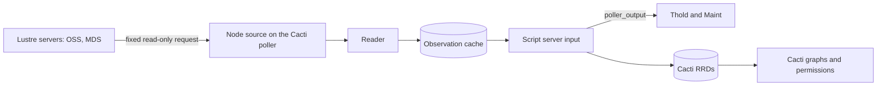

<!-- Source: README.md; SHA256: 40f2c5a5e9be97e4bd2b05a9ebab2a77de51de3af1b1c21dbeb5ee7f936cdd3b -->

<!-- translations:start -->
[English](../../../README.md) | [简体中文](../zh-CN/README.md) | [हिन्दी](../hi-IN/README.md) | [Español (España)](../es-ES/README.md) | [Español (Latinoamérica)](../es-419/README.md) | [العربية](README.md)
<!-- translations:end -->

# plugin_pfs

ملحق لـCacti 1.2 يجلب صحة أنظمة الملفات المتوازية وحملها: السعة وعدم توازن الامتلاء بين الأهداف، والإنتاجية لكل هدف، ومعدلات عمليات البيانات الوصفية. Lustre أول واجهة خلفية، ويتبعه GPFS (IBM Storage Scale) وBeeGFS عبر واجهة خلفية مشتركة. تدخل البيانات أجهزة Cacti ومصادره ورسومه العادية، فينبه Thold ويكبت Maint دون تعديل.

> **الحالة: المعلم 4، شيفرة المرحلة 1 مكتملة، لم يصدر بعد.** اكتملت المعالم 2 (الأساس) و3 (ملاحظة Lustre) و4 (التنبيه والتحضير للإصدار) على `main` أو هي قيد المراجعة. يُثبّت الملحق ويُرقّى ويُزال عبر API ملحقات Cacti ويرفض PHP أقل من 8.2. يقرأ قارئ خلفي على كل مستطلع خوادم Lustre عبر SSH بسكربت أمر مفروض ثابت ([node/pfs-read.sh](../../../node/pfs-read.sh)) ويخزّن الجرد والحالة والسعة والعدادات مع حداثتها. يصبح كل نظام ملفات جهاز Cacti باستعلامي OST وMDT وخمسة رسوم عامة ورسوم أهداف عند الطلب ومصدر ملخص لـThold. ينبه Thold v1.8.2 ويكبت Maint v1.3 دون تعديل قيم gauge الملخصة في التشغيل الشامل؛ ولا تُدعم عتبات العدادات مع Thold 1.8.2 ([docs/alerting.md](docs/alerting.md)). تعمل جميع الاختبارات حتى الآن على خرج عقد اختباري في Cacti مؤقت: لم يعمل الملحق ضد عقدة Lustre حقيقية. ما يزال قبل الإصدار: تجارب أنظمة حقيقية ([خطة التجربة](../../pilot-plan.md))، ومراجعة أمنية خارجية ([المراجعة الذاتية](../../security-review.md))، وقياسات حجم على عتاد موثّق ([الحجم](../../research/scale.md)). الإصدار 0.1.0 مُعد في `INFO` و[CHANGELOG.md](../../../CHANGELOG.md) لكن دون وسم إصدار.

## أدوار الوصول

| المجال | الوصول |
| --- | --- |
| Parallel Filesystem View | صفحات المراقبة الحالية. |
| Parallel Filesystem Operator | المراقبة إضافةً إلى صفحة العمليات وإقرارات الفرز الشخصية. |
| Parallel Filesystem Admin | وصول Operator إضافةً إلى الإعداد والإجراءات الإدارية الحالية. |

بعد نسخ ملفات الترقية، افتح صفحة الملحقات كمسؤول لتسجيل المجال الجديد. عيّن مجال Operator صراحةً ضمن **الإعداد > المستخدمون** أو مجموعات المستخدمين. تحتفظ الترقيات بمعرّفات مجالي View وAdmin ومنحهما الحاليين. يرث Admin وصول Operator، ويرث Operator وصول View في كل طلب؛ ولا يضيف ذلك منحًا مخزنة للمستخدمين أو المجموعات. تتطلب إعدادات الملحق وصول Parallel Filesystem Admin إضافةً إلى صلاحية Settings في Cacti.

تظل صلاحيات أجهزة Cacti تحدّ الصفوف والإجراءات المتاحة لكل مستخدم؛ وتتطلب الكائنات غير المربوطة مسؤولًا. تبقى بيانات الاعتماد والإعداد والربط والحذف والتغييرات الإدارية الأخرى في الصفحات الإدارية. تستمر الإقرارات في جلسة المستخدم الحالي فقط، لمدة ساعة كحد أقصى وطالما بقيت الملاحظة نفسها حديثة. تبطلها الملاحظات الجديدة أو المتغيرة. لا تجعل القياس الفاشل سليمًا ولا تكبت التنبيهات مطلقًا.

## الدافع

عندما يبطؤ نظام ملفات مشترك تتوزع الأدلة بين الخوادم. يحتفظ Lustre بعداداته لكل عقدة: يبلّغ `lctl get_param` قيم «العقدة المحلية»، لذا لا يملك كل خادم تخزين كائنات (OSS) وخادم بيانات وصفية (MDS) إلا أرقام أهدافه. يحتاج المشغّل إلى ثلاثة أجوبة من مواضع مختلفة:

- **هل يمتلئ هدف بينما غيره فارغ؟** يغيّر عدم التوازن موضع الملفات الجديدة ووقت نفاد مساحة هدف واحد.
- **ما الأهداف أو العمليات المشغولة؟** تبيّن عدادات البايت لكل هدف وعمليات كل MDT هل يرتبط الحمل بالبيانات أو بالبيانات الوصفية.
- **هل المراقبة نفسها حديثة؟** لا يطمئن الرسم المسطح إلا إذا استطاع الملحق رؤية الخوادم.

يرسم Cacti المضيفين ويضع عتبات القيم بـThold، ولا تملك مؤسسة Cacti على GitHub مستودعًا لمراقبة Lustre أو GPFS أو BeeGFS (بحث بتاريخ 2026-11-14). يسد الملحق الفجوة بقراءة قيم مسموحة للقراءة فقط من عقد التخزين، وتمثيل كل نظام كجهاز Cacti تكون أهدافه فهارس استعلام بيانات. يعيد استخدام رسوم Cacti وصلاحياته ومجمّعاته البعيدة وThold وMaint بدل بناء نسخ موازية.

## النطاق المخطط

| المرحلة | النطاق | المعالم |
|---|---|---|
| 0، البحث | مصفوفة الإصدارات وقرار وصول العقد وتأكيد سلوك المشاريع الأصلية وسلوك العدادات وتجاوز الفشل وقياس الحجم | [M1](https://github.com/somethingwithproof/plugin_pfs/milestone/1) |
| 1، الملاحظة | جرد Lustre وسعته وامتلاؤه وإنتاجية OST ومعدلات MDT والرسوم وتنبيه Thold وكبت Maint وصفحة الصحة | [M2](https://github.com/somethingwithproof/plugin_pfs/milestone/2)، [M3](https://github.com/somethingwithproof/plugin_pfs/milestone/3)، [M4](https://github.com/somethingwithproof/plugin_pfs/milestone/4) |
| 2، التعمق | مجمّعات Cacti البعيدة وعروض على مستوى المهمة والعميل ضمن عدد كائنات محدود | [M5](https://github.com/somethingwithproof/plugin_pfs/milestone/5) |
| 3، الواجهات الخلفية | GPFS (IBM Storage Scale) وBeeGFS | [M6](https://github.com/somethingwithproof/plugin_pfs/milestone/6) |

خارج النطاق: أي كتابة أو مسح أو إعادة ضبط أو ضبط أداء لعقدة أو نظام ملفات؛ محرك تنبيه خاص؛ خدمة خلفية أو بروتوكول مخصص؛ مصادر بيانات لكل مهمة؛ تغييرات في نواة Cacti أو Thold أو Maint.

## أهداف التوافق

| المكوّن | الهدف |
|---|---|
| Cacti | 1.2.31 أو أحدث، دون ترقيعات للنواة |
| PHP | 8.2 أو أحدث؛ يبقى `setup.php` قابلًا للتحليل على 8.0 كي يُرفض وقت التشغيل غير المدعوم بدل تعطيل الواجهة |
| Lustre | تُحدد خطوط الإصدارات في المعلم 1؛ المصدر والأدلة المفحوصة حتى الآن عند 2.17.0 |
| GPFS وBeeGFS | المرحلة 3؛ الإصدارات يحددها البحث |
| Thold وMaint | لا تعديل مطلوب |

## التصميم

- [docs/PLAN.md](../../PLAN.md) الخطة الكاملة: المعمارية والحقائق المعتمدة من المشاريع الأصلية (بمصادرها وما لم يتحقق بعد) ودلالات العدادات ونموذج الحالة وحدود الأمان وحسابات الأداء والاختبار والمخاطر.
- يغطي [docs/operator-guide.md](docs/operator-guide.md) التثبيت والرسوم والقيم والترقية والنسخ والاستعادة والإزالة واستكشاف الأخطاء؛ ويغطي [docs/alerting.md](docs/alerting.md) Thold وMaint.
- يصف [docs/node-setup.md](docs/node-setup.md) إعداد خادم Lustre ومستطلع للقارئ.
- يحوي [docs/decisions/](../../decisions) سجلات القرارات المعمارية المتخذة.
- يربط [docs/REQUIREMENTS.md](../../REQUIREMENTS.md) كل معرّف متطلب بقضيته.

## كيفية تتبع العمل

- تتبع **المعالم** معالم الخطة. لكل منها قضية ملحمية تسرد قضاياها الفرعية وأدلة الإكمال.
- تُصنّف **القضايا** بالوسوم: `type: requirement` و`type: research` و`type: decision` و`type: epic`. تذكر قضايا المتطلبات متطلبات مرقمة قابلة للاختبار (`REQ-AREA-NNN`) ومعايير قبول.
- تحمل **الوسوم** أيضًا `area:` و`phase:` و`priority:` و`status:`. راجع [CONTRIBUTING.md](../../../CONTRIBUTING.md#labels).
- تعرض [لوحة المشروع](https://github.com/users/somethingwithproof/projects/11) جميع القضايا عبر المعالم.

## المساهمة

اقرأ [CONTRIBUTING.md](../../../CONTRIBUTING.md). تتطلب الالتزامات توقيع DCO. نقاش التصميم في القضايا؛ تحمل القرارات المفتوحة الوسم `type: decision`.

## الأمان

أبلغ عن الثغرات بصورة خاصة؛ راجع [SECURITY.md](../../../SECURITY.md).

## الترخيص

رخصة GNU العمومية العامة v2.0، وهي رخصة Cacti وملحقاته نفسها. راجع [LICENSE](../../../LICENSE).
