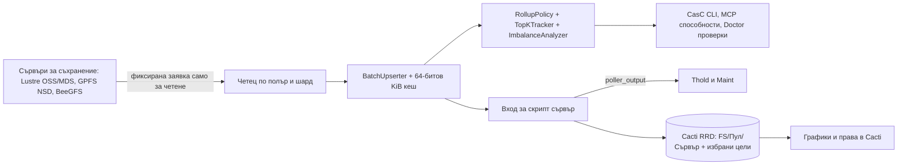

<!-- Source: README.md; SHA256: e88d6875d113220a91cfc0a9d230c829a78477b17e6aa7e44dda38c9591c86ad -->

<!-- translations:start -->
[English](../../../README.md) | [简体中文](../zh-CN/README.md) | [हिन्दी](../hi-IN/README.md) | [Español (España)](../es-ES/README.md) | [Español (Latinoamérica)](../es-419/README.md) | [العربية (السعودية)](../ar-SA/README.md) | [Afrikaans](../af-ZA/README.md) | [አማርኛ](../am-ET/README.md) | [العربية (مصر)](../ar-EG/README.md) | [العربية (المغرب)](../ar-MA/README.md) | [Български](README.md) | [বাংলা](../bn-BD/README.md) | [Bosanski](../bs-BA/README.md) | [Deutsch](../de-DE/README.md) | [Ελληνικά](../el-GR/README.md) | [فارسی](../fa-IR/README.md) | [Filipino](../fil-PH/README.md) | [Français](../fr-FR/README.md) | [Français (Maroc)](../fr-MA/README.md) | [Français (Sénégal)](../fr-SN/README.md) | [Hausa](../ha-NG/README.md) | [עברית](../he-IL/README.md) | [Hrvatski](../hr-HR/README.md) | [Bahasa Indonesia](../id-ID/README.md) | [Igbo](../ig-NG/README.md) | [Italiano](../it-IT/README.md) | [日本語](../ja-JP/README.md) | [ქართული](../ka-GE/README.md) | [한국어](../ko-KR/README.md) | [Latviešu](../lv-LV/README.md) | [Malagasy](../mg-MG/README.md) | [मराठी](../mr-IN/README.md) | [Bahasa Melayu](../ms-MY/README.md) | [Nederlands](../nl-NL/README.md) | [Polski](../pl-PL/README.md) | [Português (Brasil)](../pt-BR/README.md) | [Português (Portugal)](../pt-PT/README.md) | [Русский](../ru-RU/README.md) | [Kinyarwanda](../rw-RW/README.md) | [Soomaali](../so-SO/README.md) | [Српски](../sr-RS/README.md) | [Svenska](../sv-SE/README.md) | [Kiswahili](../sw-KE/README.md) | [தமிழ்](../ta-IN/README.md) | [తెలుగు](../te-IN/README.md) | [ไทย](../th-TH/README.md) | [Türkçe](../tr-TR/README.md) | [Українська](../uk-UA/README.md) | [اردو](../ur-PK/README.md) | [Tiếng Việt](../vi-VN/README.md) | [isiXhosa](../xh-ZA/README.md) | [Yorùbá](../yo-NG/README.md) | [繁體中文](../zh-TW/README.md) | [isiZulu](../zu-ZA/README.md)
<!-- translations:end -->

# plugin_pfs

Плъгин за Cacti 1.2, който внася състоянието, капацитета, дисбаланса на запълване, пропускателната способност по цели и честотата на операциите с метаданни за паралелни файлови системи в Cacti за Lustre, IBM Storage Scale (GPFS) и BeeGFS чрез единен интерфейс `Backend`. Всяка файлова система се свързва с обикновено устройство в Cacti със заявки за данни, обзорни графики и графики за отделни цели при поискване, както и обобщени показатели (gauges), така че Thold и Maint да известяват и потискат известията без промени.

> **Състояние: фази от 1 до 3 и примитивите за екзаскейл мащабиране са реализирани в кода, но все още няма издадена версия.** Основата, наблюдението на Lustre, известяването и потискането чрез Maint, драйверите само за четене за GPFS и BeeGFS, анализът на дисбаланса на OST/MDT с интеграция с Maint, отдалеченото събиране на данни по полър (`replicate_out`, `remote_agent`), примитивите за мащабиране до 100+ PB / exascale (`FramedReportParser`, Схема v4 `value_kib`, `RollupPolicy`, `TopKTracker`, `ShardAssigner`, `BatchUpserter`), операторският CasC CLI (`cli/pfs.php`) и куките за екосистемата (`abilities_register`, `doctor_register_checks`, `casc_register_providers`) са реализирани и проверени чрез модулни тестове, тестове за сигурност и интеграционни тестове с временна инстанция на Cacti. Всички изпълнения до момента използват тестови фикстури с изход от възли вместо реален хардуер с Lustre, GPFS или BeeGFS. Преди маркиране на издание остават отворени: пилотни внедрявания върху реални файлови системи ([пилотен план](../../pilot-plan.md)), външен одит на сигурността ([самооценка](../../security-review.md)) и измервания на мащабируемостта върху документиран хардуер ([мащабируемост](../../research/scale.md)). Версия 0.1.0 е подготвена в `INFO` и [CHANGELOG.md](../../../CHANGELOG.md), но не е маркирана с етикет.

## Роли за достъп

| Област на достъп | Достъп |
| --- | --- |
| Преглед на паралелни файлови системи (Parallel Filesystem View) | Съществуващите страници за наблюдение. |
| Оператор на паралелни файлови системи (Parallel Filesystem Operator) | Наблюдение плюс страницата „Операции“ и лични потвърждения за преглед при триаж. |
| Администриране на паралелни файлови системи (Parallel Filesystem Admin) | Операторски достъп плюс съществуващите конфигурационни и административни действия. |

След копиране на файловете за надграждане отворете страницата „Плъгини“ като администратор, за да регистрирате новата област на достъп. Назначете областта „Оператор“ изрично в **Конфигурация > Потребители** или в потребителски групи. Надгражданията запазват съществуващите идентификатори и права на областите View и Admin. Администраторският достъп наследява операторския, а операторският наследява достъпа за преглед при всяка заявка; това не добавя записани права към потребители или групи. Настройките на плъгина изискват също достъп Parallel Filesystem Admin в допълнение към правото за „Настройки“ в Cacti.

Правата за устройства в Cacti продължават да ограничават редовете и действията, достъпни за всеки потребител; несвързаните обекти изискват администратор. Идентификационните данни, конфигурацията, свързването, изтриването и другите административни промени остават в административните страници. Потвържденията са валидни само в текущата сесия на потребителя, най-много за един час и само докато същото наблюдение остава актуално. Нови или променени наблюдения ги обезсилват. Те никога не отбелязват неуспешно измерване като изправно и не потискат известия.

## Защо

Когато споделена файлова система е бавна, доказателствата са разпръснати по сървърите. Lustre пази броячите си по възли: `lctl get_param` докладва стойности „на локалния възел“, така че всеки сървър за обектно съхранение (OSS) и сървър за метаданни (MDS) разполага само с данните за собствените си цели. Оператор, който разследва бавна файлова система, се нуждае от три отговора от различни места:

- **Запълва ли се една цел, докато другите са празни?** Дисбалансът на запълването променя къде попадат новите файлове и кога отделна цел остава без място.
- **Кои цели или операции са натоварени?** Броячите на байтове по цели и броячите на операции по MDT показват дали натоварването е ограничено от данни или от метаданни.
- **Актуално ли е самото наблюдение?** Правата графика е успокоителна само ако плъгинът наистина е можел да достигне сървърите.

Cacti изчертава графики на хостове и задава прагове с Thold, а GitHub организацията на Cacti няма хранилище за наблюдение на Lustre, GPFS или BeeGFS (проверено на 2026-11-14). Плъгинът запълва тази празнина, като чете разрешени стойности само за четене от сървърите за съхранение и представя всяка файлова система като устройство в Cacti, чиито цели са индекси в заявка за данни. Той използва повторно графиките, правата, отдалечените събирачи на данни, Thold и Maint на Cacti, вместо да изгражда паралелни техни версии.

## Планиран обхват

| Фаза | Обхват | Състояние | Етапи |
|---|---|---|---|
| 0, проучване | Матрица на версиите, решение за достъп до възли, потвърждение на поведението на upstream, поведение на броячите и превключването при отказ, измервания на мащабируемостта | Завършена | [M1](https://github.com/somethingwithproof/plugin_pfs/milestone/1) |
| 1, наблюдение | Инвентар на Lustre, капацитет и запълване, дисбаланс на OST/MDT (`lib/ImbalanceAnalyzer.php`), интеграция с Maint (`lib/HealthPage.php`), пропускателна способност на OST, честота на операциите на MDT, графики, известяване с Thold, страница за състоянието | Реализирана (тествана с фикстури) | [M2](https://github.com/somethingwithproof/plugin_pfs/milestone/2), [M3](https://github.com/somethingwithproof/plugin_pfs/milestone/3), [M4](https://github.com/somethingwithproof/plugin_pfs/milestone/4) |
| 2, отдалечено събиране и мащабиране | Отдалечено събиране по полър (`lib/Reader.php`, `lib/ReplicationRepository.php`, `replicate_out`, `remote_agent`), примитиви за мащабиране 100+ PB (64-битова KiB точност + Схема v4 `value_kib`, `lib/RollupPolicy.php`, `lib/TopKTracker.php`, `lib/ShardAssigner.php` + `poller_pfs.php --shard=K/N`, `lib/BatchUpserter.php`), CasC CLI (`cli/pfs.php`), куки за MCP/Doctor/CasC | Реализирана (тествана с модулни и CI интеграционни тестове) | [M5](https://github.com/somethingwithproof/plugin_pfs/milestone/5) |
| 3, бекенди | Драйвери само за четене за IBM Storage Scale (GPFS) (`lib/GpfsBackend.php`) и BeeGFS (`lib/BeegfsBackend.php`), регистрирани в `BackendRegistry::production()` | Реализирана (модулно тествана) | [M6](https://github.com/somethingwithproof/plugin_pfs/milestone/6) |

Ключови реализирани операторски и мащабиращи примитиви:

- **Драйвери само за четене за множество файлови системи:** `LustreBackend`, `GpfsBackend` (рамкирани `mmpmon` `fs_io_s`/`io_s` със забрана на `reset`, капацитет/състояния на пуловете от `mmdf` и обобщения на чакащи операции) и `BeegfsBackend` (цели за съхранение/метаданни на BeeGFS 7.4 и 8.x с точно преобразуване от байтове в KiB, съпоставяне на състоянията за достъпност/съгласуваност и семантика на показатели за интервал), споделящи `lib/FramedReportParser.php`.
- **Дисбаланс, запас от капацитет и осведоменост за Maint:** `lib/ImbalanceAnalyzer.php` изчислява коефициентите на запълване на OST/MDT, размаха, индекса на дисбаланс чрез стандартно отклонение на популацията, свободния запас, контрола за актуалност в рамките на 1 интервал (`missing_targets`), флаговете за състояние по цели и ограничените Top-K най-неравномерно натоварени цели. `HealthPage` (`pfs_health.php`) и `CascProvider::health()` показват прозорците за поддръжка на Cacti `Maint` и потискат предупрежденията за активни неуспехи по време на планирана поддръжка.
- **Мащабиране за 100+ PB и exascale** ([docs/architecture/exascale-scaling.md](../../architecture/exascale-scaling.md)): точно десетично преобразуване от байтове в KiB (`FramedReportParser::bytesToKibInt()`), проверено при 500 PB и 2 EB, заедно с колони `BIGINT UNSIGNED value_kib` (Схема v4); йерархични RRD агрегации `Файлова система -> Пул -> Сървър за съхранение` с ограничено промотиране на избрани/натоварени/неравномерни цели (`lib/RollupPolicy.php`); ограничени $O(K)$ Top-K неравномерни цели и предварително агрегирани обобщения на тежки задачи/клиенти (`lib/TopKTracker.php`, без никога да се създават устройства или RRD файлове за отделни клиенти); детерминирано CRC32 шардиране на събирача (`lib/ShardAssigner.php`, `php plugins/pfs/poller_pfs.php [--poller=N] [--shard=K/N] [--force] [--debug]`); и пакетни SQL upsert операции по 500 реда плюс keyset странициране (`lib/BatchUpserter.php`, `CacheRepository::upsertObservationsBatch()`, `TargetRepository::forFilesystemPage()`).
- **Операторски CasC CLI и куки за екосистемата:** `cli/pfs.php` поддържа `export [--format=yaml|xml]`, `validate <file> [--format=yaml|xml]`, `plan <file> [--format=yaml|xml] [--output=text|json]`, `apply <file> --confirm=<PLAN_HASH> [--format=yaml|xml]` и `health [--format=text|json]` без външни зависимости от Composer. `setup.php` и `lib/EcosystemIntegration.php` регистрират `abilities_register` (`pfs-list-filesystems`, `pfs-get-imbalance`, `pfs-get-health`; само за четене, ограничени от `Parallel Filesystem View` и правата за устройства в Cacti), `doctor_register_checks` (`pfs_schema`, `pfs_reader_freshness`, `pfs_capacity_imbalance`), `casc_register_providers`, `replicate_out` и `remote_agent`.

Извън обхвата: всякакви операции за запис, изчистване, нулиране или настройка върху възел или файлова система; собствен механизъм за известяване в плъгина; собствен демон или мрежов протокол; устройства/RRD файлове в Cacti за отделни задачи или клиенти; промени в ядрото на Cacti, Thold или Maint.

## Цели за съвместимост

| Компонент | Цел |
|---|---|
| Cacti | 1.2.31 или по-нова, без кръпки в ядрото |
| PHP | 8.2 или по-нова; `setup.php`, `poller_pfs.php` и `cli/pfs.php` остават синтактично валидни на 8.0, така че неподдържана среда получава отказ вместо счупен интерфейс на Cacti |
| Lustre | Изходният код и ръководствата са проверени спрямо 2.17.0; тествано с фикстури |
| GPFS, BeeGFS | Реализирани и тествани с фикстури драйвери само за четене за IBM Storage Scale (GPFS) 5.x `mmpmon`/`mmdf` и BeeGFS 7.4 / 8.x |
| Thold, Maint | Thold 1.8.2 и Maint 1.3, без промени |

## Дизайн

- [docs/architecture/exascale-scaling.md](../../architecture/exascale-scaling.md) документира двуслойната архитектура за телеметрия при 100+ PB / exascale (ниво сървър + агрегации + Top-K в Cacti/`plugin_pfs`, съчетано с извънлентова клиентска телеметрия LDMS/Darshan/TOKIO) и нейния академичен контекст.
- [docs/PLAN.md](../../PLAN.md) е пълният план: архитектура, upstream факти, от които зависи (с източници и какво все още не е потвърдено), семантика на броячите, модел на състоянията, граници на сигурност, изчисления за производителност, тестване и рискове.
- [docs/operator-guide.md](../../operator-guide.md) обхваща инсталирането, графиките и стойностите, надграждането, архивирането и възстановяването, деинсталирането и отстраняването на неизправности; [docs/alerting.md](../../alerting.md) обхваща Thold и Maint.
- [docs/node-setup.md](../../node-setup.md) описва как да подготвите Lustre сървър и полър за четеца.
- [docs/decisions/](../../decisions/) съдържа записи на архитектурни решения за вече направените избори.
- [docs/REQUIREMENTS.md](../../REQUIREMENTS.md) свързва всеки идентификатор на изискване с неговата задача (issue).

## Как се проследява работата

- **Етапите (Milestones)** следват етапите от плана. Всеки има епична задача (epic issue), изброяваща подзадачите и доказателствата за завършване.
- **Задачите (Issues)** се класифицират чрез етикети: `type: requirement`, `type: research`, `type: decision`, `type: epic`. Задачите за изисквания формулират номерирани, проверими изисквания (`REQ-AREA-NNN`) и критерии за приемане.
- **Етикетите** съдържат също `area:`, `phase:`, `priority:` и `status:`. Вижте [CONTRIBUTING.md](../../../CONTRIBUTING.md#labels).
- [Таблото на проекта](https://github.com/users/somethingwithproof/projects/11) показва всички задачи по етапи.

## Принос

Прочетете [CONTRIBUTING.md](../../../CONTRIBUTING.md). Комитите изискват DCO подпис (`git commit -s`). Дискусиите по дизайна се водят в задачите; отворените решения носят етикета `type: decision`.

## Сигурност

Докладвайте уязвимости поверително; вижте [SECURITY.md](../../../SECURITY.md).

## Лиценз

GNU General Public License v2.0 — същият лиценз като Cacti и неговите плъгини. Вижте [LICENSE](../../../LICENSE).
