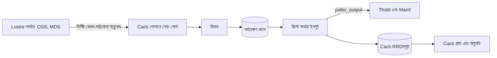

<!-- Source: README.md; SHA256: 40f2c5a5e9be97e4bd2b05a9ebab2a77de51de3af1b1c21dbeb5ee7f936cdd3b -->

<!-- translations:start -->
[English](../../../README.md) | [简体中文](../zh-CN/README.md) | [हिन्दी](../hi-IN/README.md) | [Español (España)](../es-ES/README.md) | [Español (Latinoamérica)](../es-419/README.md) | [العربية (السعودية)](../ar-SA/README.md) | [Afrikaans](../af-ZA/README.md) | [አማርኛ](../am-ET/README.md) | [العربية (مصر)](../ar-EG/README.md) | [العربية (المغرب)](../ar-MA/README.md) | [বাংলা](README.md) | [Deutsch](../de-DE/README.md) | [فارسی](../fa-IR/README.md) | [Filipino](../fil-PH/README.md) | [Français](../fr-FR/README.md) | [Français (Maroc)](../fr-MA/README.md) | [Français (Sénégal)](../fr-SN/README.md) | [Hausa](../ha-NG/README.md) | [עברית](../he-IL/README.md) | [Bahasa Indonesia](../id-ID/README.md) | [Igbo](../ig-NG/README.md) | [Italiano](../it-IT/README.md) | [日本語](../ja-JP/README.md) | [한국어](../ko-KR/README.md) | [Malagasy](../mg-MG/README.md) | [मराठी](../mr-IN/README.md) | [Bahasa Melayu](../ms-MY/README.md) | [Nederlands](../nl-NL/README.md) | [Polski](../pl-PL/README.md) | [Português (Brasil)](../pt-BR/README.md) | [Русский](../ru-RU/README.md) | [Kinyarwanda](../rw-RW/README.md) | [Soomaali](../so-SO/README.md) | [Svenska](../sv-SE/README.md) | [Kiswahili](../sw-KE/README.md) | [தமிழ்](../ta-IN/README.md) | [తెలుగు](../te-IN/README.md) | [ไทย](../th-TH/README.md) | [Türkçe](../tr-TR/README.md) | [Українська](../uk-UA/README.md) | [اردو](../ur-PK/README.md) | [Tiếng Việt](../vi-VN/README.md) | [isiXhosa](../xh-ZA/README.md) | [Yorùbá](../yo-NG/README.md) | [繁體中文](../zh-TW/README.md) | [isiZulu](../zu-ZA/README.md)
<!-- translations:end -->

# plugin_pfs

এটি একটি Cacti 1.2 প্লাগইন, যা প্যারালাল ফাইলসিস্টেমের অবস্থা এবং লোড Cacti-তে নিয়ে আসে: টার্গেটগুলোতে ধারণক্ষমতা ও ফিল ইমব্যাল্যান্স, প্রতি-টার্গেট থ্রুপুট এবং মেটাডেটা অপারেশনের হার। Lustre হলো প্রথম ব্যাকএন্ড। একটি ব্যাকএন্ড ইন্টারফেসের মাধ্যমে পরবর্তীতে GPFS (IBM Storage Scale) এবং BeeGFS যুক্ত হবে। ডেটাগুলো সাধারণ Cacti ডিভাইস, ডেটা সোর্স এবং গ্রাফে সংরক্ষিত হয়, ফলে Thold এবং Maint কোনো পরিবর্তন ছাড়াই অ্যালার্ট দিতে ও তা সাময়িকভাবে বন্ধ (suppress) রাখতে পারে।

> **অবস্থা: মাইলফলক ৪, প্রথম ধাপের কোড সম্পন্ন, তবে এখনো রিলিজ হয়নি।** মাইলফলক ২ (ভিত্তি), ৩ (Lustre পর্যবেক্ষণ), এবং ৪ (অ্যালার্টিং এবং রিলিজ প্রস্তুতি) `main` শাখায় সম্পন্ন হয়েছে অথবা পর্যালোচনায় (review) রয়েছে। প্লাগইনটি Cacti-এর প্লাগইন API-এর মাধ্যমে ইনস্টল, আপগ্রেড এবং আনইনস্টল করা যায় এবং PHP 8.2-এর নিচের সংস্করণ সমর্থন করে না। প্রতিটি পোলারে থাকা একটি ব্যাকগ্রাউন্ড রিডার একটি নির্দিষ্ট ফোর্সড-কমান্ড স্ক্রিপ্টের ([node/pfs-read.sh](../../../node/pfs-read.sh)) মাধ্যমে SSH ব্যবহার করে Lustre সার্ভার থেকে তথ্য পড়ে এবং ইনভেন্টরি, অবস্থা, ধারণক্ষমতা ও কাউন্টারগুলো তাদের সতেজতাসহ ক্যাশে সংরক্ষণ করে। প্রতিটি ফাইলসিস্টেম OST এবং MDT ডেটা কোয়েরি, পাঁচটি ওভারভিউ গ্রাফ, চাহিদা অনুযায়ী প্রতি-টার্গেট গ্রাফ এবং Thold-এর জন্য একটি সারাংশ ডেটা সোর্সসহ একটি Cacti ডিভাইসে পরিণত হয়। এন্ড-টু-এন্ড পরীক্ষায় Thold v1.8.2 এবং Maint v1.3 কোনো পরিবর্তন ছাড়াই সারাংশ গেজগুলোর ওপর অ্যালার্ট দেয় এবং তা সাপ্রেস করে; Thold 1.8.2-এ কাউন্টারের ওপর Thold থ্রেশহোল্ড সমর্থিত নয় ([docs/alerting.md](../../alerting.md))। এখন পর্যন্ত প্রতিটি পরীক্ষা একটি ডিসপোজেবল Cacti-তে ফিক্সচার নোড আউটপুটের ওপর চালানো হয়েছে: প্লাগইনটি এখনো কোনো বাস্তব Lustre নোডে চালানো হয়নি। রিলিজের আগে এখনো যা বাকি আছে: বাস্তব ফাইলসিস্টেমে পাইলট পরীক্ষা ([পাইলট পরিকল্পনা](../../pilot-plan.md)), বাহ্যিক নিরাপত্তা পর্যালোচনা ([স্ব-পর্যালোচনা](../../security-review.md)), এবং নথিভুক্ত হার্ডওয়্যারে স্কেল পরিমাপ ([স্কেল](../../research/scale.md))। সংস্করণ 0.1.0 `INFO` এবং [CHANGELOG.md](../../../CHANGELOG.md)-এ প্রস্তুত করা হয়েছে, তবে এখনো ট্যাগ করা হয়নি।

## অ্যাক্সেস ভূমিকা

| রিয়েলম | অ্যাক্সেস |
| --- | --- |
| প্যারালাল ফাইলসিস্টেম ভিউ (Parallel Filesystem View) | বিদ্যমান মনিটরিং পৃষ্ঠাগুলো। |
| প্যারালাল ফাইলসিস্টেম অপারেটর (Parallel Filesystem Operator) | মনিটরিং এবং সেই সাথে অপারেশনস পৃষ্ঠা ও ব্যক্তিগত ট্রায়াজ স্বীকৃতি। |
| প্যারালাল ফাইলসিস্টেম অ্যাডমিন (Parallel Filesystem Admin) | অপারেটর অ্যাক্সেস এবং সেই সাথে বিদ্যমান কনফিগারেশন ও প্রশাসনিক কার্যক্রম। |

আপগ্রেড ফাইলগুলো কপি করার পর, নতুন রিয়েলম নিবন্ধন করতে অ্যাডমিনিস্ট্রেটর হিসেবে Plugins পৃষ্ঠাটি খুলুন।
**Configuration > Users** অথবা ইউজার গ্রুপের অধীনে সুনির্দিষ্টভাবে Operator রিয়েলমটি বরাদ্দ করুন।
আপগ্রেডের ফলে বিদ্যমান View এবং Admin রিয়েলম আইডি ও অনুমোদনগুলো অপরিবর্তিত থাকে। প্রতিটি অনুরোধে
Admin অ্যাক্সেস স্বয়ংক্রিয়ভাবে Operator অ্যাক্সেস পায় এবং Operator অ্যাক্সেস View অ্যাক্সেস পায়;
এটি ব্যবহারকারী বা গ্রুপের জন্য সংরক্ষিত অনুমোদনে নতুন কিছু যোগ করে না। প্লাগইন সেটিংসের জন্য
Cacti-এর Settings অনুমতির পাশাপাশি Parallel Filesystem Admin অ্যাক্সেসও প্রয়োজন।

Cacti ডিভাইসের অনুমতিগুলো এখনো প্রতিটি ব্যবহারকারীর জন্য উপলব্ধ সারি এবং কার্যক্রম সীমাবদ্ধ রাখে; আনম্যাপড অবজেক্টগুলোর জন্য একজন অ্যাডমিনিস্ট্রেটর প্রয়োজন।
ক্রেডেনশিয়াল, কনফিগারেশন, ম্যাপিং, মুছে ফেলা এবং অন্যান্য প্রশাসনিক পরিবর্তনগুলো
প্রশাসনিক পৃষ্ঠাগুলোতেই থাকে। স্বীকৃতিগুলো কেবল বর্তমান
ব্যবহারকারীর সেশনেই, সর্বোচ্চ এক ঘণ্টার জন্য এবং কেবল একই পর্যবেক্ষণ সতেজ
থাকা পর্যন্ত স্থায়ী হয়। নতুন বা পরিবর্তিত পর্যবেক্ষণ এগুলোকে বাতিল করে দেয়। এগুলো কখনোই একটি ব্যর্থ
পরিমাপকে সুস্থ হিসেবে চিহ্নিত করে না বা অ্যালার্ট বন্ধ করে না।

## কেন প্রয়োজন

যখন একটি শেয়ার্ড ফাইলসিস্টেম ধীর হয়ে যায়, তখন তার প্রমাণগুলো বিভিন্ন সার্ভারে ছড়িয়ে থাকে। Lustre প্রতিটি নোডে তার কাউন্টারগুলো রাখে: `lctl get_param` "স্থানীয় নোডের" মানগুলো রিপোর্ট করে, তাই প্রতিটি অবজেক্ট স্টোরেজ সার্ভার (OSS) এবং মেটাডেটা সার্ভার (MDS) কেবল তার নিজস্ব টার্গেটগুলোর সংখ্যাই ধারণ করে। একটি ধীরগতির ফাইলসিস্টেম তদন্তকারী একজন অপারেটরের বিভিন্ন স্থান থেকে তিনটি উত্তর জানা প্রয়োজন:

- **অন্যান্য টার্গেট খালি থাকা অবস্থায় কি কোনো একটি টার্গেট ভরে যাচ্ছে?** ফিল ইমব্যাল্যান্স নির্ধারণ করে নতুন ফাইল কোথায় জমা হবে এবং কখন একটি একক টার্গেটের জায়গা শেষ হয়ে যাবে।
- **কোন টার্গেট বা অপারেশনগুলো ব্যস্ত?** প্রতি-টার্গেট বাইট কাউন্টার এবং প্রতি-MDT অপারেশন কাউন্টার দেখায় যে লোডটি ডেটা-নির্ভর নাকি মেটাডেটা-নির্ভর।
- **মনিটরিং ব্যবস্থাটি নিজেই কি হালনাগাদ রয়েছে?** একটি সমতল গ্রাফ কেবল তখনই আশ্বস্ত করে যখন প্লাগইনটি সার্ভারগুলোকে দেখতে পায়।

Cacti হোস্টগুলোর গ্রাফ তৈরি করে এবং Thold-এর মাধ্যমে মানের থ্রেশহোল্ড নির্ধারণ করে, এবং Cacti GitHub সংস্থায় Lustre, GPFS, বা BeeGFS মনিটরিংয়ের জন্য কোনো রিপোজিটরি নেই (২০২৬-১১-১৪ তারিখে অনুসন্ধানকৃত)। স্টোরেজ নোডগুলো থেকে অনুমোদিত, কেবল পাঠযোগ্য মান পড়ে এবং প্রতিটি ফাইলসিস্টেমকে একটি Cacti ডিভাইস হিসেবে উপস্থাপন করে (যার টার্গেটগুলো একটি ডেটা কোয়েরির ইনডেক্স হিসেবে থাকে) এই প্লাগইনটি সেই শূন্যস্থান পূরণ করে। এটি সমান্তরাল কোনো ব্যবস্থা তৈরি না করেই Cacti-এর গ্রাফিং, অনুমতি, রিমোট ডেটা কালেক্টর, Thold এবং Maint পুনরায় ব্যবহার করে।

## পরিকল্পিত পরিধি

| ধাপ | পরিধি | মাইলফলক |
|---|---|---|
| ০, গবেষণা | রিলিজ ম্যাট্রিক্স, নোড অ্যাক্সেস সিদ্ধান্ত, আপস্ট্রিম আচরণ নিশ্চিতকরণ, কাউন্টার এবং ফেইলওভার আচরণ, স্কেল পরিমাপ | [M1](https://github.com/somethingwithproof/plugin_pfs/milestone/1) |
| ১, পর্যবেক্ষণ | Lustre ইনভেন্টরি, ধারণক্ষমতা ও ফিল, OST থ্রুপুট, MDT অপারেশন হার, গ্রাফ, Thold অ্যালার্টিং, Maint সাপ্রেশন, স্বাস্থ্য পৃষ্ঠা | [M2](https://github.com/somethingwithproof/plugin_pfs/milestone/2), [M3](https://github.com/somethingwithproof/plugin_pfs/milestone/3), [M4](https://github.com/somethingwithproof/plugin_pfs/milestone/4) |
| ২, গভীরতা | Cacti রিমোট ডেটা কালেক্টর, একটি সীমিত অবজেক্ট সংখ্যার মধ্যে জব-স্তর এবং ক্লায়েন্ট-স্তরের ভিউ | [M5](https://github.com/somethingwithproof/plugin_pfs/milestone/5) |
| ৩, ব্যাকএন্ড | GPFS (IBM Storage Scale) এবং BeeGFS ব্যাকএন্ড | [M6](https://github.com/somethingwithproof/plugin_pfs/milestone/6) |

পরিধির বাইরে: কোনো নোড বা ফাইলসিস্টেমে লেখা, ক্লিয়ার করা, রিসেট করা বা টিউনিং অপারেশন; প্লাগইন-নিয়ন্ত্রিত অ্যালার্টিং ইঞ্জিন; কাস্টম ডেমন বা নেটওয়ার্ক প্রোটোকল; প্রতি-জব ডেটা সোর্স; Cacti কোর, Thold, বা Maint-এ কোনো পরিবর্তন।

## সামঞ্জস্যের লক্ষ্যমাত্রা

| উপাদান | লক্ষ্যমাত্রা |
|---|---|
| Cacti | 1.2.31 বা পরবর্তী, কোনো কোর প্যাচ ছাড়া |
| PHP | 8.2 বা পরবর্তী; `setup.php` 8.0 সংস্করণেও পার্সযোগ্য থাকে যাতে অসমর্থিত রানটাইম ভেঙে যাওয়া Cacti UI-এর পরিবর্তে একটি প্রত্যাখ্যান বার্তা পায় |
| Lustre | মাইলফলক ১ দ্বারা রিলিজ লাইন নির্ধারিত হবে; এখন পর্যন্ত পরীক্ষিত সোর্স ও ম্যানুয়াল 2.17.0 সংস্করণের |
| GPFS, BeeGFS | ধাপ ৩; গবেষণার মাধ্যমে রিলিজ নির্ধারিত হবে |
| Thold, Maint | কোনো পরিবর্তনের প্রয়োজন নেই |

## নকশা

- [docs/PLAN.md](../../PLAN.md) হলো পূর্ণাঙ্গ পরিকল্পনা: আর্কিটেকচার, যে আপস্ট্রিম তথ্যের ওপর এটি নির্ভর করে (উৎসসহ এবং যা এখনো যাচাই করা হয়নি), কাউন্টারের অর্থ, স্টেট মডেল, নিরাপত্তা সীমা, পারফরম্যান্স হিসাব, টেস্টিং এবং ঝুঁকি।
- [docs/operator-guide.md](../../operator-guide.md) ইনস্টল, গ্রাফ ও মান, আপগ্রেড, ব্যাকআপ ও পুনরুদ্ধার, আনইনস্টল এবং সমস্যা সমাধান কভার করে; [docs/alerting.md](../../alerting.md) Thold এবং Maint কভার করে।
- [docs/node-setup.md](../../node-setup.md) রিডারের জন্য একটি Lustre সার্ভার এবং একটি পোলার কীভাবে প্রস্তুত করতে হবে তা বর্ণনা করে।
- [docs/decisions/](../../decisions) ইতিমধ্যে নেওয়া সিদ্ধান্তগুলোর জন্য আর্কিটেকচার ডিসিশন রেকর্ড ধারণ করে।
- [docs/REQUIREMENTS.md](../../REQUIREMENTS.md) প্রতিটি রিকোয়ারমেন্ট আইডিকে তার ইস্যুর সাথে ম্যাপ করে।

## কাজ যেভাবে ট্র্যাক করা হয়

- **মাইলফলক** পরিকল্পনার মাইলফলকগুলো অনুসরণ করে। প্রতিটির একটি এপিক ইস্যু রয়েছে যেখানে এর সাব-ইস্যু এবং প্রস্থানের প্রমাণ তালিকাভুক্ত থাকে।
- **ইস্যুগুলো** লেবেল অনুযায়ী শ্রেণীবদ্ধ করা হয়: `type: requirement`, `type: research`, `type: decision`, `type: epic`। রিকোয়ারমেন্ট ইস্যুগুলোতে নম্বরযুক্ত, পরীক্ষাযোগ্য রিকোয়ারমেন্ট (`REQ-AREA-NNN`) এবং গ্রহণের মানদণ্ড উল্লেখ থাকে।
- **লেবেলগুলোতে** `area:`, `phase:`, `priority:`, এবং `status:` থাকে। দেখুন [CONTRIBUTING.md](../../../CONTRIBUTING.md#labels)।
- [প্রজেক্ট বোর্ড](https://github.com/users/somethingwithproof/projects/11) সব মাইলফলকের সমস্ত ইস্যু প্রদর্শন করে।

## অবদান রাখা

[CONTRIBUTING.md](../../../CONTRIBUTING.md) পড়ুন। কমিটগুলোর জন্য DCO সাইন-অফ প্রয়োজন। নকশা সংক্রান্ত আলোচনা ইস্যুগুলোতে হয়; অমীমাংসিত সিদ্ধান্তগুলোতে `type: decision` লেবেল থাকে।

## নিরাপত্তা

দুর্বলতাগুলো ব্যক্তিগতভাবে রিপোর্ট করুন; দেখুন [SECURITY.md](../../../SECURITY.md)।

## লাইসেন্স

GNU General Public License v2.0, যা Cacti এবং এর প্লাগইনগুলোর মতো একই লাইসেন্স। দেখুন [LICENSE](../../../LICENSE)।
