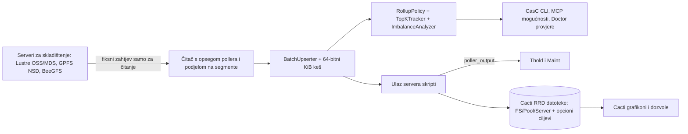

<!-- Source: README.md; SHA256: e88d6875d113220a91cfc0a9d230c829a78477b17e6aa7e44dda38c9591c86ad -->

<!-- translations:start -->
[English](../../../README.md) | [简体中文](../zh-CN/README.md) | [हिन्दी](../hi-IN/README.md) | [Español (España)](../es-ES/README.md) | [Español (Latinoamérica)](../es-419/README.md) | [العربية (السعودية)](../ar-SA/README.md) | [Afrikaans](../af-ZA/README.md) | [አማርኛ](../am-ET/README.md) | [العربية (مصر)](../ar-EG/README.md) | [العربية (المغرب)](../ar-MA/README.md) | [বাংলা](../bn-BD/README.md) | [Bosanski](README.md) | [Deutsch](../de-DE/README.md) | [فارسی](../fa-IR/README.md) | [Filipino](../fil-PH/README.md) | [Français](../fr-FR/README.md) | [Français (Maroc)](../fr-MA/README.md) | [Français (Sénégal)](../fr-SN/README.md) | [Hausa](../ha-NG/README.md) | [עברית](../he-IL/README.md) | [Hrvatski](../hr-HR/README.md) | [Bahasa Indonesia](../id-ID/README.md) | [Igbo](../ig-NG/README.md) | [Italiano](../it-IT/README.md) | [日本語](../ja-JP/README.md) | [한국어](../ko-KR/README.md) | [Malagasy](../mg-MG/README.md) | [मराठी](../mr-IN/README.md) | [Bahasa Melayu](../ms-MY/README.md) | [Nederlands](../nl-NL/README.md) | [Polski](../pl-PL/README.md) | [Português (Brasil)](../pt-BR/README.md) | [Русский](../ru-RU/README.md) | [Kinyarwanda](../rw-RW/README.md) | [Soomaali](../so-SO/README.md) | [Српски](../sr-RS/README.md) | [Svenska](../sv-SE/README.md) | [Kiswahili](../sw-KE/README.md) | [தமிழ்](../ta-IN/README.md) | [తెలుగు](../te-IN/README.md) | [ไทย](../th-TH/README.md) | [Türkçe](../tr-TR/README.md) | [Українська](../uk-UA/README.md) | [اردو](../ur-PK/README.md) | [Tiếng Việt](../vi-VN/README.md) | [isiXhosa](../xh-ZA/README.md) | [Yorùbá](../yo-NG/README.md) | [繁體中文](../zh-TW/README.md) | [isiZulu](../zu-ZA/README.md)
<!-- translations:end -->

# plugin_pfs

Dodatak za Cacti 1.2 koji u Cacti donosi stanje zdravlja, kapacitet, neravnotežu popunjenosti, protok po cilju i stope operacija metapodataka paralelnih datotečnih sistema za Lustre, IBM Storage Scale (GPFS) i BeeGFS iza jedinstvenog `Backend` interfejsa. Svaki datotečni sistem mapira se na standardni Cacti uređaj s upitima podataka, preglednim grafikonima i grafikonima po cilju na zahtjev, te zbirnim mjeračima tako da Thold i Maint bez ikakvih izmjena šalju upozorenja i potiskuju alarme.

> **Status: faze 1 do 3 i primitivi za eksaskalno skaliranje implementirani u kodu, još nije objavljeno.** Temelji, praćenje sistema Lustre, alarmiranje i potiskivanje u dodatku Maint, upravljački programi samo za čitanje za GPFS i BeeGFS, analiza neravnoteže OST/MDT s integracijom za Maint, obuhvat udaljenog prikupljača podataka (`replicate_out`, `remote_agent`), primitivi za skaliranje na 100+ PB / eksaskalu (`FramedReportParser`, shema v4 `value_kib`, `RollupPolicy`, `TopKTracker`, `ShardAssigner`, `BatchUpserter`), CasC CLI za operatore (`cli/pfs.php`) i sistemske kuke (`abilities_register`, `doctor_register_checks`, `casc_register_providers`) implementirani su i potvrđeni jediničnim, sigurnosnim i integracionim testovima na privremenoj Cacti instanci. Sva dosadašnja pokretanja koriste testne izlaze čvorova umjesto stvarnog Lustre, GPFS ili BeeGFS hardvera. Prije označavanja izdanja ostaju otvoreni: pilot-testiranja na stvarnim datotečnim sistemima ([pilot plan](../../pilot-plan.md)), vanjski sigurnosni pregled ([samoprovjera](../../security-review.md)) i mjerenja skalabilnosti na dokumentovanom hardveru ([skalabilnost](../../research/scale.md)). Verzija 0.1.0 pripremljena je u datotekama `INFO` i [CHANGELOG.md](../../../CHANGELOG.md), ali još nije označena oznakom.

## Uloge pristupa

| Područje ovlaštenja | Pristup |
| --- | --- |
| Parallel Filesystem View | Postojeće stranice za nadzor. |
| Parallel Filesystem Operator | Nadzor plus stranica Operacije i lične potvrde trijaže. |
| Parallel Filesystem Admin | Operatorski pristup plus postojeće postavke i administrativne radnje. |

Nakon kopiranja datoteka za nadogradnju, otvorite stranicu Dodaci kao administrator da registrujete novo područje ovlaštenja. Eksplicitno dodijelite područje Operator pod **Configuration > Users** ili korisničkim grupama. Nadogradnje zadržavaju postojeće ID-ove i dodjele za područja View i Admin. Pristup Admin nasljeđuje pristup Operator, a pristup Operator nasljeđuje pristup View pri svakom zahtjevu; time se korisnicima ili grupama ne dodaju pohranjene dozvole. Postavke dodatka također zahtijevaju pristup Parallel Filesystem Admin pored Cacti dozvole za postavke.

Cacti dozvole za uređaje i dalje ograničavaju redove i radnje dostupne svakom korisniku; za nemapirane objekte potreban je administrator. Pristupni podaci, konfiguracija, mapiranje, brisanje i ostale administrativne izmjene ostaju na administrativnim stranicama. Potvrde traju samo u trenutnoj korisničkoj sesiji, najduže jedan sat i samo dok isto opažanje ostaje svježe. Nova ili promijenjena opažanja ih poništavaju. One nikada ne označavaju neuspješno mjerenje kao ispravno niti potiskuju alarme.

## Zašto

Kada je dijeljeni datotečni sistem spor, tragovi su raspoređeni na više servera. Lustre čuva svoje brojače po čvoru: `lctl get_param` prikazuje vrijednosti "na lokalnom čvoru", tako da svaki server za skladištenje objekata (OSS) i server metapodataka (MDS) drži samo brojeve za vlastite ciljeve. Operator koji istražuje spor datotečni sistem treba tri odgovora sa različitih mjesta:

- **Puni li se jedan cilj dok su ostali prazni?** Neravnoteža popunjenosti mijenja mjesto na koje se smještaju nove datoteke i određuje kada će pojedini cilj ostati bez prostora.
- **Koji su ciljevi ili operacije opterećeni?** Brojači bajtova po cilju i brojači operacija po MDT-u pokazuju da li je opterećenje ograničeno podacima ili metapodacima.
- **Da li je sam nadzor ažuran?** Ravan grafikon je umirujući samo ako je dodatak zaista mogao vidjeti servere.

Cacti crta grafikone za računare i prati pragove putem dodatka Thold, a Cacti GitHub organizacija nema repozitorij za nadzor sistema Lustre, GPFS ili BeeGFS (pretraženo 2026-11-14). Ovaj dodatak popunjava tu prazninu čitanjem unaprijed odobrenih vrijednosti samo za čitanje sa čvorova za skladištenje i predstavljanjem svakog datotečnog sistema kao Cacti uređaja čiji su ciljevi indeksi upita podataka. Ponovo koristi Cacti grafikone, dozvole, udaljene prikupljače podataka, Thold i Maint umjesto da pravi njihove paralelne verzije.

## Planirani opseg

| Faza | Opseg | Status | Prekretnice |
|---|---|---|---|
| 0, istraživanje | Matrica izdanja, odluka o pristupu čvorovima, potvrda uzvodnog ponašanja, ponašanje brojača i prebacivanja u slučaju kvara, mjerenja skalabilnosti | Završeno | [M1](https://github.com/somethingwithproof/plugin_pfs/milestone/1) |
| 1, praćenje | Lustre inventar, kapacitet i popunjenost, OST/MDT neravnoteža (`lib/ImbalanceAnalyzer.php`), Maint integracija (`lib/HealthPage.php`), OST protok, MDT stope operacija, grafikoni, Thold alarmiranje, stranica zdravlja | Implementirano (testirano s testnim uzorcima) | [M2](https://github.com/somethingwithproof/plugin_pfs/milestone/2), [M3](https://github.com/somethingwithproof/plugin_pfs/milestone/3), [M4](https://github.com/somethingwithproof/plugin_pfs/milestone/4) |
| 2, udaljeno i skaliranje | Prikupljanje s opsegom po polleru (`lib/Reader.php`, `lib/ReplicationRepository.php`, `replicate_out`, `remote_agent`), primitivi za skaliranje na 100+ PB (64-bitna KiB higijena + shema v4 `value_kib`, `lib/RollupPolicy.php`, `lib/TopKTracker.php`, `lib/ShardAssigner.php` + `poller_pfs.php --shard=K/N`, `lib/BatchUpserter.php`), CasC CLI (`cli/pfs.php`), MCP/Doctor/CasC kuke | Implementirano (jedinični i CI integracioni testovi) | [M5](https://github.com/somethingwithproof/plugin_pfs/milestone/5) |
| 3, pozadinski sistemi | Upravljački programi samo za čitanje za IBM Storage Scale (GPFS) (`lib/GpfsBackend.php`) i BeeGFS (`lib/BeegfsBackend.php`) registrovani u `BackendRegistry::production()` | Implementirano (jedinični testovi) | [M6](https://github.com/somethingwithproof/plugin_pfs/milestone/6) |

Ključni implementirani operatorski primitivi i primitivi za skaliranje:

- **Upravljački programi samo za čitanje za više datotečnih sistema:** `LustreBackend`, `GpfsBackend` (isključivo uokvireni `mmpmon` `fs_io_s`/`io_s` sa zabranjenom naredbom `reset`, kapaciteti/stanja skupova `mmdf` i sažeci čekanja) i `BeegfsBackend` (ciljevi skladištenja i metapodataka za BeeGFS 7.4 i 8.x s tačnom konverzijom bajtova u KiB, mapiranjem stanja dostupnosti i konzistentnosti te semantikom mjerača po intervalu) koji dijele `lib/FramedReportParser.php`.
- **Neravnoteža, preostali prostor i svjesnost o Maintu:** `lib/ImbalanceAnalyzer.php` izračunava omjere popunjenosti OST/MDT, raspon, indeks neravnoteže populacione standardne devijacije, preostali prostor, provjeru svježine od 1 intervala (`missing_targets`), zastavice statusa po cilju i ograničene Top-K ciljeve s najvećim odstupanjem. `HealthPage` (`pfs_health.php`) i `CascProvider::health()` prikazuju Cacti `Maint` prozore održavanja i potiskuju aktivna upozorenja o greškama tokom zakazanog održavanja.
- **Skaliranje na 100+ PB i eksaskalu** ([docs/architecture/exascale-scaling.md](../../architecture/exascale-scaling.md)): tačna decimalna konverzija bajtova u KiB (`FramedReportParser::bytesToKibInt()`) potvrđena na 500 PB i 2 EB uz kolone `BIGINT UNSIGNED value_kib` (shema v4); hijerarhijske RRD agregacije `Filesystem -> Pool -> Storage Server` s ograničenim promovisanjem opcionih, vrućih i neuravnoteženih ciljeva (`lib/RollupPolicy.php`); ograničeni $O(K)$ Top-K neuravnoteženi ciljevi i unaprijed agregirani sažeci zahtjevnih poslova/klijenata (`lib/TopKTracker.php`, bez ikakvog kreiranja uređaja ili RRD-ova po klijentu); deterministička CRC32 podjela prikupljača (`lib/ShardAssigner.php`, `php plugins/pfs/poller_pfs.php [--poller=N] [--shard=K/N] [--force] [--debug]`); te grupna SQL umetanja/ažuriranja od po 500 redova uz paginaciju po ključu (`lib/BatchUpserter.php`, `CacheRepository::upsertObservationsBatch()`, `TargetRepository::forFilesystemPage()`).
- **Operatorski CasC CLI i sistemske kuke:** `cli/pfs.php` podržava `export [--format=yaml|xml]`, `validate <file> [--format=yaml|xml]`, `plan <file> [--format=yaml|xml] [--output=text|json]`, `apply <file> --confirm=<PLAN_HASH> [--format=yaml|xml]` i `health [--format=text|json]` bez ikakvih vanjskih Composer zavisnosti. `setup.php` i `lib/EcosystemIntegration.php` registruju `abilities_register` (`pfs-list-filesystems`, `pfs-get-imbalance`, `pfs-get-health`; samo za čitanje, ograničeno dozvolom `Parallel Filesystem View` i Cacti dozvolama uređaja), `doctor_register_checks` (`pfs_schema`, `pfs_reader_freshness`, `pfs_capacity_imbalance`), `casc_register_providers`, `replicate_out` i `remote_agent`.

Izvan opsega: bilo kakve operacije pisanja, brisanja, resetovanja ili podešavanja na čvoru ili datotečnom sistemu; vlastiti sistem alarmiranja u dodatku; prilagođeni demon ili mrežni protokol; Cacti uređaji/RRD-ovi po poslu ili po klijentu; izmjene jezgra sistema Cacti, dodatka Thold ili dodatka Maint.

## Ciljevi kompatibilnosti

| Komponenta | Cilj |
|---|---|
| Cacti | 1.2.31 ili noviji, bez zakrpa jezgra |
| PHP | 8.2 ili noviji; `setup.php`, `poller_pfs.php` i `cli/pfs.php` ostaju sintaksno čitljivi na verziji 8.0 kako bi nepodržano okruženje dobilo uredno odbijanje umjesto pokvarenog Cacti interfejsa |
| Lustre | Izvorni kod i priručnici provjereni na verziji 2.17.0; testirano na testnim uzorcima |
| GPFS, BeeGFS | Upravljački programi samo za čitanje za IBM Storage Scale (GPFS) 5.x `mmpmon`/`mmdf` i BeeGFS 7.4 / 8.x implementirani i testirani na testnim uzorcima |
| Thold, Maint | Thold 1.8.2 i Maint 1.3, bez izmjena |

## Dizajn

- [docs/architecture/exascale-scaling.md](../../architecture/exascale-scaling.md) dokumentuje dvoslojnu telemetrijsku arhitekturu za 100+ PB / eksaskalu (sloj servera Cacti/`plugin_pfs` + agregacije + Top-K uparen s izvanpojasnom klijentskom telemetrijom LDMS/Darshan/TOKIO) i njen akademski kontekst.
- [docs/PLAN.md](../../PLAN.md) predstavlja potpuni plan: arhitekturu, uzvodne činjenice na koje se oslanja (s izvorima i naznakom šta još nije provjereno), semantiku brojača, model stanja, sigurnosne granice, proračun performansi, testiranje i rizike.
- [docs/operator-guide.md](../../operator-guide.md) pokriva instalaciju, grafikone i vrijednosti, nadogradnju, sigurnosnu kopiju i vraćanje, deinstalaciju i rješavanje grešaka; [docs/alerting.md](../../alerting.md) pokriva Thold i Maint.
- [docs/node-setup.md](../../node-setup.md) opisuje kako konfigurisati Lustre server i poller za čitač.
- [docs/decisions/](../../decisions) sadrži zapise o arhitektonskim odlukama koje su već donesene.
- [docs/REQUIREMENTS.md](../../REQUIREMENTS.md) povezuje svaki ID zahtjeva sa pripadajućim tiketom.

## Kako se prati rad

- **Prekretnice** prate prekretnice iz plana. Svaka ima krovni tiket sa spiskom podtiketa i dokazima završetka.
- **Tiketi** su označeni po tipu: `type: requirement`, `type: research`, `type: decision`, `type: epic`. Tiketi zahtjeva navode numerisane, provjerljive zahtjeve (`REQ-AREA-NNN`) i kriterije prihvatanja.
- **Oznake** također nose `area:`, `phase:`, `priority:` i `status:`. Pogledajte [CONTRIBUTING.md](../../../CONTRIBUTING.md#labels).
- [Projektna tabla](https://github.com/users/somethingwithproof/projects/11) prikazuje sve tikete kroz sve prekretnice.

## Doprinos

Pročitajte [CONTRIBUTING.md](../../../CONTRIBUTING.md). Commit poruke zahtijevaju DCO potpis. Rasprave o dizajnu vode se u tiketima; otvorene odluke nose oznaku `type: decision`.

## Sigurnost

Sigurnosne ranjivosti prijavite povjerljivo; pogledajte [SECURITY.md](../../../SECURITY.md).

## Licenca

GNU General Public License v2.0, ista licenca kao za Cacti i njegove dodatke. Pogledajte [LICENSE](../../../LICENSE).
