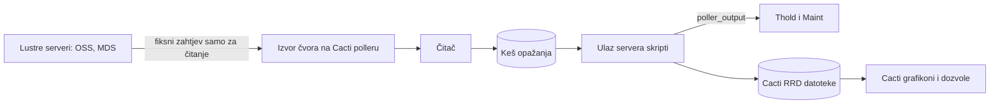

<!-- Source: README.md; SHA256: 40f2c5a5e9be97e4bd2b05a9ebab2a77de51de3af1b1c21dbeb5ee7f936cdd3b -->

<!-- translations:start -->
[English](../../../README.md) | [简体中文](../zh-CN/README.md) | [हिन्दी](../hi-IN/README.md) | [Español (España)](../es-ES/README.md) | [Español (Latinoamérica)](../es-419/README.md) | [العربية (السعودية)](../ar-SA/README.md) | [Afrikaans](../af-ZA/README.md) | [አማርኛ](../am-ET/README.md) | [العربية (مصر)](../ar-EG/README.md) | [العربية (المغرب)](../ar-MA/README.md) | [বাংলা](../bn-BD/README.md) | [Bosanski](README.md) | [Deutsch](../de-DE/README.md) | [فارسی](../fa-IR/README.md) | [Filipino](../fil-PH/README.md) | [Français](../fr-FR/README.md) | [Français (Maroc)](../fr-MA/README.md) | [Français (Sénégal)](../fr-SN/README.md) | [Hausa](../ha-NG/README.md) | [עברית](../he-IL/README.md) | [Hrvatski](../hr-HR/README.md) | [Bahasa Indonesia](../id-ID/README.md) | [Igbo](../ig-NG/README.md) | [Italiano](../it-IT/README.md) | [日本語](../ja-JP/README.md) | [한국어](../ko-KR/README.md) | [Malagasy](../mg-MG/README.md) | [मराठी](../mr-IN/README.md) | [Bahasa Melayu](../ms-MY/README.md) | [Nederlands](../nl-NL/README.md) | [Polski](../pl-PL/README.md) | [Português (Brasil)](../pt-BR/README.md) | [Русский](../ru-RU/README.md) | [Kinyarwanda](../rw-RW/README.md) | [Soomaali](../so-SO/README.md) | [Српски](../sr-RS/README.md) | [Svenska](../sv-SE/README.md) | [Kiswahili](../sw-KE/README.md) | [தமிழ்](../ta-IN/README.md) | [తెలుగు](../te-IN/README.md) | [ไทย](../th-TH/README.md) | [Türkçe](../tr-TR/README.md) | [Українська](../uk-UA/README.md) | [اردو](../ur-PK/README.md) | [Tiếng Việt](../vi-VN/README.md) | [isiXhosa](../xh-ZA/README.md) | [Yorùbá](../yo-NG/README.md) | [繁體中文](../zh-TW/README.md) | [isiZulu](../zu-ZA/README.md)
<!-- translations:end -->

# plugin_pfs

Dodatak za Cacti 1.2 koji u Cacti donosi stanje zdravlja i opterećenje paralelnih datotečnih sistema: kapacitet i neravnotežu popunjenosti po ciljevima, protok po cilju i stope operacija metapodataka. Lustre je prvi pozadinski sistem. GPFS (IBM Storage Scale) i BeeGFS slijede iza zajedničkog interfejsa pozadinskog sistema. Podaci završavaju u standardnim Cacti uređajima, izvorima podataka i grafikonima, tako da Thold i Maint bez ikakvih izmjena šalju upozorenja i potiskuju alarme.

> **Status: prekretnica 4, kod završen za fazu 1, još nije objavljeno.** Prekretnice 2 (temelji), 3 (praćenje sistema Lustre) i 4 (alarmiranje i priprema za objavu) završene su na grani `main` ili su u pregledu. Dodatak se instalira, nadograđuje i deinstalira kroz Cacti API za dodatke i odbija PHP verzije starije od 8.2. Pozadinski čitač na svakom polleru čita Lustre servere preko SSH veze pomoću fiksne prisilne komande ([node/pfs-read.sh](../../../node/pfs-read.sh)) i kešira inventar, uslov rada, kapacitet i brojače zajedno s njihovom svježinom. Svaki datotečni sistem postaje Cacti uređaj s OST i MDT upitima podataka, pet preglednih grafikona, grafikonima po cilju na zahtjev i zbirnim izvorom podataka za Thold. Neizmijenjeni Thold v1.8.2 i Maint v1.3 u cjelovitom testnom izvršavanju alarmiraju i potiskuju alarme na zbirnim mjerenjima; Thold pragovi na brojačima nisu podržani u verziji Thold 1.8.2 ([docs/alerting.md](../../alerting.md)). Svi dosadašnji testovi pokreću se na testnim izlazima čvorova u privremenoj Cacti instanci: dodatak još nije pokrenut na stvarnom Lustre čvoru. Prije objave ostaju otvoreni: pilot-testiranja na stvarnim datotečnim sistemima ([pilot plan](../../pilot-plan.md)), vanjski sigurnosni pregled ([samoprovjera](../../security-review.md)) i mjerenja skalabilnosti na dokumentovanom hardveru ([skalabilnost](../../research/scale.md)). Verzija 0.1.0 pripremljena je u datotekama `INFO` i [CHANGELOG.md](../../../CHANGELOG.md), ali još nije označena oznakom.

## Uloge pristupa

| Područje ovlaštenja | Pristup |
| --- | --- |
| Parallel Filesystem View | Postojeće stranice za nadzor. |
| Parallel Filesystem Operator | Nadzor plus stranica Operacije i lične potvrde trijaže. |
| Parallel Filesystem Admin | Operatorski pristup plus postojeće postavke i administrativne radnje. |

Nakon kopiranja datoteka za nadogradnju, otvorite stranicu Dodaci kao administrator da registrujete novo područje ovlaštenja. Eksplicitno dodijelite područje Operator pod **Configuration > Users** ili korisničkim grupama. Nadogradnje zadržavaju postojeće ID-ove i dodjele za područja View i Admin. Pristup Admin nasljeđuje pristup Operator, a pristup Operator nasljeđuje pristup View pri svakom zahtjevu; time se korisnicima ili grupama ne dodaju pohranjene dozvole. Postavke dodatka također zahtijevaju pristup Parallel Filesystem Admin pored Cacti dozvole za postavke.

Cacti dozvole za uređaje i dalje ograničavaju redove i radnje dostupne svakom korisniku; za nemapirane objekte potreban je administrator. Pristupni podaci, konfiguracija, mapiranje, brisanje i ostale administrativne izmjene ostaju na administrativnim stranicama. Potvrde traju samo u trenutnoj korisničkoj sesiji, najduže jedan sat i samo dok isto opažanje ostaje svježe. Nova ili promijenjena opažanja ih poništavaju. One nikada ne označavaju neuspješno mjerenje kao ispravno niti potiskuju alarme.

## Zašto

Kada je dijeljeni datotečni sistem spor, tragovi su raspoređeni na više servera. Lustre čuva svoje brojače po čvoru: `lctl get_param` prikazuje vrijednosti "na lokalnom čvoru", tako da svaki server za skladištenje objekata (OSS) i server metapodataka (MDS) drži samo brojeve za vlastite ciljeve. Operator koji istražuje spor datotečni sistem treba tri odgovora sa različitih mjesta:

- **Puni li se jedan cilj dok su ostali prazni?** Neravnoteža popunjenosti mijenja mjesto na koje se smještaju nove datoteke i određuje kada će pojedini cilj ostati bez prostora.
- **Koji su ciljevi ili operacije opterećeni?** Brojači bajtova po cilju i brojači operacija po MDT-u pokazuju da li je opterećenje ograničeno podacima ili metapodacima.
- **Da li je sam nadzor ažuran?** Ravan grafikon je umirujući samo ako je dodatak zaista mogao vidjeti servere.

Cacti crta grafikone za računare i prati pragove putem dodatka Thold, a Cacti GitHub organizacija nema repozitorij za nadzor sistema Lustre, GPFS ili BeeGFS (pretraženo 2026-11-14). Ovaj dodatak popunjava tu prazninu čitanjem unaprijed odobrenih vrijednosti samo za čitanje sa čvorova za skladištenje i predstavljanjem svakog datotečnog sistema kao Cacti uređaja čiji su ciljevi indeksi upita podataka. Ponovo koristi Cacti grafikone, dozvole, udaljene prikupljače podataka, Thold i Maint umjesto da pravi njihove paralelne verzije.

## Planirani opseg

| Faza | Opseg | Prekretnice |
|---|---|---|
| 0, istraživanje | Matrica izdanja, odluka o pristupu čvorovima, potvrda uzvodnog ponašanja, ponašanje brojača i prebacivanja u slučaju kvara, mjerenja skalabilnosti | [M1](https://github.com/somethingwithproof/plugin_pfs/milestone/1) |
| 1, praćenje | Lustre inventar, kapacitet i popunjenost, OST protok, MDT stope operacija, grafikoni, Thold alarmiranje, Maint potiskivanje, stranica zdravlja | [M2](https://github.com/somethingwithproof/plugin_pfs/milestone/2), [M3](https://github.com/somethingwithproof/plugin_pfs/milestone/3), [M4](https://github.com/somethingwithproof/plugin_pfs/milestone/4) |
| 2, dubina | Cacti udaljeni prikupljači podataka, prikazi na nivou poslova i klijenata unutar ograničenog broja objekata | [M5](https://github.com/somethingwithproof/plugin_pfs/milestone/5) |
| 3, pozadinski sistemi | Pozadinski sistemi GPFS (IBM Storage Scale) i BeeGFS | [M6](https://github.com/somethingwithproof/plugin_pfs/milestone/6) |

Izvan opsega: bilo kakve operacije pisanja, brisanja, resetovanja ili podešavanja na čvoru ili datotečnom sistemu; vlastiti sistem alarmiranja u dodatku; prilagođeni demon ili mrežni protokol; izvori podataka po poslu; izmjene jezgra sistema Cacti, dodatka Thold ili dodatka Maint.

## Ciljevi kompatibilnosti

| Komponenta | Cilj |
|---|---|
| Cacti | 1.2.31 ili noviji, bez zakrpa jezgra |
| PHP | 8.2 ili noviji; `setup.php` ostaje sintaksno čitljiv na verziji 8.0 kako bi nepodržano okruženje dobilo uredno odbijanje umjesto pokvarenog Cacti interfejsa |
| Lustre | Linije izdanja koje će biti definisane do prekretnice 1; dosad provjereni izvorni kod i priručnici su na verziji 2.17.0 |
| GPFS, BeeGFS | Faza 3; izdanja će biti definisana istraživanjem |
| Thold, Maint | Nisu potrebne nikakve izmjene |

## Dizajn

- [docs/PLAN.md](../../PLAN.md) predstavlja potpuni plan: arhitekturu, uzvodne činjenice na koje se oslanja (s izvorima i naznakom šta još nije provjereno), semantiku brojača, model stanja, sigurnosne granice, proračun performansi, testiranje i rizike.
- [docs/operator-guide.md](../../operator-guide.md) pokriva instalaciju, grafikone i vrijednosti, nadogradnju, sigurnosnu kopiju i vraćanje, deinstalaciju i rješavanje grešaka; [docs/alerting.md](../../alerting.md) pokriva Thold i Maint.
- [docs/node-setup.md](../../node-setup.md) opisuje kako konfigurisati Lustre server i poller za čitač.
- [docs/decisions/](../../decisions) sadrži zapise o arhitektonskim odlukama koje su već donesene.
- [docs/REQUIREMENTS.md](../../REQUIREMENTS.md) povezuje svaki ID zahtjeva sa pripadajućim tiketom.

## Kako se prati rad

- **Prekretnice** prate prekretnice iz plana. Svaka ima krovni tiket sa spiskom podtiketa i dokazima završetka.
- **Tiketi** su označeni po tipu: `type: requirement`, `type: research`, `type: decision`, `type: epic`. Tiketi zahtjeva navode numerisane, provjerljive zahtjeve (`REQ-AREA-NNN`) i kriterije prihvatanja.
- **Oznake** također nose `area:`, `phase:`, `priority:` i `status:`. Pogledajte [CONTRIBUTING.md](../../../CONTRIBUTING.md#labels).
- [Projektna tabla](https://github.com/users/somethingwithproof/projects/11) prikazuje sve tikete kroz sve prekretnice.

## Doprinos

Pročitajte [CONTRIBUTING.md](../../../CONTRIBUTING.md). Commit poruke zahtijevaju DCO potpis. Rasprave o dizajnu vode se u tiketima; otvorene odluke nose oznaku `type: decision`.

## Sigurnost

Sigurnosne ranjivosti prijavite povjerljivo; pogledajte [SECURITY.md](../../../SECURITY.md).

## Licenca

GNU General Public License v2.0, ista licenca kao za Cacti i njegove dodatke. Pogledajte [LICENSE](../../../LICENSE).
