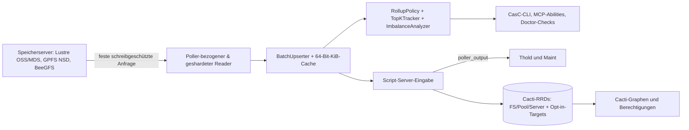

<!-- Source: README.md; SHA256: e88d6875d113220a91cfc0a9d230c829a78477b17e6aa7e44dda38c9591c86ad -->

<!-- translations:start -->
[English](../../../README.md) | [简体中文](../zh-CN/README.md) | [हिन्दी](../hi-IN/README.md) | [Español (España)](../es-ES/README.md) | [Español (Latinoamérica)](../es-419/README.md) | [العربية (السعودية)](../ar-SA/README.md) | [Afrikaans](../af-ZA/README.md) | [አማርኛ](../am-ET/README.md) | [العربية (مصر)](../ar-EG/README.md) | [العربية (المغرب)](../ar-MA/README.md) | [বাংলা](../bn-BD/README.md) | [Bosanski](../bs-BA/README.md) | [Deutsch](README.md) | [فارسی](../fa-IR/README.md) | [Filipino](../fil-PH/README.md) | [Français](../fr-FR/README.md) | [Français (Maroc)](../fr-MA/README.md) | [Français (Sénégal)](../fr-SN/README.md) | [Hausa](../ha-NG/README.md) | [עברית](../he-IL/README.md) | [Hrvatski](../hr-HR/README.md) | [Bahasa Indonesia](../id-ID/README.md) | [Igbo](../ig-NG/README.md) | [Italiano](../it-IT/README.md) | [日本語](../ja-JP/README.md) | [한국어](../ko-KR/README.md) | [Malagasy](../mg-MG/README.md) | [मराठी](../mr-IN/README.md) | [Bahasa Melayu](../ms-MY/README.md) | [Nederlands](../nl-NL/README.md) | [Polski](../pl-PL/README.md) | [Português (Brasil)](../pt-BR/README.md) | [Русский](../ru-RU/README.md) | [Kinyarwanda](../rw-RW/README.md) | [Soomaali](../so-SO/README.md) | [Српски](../sr-RS/README.md) | [Svenska](../sv-SE/README.md) | [Kiswahili](../sw-KE/README.md) | [தமிழ்](../ta-IN/README.md) | [తెలుగు](../te-IN/README.md) | [ไทย](../th-TH/README.md) | [Türkçe](../tr-TR/README.md) | [Українська](../uk-UA/README.md) | [اردو](../ur-PK/README.md) | [Tiếng Việt](../vi-VN/README.md) | [isiXhosa](../xh-ZA/README.md) | [Yorùbá](../yo-NG/README.md) | [繁體中文](../zh-TW/README.md) | [isiZulu](../zu-ZA/README.md)
<!-- translations:end -->

# plugin_pfs

Ein Cacti-1.2-Plugin, das Zustand, Kapazität, ungleichmäßige Füllstände (Fill Imbalance), Durchsatz pro Target sowie Metadaten-Operationsraten paralleler Dateisysteme über Lustre, IBM Storage Scale (GPFS) und BeeGFS hinweg hinter einer einheitlichen `Backend`-Schnittstelle in Cacti integriert. Jedes Dateisystem wird auf ein reguläres Cacti-Gerät mit Datenabfragen, Übersichts- und bedarfsweisen Target-Graphen sowie zusammenfassenden Messwerten abgebildet, sodass Thold und Maint unverändert darauf basierend alarmieren und Alarme unterdrücken können.

> **Status: Phasen 1 bis 3 sowie Exascale-Skalierungsprimitive im Code implementiert, noch nicht veröffentlicht.** Grundlagen, Lustre-Beobachtung, Alarmierung und Maint-Unterdrückung, schreibgeschützte Treiber für GPFS und BeeGFS, OST/MDT-Ungleichgewichtsanalyse mit Maint-Integration, Poller-bezogene Erfassung über Remote Data Collectors (`replicate_out`, `remote_agent`), 100+ PB / Exascale-Skalierungsprimitive (`FramedReportParser`, Schema v4 `value_kib`, `RollupPolicy`, `TopKTracker`, `ShardAssigner`, `BatchUpserter`), die CasC-Betreiber-CLI (`cli/pfs.php`) sowie Ökosystem-Hooks (`abilities_register`, `doctor_register_checks`, `casc_register_providers`) sind implementiert und durch Unit-, Sicherheits- und Wegwerf-Cacti-Integrationstests verifiziert. Alle bisherigen Läufe nutzen Fixture-Ausgaben von Nodes anstelle echter Lustre-, GPFS- oder BeeGFS-Hardware. Vor dem Taggen eines Releases noch offen: Pilotbetriebe auf echten Dateisystemen ([Pilotplan](../../pilot-plan.md)), ein externes Security-Review ([Selbstprüfung](../../security-review.md)) sowie Skalierungsmessungen auf dokumentierter Hardware ([Skalierung](../../research/scale.md)). Version 0.1.0 ist in `INFO` und [CHANGELOG.md](../../../CHANGELOG.md) vorbereitet, aber noch nicht getaggt.

## Zugriffsrollen

| Realm | Zugriff |
| --- | --- |
| Parallel Filesystem View | Bestehende Überwachungsseiten. |
| Parallel Filesystem Operator | Überwachung sowie die Seite „Operations“ und persönliche Triage-Bestätigungen. |
| Parallel Filesystem Admin | Operator-Zugriff sowie die bestehenden Konfigurations- und Verwaltungsaktionen. |

Öffnen Sie nach dem Kopieren der Upgrade-Dateien als Administrator die Seite „Plugins“, um den neuen Realm zu registrieren. Weisen Sie den Operator-Realm explizit unter **Configuration > Users** oder Benutzergruppen zu. Upgrades behalten die bestehenden IDs und Berechtigungen für die Realms View und Admin bei. Admin-Zugriff erbt bei jeder Anfrage den Operator-Zugriff, und Operator-Zugriff erbt den View-Zugriff; dadurch werden Benutzern oder Gruppen keine zusätzlichen gespeicherten Berechtigungen hinzugefügt. Für Plugin-Einstellungen ist zusätzlich zur Cacti-Berechtigung „Settings“ der Zugriff über „Parallel Filesystem Admin“ erforderlich.

Cacti-Geräteberechtigungen schränken weiterhin die für jeden Benutzer verfügbaren Zeilen und Aktionen ein; nicht zugeordnete Objekte erfordern einen Administrator. Zugangsdaten, Konfiguration, Zuordnung, Löschung und weitere administrative Änderungen verbleiben auf den Verwaltungsseiten. Bestätigungen gelten nur in der aktuellen Benutzersitzung, maximal eine Stunde lang und nur so lange, wie dieselbe Beobachtung aktuell bleibt. Neue oder geänderte Beobachtungen machen sie ungültig. Sie markieren niemals eine fehlgeschlagene Messung als fehlerfrei und unterdrücken keine Alarme.

## Warum

Wenn ein gemeinsam genutztes Dateisystem langsam ist, verteilen sich die Hinweise auf mehrere Server. Lustre führt seine Zähler pro Node: `lctl get_param` meldet Werte „auf dem lokalen Node“, sodass jeder Object Storage Server (OSS) und Metadata Server (MDS) nur die Zahlen seiner eigenen Targets vorhält. Ein Operator, der ein langsames Dateisystem untersucht, benötigt drei Antworten aus unterschiedlichen Quellen:

- **Füllt sich ein Target, während andere leer bleiben?** Eine ungleichmäßige Auslastung beeinflusst, wo neue Dateien abgelegt werden und wann ein einzelnes Target keinen Speicherplatz mehr hat.
- **Welche Targets oder Operationen sind stark ausgelastet?** Byte-Zähler pro Target und Operationszähler pro MDT zeigen, ob die Last daten- oder metadatenlimitiert ist.
- **Ist die Überwachung selbst aktuell?** Ein flacher Graph ist nur dann beruhigend, wenn das Plugin die Server tatsächlich erreichen konnte.

Cacti erstellt Graphen für Hosts und überwacht Schwellenwerte mit Thold, und die Cacti-GitHub-Organisation verfügt über kein Repository zur Überwachung von Lustre, GPFS oder BeeGFS (geprüft am 2026-11-14). Das Plugin schließt diese Lücke, indem es per Allowlist freigegebene, schreibgeschützte Werte von den Storage-Nodes ausliest und jedes Dateisystem als Cacti-Gerät abbildet, dessen Targets die Indizes einer Datenabfrage sind. Es nutzt Cactis Graphen, Berechtigungen, Remote Data Collectors, Thold und Maint weiter, anstatt parallele Eigenentwicklungen dafür aufzubauen.

## Geplanter Umfang

| Phase | Umfang | Status | Meilensteine |
|---|---|---|---|
| 0, Recherche | Release-Matrix, Entscheidung zum Node-Zugriff, Bestätigung des Upstream-Verhaltens, Zähler- und Failover-Verhalten, Skalierungsmessungen | Abgeschlossen | [M1](https://github.com/somethingwithproof/plugin_pfs/milestone/1) |
| 1, Beobachtung | Lustre-Inventar, Kapazität und Füllstand, OST/MDT-Ungleichgewicht (`lib/ImbalanceAnalyzer.php`), Maint-Integration (`lib/HealthPage.php`), OST-Durchsatz, MDT-Operationsraten, Graphen, Thold-Alarmierung, Statusseite | Implementiert (Fixture-getestet) | [M2](https://github.com/somethingwithproof/plugin_pfs/milestone/2), [M3](https://github.com/somethingwithproof/plugin_pfs/milestone/3), [M4](https://github.com/somethingwithproof/plugin_pfs/milestone/4) |
| 2, Remote und Skalierung | Poller-bezogene Remote-Erfassung (`lib/Reader.php`, `lib/ReplicationRepository.php`, `replicate_out`, `remote_agent`), 100+ PB-Skalierungsprimitive (64-Bit-KiB-Hygiene + Schema v4 `value_kib`, `lib/RollupPolicy.php`, `lib/TopKTracker.php`, `lib/ShardAssigner.php` + `poller_pfs.php --shard=K/N`, `lib/BatchUpserter.php`), CasC-CLI (`cli/pfs.php`), MCP/Doctor/CasC-Hooks | Implementiert (Unit- und CI-Integrationstests) | [M5](https://github.com/somethingwithproof/plugin_pfs/milestone/5) |
| 3, Backends | Schreibgeschützte Treiber für IBM Storage Scale (GPFS) (`lib/GpfsBackend.php`) und BeeGFS (`lib/BeegfsBackend.php`), registriert in `BackendRegistry::production()` | Implementiert (Unit-getestet) | [M6](https://github.com/somethingwithproof/plugin_pfs/milestone/6) |

Wichtigste implementierte Betreiber- und Skalierungsprimitive:

- **Schreibgeschützte Treiber für mehrere Dateisysteme:** `LustreBackend`, `GpfsBackend` (ausschließlich gerahmte `mmpmon` `fs_io_s`/`io_s`-Aufrufe bei gesperrtem `reset`, `mmdf`-Pool-Kapazitäten/-Zustände und Waiter-Zusammenfassungen) sowie `BeegfsBackend` (BeeGFS 7.4 und 8.x Speicher- und Metadaten-Targets mit exakter Byte-zu-KiB-Umrechnung, Zuordnung von Erreichbarkeits-/Konsistenzbedingungen und Gauge-Semantik pro Intervall) über das gemeinsame `lib/FramedReportParser.php`.
- **Ungleichgewicht, Reservekapazität und Maint-Erkennung:** `lib/ImbalanceAnalyzer.php` berechnet OST/MDT-Füllgrade, Spreizung, den Ungleichgewichtsindex über die Populationsstandardabweichung, Reservekapazität, die 1-Intervall-Aktualitätsprüfung (`missing_targets`), Status-Flags pro Target sowie begrenzte Top-K-Targets mit höchster Schieflage. `HealthPage` (`pfs_health.php`) und `CascProvider::health()` zeigen `Maint`-Wartungsfenster aus Cacti an und unterdrücken aktive Fehlerwarnungen während geplanter Wartungen.
- **Skalierung auf 100+ PB und Exascale** ([docs/architecture/exascale-scaling.md](../../architecture/exascale-scaling.md)): exakte dezimale Byte-zu-KiB-Umrechnung (`FramedReportParser::bytesToKibInt()`), verifiziert bei 500 PB und 2 EB zusammen mit `BIGINT UNSIGNED value_kib`-Spalten (Schema v4); hierarchische RRD-Rollups `Filesystem -> Pool -> Storage Server` mit begrenzter Heraufstufung von Opt-in-, stark belasteten oder schiefliegenden Targets (`lib/RollupPolicy.php`); begrenzte $O(K)$ Top-K-Schieflage-Targets und voraggregierte Zusammenfassungen schwerer Jobs/Clients (`lib/TopKTracker.php`, ohne jemals Geräte oder RRDs pro Client anzulegen); deterministisches CRC32-Collector-Sharding (`lib/ShardAssigner.php`, `php plugins/pfs/poller_pfs.php [--poller=N] [--shard=K/N] [--force] [--debug]`); sowie SQL-Batch-Upserts mit 500 Zeilen plus Keyset-Paginierung (`lib/BatchUpserter.php`, `CacheRepository::upsertObservationsBatch()`, `TargetRepository::forFilesystemPage()`).
- **Betreiber-CasC-CLI und Ökosystem-Hooks:** `cli/pfs.php` unterstützt `export [--format=yaml|xml]`, `validate <file> [--format=yaml|xml]`, `plan <file> [--format=yaml|xml] [--output=text|json]`, `apply <file> --confirm=<PLAN_HASH> [--format=yaml|xml]` und `health [--format=text|json]` ohne externe Composer-Abhängigkeiten. `setup.php` und `lib/EcosystemIntegration.php` registrieren `abilities_register` (`pfs-list-filesystems`, `pfs-get-imbalance`, `pfs-get-health`; schreibgeschützt, abgesichert über `Parallel Filesystem View` und Cacti-Geräteberechtigungen), `doctor_register_checks` (`pfs_schema`, `pfs_reader_freshness`, `pfs_capacity_imbalance`), `casc_register_providers`, `replicate_out` und `remote_agent`.

Außerhalb des Umfangs: jegliche Schreib-, Lösch-, Zurücksetz- oder Tuning-Operation auf einem Node oder Dateisystem; eine plugin-eigene Alarmierungs-Engine; ein eigener Daemon oder ein eigenes Netzwerkprotokoll; Cacti-Geräte/RRDs pro Job oder pro Client; Änderungen am Cacti-Core, an Thold oder an Maint.

## Kompatibilitätsziele

| Komponente | Ziel |
|---|---|
| Cacti | 1.2.31 oder neuer, keine Core-Patches |
| PHP | 8.2 oder neuer; `setup.php`, `poller_pfs.php` und `cli/pfs.php` bleiben unter 8.0 parsbar, sodass eine nicht unterstützte Laufzeitumgebung eine Ablehnung statt einer defekten Cacti-Oberfläche ausgibt |
| Lustre | Quellen und Handbücher geprüft auf Stand 2.17.0; Fixture-getestet |
| GPFS, BeeGFS | Schreibgeschützte Treiber für IBM Storage Scale (GPFS) 5.x `mmpmon`/`mmdf` und BeeGFS 7.4 / 8.x implementiert und Fixture-getestet |
| Thold, Maint | Thold 1.8.2 und Maint 1.3, unverändert |

## Design

- [docs/architecture/exascale-scaling.md](../../architecture/exascale-scaling.md) dokumentiert die zweistufige 100+ PB / Exascale-Telemetriearchitektur (Cacti/`plugin_pfs`-Server-, Rollup- und Top-K-Ebene kombiniert mit Out-of-Band-Client-Telemetrie über LDMS/Darshan/TOKIO) sowie den zugehörigen wissenschaftlichen Literaturkontext.
- [docs/PLAN.md](../../PLAN.md) enthält den vollständigen Plan: Architektur, vorausgesetzte Upstream-Fakten (mit Quellen und Angaben dazu, was noch nicht verifiziert ist), Zählersemantik, Zustandsmodell, Sicherheitsgrenzen, Leistungsberechnung, Tests und Risiken.
- [docs/operator-guide.md](../../operator-guide.md) behandelt Installation, Graphen und Messwerte, Upgrade, Backup und Wiederherstellung, Deinstallation sowie Fehlerbehebung; [docs/alerting.md](../../alerting.md) behandelt Thold und Maint.
- [docs/node-setup.md](../../node-setup.md) beschreibt, wie ein Lustre-Server und ein Poller für den Reader vorbereitet werden.
- [docs/decisions/](../../decisions) enthält Architecture Decision Records für bereits getroffene Entscheidungen.
- [docs/REQUIREMENTS.md](../../REQUIREMENTS.md) ordnet jede Anforderungs-ID dem zugehörigen Issue zu.

## Nachverfolgung der Arbeit

- **Meilensteine** folgen den Meilensteinen des Plans. Jeder besitzt ein Epic-Issue, das seine Unter-Issues und Abschlussnachweise auflistet.
- **Issues** werden über Labels typisiert: `type: requirement`, `type: research`, `type: decision`, `type: epic`. Anforderungs-Issues enthalten nummerierte, testbare Anforderungen (`REQ-AREA-NNN`) und Akzeptanzkriterien.
- **Labels** tragen außerdem `area:`, `phase:`, `priority:` und `status:`. Siehe [CONTRIBUTING.md](../../../CONTRIBUTING.md#labels).
- Das [Projektboard](https://github.com/users/somethingwithproof/projects/11) zeigt alle Issues über alle Meilensteine hinweg.

## Mitwirken

Lesen Sie [CONTRIBUTING.md](../../../CONTRIBUTING.md). Commits benötigen ein DCO-Sign-off. Designdiskussionen finden in Issues statt; offene Entscheidungen tragen das Label `type: decision`.

## Sicherheit

Melden Sie Sicherheitslücken vertraulich; siehe [SECURITY.md](../../../SECURITY.md).

## Lizenz

GNU General Public License v2.0, dieselbe Lizenz wie Cacti und seine Plugins. Siehe [LICENSE](../../../LICENSE).
