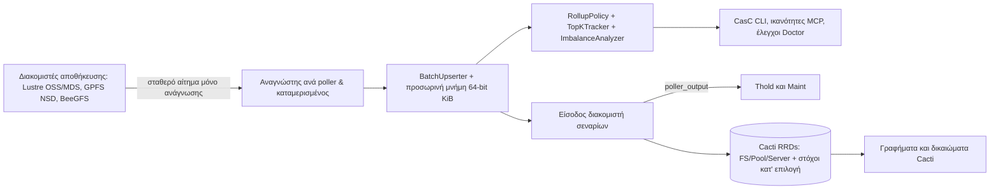

<!-- Source: README.md; SHA256: e88d6875d113220a91cfc0a9d230c829a78477b17e6aa7e44dda38c9591c86ad -->

<!-- translations:start -->
[English](../../../README.md) | [简体中文](../zh-CN/README.md) | [हिन्दी](../hi-IN/README.md) | [Español (España)](../es-ES/README.md) | [Español (Latinoamérica)](../es-419/README.md) | [العربية (السعودية)](../ar-SA/README.md) | [Afrikaans](../af-ZA/README.md) | [አማርኛ](../am-ET/README.md) | [العربية (مصر)](../ar-EG/README.md) | [العربية (المغرب)](../ar-MA/README.md) | [Български](../bg-BG/README.md) | [বাংলা](../bn-BD/README.md) | [Bosanski](../bs-BA/README.md) | [Deutsch](../de-DE/README.md) | [Ελληνικά](README.md) | [فارسی](../fa-IR/README.md) | [Filipino](../fil-PH/README.md) | [Français](../fr-FR/README.md) | [Français (Maroc)](../fr-MA/README.md) | [Français (Sénégal)](../fr-SN/README.md) | [Hausa](../ha-NG/README.md) | [עברית](../he-IL/README.md) | [Hrvatski](../hr-HR/README.md) | [Bahasa Indonesia](../id-ID/README.md) | [Igbo](../ig-NG/README.md) | [Italiano](../it-IT/README.md) | [日本語](../ja-JP/README.md) | [ქართული](../ka-GE/README.md) | [한국어](../ko-KR/README.md) | [Latviešu](../lv-LV/README.md) | [Malagasy](../mg-MG/README.md) | [मराठी](../mr-IN/README.md) | [Bahasa Melayu](../ms-MY/README.md) | [Nederlands](../nl-NL/README.md) | [Polski](../pl-PL/README.md) | [Português (Brasil)](../pt-BR/README.md) | [Português (Portugal)](../pt-PT/README.md) | [Русский](../ru-RU/README.md) | [Kinyarwanda](../rw-RW/README.md) | [Soomaali](../so-SO/README.md) | [Српски](../sr-RS/README.md) | [Svenska](../sv-SE/README.md) | [Kiswahili](../sw-KE/README.md) | [தமிழ்](../ta-IN/README.md) | [తెలుగు](../te-IN/README.md) | [ไทย](../th-TH/README.md) | [Türkçe](../tr-TR/README.md) | [Українська](../uk-UA/README.md) | [اردو](../ur-PK/README.md) | [Tiếng Việt](../vi-VN/README.md) | [isiXhosa](../xh-ZA/README.md) | [Yorùbá](../yo-NG/README.md) | [繁體中文](../zh-TW/README.md) | [isiZulu](../zu-ZA/README.md)
<!-- translations:end -->

# plugin_pfs

Ένα πρόσθετο για το Cacti 1.2 που φέρνει στο Cacti την υγεία, τη χωρητικότητα, την ανισορροπία πλήρωσης, τη διαμεταγωγή ανά στόχο και τους ρυθμούς λειτουργιών μεταδεδομένων παράλληλων συστημάτων αρχείων για Lustre, IBM Storage Scale (GPFS) και BeeGFS πίσω από μια ενιαία διεπαφή `Backend`. Κάθε σύστημα αρχείων αντιστοιχίζεται σε μια κανονική συσκευή Cacti με ερωτήματα δεδομένων, γραφήματα επισκόπησης και κατ' απαίτηση γραφήματα στόχων, καθώς και συγκεντρωτικούς δείκτες ώστε τα Thold και Maint να ειδοποιούν και να καταστέλλουν ειδοποιήσεις χωρίς καμία αλλαγή.

> **Κατάσταση: οι φάσεις 1 έως 3 και τα δομικά στοιχεία κλιμάκωσης exascale έχουν υλοποιηθεί στον κώδικα, αλλά δεν έχουν ακόμη κυκλοφορήσει.** Η υποδομή, η παρατήρηση Lustre, οι ειδοποιήσεις και η καταστολή Maint, οι οδηγοί μόνο ανάγνωσης για GPFS και BeeGFS, η ανάλυση ανισορροπίας OST/MDT με ενσωμάτωση Maint, η απομακρυσμένη συλλογή ανά poller (`replicate_out`, `remote_agent`), τα δομικά στοιχεία κλιμάκωσης 100+ PB / exascale (`FramedReportParser`, Schema v4 `value_kib`, `RollupPolicy`, `TopKTracker`, `ShardAssigner`, `BatchUpserter`), το CLI χειριστή CasC (`cli/pfs.php`) και τα σημεία επέκτασης οικοσυστήματος (`abilities_register`, `doctor_register_checks`, `casc_register_providers`) έχουν υλοποιηθεί και επαληθευτεί με δοκιμές μονάδας, ασφάλειας και ενσωμάτωσης σε προσωρινό Cacti. Όλες οι εκτελέσεις μέχρι στιγμής χρησιμοποιούν προσχεδιασμένες εξόδους κόμβων αντί για πραγματικό υλικό Lustre, GPFS ή BeeGFS. Παραμένουν ανοιχτά πριν από την ετικετοποίηση κυκλοφορίας: πιλοτικές δοκιμές σε πραγματικά συστήματα αρχείων ([πιλοτικό σχέδιο](../../pilot-plan.md)), εξωτερικός έλεγχος ασφάλειας ([αυτοαξιολόγηση](../../security-review.md)) και μετρήσεις κλίμακας σε τεκμηριωμένο υλικό ([κλίμακα](../../research/scale.md)). Η έκδοση 0.1.0 έχει προετοιμαστεί στο `INFO` και στο [CHANGELOG.md](../../../CHANGELOG.md), αλλά δεν έχει ακόμη ετικετοποιηθεί.

## Ρόλοι πρόσβασης

| Πεδίο δικαιωμάτων | Πρόσβαση |
| --- | --- |
| Προβολή παράλληλων συστημάτων αρχείων (Parallel Filesystem View) | Υπάρχουσες σελίδες παρακολούθησης. |
| Χειριστής παράλληλων συστημάτων αρχείων (Parallel Filesystem Operator) | Παρακολούθηση συν τη σελίδα Λειτουργιών και προσωπικές επιβεβαιώσεις διαλογής. |
| Διαχειριστής παράλληλων συστημάτων αρχείων (Parallel Filesystem Admin) | Πρόσβαση χειριστή συν τις υπάρχουσες ενέργειες διαμόρφωσης και διαχείρισης. |

Αφού αντιγράψετε τα αρχεία αναβάθμισης, ανοίξτε τη σελίδα «Πρόσθετα» (Plugins) ως διαχειριστής για να καταχωρηθεί
το νέο πεδίο δικαιωμάτων. Εκχωρήστε ρητά το πεδίο Operator από **Configuration > Users** ή από ομάδες χρηστών.
Οι αναβαθμίσεις διατηρούν τα υπάρχοντα αναγνωριστικά και τις παραχωρήσεις των πεδίων View και Admin. Η πρόσβαση Admin
κληρονομεί την πρόσβαση Operator και η πρόσβαση Operator κληρονομεί την πρόσβαση View σε κάθε αίτημα·
αυτό δεν προσθέτει αποθηκευμένες παραχωρήσεις σε χρήστες ή ομάδες. Οι ρυθμίσεις του πρόσθετου απαιτούν επίσης
πρόσβαση Parallel Filesystem Admin επιπλέον του δικαιώματος Settings του Cacti.

Τα δικαιώματα συσκευών του Cacti εξακολουθούν να περιορίζουν τις γραμμές και τις ενέργειες που είναι διαθέσιμες σε κάθε χρήστη· τα μη αντιστοιχισμένα αντικείμενα απαιτούν διαχειριστή.
Τα διαπιστευτήρια, η διαμόρφωση, η αντιστοίχιση, η διαγραφή και άλλες διαχειριστικές αλλαγές
παραμένουν στις σελίδες διαχείρισης. Οι επιβεβαιώσεις διαρκούν μόνο στην τρέχουσα
συνεδρία του χρήστη, για το πολύ μία ώρα και μόνο όσο η ίδια παρατήρηση παραμένει
επίκαιρη. Νέες ή τροποποιημένες παρατηρήσεις τις ακυρώνουν. Δεν χαρακτηρίζουν ποτέ μια αποτυχημένη
μέτρηση ως υγιή ούτε καταστέλλουν ειδοποιήσεις.

## Γιατί

Όταν ένα κοινόχρηστο σύστημα αρχείων είναι αργό, τα στοιχεία είναι διασκορπισμένα σε πολλούς διακομιστές. Το Lustre διατηρεί τους μετρητές του ανά κόμβο: το `lctl get_param` αναφέρει τιμές «στον τοπικό κόμβο», επομένως κάθε διακομιστής αποθήκευσης αντικειμένων (OSS) και διακομιστής μεταδεδομένων (MDS) διαθέτει μόνο τους αριθμούς των δικών του στόχων. Ένας χειριστής που διερευνά ένα αργό σύστημα αρχείων χρειάζεται τρεις απαντήσεις από διαφορετικά σημεία:

- **Γεμίζει ένας στόχος ενώ οι άλλοι είναι άδειοι;** Η ανισορροπία πλήρωσης επηρεάζει πού καταλήγουν τα νέα αρχεία και πότε ένας μεμονωμένος στόχος εξαντλεί τον χώρο του.
- **Ποιοι στόχοι ή ποιες λειτουργίες είναι απασχολημένες;** Οι μετρητές byte ανά στόχο και οι μετρητές λειτουργιών ανά MDT δείχνουν αν το φορτίο περιορίζεται από δεδομένα ή από μεταδεδομένα.
- **Είναι επίκαιρη η ίδια η παρακολούθηση;** Ένα επίπεδο γράφημα είναι καθησυχαστικό μόνο εφόσον το πρόσθετο μπορούσε να δει τους διακομιστές.

Το Cacti σχεδιάζει γραφήματα κεντρικών υπολογιστών και θέτει κατώφλια τιμών με το Thold, ενώ ο οργανισμός Cacti στο GitHub δεν διαθέτει αποθετήριο για παρακολούθηση Lustre, GPFS ή BeeGFS (έλεγχος στις 2026-11-14). Το πρόσθετο καλύπτει αυτό το κενό διαβάζοντας επιτρεπόμενες τιμές μόνο ανάγνωσης από τους κόμβους αποθήκευσης και αναπαριστώντας κάθε σύστημα αρχείων ως συσκευή Cacti της οποίας οι στόχοι αποτελούν ευρετήρια ενός ερωτήματος δεδομένων. Επαναχρησιμοποιεί τα γραφήματα, τα δικαιώματα, τους απομακρυσμένους συλλέκτες δεδομένων, το Thold και το Maint του Cacti αντί να δημιουργεί παράλληλες εκδόσεις τους.

## Προγραμματισμένο εύρος

| Φάση | Εύρος | Κατάσταση | Ορόσημα |
|---|---|---|---|
| 0, έρευνα | Πίνακας εκδόσεων, απόφαση πρόσβασης σε κόμβους, επιβεβαίωση συμπεριφοράς upstream, συμπεριφορά μετρητών και ανακατεύθυνσης σφάλματος, μετρήσεις κλίμακας | Ολοκληρώθηκε | [M1](https://github.com/somethingwithproof/plugin_pfs/milestone/1) |
| 1, παρατήρηση | Απογραφή Lustre, χωρητικότητα και πλήρωση, ανισορροπία OST/MDT (`lib/ImbalanceAnalyzer.php`), ενσωμάτωση Maint (`lib/HealthPage.php`), διαμεταγωγή OST, ρυθμοί λειτουργιών MDT, γραφήματα, ειδοποιήσεις Thold, σελίδα υγείας | Υλοποιήθηκε (δοκιμασμένο με fixtures) | [M2](https://github.com/somethingwithproof/plugin_pfs/milestone/2), [M3](https://github.com/somethingwithproof/plugin_pfs/milestone/3), [M4](https://github.com/somethingwithproof/plugin_pfs/milestone/4) |
| 2, απομακρυσμένη συλλογή και κλίμακα | Απομακρυσμένη συλλογή ανά poller (`lib/Reader.php`, `lib/ReplicationRepository.php`, `replicate_out`, `remote_agent`), δομικά στοιχεία κλιμάκωσης 100+ PB (64-bit KiB hygiene + Schema v4 `value_kib`, `lib/RollupPolicy.php`, `lib/TopKTracker.php`, `lib/ShardAssigner.php` + `poller_pfs.php --shard=K/N`, `lib/BatchUpserter.php`), CasC CLI (`cli/pfs.php`), σημεία επέκτασης MCP/Doctor/CasC | Υλοποιήθηκε (δοκιμές μονάδας και ενσωμάτωσης CI) | [M5](https://github.com/somethingwithproof/plugin_pfs/milestone/5) |
| 3, συστήματα υποστήριξης | Οδηγοί μόνο ανάγνωσης IBM Storage Scale (GPFS) (`lib/GpfsBackend.php`) και BeeGFS (`lib/BeegfsBackend.php`) καταχωρημένοι στο `BackendRegistry::production()` | Υλοποιήθηκε (δοκιμές μονάδας) | [M6](https://github.com/somethingwithproof/plugin_pfs/milestone/6) |

Βασικά υλοποιημένα δομικά στοιχεία χειριστή και κλιμάκωσης:

- **Οδηγοί μόνο ανάγνωσης πολλαπλών συστημάτων αρχείων:** `LustreBackend`, `GpfsBackend` (πλαίσιο `mmpmon` μόνο `fs_io_s`/`io_s` με απαγορευμένο το `reset`, χωρητικότητα/καταστάσεις δεξαμενών `mmdf` και συνόψεις waiter) και `BeegfsBackend` (στόχοι αποθήκευσης/μεταδεδομένων BeeGFS 7.4 και 8.x με ακριβή μετατροπή byte σε KiB, αντιστοίχιση κατάστασης προσβασιμότητας/συνέπειας και σημασιολογία δείκτη ανά διάστημα) που μοιράζονται το `lib/FramedReportParser.php`.
- **Ανισορροπία, περιθώριο χωρητικότητας και επίγνωση Maint:** το `lib/ImbalanceAnalyzer.php` υπολογίζει αναλογίες πλήρωσης OST/MDT, εύρος διασποράς, δείκτη ανισορροπίας τυπικής απόκλισης πληθυσμού, περιθώριο χωρητικότητας, επιβολή επικαιρότητας 1 διαστήματος (`missing_targets`), σημαίες κατάστασης ανά στόχο και φραγμένους Top-K στόχους με απόκλιση. Τα `HealthPage` (`pfs_health.php`) και `CascProvider::health()` εμφανίζουν παράθυρα συντήρησης Cacti `Maint` και καταστέλλουν ενεργές προειδοποιήσεις αποτυχίας κατά τη διάρκεια προγραμματισμένης συντήρησης.
- **Κλιμάκωση 100+ PB και exascale** ([docs/architecture/exascale-scaling.md](../../architecture/exascale-scaling.md)): ακριβής δεκαδική μετατροπή byte σε KiB (`FramedReportParser::bytesToKibInt()`) επαληθευμένη στα 500 PB και 2 EB μαζί με στήλες `BIGINT UNSIGNED value_kib` (Schema v4)· ιεραρχικές συγκεντρώσεις RRD `Filesystem -> Pool -> Storage Server` με φραγμένη προώθηση στόχων κατ' επιλογή/υψηλού φορτίου/με απόκλιση (`lib/RollupPolicy.php`)· φραγμένη παρακολούθηση $O(K)$ Top-K στόχων με απόκλιση και προσυγκεντρωμένες συνόψεις βαριών εργασιών/πελατών (`lib/TopKTracker.php`, χωρίς ποτέ να δημιουργούνται συσκευές ή RRD ανά πελάτη)· ντετερμινιστικός καταμερισμός συλλεκτών CRC32 (`lib/ShardAssigner.php`, `php plugins/pfs/poller_pfs.php [--poller=N] [--shard=K/N] [--force] [--debug]`)· και ομαδικές εγγραφές SQL 500 γραμμών μαζί με σελιδοποίηση keyset (`lib/BatchUpserter.php`, `CacheRepository::upsertObservationsBatch()`, `TargetRepository::forFilesystemPage()`).
- **CasC CLI χειριστή και σημεία επέκτασης οικοσυστήματος:** το `cli/pfs.php` υποστηρίζει `export [--format=yaml|xml]`, `validate <file> [--format=yaml|xml]`, `plan <file> [--format=yaml|xml] [--output=text|json]`, `apply <file> --confirm=<PLAN_HASH> [--format=yaml|xml]` και `health [--format=text|json]` με μηδενικές εξωτερικές εξαρτήσεις Composer. Τα `setup.php` και `lib/EcosystemIntegration.php` καταχωρούν τα `abilities_register` (`pfs-list-filesystems`, `pfs-get-imbalance`, `pfs-get-health`· μόνο ανάγνωσης, προστατευμένα από το `Parallel Filesystem View` και τα δικαιώματα συσκευών Cacti), `doctor_register_checks` (`pfs_schema`, `pfs_reader_freshness`, `pfs_capacity_imbalance`), `casc_register_providers`, `replicate_out` και `remote_agent`.

Εκτός εύρους: οποιαδήποτε λειτουργία εγγραφής, εκκαθάρισης, επαναφοράς ή ρύθμισης σε κόμβο ή σύστημα αρχείων· ιδιόκτητη μηχανή ειδοποιήσεων του πρόσθετου· προσαρμοσμένος δαίμονας ή πρωτόκολλο δικτύου· συσκευές/RRD Cacti ανά εργασία ή ανά πελάτη· αλλαγές στον πυρήνα του Cacti, στο Thold ή στο Maint.

## Στόχοι συμβατότητας

| Στοιχείο | Στόχος |
|---|---|
| Cacti | 1.2.31 ή νεότερη, χωρίς τροποποιήσεις στον πυρήνα |
| PHP | 8.2 ή νεότερη· τα `setup.php`, `poller_pfs.php` και `cli/pfs.php` παραμένουν συντακτικά αναλύσιμα στην 8.0 ώστε ένα μη υποστηριζόμενο περιβάλλον εκτέλεσης να λαμβάνει απόρριψη αντί για κατεστραμμένη διεπαφή Cacti |
| Lustre | Ο πηγαίος κώδικας και τα εγχειρίδια ελέγχθηκαν στην έκδοση 2.17.0· δοκιμασμένο με fixtures |
| GPFS, BeeGFS | Υλοποιημένοι και δοκιμασμένοι με fixtures οδηγοί μόνο ανάγνωσης για IBM Storage Scale (GPFS) 5.x `mmpmon`/`mmdf` και BeeGFS 7.4 / 8.x |
| Thold, Maint | Thold 1.8.2 και Maint 1.3, αμετάβλητα |

## Σχεδιασμός

- Το [docs/architecture/exascale-scaling.md](../../architecture/exascale-scaling.md) τεκμηριώνει την αρχιτεκτονική τηλεμετρίας δύο επιπέδων 100+ PB / exascale (επίπεδο διακομιστή + συγκέντρωσης + Top-K του Cacti/`plugin_pfs` σε συνδυασμό με εξωτερική τηλεμετρία πελατών LDMS/Darshan/TOKIO) και το ακαδημαϊκό βιβλιογραφικό της πλαίσιο.
- Το [docs/PLAN.md](../../PLAN.md) είναι το πλήρες σχέδιο: αρχιτεκτονική, δεδομένα upstream στα οποία βασίζεται (με πηγές και τι παραμένει μη επαληθευμένο), σημασιολογία μετρητών, μοντέλο καταστάσεων, όρια ασφάλειας, αριθμητική απόδοσης, δοκιμές και κίνδυνοι.
- Το [docs/operator-guide.md](../../operator-guide.md) καλύπτει την εγκατάσταση, τα γραφήματα και τις τιμές, την αναβάθμιση, τη δημιουργία αντιγράφων ασφαλείας και επαναφορά, την απεγκατάσταση και την αντιμετώπιση προβλημάτων· το [docs/alerting.md](../../alerting.md) καλύπτει τα Thold και Maint.
- Το [docs/node-setup.md](../../node-setup.md) περιγράφει πώς να προετοιμάσετε έναν διακομιστή Lustre και έναν poller για τον αναγνώστη.
- Ο κατάλογος [docs/decisions/](../../decisions/) περιέχει αρχεία αρχιτεκτονικών αποφάσεων για επιλογές που έχουν ήδη γίνει.
- Το [docs/REQUIREMENTS.md](../../REQUIREMENTS.md) αντιστοιχίζει κάθε αναγνωριστικό απαίτησης στο αντίστοιχο ζήτημα.

## Πώς παρακολουθείται η εργασία

- Τα **Ορόσημα (Milestones)** ακολουθούν τα ορόσημα του σχεδίου. Καθένα έχει ένα επικό ζήτημα (epic issue) που παραθέτει τα επιμέρους ζητήματα και τα αποδεικτικά στοιχεία ολοκλήρωσης.
- Τα **Ζητήματα (Issues)** κατηγοριοποιούνται με ετικέτες: `type: requirement`, `type: research`, `type: decision`, `type: epic`. Τα ζητήματα απαιτήσεων δηλώνουν αριθμημένες, ελέγξιμες απαιτήσεις (`REQ-AREA-NNN`) και κριτήρια αποδοχής.
- Οι **Ετικέτες (Labels)** φέρουν επίσης προθέματα `area:`, `phase:`, `priority:` και `status:`. Δείτε το [CONTRIBUTING.md](../../../CONTRIBUTING.md#labels).
- Ο [πίνακας έργου](https://github.com/users/somethingwithproof/projects/11) εμφανίζει όλα τα ζητήματα σε όλα τα ορόσημα.

## Συνεισφορά

Διαβάστε το [CONTRIBUTING.md](../../../CONTRIBUTING.md). Οι καταχωρήσεις (commits) απαιτούν υπογραφή DCO (DCO sign-off). Η συζήτηση σχεδιασμού γίνεται στα ζητήματα· οι ανοιχτές αποφάσεις φέρουν την ετικέτα `type: decision`.

## Ασφάλεια

Αναφέρετε ευπάθειες ιδιωτικά· δείτε το [SECURITY.md](../../../SECURITY.md).

## Άδεια χρήσης

GNU General Public License v2.0, η ίδια άδεια με το Cacti και τα πρόσθετά του. Δείτε το [LICENSE](../../../LICENSE).
