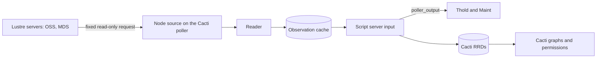

<!-- Source: README.md; SHA256: 40f2c5a5e9be97e4bd2b05a9ebab2a77de51de3af1b1c21dbeb5ee7f936cdd3b -->

<!-- translations:start -->
[English](../../../README.md) | [简体中文](../zh-CN/README.md) | [हिन्दी](../hi-IN/README.md) | [Español (España)](../es-ES/README.md) | [Español (Latinoamérica)](README.md) | [العربية (السعودية)](../ar-SA/README.md) | [Afrikaans](../af-ZA/README.md) | [አማርኛ](../am-ET/README.md) | [العربية (مصر)](../ar-EG/README.md) | [العربية (المغرب)](../ar-MA/README.md) | [বাংলা](../bn-BD/README.md) | [Deutsch](../de-DE/README.md) | [فارسی](../fa-IR/README.md) | [Filipino](../fil-PH/README.md) | [Français](../fr-FR/README.md) | [Français (Maroc)](../fr-MA/README.md) | [Français (Sénégal)](../fr-SN/README.md) | [Hausa](../ha-NG/README.md) | [עברית](../he-IL/README.md) | [Bahasa Indonesia](../id-ID/README.md) | [Igbo](../ig-NG/README.md) | [Italiano](../it-IT/README.md) | [日本語](../ja-JP/README.md) | [한국어](../ko-KR/README.md) | [Malagasy](../mg-MG/README.md) | [मराठी](../mr-IN/README.md) | [Bahasa Melayu](../ms-MY/README.md) | [Nederlands](../nl-NL/README.md) | [Polski](../pl-PL/README.md) | [Português (Brasil)](../pt-BR/README.md) | [Русский](../ru-RU/README.md) | [Kinyarwanda](../rw-RW/README.md) | [Soomaali](../so-SO/README.md) | [Svenska](../sv-SE/README.md) | [Kiswahili](../sw-KE/README.md) | [தமிழ்](../ta-IN/README.md) | [తెలుగు](../te-IN/README.md) | [ไทย](../th-TH/README.md) | [Türkçe](../tr-TR/README.md) | [Українська](../uk-UA/README.md) | [اردو](../ur-PK/README.md) | [Tiếng Việt](../vi-VN/README.md) | [isiXhosa](../xh-ZA/README.md) | [Yorùbá](../yo-NG/README.md) | [繁體中文](../zh-TW/README.md) | [isiZulu](../zu-ZA/README.md)
<!-- translations:end -->

# plugin_pfs

Un plugin para Cacti 1.2 que incorpora salud y carga de sistemas de archivos paralelos: capacidad y desequilibrio de ocupación entre destinos, rendimiento por destino y tasas de operaciones de metadatos. Lustre es el primer backend; GPFS (IBM Storage Scale) y BeeGFS seguirán mediante una interfaz de backend. Los datos llegan a dispositivos, fuentes y gráficos Cacti ordinarios, por lo que Thold y Maint alertan y suprimen sin cambios.

> **Estado: hito 4, código completo para fase 1, sin publicar.** Los hitos 2 (base), 3 (observación Lustre) y 4 (alertas y preparación de publicación) están terminados en `main` o en revisión. El plugin se instala, actualiza y desinstala mediante la API de plugins Cacti y rechaza PHP anterior a 8.2. Un lector en segundo plano en cada sondeador lee servidores Lustre por SSH mediante un script fijo de comando forzado ([node/pfs-read.sh](../../../node/pfs-read.sh)) y almacena inventario, condición, capacidad y contadores con su actualidad. Cada sistema se convierte en dispositivo Cacti con consultas OST y MDT, cinco gráficos generales, gráficos por destino bajo demanda y una fuente de resumen para Thold. Thold v1.8.2 y Maint v1.3, sin cambios, alertan y suprimen los gauges de resumen en la ejecución de extremo a extremo; Thold 1.8.2 no admite umbrales sobre contadores ([docs/alerting.md](docs/alerting.md)). Todas las pruebas hasta ahora usan salida de nodo de prueba en un Cacti desechable: no se ha ejecutado contra un nodo Lustre real. Antes de publicar faltan pilotos en sistemas reales ([plan piloto](../../pilot-plan.md)), revisión externa de seguridad ([autorrevisión](../../security-review.md)) y medidas de escala en hardware documentado ([escala](../../research/scale.md)). La versión 0.1.0 está preparada en `INFO` y [CHANGELOG.md](../../../CHANGELOG.md), pero no etiquetada.

## Roles de acceso

| Ámbito | Acceso |
| --- | --- |
| Parallel Filesystem View | Páginas de monitorización existentes. |
| Parallel Filesystem Operator | Monitorización, página Operaciones y confirmaciones personales de clasificación. |
| Parallel Filesystem Admin | Acceso Operator más configuración y acciones administrativas existentes. |

Tras copiar los archivos de actualización, abra Plugins como administrador para registrar el nuevo ámbito. Asigne expresamente Operator en **Configuración > Usuarios** o en grupos de usuarios. Las actualizaciones conservan los identificadores y concesiones existentes de View y Admin. En cada solicitud, Admin hereda Operator y Operator hereda View; esto no agrega concesiones persistentes a usuarios ni grupos. Los ajustes del plugin requieren Parallel Filesystem Admin además del permiso Settings de Cacti.

Los permisos de dispositivo de Cacti siguen limitando las filas y acciones de cada usuario; los objetos sin asignar requieren un administrador. Credenciales, configuración, asignación, borrado y otros cambios administrativos permanecen en las páginas administrativas. Las confirmaciones duran solo en la sesión del usuario actual, como máximo una hora y mientras siga vigente la misma observación. Las observaciones nuevas o modificadas las invalidan. Nunca marcan una medición fallida como correcta ni suprimen alertas.

## Motivo

Cuando un sistema compartido va lento, las evidencias se reparten entre servidores. Lustre guarda contadores por nodo: `lctl get_param` comunica valores «del nodo local», así que cada servidor de almacenamiento de objetos (OSS) y de metadatos (MDS) solo tiene cifras de sus destinos. Un operador necesita tres respuestas desde lugares distintos:

- **¿Un destino se llena mientras otros están vacíos?** El desequilibrio influye en dónde se crean archivos y cuándo un destino se queda sin espacio.
- **¿Qué destinos u operaciones están ocupados?** Los contadores de bytes por destino y de operaciones por MDT revelan si la carga depende de datos o metadatos.
- **¿Está actualizada la propia monitorización?** Un gráfico plano solo tranquiliza si el plugin pudo ver los servidores.

Cacti grafica hosts y aplica umbrales con Thold, y su organización GitHub no tiene repositorio para monitorizar Lustre, GPFS o BeeGFS (búsqueda del 2026-11-14). El plugin cubre esa carencia leyendo valores permitidos y de solo lectura de los nodos y representando cada sistema como dispositivo Cacti cuyos destinos son índices de una consulta. Reutiliza gráficos, permisos, recolectores remotos, Thold y Maint de Cacti en lugar de construir versiones paralelas.

## Alcance previsto

| Fase | Alcance | Hitos |
|---|---|---|
| 0, investigación | Matriz de versiones, decisión de acceso, confirmación del comportamiento original, contadores y conmutación por error, escala | [M1](https://github.com/somethingwithproof/plugin_pfs/milestone/1) |
| 1, observación | Inventario Lustre, capacidad y ocupación, rendimiento OST, tasas MDT, gráficos, alertas Thold, supresión Maint y página de estado | [M2](https://github.com/somethingwithproof/plugin_pfs/milestone/2), [M3](https://github.com/somethingwithproof/plugin_pfs/milestone/3), [M4](https://github.com/somethingwithproof/plugin_pfs/milestone/4) |
| 2, profundidad | Recolectores remotos Cacti, vistas por trabajo y cliente con cantidad acotada de objetos | [M5](https://github.com/somethingwithproof/plugin_pfs/milestone/5) |
| 3, backends | Backends GPFS (IBM Storage Scale) y BeeGFS | [M6](https://github.com/somethingwithproof/plugin_pfs/milestone/6) |

Fuera de alcance: cualquier escritura, borrado, reinicio o ajuste de nodo o sistema de archivos; motor de alertas propio; demonio o protocolo de red personalizado; fuentes por trabajo; cambios en el núcleo Cacti, Thold o Maint.

## Objetivos de compatibilidad

| Componente | Objetivo |
|---|---|
| Cacti | 1.2.31 o posterior, sin parches del núcleo |
| PHP | 8.2 o posterior; `setup.php` sigue siendo analizable en 8.0 para rechazar entornos no compatibles en lugar de romper la interfaz |
| Lustre | Líneas de versión por fijar en el hito 1; código y manuales revisados hasta ahora en 2.17.0 |
| GPFS, BeeGFS | Fase 3; versiones pendientes de investigación |
| Thold, Maint | No requieren cambios |

## Diseño

- [docs/PLAN.md](../../PLAN.md) contiene el plan completo: arquitectura, hechos de proyectos originales de los que depende (con fuentes y lo aún no verificado), semántica de contadores, modelo de estado, límites de seguridad, cálculos de rendimiento, pruebas y riesgos.
- [docs/operator-guide.md](docs/operator-guide.md) cubre instalación, gráficos y valores, actualización, copias y restauración, desinstalación y resolución de problemas; [docs/alerting.md](docs/alerting.md) cubre Thold y Maint.
- [docs/node-setup.md](docs/node-setup.md) explica cómo preparar un servidor Lustre y un sondeador para el lector.
- [docs/decisions/](../../decisions) contiene los registros de decisiones arquitectónicas tomadas.
- [docs/REQUIREMENTS.md](../../REQUIREMENTS.md) relaciona cada requisito con su incidencia.

## Cómo se sigue el trabajo

- Los **hitos** siguen los del plan. Cada uno tiene una incidencia épica con sus subincidencias y las evidencias de finalización.
- Las **incidencias** se clasifican por etiqueta: `type: requirement`, `type: research`, `type: decision`, `type: epic`. Las de requisito contienen requisitos numerados y verificables (`REQ-AREA-NNN`) y criterios de aceptación.
- Las **etiquetas** también incluyen `area:`, `phase:`, `priority:` y `status:`. Consulte [CONTRIBUTING.md](../../../CONTRIBUTING.md#labels).
- El [tablero del proyecto](https://github.com/users/somethingwithproof/projects/11) muestra todas las incidencias de los hitos.

## Contribuir

Lea [CONTRIBUTING.md](../../../CONTRIBUTING.md). Los commits requieren firma DCO. El diseño se debate en incidencias; las decisiones abiertas llevan `type: decision`.

## Seguridad

Comunique las vulnerabilidades de forma privada; consulte [SECURITY.md](../../../SECURITY.md).

## Licencia

Licencia Pública General GNU v2.0, la misma que Cacti y sus plugins. Consulte [LICENSE](../../../LICENSE).
