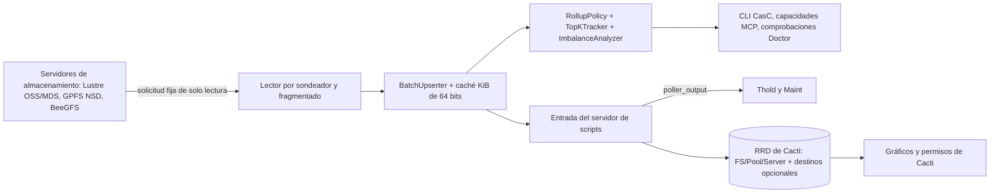

<!-- Source: README.md; SHA256: e88d6875d113220a91cfc0a9d230c829a78477b17e6aa7e44dda38c9591c86ad -->

<!-- translations:start -->
[English](../../../README.md) | [简体中文](../zh-CN/README.md) | [हिन्दी](../hi-IN/README.md) | [Español (España)](README.md) | [Español (Latinoamérica)](../es-419/README.md) | [العربية (السعودية)](../ar-SA/README.md) | [Afrikaans](../af-ZA/README.md) | [አማርኛ](../am-ET/README.md) | [العربية (مصر)](../ar-EG/README.md) | [العربية (المغرب)](../ar-MA/README.md) | [Български](../bg-BG/README.md) | [বাংলা](../bn-BD/README.md) | [Bosanski](../bs-BA/README.md) | [Deutsch](../de-DE/README.md) | [Ελληνικά](../el-GR/README.md) | [فارسی](../fa-IR/README.md) | [Filipino](../fil-PH/README.md) | [Français](../fr-FR/README.md) | [Français (Maroc)](../fr-MA/README.md) | [Français (Sénégal)](../fr-SN/README.md) | [Hausa](../ha-NG/README.md) | [עברית](../he-IL/README.md) | [Hrvatski](../hr-HR/README.md) | [Bahasa Indonesia](../id-ID/README.md) | [Igbo](../ig-NG/README.md) | [Italiano](../it-IT/README.md) | [日本語](../ja-JP/README.md) | [ქართული](../ka-GE/README.md) | [한국어](../ko-KR/README.md) | [Latviešu](../lv-LV/README.md) | [Malagasy](../mg-MG/README.md) | [मराठी](../mr-IN/README.md) | [Bahasa Melayu](../ms-MY/README.md) | [Nederlands](../nl-NL/README.md) | [Polski](../pl-PL/README.md) | [Português (Brasil)](../pt-BR/README.md) | [Português (Portugal)](../pt-PT/README.md) | [Русский](../ru-RU/README.md) | [Kinyarwanda](../rw-RW/README.md) | [Soomaali](../so-SO/README.md) | [Српски](../sr-RS/README.md) | [Svenska](../sv-SE/README.md) | [Kiswahili](../sw-KE/README.md) | [தமிழ்](../ta-IN/README.md) | [తెలుగు](../te-IN/README.md) | [ไทย](../th-TH/README.md) | [Türkçe](../tr-TR/README.md) | [Українська](../uk-UA/README.md) | [اردو](../ur-PK/README.md) | [Tiếng Việt](../vi-VN/README.md) | [isiXhosa](../xh-ZA/README.md) | [Yorùbá](../yo-NG/README.md) | [繁體中文](../zh-TW/README.md) | [isiZulu](../zu-ZA/README.md)
<!-- translations:end -->

# plugin_pfs

Un plugin para Cacti 1.2 que lleva a Cacti el estado, la capacidad, el desequilibrio de ocupación, el rendimiento por destino y las tasas de operaciones de metadatos de sistemas de archivos paralelos en Lustre, IBM Storage Scale (GPFS) y BeeGFS tras una interfaz `Backend` unificada. Cada sistema de archivos se asigna a un dispositivo Cacti ordinario con consultas de datos, gráficos generales y bajo demanda por destino, y medidores de resumen para que Thold y Maint alerten y supriman sin cambios.

> **Estado: fases 1 a 3 y primitivas de escalado a exaescala implementadas en código, sin publicar aún.** La base, la observación de Lustre, las alertas y la supresión con Maint, los controladores de solo lectura para GPFS y BeeGFS, el análisis de desequilibrio OST/MDT con integración en Maint, el ámbito de recopilador remoto (`replicate_out`, `remote_agent`), las primitivas de escalado a 100+ PB / exaescala (`FramedReportParser`, esquema v4 `value_kib`, `RollupPolicy`, `TopKTracker`, `ShardAssigner`, `BatchUpserter`), la CLI de operador CasC (`cli/pfs.php`) y los ganchos del ecosistema (`abilities_register`, `doctor_register_checks`, `casc_register_providers`) están implementados y verificados con pruebas unitarias, de seguridad y de integración en Cacti desechable. Todas las ejecuciones hasta ahora usan salidas de nodos de prueba en lugar de hardware real de Lustre, GPFS o BeeGFS. Antes de etiquetar una versión quedan abiertos: pilotos en sistemas reales ([plan piloto](../../pilot-plan.md)), una revisión externa de seguridad ([autorrevisión](../../security-review.md)) y medidas de escala en hardware documentado ([escala](../../research/scale.md)). La versión 0.1.0 está preparada en `INFO` y [CHANGELOG.md](../../../CHANGELOG.md), pero no etiquetada.

## Roles de acceso

| Ámbito | Acceso |
| --- | --- |
| Parallel Filesystem View | Páginas de monitorización existentes. |
| Parallel Filesystem Operator | Monitorización, página Operaciones y confirmaciones personales de clasificación. |
| Parallel Filesystem Admin | Acceso Operator más configuración y acciones administrativas existentes. |

Tras copiar los archivos de actualización, abra Plugins como administrador para registrar el nuevo ámbito. Asigne expresamente Operator en **Configuración > Usuarios** o en grupos de usuarios. Las actualizaciones conservan los identificadores y concesiones existentes de View y Admin. En cada solicitud, Admin hereda Operator y Operator hereda View; esto no añade concesiones persistentes a usuarios ni grupos. Los ajustes del plugin requieren Parallel Filesystem Admin además del permiso Settings de Cacti.

Los permisos de dispositivo de Cacti siguen limitando las filas y acciones de cada usuario; los objetos sin asignar requieren un administrador. Credenciales, configuración, asignación, borrado y otros cambios administrativos permanecen en las páginas administrativas. Las confirmaciones duran solo en la sesión del usuario actual, como máximo una hora y mientras siga vigente la misma observación. Las observaciones nuevas o modificadas las invalidan. Nunca marcan una medición fallida como correcta ni suprimen alertas.

## Motivo

Cuando un sistema compartido va lento, las evidencias se reparten entre servidores. Lustre guarda contadores por nodo: `lctl get_param` comunica valores «del nodo local», así que cada servidor de almacenamiento de objetos (OSS) y de metadatos (MDS) solo tiene cifras de sus destinos. Un operador necesita tres respuestas desde lugares distintos:

- **¿Un destino se llena mientras otros están vacíos?** El desequilibrio influye en dónde se crean archivos y cuándo un destino se queda sin espacio.
- **¿Qué destinos u operaciones están ocupados?** Los contadores de bytes por destino y de operaciones por MDT revelan si la carga depende de datos o metadatos.
- **¿Está actualizada la propia monitorización?** Un gráfico plano solo tranquiliza si el plugin pudo ver los servidores.

Cacti grafica hosts y aplica umbrales con Thold, y su organización GitHub no tiene repositorio para monitorizar Lustre, GPFS o BeeGFS (búsqueda del 2026-11-14). El plugin cubre esa carencia leyendo valores permitidos y de solo lectura de los nodos y representando cada sistema como dispositivo Cacti cuyos destinos son índices de una consulta. Reutiliza gráficos, permisos, recolectores remotos, Thold y Maint de Cacti en lugar de construir versiones paralelas.

## Alcance previsto

| Fase | Alcance | Estado | Hitos |
|---|---|---|---|
| 0, investigación | Matriz de versiones, decisión de acceso, confirmación del comportamiento original, contadores y conmutación por error, escala | Completo | [M1](https://github.com/somethingwithproof/plugin_pfs/milestone/1) |
| 1, observación | Inventario Lustre, capacidad y ocupación, desequilibrio OST/MDT (`lib/ImbalanceAnalyzer.php`), integración con Maint (`lib/HealthPage.php`), rendimiento OST, tasas MDT, gráficos, alertas Thold, página de estado | Implementado (probado con fixtures) | [M2](https://github.com/somethingwithproof/plugin_pfs/milestone/2), [M3](https://github.com/somethingwithproof/plugin_pfs/milestone/3), [M4](https://github.com/somethingwithproof/plugin_pfs/milestone/4) |
| 2, remoto y escala | Recolección remota por sondeador (`lib/Reader.php`, `lib/ReplicationRepository.php`, `replicate_out`, `remote_agent`), primitivas de escalado a 100+ PB (higiene KiB de 64 bits + esquema v4 `value_kib`, `lib/RollupPolicy.php`, `lib/TopKTracker.php`, `lib/ShardAssigner.php` + `poller_pfs.php --shard=K/N`, `lib/BatchUpserter.php`), CLI CasC (`cli/pfs.php`), ganchos MCP/Doctor/CasC | Implementado (pruebas unitarias y de integración en CI) | [M5](https://github.com/somethingwithproof/plugin_pfs/milestone/5) |
| 3, backends | Controladores de solo lectura IBM Storage Scale (GPFS) (`lib/GpfsBackend.php`) y BeeGFS (`lib/BeegfsBackend.php`) registrados en `BackendRegistry::production()` | Implementado (pruebas unitarias) | [M6](https://github.com/somethingwithproof/plugin_pfs/milestone/6) |

Principales primitivas de operación y escalado implementadas:

- **Controladores multisistema de solo lectura:** `LustreBackend`, `GpfsBackend` (solo `mmpmon` `fs_io_s`/`io_s` enmarcado con `reset` prohibido, capacidad/estados de grupos `mmdf` y resúmenes de esperas) y `BeegfsBackend` (destinos de almacenamiento y metadatos de BeeGFS 7.4 y 8.x con conversión exacta de bytes a KiB, asignación de estado de accesibilidad/coherencia y semántica de medidor por intervalo) compartiendo `lib/FramedReportParser.php`.
- **Desequilibrio, margen disponible y conocimiento de Maint:** `lib/ImbalanceAnalyzer.php` calcula proporciones de ocupación OST/MDT, dispersión, índice de desequilibrio de desviación estándar poblacional, margen libre, exigencia de actualidad de 1 intervalo (`missing_targets`), indicadores de estado por destino y los Top-K destinos más desbalanceados acotados. `HealthPage` (`pfs_health.php`) y `CascProvider::health()` exponen ventanas de mantenimiento `Maint` de Cacti y suprimen avisos de fallo activos durante el mantenimiento programado.
- **Escalado a 100+ PB y exaescala** ([docs/architecture/exascale-scaling.md](../../architecture/exascale-scaling.md)): conversión decimal exacta de bytes a KiB (`FramedReportParser::bytesToKibInt()`) verificada a 500 PB y 2 EB junto con columnas `BIGINT UNSIGNED value_kib` (esquema v4); consolidaciones RRD jerárquicas `Filesystem -> Pool -> Storage Server` con promoción acotada de destinos opcionales, calientes o desequilibrados (`lib/RollupPolicy.php`); destinos Top-K desequilibrados acotados en $O(K)$ y resúmenes preagregados de trabajos/clientes intensivos (`lib/TopKTracker.php`, sin crear nunca dispositivos ni RRD por cliente); fragmentación determinista de recopiladores mediante CRC32 (`lib/ShardAssigner.php`, `php plugins/pfs/poller_pfs.php [--poller=N] [--shard=K/N] [--force] [--debug]`); e inserciones SQL por lotes de 500 filas más paginación por clave (`lib/BatchUpserter.php`, `CacheRepository::upsertObservationsBatch()`, `TargetRepository::forFilesystemPage()`).
- **CLI CasC para operadores y ganchos del ecosistema:** `cli/pfs.php` admite `export [--format=yaml|xml]`, `validate <file> [--format=yaml|xml]`, `plan <file> [--format=yaml|xml] [--output=text|json]`, `apply <file> --confirm=<PLAN_HASH> [--format=yaml|xml]` y `health [--format=text|json]` sin dependencias externas de Composer. `setup.php` y `lib/EcosystemIntegration.php` registran `abilities_register` (`pfs-list-filesystems`, `pfs-get-imbalance`, `pfs-get-health`; de solo lectura, restringidas por `Parallel Filesystem View` y permisos de dispositivo de Cacti), `doctor_register_checks` (`pfs_schema`, `pfs_reader_freshness`, `pfs_capacity_imbalance`), `casc_register_providers`, `replicate_out` y `remote_agent`.

Fuera de alcance: cualquier escritura, borrado, reinicio o ajuste de nodo o sistema de archivos; motor de alertas propio; demonio o protocolo de red personalizado; dispositivos o RRD de Cacti por trabajo o por cliente; cambios en el núcleo Cacti, Thold o Maint.

## Objetivos de compatibilidad

| Componente | Objetivo |
|---|---|
| Cacti | 1.2.31 o posterior, sin parches del núcleo |
| PHP | 8.2 o posterior; `setup.php`, `poller_pfs.php` y `cli/pfs.php` siguen siendo analizables en 8.0 para rechazar entornos no compatibles en lugar de romper la interfaz |
| Lustre | Código y manuales comprobados en 2.17.0; probado con fixtures |
| GPFS, BeeGFS | Controladores de solo lectura IBM Storage Scale (GPFS) 5.x `mmpmon`/`mmdf` y BeeGFS 7.4 / 8.x implementados y probados con fixtures |
| Thold, Maint | Thold 1.8.2 y Maint 1.3, sin cambios |

## Diseño

- [docs/architecture/exascale-scaling.md](../../architecture/exascale-scaling.md) documenta la arquitectura de telemetría en dos niveles de 100+ PB / exaescala (nivel de servidor Cacti/`plugin_pfs` + agregación + Top-K emparejado con telemetría de cliente fuera de banda LDMS/Darshan/TOKIO) y su contexto bibliográfico.
- [docs/PLAN.md](../../PLAN.md) contiene el plan completo: arquitectura, hechos de proyectos originales de los que depende (con fuentes y lo aún no verificado), semántica de contadores, modelo de estado, límites de seguridad, cálculos de rendimiento, pruebas y riesgos.
- [docs/operator-guide.md](docs/operator-guide.md) cubre instalación, gráficos y valores, actualización, copias y restauración, desinstalación y resolución de problemas; [docs/alerting.md](docs/alerting.md) cubre Thold y Maint.
- [docs/node-setup.md](docs/node-setup.md) explica cómo preparar un servidor Lustre y un sondeador para el lector.
- [docs/decisions/](../../decisions) contiene los registros de decisiones arquitectónicas tomadas.
- [docs/REQUIREMENTS.md](../../REQUIREMENTS.md) relaciona cada requisito con su incidencia.

## Cómo se sigue el trabajo

- Los **hitos** siguen los del plan. Cada uno tiene una incidencia épica con sus subincidencias y las evidencias de finalización.
- Las **incidencias** se clasifican por etiqueta: `type: requirement`, `type: research`, `type: decision`, `type: epic`. Las de requisito contienen requisitos numerados y verificables (`REQ-AREA-NNN`) y criterios de aceptación.
- Las **etiquetas** también incluyen `area:`, `phase:`, `priority:` y `status:`. Consulte [CONTRIBUTING.md](../../../CONTRIBUTING.md#labels).
- El [tablero del proyecto](https://github.com/users/somethingwithproof/projects/11) muestra todas las incidencias de los hitos.

## Contribuir

Lea [CONTRIBUTING.md](../../../CONTRIBUTING.md). Los commits requieren firma DCO. El diseño se debate en incidencias; las decisiones abiertas llevan `type: decision`.

## Seguridad

Comunique las vulnerabilidades de forma privada; consulte [SECURITY.md](../../../SECURITY.md).

## Licencia

Licencia Pública General GNU v2.0, la misma que Cacti y sus plugins. Consulte [LICENSE](../../../LICENSE).
