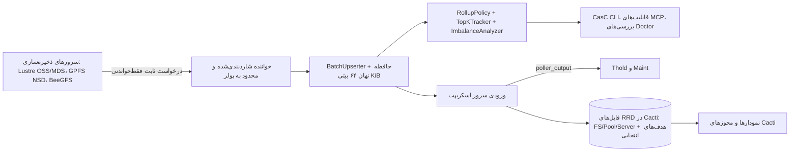

<!-- Source: README.md; SHA256: e88d6875d113220a91cfc0a9d230c829a78477b17e6aa7e44dda38c9591c86ad -->

<!-- translations:start -->
[English](../../../README.md) | [简体中文](../zh-CN/README.md) | [हिन्दी](../hi-IN/README.md) | [Español (España)](../es-ES/README.md) | [Español (Latinoamérica)](../es-419/README.md) | [العربية (السعودية)](../ar-SA/README.md) | [Afrikaans](../af-ZA/README.md) | [አማርኛ](../am-ET/README.md) | [العربية (مصر)](../ar-EG/README.md) | [العربية (المغرب)](../ar-MA/README.md) | [Български](../bg-BG/README.md) | [বাংলা](../bn-BD/README.md) | [Bosanski](../bs-BA/README.md) | [Deutsch](../de-DE/README.md) | [Ελληνικά](../el-GR/README.md) | [فارسی](README.md) | [Filipino](../fil-PH/README.md) | [Français](../fr-FR/README.md) | [Français (Maroc)](../fr-MA/README.md) | [Français (Sénégal)](../fr-SN/README.md) | [Hausa](../ha-NG/README.md) | [עברית](../he-IL/README.md) | [Hrvatski](../hr-HR/README.md) | [Bahasa Indonesia](../id-ID/README.md) | [Igbo](../ig-NG/README.md) | [Italiano](../it-IT/README.md) | [日本語](../ja-JP/README.md) | [ქართული](../ka-GE/README.md) | [한국어](../ko-KR/README.md) | [Latviešu](../lv-LV/README.md) | [Malagasy](../mg-MG/README.md) | [मराठी](../mr-IN/README.md) | [Bahasa Melayu](../ms-MY/README.md) | [Nederlands](../nl-NL/README.md) | [Polski](../pl-PL/README.md) | [Português (Brasil)](../pt-BR/README.md) | [Português (Portugal)](../pt-PT/README.md) | [Русский](../ru-RU/README.md) | [Kinyarwanda](../rw-RW/README.md) | [Soomaali](../so-SO/README.md) | [Српски](../sr-RS/README.md) | [Svenska](../sv-SE/README.md) | [Kiswahili](../sw-KE/README.md) | [தமிழ்](../ta-IN/README.md) | [తెలుగు](../te-IN/README.md) | [ไทย](../th-TH/README.md) | [Türkçe](../tr-TR/README.md) | [Українська](../uk-UA/README.md) | [اردو](../ur-PK/README.md) | [Tiếng Việt](../vi-VN/README.md) | [isiXhosa](../xh-ZA/README.md) | [Yorùbá](../yo-NG/README.md) | [繁體中文](../zh-TW/README.md) | [isiZulu](../zu-ZA/README.md)
<!-- translations:end -->

# plugin_pfs

یک افزونه برای Cacti 1.2 که سلامت فایل‌سیستم موازی، ظرفیت، عدم توازن پرشدگی، توان عملیاتی به ازای هر هدف و نرخ عملیات فراداده را در سراسر Lustre، IBM Storage Scale (GPFS) و BeeGFS پشت یک رابط یکپارچه `Backend` به Cacti می‌آورد. هر فایل‌سیستم به یک دستگاه عادی Cacti با پرس‌وجوهای داده، نمودارهای نمای کلی و به ازای هر هدف در صورت درخواست، و شاخص‌های خلاصه تبدیل می‌شود تا Thold و Maint بدون هیچ تغییری روی آن‌ها هشدار دهند و هشدارها را سرکوب کنند.

> **وضعیت: فازهای ۱ تا ۳ و پایه‌های مقیاس‌پذیری اگزاسکیل در کد پیاده‌سازی شده‌اند، هنوز منتشر نشده است.** زیرساخت، مشاهده Lustre، هشداردهی و سرکوب Maint، درایورهای فقط‌خواندنی GPFS و BeeGFS، تحلیل عدم توازن OST/MDT همراه با یکپارچه‌سازی Maint، محدودسازی جمع‌آوری‌کننده داده از راه دور (`replicate_out`، `remote_agent`)، پایه‌های مقیاس‌پذیری ۱۰۰+ پتابایت / اگزاسکیل (`FramedReportParser`، طرحواره v4 با `value_kib`، `RollupPolicy`، `TopKTracker`، `ShardAssigner`، `BatchUpserter`)، رابط خط فرمان اپراتور CasC (`cli/pfs.php`) و قلاب‌های اکوسیستم (`abilities_register`، `doctor_register_checks`، `casc_register_providers`) پیاده‌سازی شده و با آزمون‌های واحد، امنیتی و یکپارچه‌سازی در Cacti یک‌بارمصرف تایید شده‌اند. تمام اجراهای انجام‌شده تاکنون از خروجی گره شبیه‌سازی‌شده به‌جای سخت‌افزار زنده Lustre، GPFS یا BeeGFS استفاده کرده‌اند. موارد باز پیش از برچسب‌گذاری انتشار: اجرای آزمایشی روی فایل‌سیستم‌های واقعی ([طرح آزمایشی](../../pilot-plan.md))، بررسی امنیتی خارجی ([خودارزیابی](../../security-review.md)) و اندازه‌گیری‌های مقیاس روی سخت‌افزار مستندشده ([مقیاس](../../research/scale.md)). نسخه 0.1.0 در `INFO` و [CHANGELOG.md](../../../CHANGELOG.md) آماده شده اما هنوز برچسب‌گذاری نشده است.

## نقش‌های دسترسی

| نقش | دسترسی |
| --- | --- |
| Parallel Filesystem View | صفحات پایش موجود. |
| Parallel Filesystem Operator | پایش به همراه صفحه عملیات و تاییدیه‌های تریاژ شخصی. |
| Parallel Filesystem Admin | دسترسی Operator به همراه پیکربندی موجود و اقدامات مدیریتی. |

پس از کپی کردن فایل‌های ارتقا، صفحه Plugins را به‌عنوان مدیر باز کنید تا قلمرو جدید ثبت شود. قلمرو Operator را به‌صورت صریح در بخش **Configuration > Users** یا گروه‌های کاربری تخصیص دهید. ارتقاها شناسه‌ها و مجوزهای اعطاشده فعلی قلمروهای View و Admin را حفظ می‌کنند. دسترسی Admin دسترسی Operator را به ارث می‌برد و دسترسی Operator در هر درخواست دسترسی View را به ارث می‌برد؛ این کار مجوزهای ذخیره‌شده‌ای به کاربران یا گروه‌ها اضافه نمی‌کند. تنظیمات افزونه نیز علاوه بر مجوز Settings در Cacti، به دسترسی Parallel Filesystem Admin نیاز دارد.

مجوزهای دستگاه Cacti همچنان ردیف‌ها و اقدامات در دسترس هر کاربر را محدود می‌کنند؛ اشیای نگاشت‌نشده نیازمند مدیر هستند. اعتبارنامه‌ها، پیکربندی، نگاشت، حذف و سایر تغییرات مدیریتی در صفحات مدیریتی باقی می‌مانند. تاییدیه‌ها فقط در نشست فعلی کاربر، حداکثر به مدت یک ساعت و تنها تا زمانی که همان مشاهده تازه باقی بماند معتبر هستند. مشاهدات جدید یا تغییریافته آن‌ها را نامعتبر می‌کنند. آن‌ها هرگز یک اندازه‌گیری ناموفق را سالم علامت‌گذاری نمی‌کنند یا هشدارها را سرکوب نمی‌کنند.

## چرا

وقتی یک فایل‌سیستم اشتراکی کند می‌شود، شواهد در میان سرورها پراکنده هستند. Lustre شمارنده‌های خود را به ازای هر گره نگه می‌دارد: دستور `lctl get_param` مقادیر «روی گره محلی» را گزارش می‌دهد، بنابراین هر سرور ذخیره‌سازی شئ (OSS) و سرور فراداده (MDS) فقط اعداد مربوط به هدف‌های خود را نگه می‌دارد. اپراتوری که در حال بررسی کندی یک فایل‌سیستم است، به سه پاسخ از مکان‌های مختلف نیاز دارد:

- **آیا یک هدف در حال پر شدن است در حالی که بقیه خالی هستند؟** عدم توازن پرشدگی محل قرارگیری فایل‌های جدید و زمان پر شدن کامل یک هدف واحد را تغییر می‌دهد.
- **کدام هدف‌ها یا عملیات شلوغ هستند؟** شمارنده‌های بایت به ازای هر هدف و شمارنده‌های عملیات به ازای هر MDT نشان می‌دهند که آیا بار محدود به داده است یا محدود به فراداده.
- **آیا خود پایش به‌روز است؟** یک نمودار صاف تنها زمانی اطمینان‌بخش است که افزونه توانسته باشد سرورها را ببیند.

Cacti میزبان‌ها را رسم می‌کند و مقادیر را با Thold آستانه‌گذاری می‌کند، و سازمان GitHub مربوط به Cacti هیچ مخزنی برای پایش Lustre، GPFS یا BeeGFS ندارد (بررسی‌شده در 2026-11-14). این افزونه با خواندن مقادیر مجاز و فقط‌خواندنی از گره‌های ذخیره‌سازی و نمایش هر فایل‌سیستم به‌عنوان یک دستگاه Cacti که هدف‌های آن نمایه‌های یک پرس‌وجوی داده هستند، این خلأ را پر می‌کند. این افزونه به‌جای ساخت نسخه‌های موازی، از نمودارکشی، مجوزها، جمع‌آوری‌کننده‌های داده از راه دور، Thold و Maint خود Cacti استفاده مجدد می‌کند.

## محدوده برنامه‌ریزی‌شده

| فاز | محدوده | وضعیت | نقاط عطف |
|---|---|---|---|
| 0، پژوهش | ماتریس انتشار، تصمیم دسترسی به گره، تایید رفتار بالادستی، رفتار شمارنده و failover، اندازه‌گیری‌های مقیاس | کامل‌شده | [M1](https://github.com/somethingwithproof/plugin_pfs/milestone/1) |
| 1، مشاهده | موجودی Lustre، ظرفیت و پرشدگی، عدم توازن OST/MDT (`lib/ImbalanceAnalyzer.php`)، یکپارچه‌سازی Maint (`lib/HealthPage.php`)، توان عملیاتی OST، نرخ عملیات MDT، نمودارها، هشداردهی Thold، صفحه سلامت | پیاده‌سازی‌شده (آزمون با خروجی شبیه‌سازی‌شده) | [M2](https://github.com/somethingwithproof/plugin_pfs/milestone/2), [M3](https://github.com/somethingwithproof/plugin_pfs/milestone/3), [M4](https://github.com/somethingwithproof/plugin_pfs/milestone/4) |
| 2، راه دور و مقیاس | جمع‌آوری از راه دور محدود به پولر (`lib/Reader.php`، `lib/ReplicationRepository.php`، `replicate_out`، `remote_agent`)، پایه‌های مقیاس‌پذیری ۱۰۰+ پتابایت (بهداشت ۶۴ بیتی KiB + طرحواره v4 `value_kib`، `lib/RollupPolicy.php`، `lib/TopKTracker.php`، `lib/ShardAssigner.php` + `poller_pfs.php --shard=K/N`، `lib/BatchUpserter.php`)، رابط خط فرمان CasC (`cli/pfs.php`)، قلاب‌های MCP/Doctor/CasC | پیاده‌سازی‌شده (آزمون واحد و یکپارچه‌سازی CI) | [M5](https://github.com/somethingwithproof/plugin_pfs/milestone/5) |
| 3، پس‌زمینه‌ها | درایورهای فقط‌خواندنی IBM Storage Scale (GPFS) (`lib/GpfsBackend.php`) و BeeGFS (`lib/BeegfsBackend.php`) ثبت‌شده در `BackendRegistry::production()` | پیاده‌سازی‌شده (آزمون واحد) | [M6](https://github.com/somethingwithproof/plugin_pfs/milestone/6) |

پایه‌های کلیدی پیاده‌سازی‌شده برای اپراتور و مقیاس‌پذیری:

- **درایورهای فقط‌خواندنی چندفایل‌سیستمی:** `LustreBackend`، `GpfsBackend` (فقط `mmpmon` قاب‌بندی‌شده `fs_io_s`/`io_s` با ممنوعیت `reset`، ظرفیت/وضعیت‌های مخزن `mmdf` و خلاصه منتظرها) و `BeegfsBackend` (هدف‌های ذخیره‌سازی و فراداده BeeGFS 7.4 و 8.x با تبدیل دقیق بایت به KiB، نگاشت وضعیت دسترسی‌پذیری/سازگاری و معناشناسی شاخص در هر بازه) که در `lib/FramedReportParser.php` مشترک هستند.
- **آگاهی از عدم توازن، فضای آزاد باقیمانده و Maint:** ماژول `lib/ImbalanceAnalyzer.php` نسبت‌های پرشدگی OST/MDT، گستردگی، شاخص عدم توازن انحراف معیار جمعیت، فضای آزاد باقیمانده، اعمال تازگی ۱ بازه‌ای (`missing_targets`)، پرچم‌های وضعیت به ازای هر هدف و هدف‌های نامتوازن Top-K کراندار را محاسبه می‌کند. `HealthPage` (`pfs_health.php`) و `CascProvider::health()` پنجره‌های نگهداری `Maint` در Cacti را نمایش می‌دهند و هشدارهای خطای فعال را در طول نگهداری زمان‌بندی‌شده سرکوب می‌کنند.
- **مقیاس‌پذیری ۱۰۰+ پتابایت و اگزاسکیل** ([docs/architecture/exascale-scaling.md](../../architecture/exascale-scaling.md)): تبدیل دقیق دهدهی بایت به KiB (`FramedReportParser::bytesToKibInt()`) تاییدشده در ۵۰۰ پتابایت و ۲ اگزابایت در کنار ستون‌های `BIGINT UNSIGNED value_kib` (طرحواره v4)؛ تجمیع‌های سلسله‌مراتبی RRD به‌صورت `Filesystem -> Pool -> Storage Server` با ارتقای کراندار هدف‌های انتخاب‌شده/پربار/نامتوازن (`lib/RollupPolicy.php`)؛ هدف‌های نامتوازن Top-K کراندار با پیچیدگی $O(K)$ و خلاصه‌های پیش‌تجمیع‌شده کار/کلاینت‌های سنگین (`lib/TopKTracker.php`، بدون ایجاد دستگاه یا RRD به ازای هر کلاینت)؛ شاردینگ قطعی جمع‌آوری‌کننده بر پایه CRC32 (`lib/ShardAssigner.php`، `php plugins/pfs/poller_pfs.php [--poller=N] [--shard=K/N] [--force] [--debug]`)؛ و درج/به‌روزرسانی دسته‌ای ۵۰۰ ردیفی SQL به همراه صفحه‌بندی keyset (`lib/BatchUpserter.php`، `CacheRepository::upsertObservationsBatch()`، `TargetRepository::forFilesystemPage()`).
- **رابط خط فرمان CasC اپراتور و قلاب‌های اکوسیستم:** ابزار `cli/pfs.php` از `export [--format=yaml|xml]`، `validate <file> [--format=yaml|xml]`، `plan <file> [--format=yaml|xml] [--output=text|json]`، `apply <file> --confirm=<PLAN_HASH> [--format=yaml|xml]` و `health [--format=text|json]` بدون هیچ وابستگی خارجی Composer پشتیبانی می‌کند. فایل‌های `setup.php` و `lib/EcosystemIntegration.php` قلاب‌های `abilities_register` (`pfs-list-filesystems`، `pfs-get-imbalance`، `pfs-get-health`؛ فقط‌خواندنی و مقید به `Parallel Filesystem View` و مجوزهای دستگاه Cacti)، `doctor_register_checks` (`pfs_schema`، `pfs_reader_freshness`، `pfs_capacity_imbalance`)، `casc_register_providers`، `replicate_out` و `remote_agent` را ثبت می‌کنند.

خارج از محدوده: هرگونه عملیات نوشتن، پاک کردن، بازنشانی یا تنظیم روی یک گره یا فایل‌سیستم؛ موتور هشداردهی اختصاصی افزونه؛ دیمن یا پروتکل شبکه سفارشی؛ دستگاه‌ها یا فایل‌های RRD در Cacti به ازای هر کار یا هر کلاینت؛ تغییرات در هسته Cacti، Thold یا Maint.

## اهداف سازگاری

| مؤلفه | هدف |
|---|---|
| Cacti | نسخه 1.2.31 یا بالاتر، بدون نیاز به وصله هسته |
| PHP | نسخه 8.2 یا بالاتر؛ `setup.php`، `poller_pfs.php` و `cli/pfs.php` در نسخه 8.0 قابل تجزیه باقی می‌مانند تا یک محیط اجرای پشتیبانی‌نشده به جای خراب کردن رابط کاربری Cacti، یک پیام رد دریافت کند |
| Lustre | کد منبع و راهنماهای بررسی‌شده در نسخه 2.17.0؛ آزمون‌شده با خروجی شبیه‌سازی‌شده |
| GPFS، BeeGFS | درایورهای فقط‌خواندنی IBM Storage Scale (GPFS) 5.x `mmpmon`/`mmdf` و BeeGFS 7.4 / 8.x پیاده‌سازی و با خروجی شبیه‌سازی‌شده آزمون شده‌اند |
| Thold، Maint | نسخه‌های Thold 1.8.2 و Maint 1.3، بدون تغییر |

## طراحی

- [docs/architecture/exascale-scaling.md](../../architecture/exascale-scaling.md) معماری تله‌متری دولایه ۱۰۰+ پتابایت / اگزاسکیل (لایه سرور + تجمیع + Top-K در Cacti/`plugin_pfs` همراه با تله‌متری کلاینت خارج از باند LDMS/Darshan/TOKIO) و پیشینه ادبیات دانشگاهی آن را مستند می‌کند.
- [docs/PLAN.md](../../PLAN.md) برنامه کامل است: معماری، حقایق بالادستی که به آن‌ها وابسته است (همراه با منابع و مواردی که هنوز تایید نشده‌اند)، معناشناسی شمارنده‌ها، مدل وضعیت، مرزهای امنیتی، محاسبات کارایی، آزمایش و ریسک‌ها.
- [docs/operator-guide.md](../../operator-guide.md) نصب، نمودارها و مقادیر، ارتقا، پشتیبان‌گیری و بازیابی، حذف و عیب‌یابی را پوشش می‌دهد؛ [docs/alerting.md](../../alerting.md) به Thold و Maint می‌پردازد.
- [docs/node-setup.md](../../node-setup.md) نحوه آماده‌سازی یک سرور Lustre و یک پولر برای خواننده را شرح می‌دهد.
- [docs/decisions/](../../decisions) سوابق تصمیم‌های معماری را برای انتخاب‌هایی که از قبل انجام شده‌اند نگه می‌دارد.
- [docs/REQUIREMENTS.md](../../REQUIREMENTS.md) هر شناسه نیازمندی را به issue مربوط به آن نگاشت می‌کند.

## نحوه پیگیری کارها

- **نقاط عطف** از نقاط عطف برنامه پیروی می‌کنند. هر کدام یک issue حماسی دارد که زیرمسائل و شواهد خروج آن را فهرست می‌کند.
- **مسائل** با برچسب دسته‌بندی می‌شوند: `type: requirement`، `type: research`، `type: decision`، `type: epic`. مسائل نیازمندی، نیازمندی‌های شماره‌گذاری‌شده و قابل آزمایش (`REQ-AREA-NNN`) و معیارهای پذیرش را بیان می‌کنند.
- **برچسب‌ها** همچنین دارای پیشوندهای `area:`، `phase:`، `priority:` و `status:` هستند. به [CONTRIBUTING.md](../../../CONTRIBUTING.md#labels) مراجعه کنید.
- [تخته پروژه](https://github.com/users/somethingwithproof/projects/11) تمام مسائل را در سراسر نقاط عطف نشان می‌دهد.

## مشارکت

فایل [CONTRIBUTING.md](../../../CONTRIBUTING.md) را مطالعه کنید. کامیت‌ها به امضای DCO نیاز دارند. بحث‌های طراحی در بخش issues انجام می‌شوند؛ تصمیم‌های باز دارای برچسب `type: decision` هستند.

## امنیت

آسیب‌پذیری‌ها را به‌صورت خصوصی گزارش دهید؛ به [SECURITY.md](../../../SECURITY.md) مراجعه کنید.

## مجوز

پروانه عمومی همگانی گنو نسخه ۲.۰، همان مجوز Cacti و افزونه‌های آن. به [LICENSE](../../../LICENSE) مراجعه کنید.
