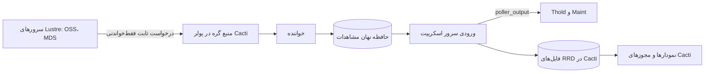

<!-- Source: README.md; SHA256: e88d6875d113220a91cfc0a9d230c829a78477b17e6aa7e44dda38c9591c86ad -->

<!-- translations:start -->
[English](../../../README.md) | [简体中文](../zh-CN/README.md) | [हिन्दी](../hi-IN/README.md) | [Español (España)](../es-ES/README.md) | [Español (Latinoamérica)](../es-419/README.md) | [العربية (السعودية)](../ar-SA/README.md) | [Afrikaans](../af-ZA/README.md) | [አማርኛ](../am-ET/README.md) | [العربية (مصر)](../ar-EG/README.md) | [العربية (المغرب)](../ar-MA/README.md) | [বাংলা](../bn-BD/README.md) | [Bosanski](../bs-BA/README.md) | [Deutsch](../de-DE/README.md) | [فارسی](README.md) | [Filipino](../fil-PH/README.md) | [Français](../fr-FR/README.md) | [Français (Maroc)](../fr-MA/README.md) | [Français (Sénégal)](../fr-SN/README.md) | [Hausa](../ha-NG/README.md) | [עברית](../he-IL/README.md) | [Hrvatski](../hr-HR/README.md) | [Bahasa Indonesia](../id-ID/README.md) | [Igbo](../ig-NG/README.md) | [Italiano](../it-IT/README.md) | [日本語](../ja-JP/README.md) | [한국어](../ko-KR/README.md) | [Malagasy](../mg-MG/README.md) | [मराठी](../mr-IN/README.md) | [Bahasa Melayu](../ms-MY/README.md) | [Nederlands](../nl-NL/README.md) | [Polski](../pl-PL/README.md) | [Português (Brasil)](../pt-BR/README.md) | [Русский](../ru-RU/README.md) | [Kinyarwanda](../rw-RW/README.md) | [Soomaali](../so-SO/README.md) | [Српски](../sr-RS/README.md) | [Svenska](../sv-SE/README.md) | [Kiswahili](../sw-KE/README.md) | [தமிழ்](../ta-IN/README.md) | [తెలుగు](../te-IN/README.md) | [ไทย](../th-TH/README.md) | [Türkçe](../tr-TR/README.md) | [Українська](../uk-UA/README.md) | [اردو](../ur-PK/README.md) | [Tiếng Việt](../vi-VN/README.md) | [isiXhosa](../xh-ZA/README.md) | [Yorùbá](../yo-NG/README.md) | [繁體中文](../zh-TW/README.md) | [isiZulu](../zu-ZA/README.md)
<!-- translations:end -->

# plugin_pfs

یک افزونه برای Cacti 1.2 که وضعیت سلامت و بار فایل‌سیستم‌های موازی را به Cacti می‌آورد: ظرفیت و عدم توازن پرشدگی در میان هدف‌ها، توان عملیاتی به ازای هر هدف، و نرخ عملیات فراداده. Lustre نخستین پس‌زمینه است. GPFS (IBM Storage Scale) و BeeGFS نیز پشت یک رابط پس‌زمینه دنبال می‌شوند. داده‌ها در دستگاه‌ها، منابع داده و نمودارهای عادی Cacti قرار می‌گیرند، بنابراین Thold و Maint بدون هیچ تغییری روی آن‌ها هشدار می‌دهند و هشدارها را سرکوب می‌کنند.

> **وضعیت: نقطه عطف ۴، کدهای فاز ۱ تکمیل شده، منتشر نشده.** نقاط عطف ۲ (زیرساخت)، ۳ (مشاهده Lustre) و ۴ (هشداردهی و آماده‌سازی انتشار) روی شاخه `main` انجام شده‌اند یا در حال بررسی هستند. این افزونه از طریق API افزونه Cacti نصب، ارتقا و حذف می‌شود و PHP پایین‌تر از 8.2 را نمی‌پذیرد. یک خواننده پس‌زمینه در هر پولر، سرورهای Lustre را از طریق SSH و با یک اسکریپت دستور اجباری ثابت ([node/pfs-read.sh](../../../node/pfs-read.sh)) می‌خواند و فهرست موجودی، وضعیت، ظرفیت و شمارنده‌ها را همراه با میزان تازگی آن‌ها در حافظه نهان ذخیره می‌کند. هر فایل‌سیستم به یک دستگاه Cacti با پرس‌وجوهای داده OST و MDT، پنج نمودار نمای کلی، نمودارهای به ازای هر هدف در صورت درخواست، و یک منبع داده خلاصه برای Thold تبدیل می‌شود. نسخه‌های بدون تغییر Thold v1.8.2 و Maint v1.3 در اجرای سرتاسری روی شاخص‌های خلاصه هشدار می‌دهند و آن‌ها را سرکوب می‌کنند؛ آستانه‌های Thold روی شمارنده‌ها در Thold 1.8.2 پشتیبانی نمی‌شوند ([docs/alerting.md](../../alerting.md)). تمام آزمایش‌های انجام‌شده تا این لحظه روی خروجی شبیه‌سازی‌شده گره در یک محیط Cacti یک‌بارمصرف اجرا شده‌اند: این افزونه هنوز روی یک گره واقعی Lustre اجرا نشده است. موارد باز پیش از انتشار: اجرای آزمایشی روی فایل‌سیستم‌های واقعی ([طرح آزمایشی](../../pilot-plan.md))، بررسی امنیتی خارجی ([خودارزیابی](../../security-review.md))، و اندازه‌گیری‌های مقیاس روی سخت‌افزار مستندشده ([مقیاس](../../research/scale.md)). نسخه 0.1.0 در `INFO` و [CHANGELOG.md](../../../CHANGELOG.md) آماده شده اما هنوز تگ‌گذاری نشده است.

## نقش‌های دسترسی

| نقش | دسترسی |
| --- | --- |
| Parallel Filesystem View | صفحات پایش موجود. |
| Parallel Filesystem Operator | پایش به همراه صفحه عملیات و تاییدیه‌های تریاژ شخصی. |
| Parallel Filesystem Admin | دسترسی Operator به همراه پیکربندی موجود و اقدامات مدیریتی. |

پس از کپی کردن فایل‌های ارتقا، صفحه Plugins را به‌عنوان مدیر باز کنید تا قلمرو جدید ثبت شود. قلمرو Operator را به‌صورت صریح در بخش **Configuration > Users** یا گروه‌های کاربری تخصیص دهید. ارتقاها شناسه‌ها و مجوزهای اعطاشده فعلی قلمروهای View و Admin را حفظ می‌کنند. دسترسی Admin دسترسی Operator را به ارث می‌برد و دسترسی Operator در هر درخواست دسترسی View را به ارث می‌برد؛ این کار مجوزهای ذخیره‌شده‌ای به کاربران یا گروه‌ها اضافه نمی‌کند. تنظیمات افزونه نیز علاوه بر مجوز Settings در Cacti، به دسترسی Parallel Filesystem Admin نیاز دارد.

مجوزهای دستگاه Cacti همچنان ردیف‌ها و اقدامات در دسترس هر کاربر را محدود می‌کنند؛ اشیای نگاشت‌نشده نیازمند مدیر هستند. اعتبارنامه‌ها، پیکربندی، نگاشت، حذف و سایر تغییرات مدیریتی در صفحات مدیریتی باقی می‌مانند. تاییدیه‌ها فقط در نشست فعلی کاربر، حداکثر به مدت یک ساعت و تنها تا زمانی که همان مشاهده تازه باقی بماند معتبر هستند. مشاهدات جدید یا تغییریافته آن‌ها را نامعتبر می‌کنند. آن‌ها هرگز یک اندازه‌گیری ناموفق را سالم علامت‌گذاری نمی‌کنند یا هشدارها را سرکوب نمی‌کنند.

## چرا

وقتی یک فایل‌سیستم اشتراکی کند می‌شود، شواهد در میان سرورها پراکنده هستند. Lustre شمارنده‌های خود را به ازای هر گره نگه می‌دارد: دستور `lctl get_param` مقادیر «روی گره محلی» را گزارش می‌دهد، بنابراین هر سرور ذخیره‌سازی شئ (OSS) و سرور فراداده (MDS) فقط اعداد مربوط به هدف‌های خود را نگه می‌دارد. اپراتوری که در حال بررسی کندی یک فایل‌سیستم است، به سه پاسخ از مکان‌های مختلف نیاز دارد:

- **آیا یک هدف در حال پر شدن است در حالی که بقیه خالی هستند؟** عدم توازن پرشدگی محل قرارگیری فایل‌های جدید و زمان پر شدن کامل یک هدف واحد را تغییر می‌دهد.
- **کدام هدف‌ها یا عملیات شلوغ هستند؟** شمارنده‌های بایت به ازای هر هدف و شمارنده‌های عملیات به ازای هر MDT نشان می‌دهند که آیا بار محدود به داده است یا محدود به فراداده.
- **آیا خود پایش به‌روز است؟** یک نمودار صاف تنها زمانی اطمینان‌بخش است که افزونه توانسته باشد سرورها را ببیند.

Cacti میزبان‌ها را رسم می‌کند و مقادیر را با Thold آستانه‌گذاری می‌کند، و سازمان GitHub مربوط به Cacti هیچ مخزنی برای پایش Lustre، GPFS یا BeeGFS ندارد (بررسی‌شده در 2026-11-14). این افزونه با خواندن مقادیر مجاز و فقط‌خواندنی از گره‌های ذخیره‌سازی و نمایش هر فایل‌سیستم به‌عنوان یک دستگاه Cacti که هدف‌های آن نمایه‌های یک پرس‌وجوی داده هستند، این خلأ را پر می‌کند. این افزونه به‌جای ساخت نسخه‌های موازی، از نمودارکشی، مجوزها، جمع‌آوری‌کننده‌های داده از راه دور، Thold و Maint خود Cacti استفاده مجدد می‌کند.

## محدوده برنامه‌ریزی‌شده

| فاز | محدوده | نقاط عطف |
|---|---|---|
| 0، پژوهش | ماتریس انتشار، تصمیم دسترسی به گره، تایید رفتار بالادستی، رفتار شمارنده و failover، اندازه‌گیری‌های مقیاس | [M1](https://github.com/somethingwithproof/plugin_pfs/milestone/1) |
| 1، مشاهده | موجودی Lustre، ظرفیت و پرشدگی، توان عملیاتی OST، نرخ عملیات MDT، نمودارها، هشداردهی Thold، سرکوب Maint، صفحه سلامت | [M2](https://github.com/somethingwithproof/plugin_pfs/milestone/2), [M3](https://github.com/somethingwithproof/plugin_pfs/milestone/3), [M4](https://github.com/somethingwithproof/plugin_pfs/milestone/4) |
| 2، عمق | جمع‌آوری‌کننده‌های داده از راه دور Cacti، نماهای سطح کار و سطح کلاینت در محدوده تعداد شئ مشخص | [M5](https://github.com/somethingwithproof/plugin_pfs/milestone/5) |
| 3، پس‌زمینه‌ها | پس‌زمینه‌های GPFS (IBM Storage Scale) و BeeGFS | [M6](https://github.com/somethingwithproof/plugin_pfs/milestone/6) |

خارج از محدوده: هرگونه عملیات نوشتن، پاک کردن، بازنشانی یا تنظیم روی یک گره یا فایل‌سیستم؛ موتور هشداردهی اختصاصی افزونه؛ دیمن یا پروتکل شبکه سفارشی؛ منابع داده به ازای هر کار؛ تغییرات در هسته Cacti، Thold یا Maint.

## اهداف سازگاری

| مؤلفه | هدف |
|---|---|
| Cacti | نسخه 1.2.31 یا بالاتر، بدون نیاز به وصله هسته |
| PHP | نسخه 8.2 یا بالاتر؛ `setup.php` در نسخه 8.0 قابل تجزیه باقی می‌ماند تا یک محیط اجرای پشتیبانی‌نشده به جای خراب کردن رابط کاربری Cacti، یک پیام رد دریافت کند |
| Lustre | شاخه‌های انتشار توسط نقطه عطف 1 مشخص می‌شوند؛ کد منبع و راهنماهای بررسی‌شده تاکنون در نسخه 2.17.0 هستند |
| GPFS، BeeGFS | فاز 3؛ نسخه‌های انتشار با پژوهش مشخص می‌شوند |
| Thold، Maint | بدون نیاز به تغییر |

## طراحی

- [docs/PLAN.md](../../PLAN.md) برنامه کامل است: معماری، حقایق بالادستی که به آن‌ها وابسته است (همراه با منابع و مواردی که هنوز تایید نشده‌اند)، معناشناسی شمارنده‌ها، مدل وضعیت، مرزهای امنیتی، محاسبات کارایی، آزمایش و ریسک‌ها.
- [docs/operator-guide.md](../../operator-guide.md) نصب، نمودارها و مقادیر، ارتقا، پشتیبان‌گیری و بازیابی، حذف و عیب‌یابی را پوشش می‌دهد؛ [docs/alerting.md](../../alerting.md) به Thold و Maint می‌پردازد.
- [docs/node-setup.md](../../node-setup.md) نحوه آماده‌سازی یک سرور Lustre و یک پولر برای خواننده را شرح می‌دهد.
- [docs/decisions/](../../decisions) سوابق تصمیم‌های معماری را برای انتخاب‌هایی که از قبل انجام شده‌اند نگه می‌دارد.
- [docs/REQUIREMENTS.md](../../REQUIREMENTS.md) هر شناسه نیازمندی را به issue مربوط به آن نگاشت می‌کند.

## نحوه پیگیری کارها

- **نقاط عطف** از نقاط عطف برنامه پیروی می‌کنند. هر کدام یک issue حماسی دارد که زیرمسائل و شواهد خروج آن را فهرست می‌کند.
- **مسائل** با برچسب دسته‌بندی می‌شوند: `type: requirement`، `type: research`، `type: decision`، `type: epic`. مسائل نیازمندی، نیازمندی‌های شماره‌گذاری‌شده و قابل آزمایش (`REQ-AREA-NNN`) و معیارهای پذیرش را بیان می‌کنند.
- **برچسب‌ها** همچنین دارای پیشوندهای `area:`، `phase:`، `priority:` و `status:` هستند. به [CONTRIBUTING.md](../../../CONTRIBUTING.md#labels) مراجعه کنید.
- [تخته پروژه](https://github.com/users/somethingwithproof/projects/11) تمام مسائل را در سراسر نقاط عطف نشان می‌دهد.

## مشارکت

فایل [CONTRIBUTING.md](../../../CONTRIBUTING.md) را مطالعه کنید. کامیت‌ها به امضای DCO نیاز دارند. بحث‌های طراحی در بخش issues انجام می‌شوند؛ تصمیم‌های باز دارای برچسب `type: decision` هستند.

## امنیت

آسیب‌پذیری‌ها را به‌صورت خصوصی گزارش دهید؛ به [SECURITY.md](../../../SECURITY.md) مراجعه کنید.

## مجوز

پروانه عمومی همگانی گنو نسخه ۲.۰، همان مجوز Cacti و افزونه‌های آن. به [LICENSE](../../../LICENSE) مراجعه کنید.
