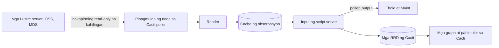

<!-- Source: README.md; SHA256: 40f2c5a5e9be97e4bd2b05a9ebab2a77de51de3af1b1c21dbeb5ee7f936cdd3b -->

<!-- translations:start -->
[English](../../../README.md) | [简体中文](../zh-CN/README.md) | [हिन्दी](../hi-IN/README.md) | [Español (España)](../es-ES/README.md) | [Español (Latinoamérica)](../es-419/README.md) | [العربية (السعودية)](../ar-SA/README.md) | [Afrikaans](../af-ZA/README.md) | [አማርኛ](../am-ET/README.md) | [العربية (مصر)](../ar-EG/README.md) | [العربية (المغرب)](../ar-MA/README.md) | [বাংলা](../bn-BD/README.md) | [Deutsch](../de-DE/README.md) | [فارسی](../fa-IR/README.md) | [Filipino](README.md) | [Français](../fr-FR/README.md) | [Français (Maroc)](../fr-MA/README.md) | [Français (Sénégal)](../fr-SN/README.md) | [Hausa](../ha-NG/README.md) | [עברית](../he-IL/README.md) | [Bahasa Indonesia](../id-ID/README.md) | [Igbo](../ig-NG/README.md) | [Italiano](../it-IT/README.md) | [日本語](../ja-JP/README.md) | [한국어](../ko-KR/README.md) | [Malagasy](../mg-MG/README.md) | [मराठी](../mr-IN/README.md) | [Bahasa Melayu](../ms-MY/README.md) | [Nederlands](../nl-NL/README.md) | [Polski](../pl-PL/README.md) | [Português (Brasil)](../pt-BR/README.md) | [Русский](../ru-RU/README.md) | [Kinyarwanda](../rw-RW/README.md) | [Soomaali](../so-SO/README.md) | [Svenska](../sv-SE/README.md) | [Kiswahili](../sw-KE/README.md) | [தமிழ்](../ta-IN/README.md) | [తెలుగు](../te-IN/README.md) | [ไทย](../th-TH/README.md) | [Türkçe](../tr-TR/README.md) | [Українська](../uk-UA/README.md) | [اردو](../ur-PK/README.md) | [Tiếng Việt](../vi-VN/README.md) | [isiXhosa](../xh-ZA/README.md) | [Yorùbá](../yo-NG/README.md) | [繁體中文](../zh-TW/README.md) | [isiZulu](../zu-ZA/README.md)
<!-- translations:end -->

# plugin_pfs

Isang plugin para sa Cacti 1.2 na nagdadala ng kalusugan at load ng parallel filesystem sa Cacti: kapasidad at hindi balanseng pagpuno sa mga target, throughput bawat target, at mga rate ng operasyon ng metadata. Ang Lustre ang unang backend. Susunod ang GPFS (IBM Storage Scale) at BeeGFS sa likod ng isang backend interface. Napupunta ang datos sa mga karaniwang Cacti device, data source, at graph, kaya nakakapag-alert at nakakapag-suppress dito ang Thold at Maint nang walang binabago.

> **Katayuan: milestone 4, kumpleto na ang code para sa phase 1, hindi pa inilalabas.** Tapos na sa `main` o nasa pagsusuri na ang mga milestone 2 (pundasyon), 3 (obserbasyon sa Lustre), at 4 (pag-aalert at paghahanda sa release). Nag-iinstall, nag-a-upgrade, at nag-a-uninstall ang plugin sa pamamagitan ng plugin API ng Cacti at tumatanggi sa PHP na mas mababa sa 8.2. Isang background reader sa bawat poller ang nagbabasa ng mga Lustre server sa pamamagitan ng SSH gamit ang isang nakapirming forced-command script ([node/pfs-read.sh](../../../node/pfs-read.sh)) at nagka-cache ng inventory, kondisyon, kapasidad, at mga counter kasama ang kanilang freshness. Ang bawat filesystem ay nagiging isang Cacti device na may mga OST at MDT data query, limang pangkalahatang graph, mga per-target graph kapag hiniling, at isang summary data source para sa Thold. Ang Thold v1.8.2 at Maint v1.3, nang walang pagbabago, ay nag-aalert at nagsu-suppress sa mga summary gauge sa end-to-end run; hindi sinusuportahan sa Thold 1.8.2 ang mga threshold ng Thold sa mga counter ([docs/alerting.md](../../alerting.md)). Lahat ng pagsusuri sa ngayon ay tumatakbo sa fixture node output sa isang disposable na Cacti: hindi pa nasusubukan ang plugin sa isang totoong Lustre node. Bukas pa bago ang paglabas: mga pilot sa mga totoong filesystem ([plano sa pilot](../../pilot-plan.md)), ang panlabas na pagsusuri sa seguridad ([pansariling pagsusuri](../../security-review.md)), at mga pagsukat ng scale sa nakadokumentong hardware ([scale](../../research/scale.md)). Nakahanda na ang bersyon 0.1.0 sa `INFO` at [CHANGELOG.md](../../../CHANGELOG.md) ngunit hindi pa naka-tag.

## Mga tungkulin sa pag-access

| Realm | Pag-access |
| --- | --- |
| Parallel Filesystem View | Mga kasalukuyang pahina ng pagsubaybay. |
| Parallel Filesystem Operator | Pagsubaybay kasama ang pahina ng Operations at mga personal na pagkilala sa triage. |
| Parallel Filesystem Admin | Pag-access ng Operator kasama ang mga kasalukuyang pagsasaayos at mga aksyong pang-administratibo. |

Pagkatapos kopyahin ang mga upgrade file, buksan ang pahina ng Plugins bilang administrator upang irehistro
ang bagong realm. Italaga nang hayagan ang Operator realm sa ilalim ng **Configuration > Users** o mga user group.
Pinapanatili ng mga upgrade ang mga kasalukuyang View at Admin realm ID at mga grant. Ang pag-access ng Admin
ay nagmamana ng pag-access ng Operator, at ang pag-access ng Operator ay nagmamana ng pag-access ng View sa bawat kahilingan;
hindi ito nagdaragdag ng mga nakaimbak na grant sa mga user o group. Nangangailangan din ang mga setting ng plugin ng
pag-access na Parallel Filesystem Admin bilang karagdagan sa pahintulot na Settings ng Cacti.

Nililimitahan pa rin ng mga pahintulot ng Cacti device ang mga row at aksyon na magagamit ng bawat user; nangangailangan ng administrator ang mga hindi naka-map na object.
Nananatili sa mga pahinang pang-administratibo ang mga kredensyal, pagsasaayos, pag-map, pagbura, at iba pang mga pagbabagong pang-administratibo.
Tumatagal lamang ang mga pagkilala (acknowledgment) sa kasalukuyang session ng user, nang hindi hihigit sa isang oras at habang nananatiling
sariwa ang parehong obserbasyon. Pinawawalang-bisa ang mga ito ng mga bago o nagbagong obserbasyon. Hindi nila kailanman minamarkahan bilang malusog ang isang nabigong pagsukat o sinusupress ang mga alert.

## Bakit

Kapag mabagal ang isang shared filesystem, nakakalat sa mga server ang ebidensya. Pinapanatili ng Lustre ang mga counter nito bawat node: nag-uulat ang `lctl get_param` ng mga halaga "sa lokal na node", kaya hawak lamang ng bawat object storage server (OSS) at metadata server (MDS) ang mga numero ng sarili nitong mga target. Ang isang operator na nag-iimbestiga ng mabagal na filesystem ay nangangailangan ng tatlong sagot mula sa iba't ibang lugar:

- **Napupuno ba ang isang target habang walang laman ang iba?** Binabago ng hindi balanseng pagpuno kung saan napupunta ang mga bagong file at kung kailan mauubusan ng espasyo ang isang target.
- **Aling mga target o operasyon ang abala?** Ipinapakita ng mga per-target byte counter at per-MDT operation counter kung ang load ay data-bound o metadata-bound.
- **Napapanahon ba ang mismong pagsubaybay?** Nagbibigay lamang ng kapanatagan ang isang patag na graph kung nakikita ng plugin ang mga server.

Nag-g-graph ang Cacti ng mga host at nagta-threshold ng mga halaga gamit ang Thold, at walang repository ang organisasyon ng Cacti sa GitHub para sa pagsubaybay ng Lustre, GPFS, o BeeGFS (hinanap noong 2026-11-14). Sinasara ng plugin ang puwang na iyon sa pamamagitan ng pagbabasa ng mga pinapayagan (allowlisted) at read-only na halaga mula sa mga storage node at pagkatawan sa bawat filesystem bilang isang Cacti device kung saan ang mga target ay mga index ng isang data query. Ginagamit nitong muli ang pag-graph, mga pahintulot, mga remote data collector, Thold, at Maint ng Cacti sa halip na gumawa ng mga kaparehong bersyon ng mga ito.

## Nakaplanong saklaw

| Phase | Saklaw | Mga Milestone |
|---|---|---|
| 0, pananaliksik | Matrix ng release, desisyon sa pag-access ng node, kumpirmasyon ng gawi sa upstream, gawi ng counter at failover, mga pagsukat ng scale | [M1](https://github.com/somethingwithproof/plugin_pfs/milestone/1) |
| 1, pagmamasid | Inventory ng Lustre, kapasidad at pagpuno, OST throughput, mga rate ng operasyon ng MDT, mga graph, pag-aalert sa Thold, pag-suppress sa Maint, pahina ng kalusugan | [M2](https://github.com/somethingwithproof/plugin_pfs/milestone/2), [M3](https://github.com/somethingwithproof/plugin_pfs/milestone/3), [M4](https://github.com/somethingwithproof/plugin_pfs/milestone/4) |
| 2, lalim | Mga remote data collector ng Cacti, mga view sa antas ng job at client sa loob ng nakatakdang bilang ng object | [M5](https://github.com/somethingwithproof/plugin_pfs/milestone/5) |
| 3, mga backend | Mga backend ng GPFS (IBM Storage Scale) at BeeGFS | [M6](https://github.com/somethingwithproof/plugin_pfs/milestone/6) |

Wala sa saklaw: anumang operasyon ng pagsulat, pag-clear, pag-reset, o pag-tune sa isang node o filesystem; isang alerting engine na pagmamay-ari ng plugin; isang custom na daemon o network protocol; mga per-job data source; mga pagbabago sa Cacti core, Thold, o Maint.

## Mga target na pagiging tugma

| Bahagi | Target |
|---|---|
| Cacti | 1.2.31 o mas bago, walang mga patch sa core |
| PHP | 8.2 o mas bago; nananatiling maipa-parse ang `setup.php` sa 8.0 upang ang hindi sinusuportahang runtime ay makatanggap ng pagtanggi sa halip na sirang Cacti UI |
| Lustre | Mga release line na itatakda ng milestone 1; ang source at mga manual na nasuri sa ngayon ay nasa 2.17.0 |
| GPFS, BeeGFS | Phase 3; mga release na itatakda ng pananaliksik |
| Thold, Maint | Walang kinakailangang pagbabago |

## Disenyo

- Ang [docs/PLAN.md](../../PLAN.md) ang buong plano: arkitektura, mga katotohanang upstream na pinagbabatayan nito (may mga pinagmulan at kung ano ang hindi pa nabe-verify), semantika ng counter, modelo ng estado, mga hangganan ng seguridad, aritmetika ng pagganap, pagsubok, at mga panganib.
- Sinasaklaw ng [docs/operator-guide.md](../../operator-guide.md) ang pag-install, mga graph at halaga, pag-upgrade, pag-backup at pag-restore, pag-uninstall, at pag-troubleshoot; sinasaklaw ng [docs/alerting.md](../../alerting.md) ang Thold at Maint.
- Inilalarawan ng [docs/node-setup.md](../../node-setup.md) kung paano ihanda ang isang Lustre server at isang poller para sa reader.
- Naglalaman ang [docs/decisions/](../../decisions) ng mga architecture decision record para sa mga pagpiling nagawa na.
- Iminamapa ng [docs/REQUIREMENTS.md](../../REQUIREMENTS.md) ang bawat requirement ID sa issue nito.

## Paano sinusubaybayan ang trabaho

- Sinusundan ng mga **Milestone** ang mga milestone ng plano. Bawat isa ay may epic issue na naglilista ng mga sub-issue at ebidensya ng pagtatapos nito.
- Inuuri ang mga **Issue** ayon sa label: `type: requirement`, `type: research`, `type: decision`, `type: epic`. Isinasaad ng mga requirement issue ang mga may bilang at masusuring kinakailangan (`REQ-AREA-NNN`) at pamantayan sa pagtanggap.
- Nagdadala rin ang mga **Label** ng `area:`, `phase:`, `priority:`, at `status:`. Tingnan ang [CONTRIBUTING.md](../../../CONTRIBUTING.md#labels).
- Ipinapakita ng [board ng proyekto](https://github.com/users/somethingwithproof/projects/11) ang lahat ng issue sa mga milestone.

## Pag-aambag

Basahin ang [CONTRIBUTING.md](../../../CONTRIBUTING.md). Nangangailangan ng DCO sign-off ang mga commit. Nagaganap sa mga issue ang talakayan sa disenyo; ang mga bukas na desisyon ay may label na `type: decision`.

## Seguridad

Iulat ang mga kahinaan nang pribado; tingnan ang [SECURITY.md](../../../SECURITY.md).

## Lisensya

GNU General Public License v2.0, ang parehong lisensya ng Cacti at mga plugin nito. Tingnan ang [LICENSE](../../../LICENSE).
