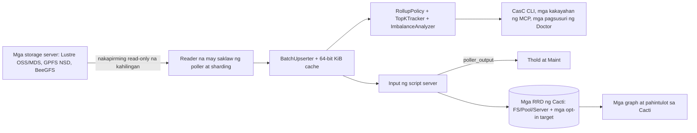

<!-- Source: README.md; SHA256: e88d6875d113220a91cfc0a9d230c829a78477b17e6aa7e44dda38c9591c86ad -->

<!-- translations:start -->
[English](../../../README.md) | [简体中文](../zh-CN/README.md) | [हिन्दी](../hi-IN/README.md) | [Español (España)](../es-ES/README.md) | [Español (Latinoamérica)](../es-419/README.md) | [العربية (السعودية)](../ar-SA/README.md) | [Afrikaans](../af-ZA/README.md) | [አማርኛ](../am-ET/README.md) | [العربية (مصر)](../ar-EG/README.md) | [العربية (المغرب)](../ar-MA/README.md) | [Български](../bg-BG/README.md) | [বাংলা](../bn-BD/README.md) | [Bosanski](../bs-BA/README.md) | [Deutsch](../de-DE/README.md) | [Ελληνικά](../el-GR/README.md) | [فارسی](../fa-IR/README.md) | [Filipino](README.md) | [Français](../fr-FR/README.md) | [Français (Maroc)](../fr-MA/README.md) | [Français (Sénégal)](../fr-SN/README.md) | [Hausa](../ha-NG/README.md) | [עברית](../he-IL/README.md) | [Hrvatski](../hr-HR/README.md) | [Bahasa Indonesia](../id-ID/README.md) | [Igbo](../ig-NG/README.md) | [Italiano](../it-IT/README.md) | [日本語](../ja-JP/README.md) | [ქართული](../ka-GE/README.md) | [한국어](../ko-KR/README.md) | [Latviešu](../lv-LV/README.md) | [Malagasy](../mg-MG/README.md) | [मराठी](../mr-IN/README.md) | [Bahasa Melayu](../ms-MY/README.md) | [Nederlands](../nl-NL/README.md) | [Polski](../pl-PL/README.md) | [Português (Brasil)](../pt-BR/README.md) | [Português (Portugal)](../pt-PT/README.md) | [Русский](../ru-RU/README.md) | [Kinyarwanda](../rw-RW/README.md) | [Soomaali](../so-SO/README.md) | [Српски](../sr-RS/README.md) | [Svenska](../sv-SE/README.md) | [Kiswahili](../sw-KE/README.md) | [தமிழ்](../ta-IN/README.md) | [తెలుగు](../te-IN/README.md) | [ไทย](../th-TH/README.md) | [Türkçe](../tr-TR/README.md) | [Українська](../uk-UA/README.md) | [اردو](../ur-PK/README.md) | [Tiếng Việt](../vi-VN/README.md) | [isiXhosa](../xh-ZA/README.md) | [Yorùbá](../yo-NG/README.md) | [繁體中文](../zh-TW/README.md) | [isiZulu](../zu-ZA/README.md)
<!-- translations:end -->

# plugin_pfs

Isang plugin para sa Cacti 1.2 na nagdadala sa Cacti ng kalusugan ng parallel filesystem, kapasidad, hindi balanseng pagpuno, throughput bawat target, at mga rate ng operasyon ng metadata sa Lustre, IBM Storage Scale (GPFS), at BeeGFS sa likod ng isang pinag-isang `Backend` interface. Ang bawat filesystem ay nakamapa sa isang karaniwang Cacti device na may mga data query, mga pangkalahatan at on-demand na target graph, at mga summary gauge upang makapag-alert at makapag-suppress ang Thold at Maint nang walang pagbabago.

> **Katayuan: naipatupad na sa code ang mga phase 1 hanggang 3 at mga exascale scaling primitive, hindi pa inilalabas.** Naipatupad at napatunayan na sa pamamagitan ng mga unit, security, at disposable-Cacti integration test ang pundasyon, pagmamasid sa Lustre, pag-aalert at pag-suppress ng Maint, mga read-only driver ng GPFS at BeeGFS, pagsusuri ng hindi balanseng OST/MDT na may integrasyon ng Maint, pagsasaklaw ng remote data collector (`replicate_out`, `remote_agent`), mga 100+ PB / exascale scaling primitive (`FramedReportParser`, Schema v4 `value_kib`, `RollupPolicy`, `TopKTracker`, `ShardAssigner`, `BatchUpserter`), ang CasC operator CLI (`cli/pfs.php`), at mga ecosystem hook (`abilities_register`, `doctor_register_checks`, `casc_register_providers`). Lahat ng pagsubok hanggang sa ngayon ay gumagamit ng fixture node output sa halip na aktwal na hardware ng Lustre, GPFS, o BeeGFS. Bukas pa bago mag-tag ng release: mga pilot sa mga totoong filesystem ([plano sa pilot](../../pilot-plan.md)), panlabas na pagsusuri sa seguridad ([pansariling pagsusuri](../../security-review.md)), at mga pagsukat ng scale sa nakadokumentong hardware ([scale](../../research/scale.md)). Nakahanda na ang bersyon 0.1.0 sa `INFO` at [CHANGELOG.md](../../../CHANGELOG.md) ngunit hindi pa naka-tag.

## Mga tungkulin sa pag-access

| Realm | Pag-access |
| --- | --- |
| Parallel Filesystem View | Mga kasalukuyang pahina ng pagsubaybay. |
| Parallel Filesystem Operator | Pagsubaybay kasama ang pahina ng Operations at mga personal na pagkilala sa triage. |
| Parallel Filesystem Admin | Pag-access ng Operator kasama ang mga kasalukuyang pagsasaayos at mga aksyong pang-administratibo. |

Pagkatapos kopyahin ang mga upgrade file, buksan ang pahina ng Plugins bilang administrator upang irehistro
ang bagong realm. Italaga nang hayagan ang Operator realm sa ilalim ng **Configuration > Users** o mga user group.
Pinapanatili ng mga upgrade ang mga kasalukuyang View at Admin realm ID at mga grant. Ang pag-access ng Admin
ay nagmamana ng pag-access ng Operator, at ang pag-access ng Operator ay nagmamana ng pag-access ng View sa bawat kahilingan;
hindi ito nagdaragdag ng mga nakaimbak na grant sa mga user o group. Nangangailangan din ang mga setting ng plugin ng
pag-access na Parallel Filesystem Admin bilang karagdagan sa pahintulot na Settings ng Cacti.

Nililimitahan pa rin ng mga pahintulot ng Cacti device ang mga row at aksyon na magagamit ng bawat user; nangangailangan ng administrator ang mga hindi naka-map na object.
Nananatili sa mga pahinang pang-administratibo ang mga kredensyal, pagsasaayos, pag-map, pagbura, at iba pang mga pagbabagong pang-administratibo.
Tumatagal lamang ang mga pagkilala (acknowledgment) sa kasalukuyang session ng user, nang hindi hihigit sa isang oras at habang nananatiling
sariwa ang parehong obserbasyon. Pinawawalang-bisa ang mga ito ng mga bago o nagbagong obserbasyon. Hindi nila kailanman minamarkahan bilang malusog ang isang nabigong pagsukat o sinusupress ang mga alert.

## Bakit

Kapag mabagal ang isang shared filesystem, nakakalat sa mga server ang ebidensya. Pinapanatili ng Lustre ang mga counter nito bawat node: nag-uulat ang `lctl get_param` ng mga halaga "sa lokal na node", kaya hawak lamang ng bawat object storage server (OSS) at metadata server (MDS) ang mga numero ng sarili nitong mga target. Ang isang operator na nag-iimbestiga ng mabagal na filesystem ay nangangailangan ng tatlong sagot mula sa iba't ibang lugar:

- **Napupuno ba ang isang target habang walang laman ang iba?** Binabago ng hindi balanseng pagpuno kung saan napupunta ang mga bagong file at kung kailan mauubusan ng espasyo ang isang target.
- **Aling mga target o operasyon ang abala?** Ipinapakita ng mga per-target byte counter at per-MDT operation counter kung ang load ay data-bound o metadata-bound.
- **Napapanahon ba ang mismong pagsubaybay?** Nagbibigay lamang ng kapanatagan ang isang patag na graph kung nakikita ng plugin ang mga server.

Nag-g-graph ang Cacti ng mga host at nagta-threshold ng mga halaga gamit ang Thold, at walang repository ang organisasyon ng Cacti sa GitHub para sa pagsubaybay ng Lustre, GPFS, o BeeGFS (hinanap noong 2026-11-14). Sinasara ng plugin ang puwang na iyon sa pamamagitan ng pagbabasa ng mga pinapayagan (allowlisted) at read-only na halaga mula sa mga storage node at pagkatawan sa bawat filesystem bilang isang Cacti device kung saan ang mga target ay mga index ng isang data query. Ginagamit nitong muli ang pag-graph, mga pahintulot, mga remote data collector, Thold, at Maint ng Cacti sa halip na gumawa ng mga kaparehong bersyon ng mga ito.

## Nakaplanong saklaw

| Phase | Saklaw | Katayuan | Mga Milestone |
|---|---|---|---|
| 0, pananaliksik | Matrix ng release, desisyon sa pag-access ng node, kumpirmasyon ng gawi sa upstream, gawi ng counter at failover, mga pagsukat ng scale | Kumpleto | [M1](https://github.com/somethingwithproof/plugin_pfs/milestone/1) |
| 1, pagmamasid | Inventory ng Lustre, kapasidad at pagpuno, hindi balanseng OST/MDT (`lib/ImbalanceAnalyzer.php`), integrasyon ng Maint (`lib/HealthPage.php`), OST throughput, mga rate ng operasyon ng MDT, mga graph, pag-aalert sa Thold, pahina ng kalusugan | Naipatupad (nasubukan gamit ang fixture) | [M2](https://github.com/somethingwithproof/plugin_pfs/milestone/2), [M3](https://github.com/somethingwithproof/plugin_pfs/milestone/3), [M4](https://github.com/somethingwithproof/plugin_pfs/milestone/4) |
| 2, remote at scale | Remote collection na saklaw ng poller (`lib/Reader.php`, `lib/ReplicationRepository.php`, `replicate_out`, `remote_agent`), mga 100+ PB scaling primitive (64-bit KiB hygiene + Schema v4 `value_kib`, `lib/RollupPolicy.php`, `lib/TopKTracker.php`, `lib/ShardAssigner.php` + `poller_pfs.php --shard=K/N`, `lib/BatchUpserter.php`), CasC CLI (`cli/pfs.php`), mga hook ng MCP/Doctor/CasC | Naipatupad (nasubukan sa unit at CI integration) | [M5](https://github.com/somethingwithproof/plugin_pfs/milestone/5) |
| 3, mga backend | Mga read-only driver ng IBM Storage Scale (GPFS) (`lib/GpfsBackend.php`) at BeeGFS (`lib/BeegfsBackend.php`) na nakarehistro sa `BackendRegistry::production()` | Naipatupad (nasubukan sa unit) | [M6](https://github.com/somethingwithproof/plugin_pfs/milestone/6) |

Mga pangunahing naipatupad na operator at scaling primitive:

- **Mga multi-filesystem read-only driver:** `LustreBackend`, `GpfsBackend` (naka-frame na `mmpmon` `fs_io_s`/`io_s` lamang kung saan bawal ang `reset`, mga kapasidad/estado ng pool ng `mmdf`, at mga buod ng waiter), at `BeegfsBackend` (mga storage/metadata target ng BeeGFS 7.4 at 8.x na may eksaktong pag-convert ng byte sa KiB, pagmamapa ng kondisyon ng reachability/consistency, at semantika ng per-interval gauge) na nagbabahagi ng `lib/FramedReportParser.php`.
- **Kamalayan sa hindi pagkakapantay, headroom, at Maint:** Kinakalkula ng `lib/ImbalanceAnalyzer.php` ang mga fill ratio ng OST/MDT, spread, population standard deviation imbalance index, headroom, 1-interval freshness enforcement (`missing_targets`), mga per-target status flag, at limitadong Top-K na hindi balanseng target. Ipinapakita ng `HealthPage` (`pfs_health.php`) at `CascProvider::health()` ang mga window ng pagpapanatili ng `Maint` ng Cacti at pinipigilan ang mga aktibong babala ng pagkabigo sa panahon ng nakaiskedyul na pagpapanatili.
- **100+ PB at exascale scaling** ([docs/architecture/exascale-scaling.md](../../architecture/exascale-scaling.md)): eksaktong decimal na pag-convert ng byte sa KiB (`FramedReportParser::bytesToKibInt()`) na napatunayan sa 500 PB at 2 EB kasabay ng mga column na `BIGINT UNSIGNED value_kib` (Schema v4); hierarchical na `Filesystem -> Pool -> Storage Server` na mga RRD rollup na may limitadong opt-in/hot/skewed target promotion (`lib/RollupPolicy.php`); limitadong $O(K)$ na mga Top-K na hindi balanseng target at paunang pinagsama-samang buod ng mabibigat na job/client (`lib/TopKTracker.php`, hindi kailanman gumagawa ng mga per-client device o RRD); deterministikong CRC32 collector sharding (`lib/ShardAssigner.php`, `php plugins/pfs/poller_pfs.php [--poller=N] [--shard=K/N] [--force] [--debug]`); at 500-row batched SQL upsert kasama ang keyset pagination (`lib/BatchUpserter.php`, `CacheRepository::upsertObservationsBatch()`, `TargetRepository::forFilesystemPage()`).
- **Operator CasC CLI at mga ecosystem hook:** Sinusuportahan ng `cli/pfs.php` ang `export [--format=yaml|xml]`, `validate <file> [--format=yaml|xml]`, `plan <file> [--format=yaml|xml] [--output=text|json]`, `apply <file> --confirm=<PLAN_HASH> [--format=yaml|xml]`, at `health [--format=text|json]` na walang panlabas na dependency ng Composer. Inirerehistro ng `setup.php` at `lib/EcosystemIntegration.php` ang `abilities_register` (`pfs-list-filesystems`, `pfs-get-imbalance`, `pfs-get-health`; read-only, nakabatay sa `Parallel Filesystem View` at mga pahintulot ng Cacti device), `doctor_register_checks` (`pfs_schema`, `pfs_reader_freshness`, `pfs_capacity_imbalance`), `casc_register_providers`, `replicate_out`, at `remote_agent`.

Wala sa saklaw: anumang operasyon ng pagsulat, pag-clear, pag-reset, o pag-tune sa isang node o filesystem; isang alerting engine na pagmamay-ari ng plugin; isang custom na daemon o network protocol; mga per-job o per-client na Cacti device/RRD; mga pagbabago sa Cacti core, Thold, o Maint.

## Mga target na pagiging tugma

| Bahagi | Target |
|---|---|
| Cacti | 1.2.31 o mas bago, walang mga patch sa core |
| PHP | 8.2 o mas bago; nananatiling maipa-parse ang `setup.php`, `poller_pfs.php`, at `cli/pfs.php` sa 8.0 upang ang hindi sinusuportahang runtime ay makatanggap ng pagtanggi sa halip na sirang Cacti UI |
| Lustre | Nasuri ang source at mga manual sa 2.17.0; nasubukan gamit ang fixture |
| GPFS, BeeGFS | Naipatupad at nasubukan gamit ang fixture ang mga read-only driver ng IBM Storage Scale (GPFS) 5.x `mmpmon`/`mmdf` at BeeGFS 7.4 / 8.x |
| Thold, Maint | Thold 1.8.2 at Maint 1.3, walang pagbabago |

## Disenyo

- Idinodokumento ng [docs/architecture/exascale-scaling.md](../../architecture/exascale-scaling.md) ang two-tier 100+ PB / exascale telemetry architecture (Cacti/`plugin_pfs` server + rollup + Top-K tier na ipinares sa out-of-band na LDMS/Darshan/TOKIO client telemetry) at ang konteksto nito sa akademikong literatura.
- Ang [docs/PLAN.md](../../PLAN.md) ang buong plano: arkitektura, mga katotohanang upstream na pinagbabatayan nito (may mga pinagmulan at kung ano ang hindi pa nabe-verify), semantika ng counter, modelo ng estado, mga hangganan ng seguridad, aritmetika ng pagganap, pagsubok, at mga panganib.
- Sinasaklaw ng [docs/operator-guide.md](../../operator-guide.md) ang pag-install, mga graph at halaga, pag-upgrade, pag-backup at pag-restore, pag-uninstall, at pag-troubleshoot; sinasaklaw ng [docs/alerting.md](../../alerting.md) ang Thold at Maint.
- Inilalarawan ng [docs/node-setup.md](../../node-setup.md) kung paano ihanda ang isang Lustre server at isang poller para sa reader.
- Naglalaman ang [docs/decisions/](../../decisions) ng mga architecture decision record para sa mga pagpiling nagawa na.
- Iminamapa ng [docs/REQUIREMENTS.md](../../REQUIREMENTS.md) ang bawat requirement ID sa issue nito.

## Paano sinusubaybayan ang trabaho

- Sinusundan ng mga **Milestone** ang mga milestone ng plano. Bawat isa ay may epic issue na naglilista ng mga sub-issue at ebidensya ng pagtatapos nito.
- Inuuri ang mga **Issue** ayon sa label: `type: requirement`, `type: research`, `type: decision`, `type: epic`. Isinasaad ng mga requirement issue ang mga may bilang at masusuring kinakailangan (`REQ-AREA-NNN`) at pamantayan sa pagtanggap.
- Nagdadala rin ang mga **Label** ng `area:`, `phase:`, `priority:`, at `status:`. Tingnan ang [CONTRIBUTING.md](../../../CONTRIBUTING.md#labels).
- Ipinapakita ng [board ng proyekto](https://github.com/users/somethingwithproof/projects/11) ang lahat ng issue sa mga milestone.

## Pag-aambag

Basahin ang [CONTRIBUTING.md](../../../CONTRIBUTING.md). Nangangailangan ng DCO sign-off ang mga commit. Nagaganap sa mga issue ang talakayan sa disenyo; ang mga bukas na desisyon ay may label na `type: decision`.

## Seguridad

Iulat ang mga kahinaan nang pribado; tingnan ang [SECURITY.md](../../../SECURITY.md).

## Lisensya

GNU General Public License v2.0, ang parehong lisensya ng Cacti at mga plugin nito. Tingnan ang [LICENSE](../../../LICENSE).
