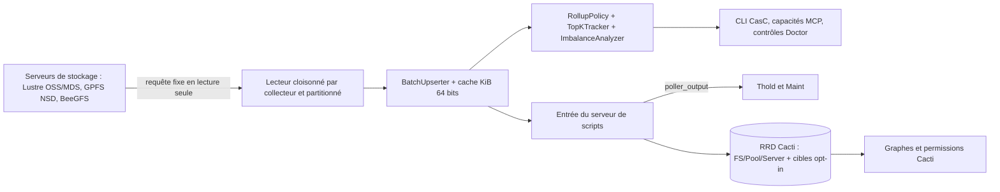

<!-- Source: README.md; SHA256: e88d6875d113220a91cfc0a9d230c829a78477b17e6aa7e44dda38c9591c86ad -->

<!-- translations:start -->
[English](../../../README.md) | [简体中文](../zh-CN/README.md) | [हिन्दी](../hi-IN/README.md) | [Español (España)](../es-ES/README.md) | [Español (Latinoamérica)](../es-419/README.md) | [العربية (السعودية)](../ar-SA/README.md) | [Afrikaans](../af-ZA/README.md) | [አማርኛ](../am-ET/README.md) | [العربية (مصر)](../ar-EG/README.md) | [العربية (المغرب)](../ar-MA/README.md) | [বাংলা](../bn-BD/README.md) | [Bosanski](../bs-BA/README.md) | [Deutsch](../de-DE/README.md) | [فارسی](../fa-IR/README.md) | [Filipino](../fil-PH/README.md) | [Français](../fr-FR/README.md) | [Français (Maroc)](README.md) | [Français (Sénégal)](../fr-SN/README.md) | [Hausa](../ha-NG/README.md) | [עברית](../he-IL/README.md) | [Hrvatski](../hr-HR/README.md) | [Bahasa Indonesia](../id-ID/README.md) | [Igbo](../ig-NG/README.md) | [Italiano](../it-IT/README.md) | [日本語](../ja-JP/README.md) | [한국어](../ko-KR/README.md) | [Malagasy](../mg-MG/README.md) | [मराठी](../mr-IN/README.md) | [Bahasa Melayu](../ms-MY/README.md) | [Nederlands](../nl-NL/README.md) | [Polski](../pl-PL/README.md) | [Português (Brasil)](../pt-BR/README.md) | [Русский](../ru-RU/README.md) | [Kinyarwanda](../rw-RW/README.md) | [Soomaali](../so-SO/README.md) | [Српски](../sr-RS/README.md) | [Svenska](../sv-SE/README.md) | [Kiswahili](../sw-KE/README.md) | [தமிழ்](../ta-IN/README.md) | [తెలుగు](../te-IN/README.md) | [ไทย](../th-TH/README.md) | [Türkçe](../tr-TR/README.md) | [Українська](../uk-UA/README.md) | [اردو](../ur-PK/README.md) | [Tiếng Việt](../vi-VN/README.md) | [isiXhosa](../xh-ZA/README.md) | [Yorùbá](../yo-NG/README.md) | [繁體中文](../zh-TW/README.md) | [isiZulu](../zu-ZA/README.md)
<!-- translations:end -->

# plugin_pfs

Un plugin Cacti 1.2 qui intègre dans Cacti la santé des systèmes de fichiers parallèles, la capacité, le déséquilibre de remplissage, le débit par cible et les taux d'opérations de métadonnées sur Lustre, IBM Storage Scale (GPFS) et BeeGFS derrière une interface unifiée `Backend`. Chaque système de fichiers correspond à un équipement Cacti standard doté de requêtes de données, de graphes de vue d'ensemble et de cibles à la demande, ainsi que de jauges de synthèse afin que Thold et Maint déclenchent les alertes et les suppriment sans aucune modification.

> **Statut : phases 1 à 3 et primitives de passage à l'échelle exascale implémentées dans le code, non encore publié.** Les fondations, l'observation Lustre, les alertes et la suppression Maint, les pilotes en lecture seule GPFS et BeeGFS, l'analyse du déséquilibre OST/MDT avec intégration Maint, le cloisonnement des collecteurs distants (`replicate_out`, `remote_agent`), les primitives de mise à l'échelle 100+ Po / exascale (`FramedReportParser`, schéma v4 `value_kib`, `RollupPolicy`, `TopKTracker`, `ShardAssigner`, `BatchUpserter`), l'outil CLI opérateur CasC (`cli/pfs.php`) et les hooks d'écosystème (`abilities_register`, `doctor_register_checks`, `casc_register_providers`) sont implémentés et vérifiés par des tests unitaires, de sécurité et d'intégration sur Cacti jetable. Toutes les exécutions effectuées jusqu'ici utilisent des sorties de nœuds simulées plutôt que du matériel réel Lustre, GPFS ou BeeGFS. Restent ouverts avant d'étiqueter une version : les pilotes sur des systèmes de fichiers réels ([plan pilote](../../pilot-plan.md)), un audit de sécurité externe ([auto-évaluation](../../security-review.md)) et les mesures de montée en charge sur du matériel documenté ([montée en charge](../../research/scale.md)). La version 0.1.0 est préparée dans `INFO` et [CHANGELOG.md](../../../CHANGELOG.md), mais n'est pas encore étiquetée (taggée).

## Rôles d'accès

| Domaine | Accès |
| --- | --- |
| Parallel Filesystem View | Pages de supervision existantes. |
| Parallel Filesystem Operator | Supervision, page Operations et acquittements personnels de triage. |
| Parallel Filesystem Admin | Accès Operator ainsi que la configuration existante et les actions d'administration. |

Après avoir copié les fichiers de mise à niveau, ouvrez la page Plugins en tant qu'administrateur pour enregistrer le nouveau domaine. Attribuez explicitement le domaine Operator sous **Configuration > Users** ou aux groupes d'utilisateurs.
Les mises à niveau conservent les identifiants et les autorisations existants des domaines View et Admin. L'accès Admin hérite de l'accès Operator, et l'accès Operator hérite de l'accès View à chaque requête ; cela n'ajoute pas d'autorisations enregistrées aux utilisateurs ni aux groupes. Les paramètres du plugin exigent également l'accès Parallel Filesystem Admin en plus de la permission Settings de Cacti.

Les permissions d'équipement Cacti continuent de limiter les lignes et les actions disponibles pour chaque utilisateur ; les objets non mappés requièrent un administrateur.
Les identifiants, la configuration, le mappage, la suppression et les autres modifications d'administration restent dans les pages d'administration. Les acquittements ne durent que pendant la session en cours de l'utilisateur, pendant au plus une heure et uniquement tant que la même observation reste fraîche. Toute observation nouvelle ou modifiée les invalide. Ils ne marquent jamais une mesure en échec comme saine et ne suppriment pas les alertes.

## Pourquoi

Lorsqu'un système de fichiers partagé est lent, les indices sont répartis sur plusieurs serveurs. Lustre conserve ses compteurs par nœud : `lctl get_param` rapporte les valeurs « sur le nœud local », de sorte que chaque serveur de stockage d'objets (OSS) et chaque serveur de métadonnées (MDS) ne détient que les chiffres de ses propres cibles. Un opérateur qui analyse un système de fichiers lent a besoin de trois réponses provenant d'emplacements distincts :

- **Une cible se remplit-elle tandis que d'autres restent vides ?** Le déséquilibre de remplissage influence l'emplacement des nouveaux fichiers et le moment où une cible donnée manque d'espace.
- **Quelles cibles ou opérations sont sollicitées ?** Les compteurs d'octets par cible et les compteurs d'opérations par MDT indiquent si la charge est liée aux données ou aux métadonnées.
- **La supervision elle-même est-elle à jour ?** Un graphe plat n'est rassurant que si le plugin a réellement pu joindre les serveurs.

Cacti trace les graphes des hôtes et applique des seuils avec Thold, et l'organisation GitHub de Cacti ne dispose d'aucun dépôt pour la supervision de Lustre, GPFS ou BeeGFS (recherche effectuée le 2026-11-14). Le plugin comble cette lacune en lisant des valeurs autorisées en lecture seule depuis les nœuds de stockage et en représentant chaque système de fichiers comme un équipement Cacti dont les cibles constituent les index d'une requête de données. Il réutilise la génération de graphes, les permissions, les collecteurs de données distants, Thold et Maint de Cacti plutôt que d'en développer des versions parallèles.

## Périmètre prévu

| Phase | Périmètre | Statut | Jalons |
|---|---|---|---|
| 0, recherche | Matrice de versions, décision d'accès aux nœuds, confirmation du comportement amont, comportement des compteurs et du basculement, mesures de montée en charge | Terminé | [M1](https://github.com/somethingwithproof/plugin_pfs/milestone/1) |
| 1, observation | Inventaire Lustre, capacité et remplissage, déséquilibre OST/MDT (`lib/ImbalanceAnalyzer.php`), intégration Maint (`lib/HealthPage.php`), débit OST, taux d'opérations MDT, graphes, alertes Thold, page de santé | Implémenté (testé sur fixtures) | [M2](https://github.com/somethingwithproof/plugin_pfs/milestone/2), [M3](https://github.com/somethingwithproof/plugin_pfs/milestone/3), [M4](https://github.com/somethingwithproof/plugin_pfs/milestone/4) |
| 2, distant et échelle | Collecte distante cloisonnée par collecteur (`lib/Reader.php`, `lib/ReplicationRepository.php`, `replicate_out`, `remote_agent`), primitives de mise à l'échelle 100+ Po (hygiène KiB 64 bits + schéma v4 `value_kib`, `lib/RollupPolicy.php`, `lib/TopKTracker.php`, `lib/ShardAssigner.php` + `poller_pfs.php --shard=K/N`, `lib/BatchUpserter.php`), CLI CasC (`cli/pfs.php`), hooks MCP/Doctor/CasC | Implémenté (tests unitaires et intégration CI) | [M5](https://github.com/somethingwithproof/plugin_pfs/milestone/5) |
| 3, backends | Pilotes en lecture seule IBM Storage Scale (GPFS) (`lib/GpfsBackend.php`) et BeeGFS (`lib/BeegfsBackend.php`) enregistrés dans `BackendRegistry::production()` | Implémenté (tests unitaires) | [M6](https://github.com/somethingwithproof/plugin_pfs/milestone/6) |

Principales primitives opérateur et de montée en charge implémentées :

- **Pilotes multi-systèmes de fichiers en lecture seule :** `LustreBackend`, `GpfsBackend` (uniquement `mmpmon` encadré `fs_io_s`/`io_s` avec `reset` interdit, capacité/états des pools `mmdf` et synthèses d'attente) et `BeegfsBackend` (cibles de stockage et de métadonnées BeeGFS 7.4 et 8.x avec conversion exacte des octets en KiB, correspondance d'accessibilité et de cohérence, et sémantique de jauge par intervalle) partageant `lib/FramedReportParser.php`.
- **Déséquilibre, marge disponible et intégration Maint :** `lib/ImbalanceAnalyzer.php` calcule les taux de remplissage OST/MDT, l'écart, l'indice de déséquilibre par écart-type de population, la marge disponible, le contrôle de fraîcheur sur un intervalle (`missing_targets`), les indicateurs d'état par cible et un Top-K borné des cibles déséquilibrées. `HealthPage` (`pfs_health.php`) et `CascProvider::health()` exposent les fenêtres de maintenance `Maint` de Cacti et suppriment les avertissements d'échec actifs pendant la maintenance planifiée.
- **Montée en charge 100+ Po et exascale** ([docs/architecture/exascale-scaling.md](../../architecture/exascale-scaling.md)) : conversion décimale exacte des octets en KiB (`FramedReportParser::bytesToKibInt()`) vérifiée à 500 Po et 2 Eo avec des colonnes `BIGINT UNSIGNED value_kib` (schéma v4) ; agrégations RRD hiérarchiques `Filesystem -> Pool -> Storage Server` avec promotion bornée de cibles opt-in/chaudes/déséquilibrées (`lib/RollupPolicy.php`) ; Top-K borné $O(K)$ des cibles déséquilibrées et synthèses pré-agrégées des tâches/clients lourds (`lib/TopKTracker.php`, sans jamais créer d'équipements ni de RRD par client) ; partitionnement déterministe CRC32 des collecteurs (`lib/ShardAssigner.php`, `php plugins/pfs/poller_pfs.php [--poller=N] [--shard=K/N] [--force] [--debug]`) ; et upserts SQL par lots de 500 lignes avec pagination par curseur clé (`lib/BatchUpserter.php`, `CacheRepository::upsertObservationsBatch()`, `TargetRepository::forFilesystemPage()`).
- **CLI opérateur CasC et hooks d'écosystème :** `cli/pfs.php` prend en charge `export [--format=yaml|xml]`, `validate <file> [--format=yaml|xml]`, `plan <file> [--format=yaml|xml] [--output=text|json]`, `apply <file> --confirm=<PLAN_HASH> [--format=yaml|xml]` et `health [--format=text|json]` sans aucune dépendance Composer externe. `setup.php` et `lib/EcosystemIntegration.php` enregistrent `abilities_register` (`pfs-list-filesystems`, `pfs-get-imbalance`, `pfs-get-health` ; en lecture seule, conditionné à `Parallel Filesystem View` et aux permissions d'équipement Cacti), `doctor_register_checks` (`pfs_schema`, `pfs_reader_freshness`, `pfs_capacity_imbalance`), `casc_register_providers`, `replicate_out` et `remote_agent`.

Hors périmètre : toute opération d'écriture, d'effacement, de réinitialisation ou de réglage sur un nœud ou un système de fichiers ; un moteur d'alertes propre au plugin ; un démon ou protocole réseau personnalisé ; des équipements ou RRD Cacti par tâche ou par client ; toute modification du cœur de Cacti, de Thold ou de Maint.

## Cibles de compatibilité

| Composant | Cible |
|---|---|
| Cacti | 1.2.31 ou version ultérieure, aucun correctif du cœur |
| PHP | 8.2 ou version ultérieure ; `setup.php`, `poller_pfs.php` et `cli/pfs.php` restent analysables sous 8.0 afin qu'un environnement d'exécution non pris en charge reçoive un refus plutôt qu'une interface Cacti cassée |
| Lustre | Sources et manuels vérifiés en version 2.17.0 ; testé sur fixtures |
| GPFS, BeeGFS | Pilotes en lecture seule IBM Storage Scale (GPFS) 5.x `mmpmon`/`mmdf` et BeeGFS 7.4 / 8.x implémentés et testés sur fixtures |
| Thold, Maint | Thold 1.8.2 et Maint 1.3, inchangés |

## Conception

- [docs/architecture/exascale-scaling.md](../../architecture/exascale-scaling.md) documente l'architecture de télémétrie à deux niveaux pour 100+ Po / exascale (niveau serveur + agrégation + Top-K dans Cacti/`plugin_pfs` associé à une télémétrie client hors bande LDMS/Darshan/TOKIO) et son contexte dans la littérature académique.
- [docs/PLAN.md](../../PLAN.md) constitue le plan complet : architecture, faits amont sur lesquels il s'appuie (avec sources et éléments encore non vérifiés), sémantique des compteurs, modèle d'états, frontières de sécurité, arithmétique de performance, tests et risques.
- [docs/operator-guide.md](../../operator-guide.md) couvre l'installation, les graphes et les valeurs, la mise à niveau, la sauvegarde et la restauration, la désinstallation et le dépannage ; [docs/alerting.md](../../alerting.md) couvre Thold et Maint.
- [docs/node-setup.md](../../node-setup.md) décrit comment préparer un serveur Lustre et un collecteur pour le lecteur.
- [docs/decisions/](../../decisions) contient les dossiers de décisions d'architecture pour les choix déjà effectués.
- [docs/REQUIREMENTS.md](../../REQUIREMENTS.md) associe chaque identifiant d'exigence à son ticket.

## Suivi des travaux

- **Jalons** : ils suivent les jalons du plan. Chacun dispose d'un ticket épique listant ses sous-tickets et ses preuves de clôture.
- **Tickets** : ils sont typés par étiquette : `type: requirement`, `type: research`, `type: decision`, `type: epic`. Les tickets d'exigence énoncent des exigences numérotées et testables (`REQ-AREA-NNN`) ainsi que leurs critères d'acceptation.
- **Étiquettes** : elles portent également `area:`, `phase:`, `priority:` et `status:`. Consultez [CONTRIBUTING.md](../../../CONTRIBUTING.md#labels).
- Le [tableau de projet](https://github.com/users/somethingwithproof/projects/11) présente l'ensemble des tickets à travers les jalons.

## Contribution

Consultez [CONTRIBUTING.md](../../../CONTRIBUTING.md). Les commits nécessitent une signature DCO (sign-off). Les discussions de conception ont lieu dans les tickets ; les décisions ouvertes portent l'étiquette `type: decision`.

## Sécurité

Signalez les vulnérabilités en privé ; consultez [SECURITY.md](../../../SECURITY.md).

## Licence

Licence publique générale GNU v2.0 (GNU General Public License v2.0), la même licence que Cacti et ses plugins. Consultez [LICENSE](../../../LICENSE).
