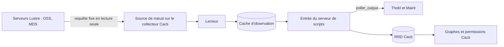

<!-- Source: README.md; SHA256: e88d6875d113220a91cfc0a9d230c829a78477b17e6aa7e44dda38c9591c86ad -->

<!-- translations:start -->
[English](../../../README.md) | [简体中文](../zh-CN/README.md) | [हिन्दी](../hi-IN/README.md) | [Español (España)](../es-ES/README.md) | [Español (Latinoamérica)](../es-419/README.md) | [العربية (السعودية)](../ar-SA/README.md) | [Afrikaans](../af-ZA/README.md) | [አማርኛ](../am-ET/README.md) | [العربية (مصر)](../ar-EG/README.md) | [العربية (المغرب)](../ar-MA/README.md) | [বাংলা](../bn-BD/README.md) | [Bosanski](../bs-BA/README.md) | [Deutsch](../de-DE/README.md) | [فارسی](../fa-IR/README.md) | [Filipino](../fil-PH/README.md) | [Français](../fr-FR/README.md) | [Français (Maroc)](README.md) | [Français (Sénégal)](../fr-SN/README.md) | [Hausa](../ha-NG/README.md) | [עברית](../he-IL/README.md) | [Hrvatski](../hr-HR/README.md) | [Bahasa Indonesia](../id-ID/README.md) | [Igbo](../ig-NG/README.md) | [Italiano](../it-IT/README.md) | [日本語](../ja-JP/README.md) | [한국어](../ko-KR/README.md) | [Malagasy](../mg-MG/README.md) | [मराठी](../mr-IN/README.md) | [Bahasa Melayu](../ms-MY/README.md) | [Nederlands](../nl-NL/README.md) | [Polski](../pl-PL/README.md) | [Português (Brasil)](../pt-BR/README.md) | [Русский](../ru-RU/README.md) | [Kinyarwanda](../rw-RW/README.md) | [Soomaali](../so-SO/README.md) | [Српски](../sr-RS/README.md) | [Svenska](../sv-SE/README.md) | [Kiswahili](../sw-KE/README.md) | [தமிழ்](../ta-IN/README.md) | [తెలుగు](../te-IN/README.md) | [ไทย](../th-TH/README.md) | [Türkçe](../tr-TR/README.md) | [Українська](../uk-UA/README.md) | [اردو](../ur-PK/README.md) | [Tiếng Việt](../vi-VN/README.md) | [isiXhosa](../xh-ZA/README.md) | [Yorùbá](../yo-NG/README.md) | [繁體中文](../zh-TW/README.md) | [isiZulu](../zu-ZA/README.md)
<!-- translations:end -->

# plugin_pfs

Un plugin Cacti 1.2 qui intègre la santé et la charge des systèmes de fichiers parallèles dans Cacti : capacité et déséquilibre de remplissage entre cibles, débit par cible et taux d'opérations de métadonnées. Lustre constitue le premier backend. GPFS (IBM Storage Scale) et BeeGFS suivront derrière une interface de backend. Les données sont stockées dans des équipements, des sources de données et des graphes Cacti standards, de sorte que Thold et Maint déclenchent des alertes et les suppriment sans aucune modification.

> **Statut : jalon 4, code terminé pour la phase 1, non publié.** Les jalons 2 (fondations), 3 (observation Lustre) et 4 (alertes et préparation de la publication) sont terminés sur `main` ou en cours de revue. Le plugin s'installe, se met à niveau et se désinstalle via l'API des plugins de Cacti et refuse toute version de PHP inférieure à 8.2. Un lecteur en arrière-plan sur chaque collecteur (poller) interroge les serveurs Lustre en SSH via un script à commande forcée fixe ([node/pfs-read.sh](../../../node/pfs-read.sh)) et met en cache l'inventaire, l'état, la capacité et les compteurs avec leur fraîcheur. Chaque système de fichiers devient un équipement Cacti doté de requêtes de données OST et MDT, de cinq graphes de vue d'ensemble, de graphes par cible à la demande et d'une source de données de synthèse pour Thold. Thold v1.8.2 et Maint v1.3, sans modification, déclenchent des alertes et les suppriment sur les jauges de synthèse lors de l'exécution de bout en bout ; les seuils Thold sur les compteurs ne sont pas pris en charge avec Thold 1.8.2 ([docs/alerting.md](../../alerting.md)). Tous les tests effectués jusqu'à présent s'exécutent sur des sorties de nœuds simulées dans un Cacti jetable : le plugin n'a pas encore été exécuté sur un véritable nœud Lustre. Restent en suspens avant une publication : les pilotes sur des systèmes de fichiers réels ([plan pilote](../../pilot-plan.md)), l'audit de sécurité externe ([auto-évaluation](../../security-review.md)) et les mesures de montée en charge sur du matériel documenté ([montée en charge](../../research/scale.md)). La version 0.1.0 est préparée dans `INFO` et [CHANGELOG.md](../../../CHANGELOG.md), mais n'est pas encore étiquetée (taggée).

## Rôles d'accès

| Domaine | Accès |
| --- | --- |
| Parallel Filesystem View | Pages de supervision existantes. |
| Parallel Filesystem Operator | Supervision, page Operations et acquittements personnels de triage. |
| Parallel Filesystem Admin | Accès Operator ainsi que la configuration existante et les actions d'administration. |

Après avoir copié les fichiers de mise à niveau, ouvrez la page Plugins en tant qu'administrateur pour enregistrer le nouveau domaine. Attribuez explicitement le domaine Operator sous **Configuration > Users** ou aux groupes d'utilisateurs.
Les mises à niveau conservent les identifiants et les autorisations existants des domaines View et Admin. L'accès Admin hérite de l'accès Operator, et l'accès Operator hérite de l'accès View à chaque requête ; cela n'ajoute pas d'autorisations enregistrées aux utilisateurs ni aux groupes. Les paramètres du plugin exigent également l'accès Parallel Filesystem Admin en plus de la permission Settings de Cacti.

Les permissions d'équipement Cacti continuent de limiter les lignes et les actions disponibles pour chaque utilisateur ; les objets non mappés requièrent un administrateur.
Les identifiants, la configuration, le mappage, la suppression et les autres modifications d'administration restent dans les pages d'administration. Les acquittements ne durent que pendant la session en cours de l'utilisateur, pendant au plus une heure et uniquement tant que la même observation reste fraîche. Toute observation nouvelle ou modifiée les invalide. Ils ne marquent jamais une mesure en échec comme saine et ne suppriment pas les alertes.

## Pourquoi

Lorsqu'un système de fichiers partagé est lent, les indices sont répartis sur plusieurs serveurs. Lustre conserve ses compteurs par nœud : `lctl get_param` rapporte les valeurs « sur le nœud local », de sorte que chaque serveur de stockage d'objets (OSS) et chaque serveur de métadonnées (MDS) ne détient que les chiffres de ses propres cibles. Un opérateur qui analyse un système de fichiers lent a besoin de trois réponses provenant d'emplacements distincts :

- **Une cible se remplit-elle tandis que d'autres restent vides ?** Le déséquilibre de remplissage influence l'emplacement des nouveaux fichiers et le moment où une cible donnée manque d'espace.
- **Quelles cibles ou opérations sont sollicitées ?** Les compteurs d'octets par cible et les compteurs d'opérations par MDT indiquent si la charge est liée aux données ou aux métadonnées.
- **La supervision elle-même est-elle à jour ?** Un graphe plat n'est rassurant que si le plugin a réellement pu joindre les serveurs.

Cacti trace les graphes des hôtes et applique des seuils avec Thold, et l'organisation GitHub de Cacti ne dispose d'aucun dépôt pour la supervision de Lustre, GPFS ou BeeGFS (recherche effectuée le 2026-11-14). Le plugin comble cette lacune en lisant des valeurs autorisées en lecture seule depuis les nœuds de stockage et en représentant chaque système de fichiers comme un équipement Cacti dont les cibles constituent les index d'une requête de données. Il réutilise la génération de graphes, les permissions, les collecteurs de données distants, Thold et Maint de Cacti plutôt que d'en développer des versions parallèles.

## Périmètre prévu

| Phase | Périmètre | Jalons |
|---|---|---|
| 0, recherche | Matrice de versions, décision d'accès aux nœuds, confirmation du comportement amont, comportement des compteurs et du basculement, mesures de montée en charge | [M1](https://github.com/somethingwithproof/plugin_pfs/milestone/1) |
| 1, observation | Inventaire Lustre, capacité et remplissage, débit OST, taux d'opérations MDT, graphes, alertes Thold, suppression Maint, page de santé | [M2](https://github.com/somethingwithproof/plugin_pfs/milestone/2), [M3](https://github.com/somethingwithproof/plugin_pfs/milestone/3), [M4](https://github.com/somethingwithproof/plugin_pfs/milestone/4) |
| 2, approfondissement | Collecteurs de données distants Cacti, vues par tâche (job) et par client dans la limite d'un nombre borné d'objets | [M5](https://github.com/somethingwithproof/plugin_pfs/milestone/5) |
| 3, backends | Backends GPFS (IBM Storage Scale) et BeeGFS | [M6](https://github.com/somethingwithproof/plugin_pfs/milestone/6) |

Hors périmètre : toute opération d'écriture, d'effacement, de réinitialisation ou de réglage sur un nœud ou un système de fichiers ; un moteur d'alertes propre au plugin ; un démon ou protocole réseau personnalisé ; des sources de données par tâche ; toute modification du cœur de Cacti, de Thold ou de Maint.

## Cibles de compatibilité

| Composant | Cible |
|---|---|
| Cacti | 1.2.31 ou version ultérieure, aucun correctif du cœur |
| PHP | 8.2 ou version ultérieure ; `setup.php` reste analysable sous 8.0 afin qu'un environnement d'exécution non pris en charge reçoive un refus plutôt qu'une interface Cacti cassée |
| Lustre | Lignées de versions à arrêter au jalon 1 ; les sources et manuels vérifiés jusqu'ici portent sur la 2.17.0 |
| GPFS, BeeGFS | Phase 3 ; versions à arrêter par la phase de recherche |
| Thold, Maint | Aucune modification requise |

## Conception

- [docs/PLAN.md](../../PLAN.md) constitue le plan complet : architecture, faits amont sur lesquels il s'appuie (avec sources et éléments encore non vérifiés), sémantique des compteurs, modèle d'états, frontières de sécurité, arithmétique de performance, tests et risques.
- [docs/operator-guide.md](../../operator-guide.md) couvre l'installation, les graphes et les valeurs, la mise à niveau, la sauvegarde et la restauration, la désinstallation et le dépannage ; [docs/alerting.md](../../alerting.md) couvre Thold et Maint.
- [docs/node-setup.md](../../node-setup.md) décrit comment préparer un serveur Lustre et un collecteur pour le lecteur.
- [docs/decisions/](../../decisions) contient les dossiers de décisions d'architecture pour les choix déjà effectués.
- [docs/REQUIREMENTS.md](../../REQUIREMENTS.md) associe chaque identifiant d'exigence à son ticket.

## Suivi des travaux

- **Jalons** : ils suivent les jalons du plan. Chacun dispose d'un ticket épique listant ses sous-tickets et ses preuves de clôture.
- **Tickets** : ils sont typés par étiquette : `type: requirement`, `type: research`, `type: decision`, `type: epic`. Les tickets d'exigence énoncent des exigences numérotées et testables (`REQ-AREA-NNN`) ainsi que leurs critères d'acceptation.
- **Étiquettes** : elles portent également `area:`, `phase:`, `priority:` et `status:`. Consultez [CONTRIBUTING.md](../../../CONTRIBUTING.md#labels).
- Le [tableau de projet](https://github.com/users/somethingwithproof/projects/11) présente l'ensemble des tickets à travers les jalons.

## Contribution

Consultez [CONTRIBUTING.md](../../../CONTRIBUTING.md). Les commits nécessitent une signature DCO (sign-off). Les discussions de conception ont lieu dans les tickets ; les décisions ouvertes portent l'étiquette `type: decision`.

## Sécurité

Signalez les vulnérabilités en privé ; consultez [SECURITY.md](../../../SECURITY.md).

## Licence

Licence publique générale GNU v2.0 (GNU General Public License v2.0), la même licence que Cacti et ses plugins. Consultez [LICENSE](../../../LICENSE).
