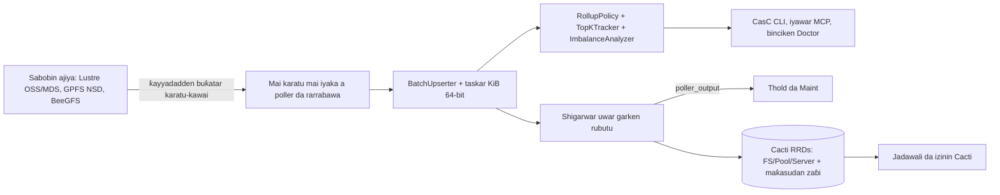

<!-- Source: README.md; SHA256: e88d6875d113220a91cfc0a9d230c829a78477b17e6aa7e44dda38c9591c86ad -->

<!-- translations:start -->
[English](../../../README.md) | [简体中文](../zh-CN/README.md) | [हिन्दी](../hi-IN/README.md) | [Español (España)](../es-ES/README.md) | [Español (Latinoamérica)](../es-419/README.md) | [العربية (السعودية)](../ar-SA/README.md) | [Afrikaans](../af-ZA/README.md) | [አማርኛ](../am-ET/README.md) | [العربية (مصر)](../ar-EG/README.md) | [العربية (المغرب)](../ar-MA/README.md) | [বাংলা](../bn-BD/README.md) | [Bosanski](../bs-BA/README.md) | [Deutsch](../de-DE/README.md) | [فارسی](../fa-IR/README.md) | [Filipino](../fil-PH/README.md) | [Français](../fr-FR/README.md) | [Français (Maroc)](../fr-MA/README.md) | [Français (Sénégal)](../fr-SN/README.md) | [Hausa](README.md) | [עברית](../he-IL/README.md) | [Hrvatski](../hr-HR/README.md) | [Bahasa Indonesia](../id-ID/README.md) | [Igbo](../ig-NG/README.md) | [Italiano](../it-IT/README.md) | [日本語](../ja-JP/README.md) | [한국어](../ko-KR/README.md) | [Malagasy](../mg-MG/README.md) | [मराठी](../mr-IN/README.md) | [Bahasa Melayu](../ms-MY/README.md) | [Nederlands](../nl-NL/README.md) | [Polski](../pl-PL/README.md) | [Português (Brasil)](../pt-BR/README.md) | [Русский](../ru-RU/README.md) | [Kinyarwanda](../rw-RW/README.md) | [Soomaali](../so-SO/README.md) | [Српски](../sr-RS/README.md) | [Svenska](../sv-SE/README.md) | [Kiswahili](../sw-KE/README.md) | [தமிழ்](../ta-IN/README.md) | [తెలుగు](../te-IN/README.md) | [ไทย](../th-TH/README.md) | [Türkçe](../tr-TR/README.md) | [Українська](../uk-UA/README.md) | [اردو](../ur-PK/README.md) | [Tiếng Việt](../vi-VN/README.md) | [isiXhosa](../xh-ZA/README.md) | [Yorùbá](../yo-NG/README.md) | [繁體中文](../zh-TW/README.md) | [isiZulu](../zu-ZA/README.md)
<!-- translations:end -->

# plugin_pfs

Ƙarin plugin na Cacti 1.2 wanda ke kawo yanayin lafiyar tsarin fayil na gaggawa (parallel filesystem), ƙarfin ajiya, rashin daidaiton cika, saurin watsa bayanai na kowane maƙasudi, da ƙimar ayyukan metadata cikin Cacti a cikin Lustre, IBM Storage Scale (GPFS), da BeeGFS a bayan haɗaɗɗiyar ƙirar `Backend`. Kowane tsarin fayil yana taswira zuwa na'urar Cacti ta yau da kullum mai tambayoyin bayanai, jadawalan taƙaitawa da na kowane maƙasudi idan an buƙata, da ma'aunan taƙaitawa, don haka Thold da Maint suna ba da faɗakarwa da dakatar da su ba tare da wani sauyi ba.

> **Matsayi: an aiwatar da matakai na 1 zuwa na 3 da tubalan faɗaɗa girman exascale a cikin lamba, ba a sake shi ba tukuna.** An aiwatar tare da tabbatar da tushe, lura da Lustre, faɗakarwa da dakatarwar Maint, direbobin karatu-kawai na GPFS da BeeGFS, nazarin rashin daidaiton OST/MDT tare da haɗin Maint, iyakance masu tattara bayanai na nesa (`replicate_out`, `remote_agent`), tubalan faɗaɗawa na 100+ PB / exascale (`FramedReportParser`, Schema v4 `value_kib`, `RollupPolicy`, `TopKTracker`, `ShardAssigner`, `BatchUpserter`), CLI na mai aiki na CasC (`cli/pfs.php`), da ƙugiyoyin yanayin aiki (`abilities_register`, `doctor_register_checks`, `casc_register_providers`) ta gwaje-gwajen naúrar, tsaro, da haɗin gwiwa a Cacti na wucin-gadi. Duk gwaje-gwajen da aka yi ya zuwa yanzu suna amfani da fitarwar node na gwaji maimakon ainihin kayan masarufi na Lustre, GPFS, ko BeeGFS. Abubuwan da ke saura kafin sa alamar saki: gwaje-gwajen farko a kan ainihin tsarin fayiloli ([shirin gwaji](../../pilot-plan.md)), bitar tsaro ta waje ([bitar kai](../../security-review.md)), da ma'aunan girma a kan kayan masarufi da aka rubuta ([ma'aunin girma](../../research/scale.md)). An shirya sigar 0.1.0 a cikin `INFO` da [CHANGELOG.md](../../../CHANGELOG.md) amma ba a sa mata alama (tag) ba.

## Matsayin shiga

| Fage | Ikon Shiga |
| --- | --- |
| Parallel Filesystem View | Shafukan sa ido da ke akwai. |
| Parallel Filesystem Operator | Sa ido tare da shafin Ayyuka (Operations) da amincewar rarrabawa ta sirri. |
| Parallel Filesystem Admin | Ikon shiga na Operator tare da saitin da ke akwai da ayyukan gudanarwa. |

Bayan kwafe fayilolin sabuntawa, buɗe shafin Plugins a matsayin mai gudanarwa (administrator) don yin rijistar sabon fagen shiga.
Sanya fagen Operator kai tsaye a ƙarƙashin **Configuration > Users** ko ƙungiyoyin masu amfani.
Sabuntawa suna riƙe IDs da izinin View da Admin da ke akwai. Ikon shiga na Admin
yana gadon ikon Operator, kuma ikon Operator yana gadon ikon View a kan kowane buƙata;
wannan ba ya ƙara izinin da aka ajiye ga masu amfani ko ƙungiyoyi. Saitunan plugin kuma suna buƙatar
ikon shiga na Parallel Filesystem Admin baya ga izinin Settings na Cacti.

Izinin na'urorin Cacti har yanzu suna iyakance layuka da ayyukan da ke akwai ga kowane mai amfani; abubuwan da ba a taswira ba suna buƙatar mai gudanarwa.
Takardun shaida, saiti, taswira, gogewa da sauran canje-canjen gudanarwa
suna ci gaba da kasancewa a cikin shafukan gudanarwa. Amincewa (acknowledgments) tana aiki ne kawai a cikin zaman
mai amfani na yanzu, na tsawon awanni ɗaya a mafi yawa kuma kawai yayin da wannan lura ta kasance
sabuwa. Sabbin lura ko waɗanda suka canza suna soke su. Ba sa taɓa nuna ma'aunin da ya gaza
a matsayin mai lafiya ko dakatar da faɗakarwa.

## Dalili

Lokacin da tsarin fayil na haɗin gwiwa ya yi jinkiri, shaidun suna bazu a cikin sabobi. Lustre yana adana na'urorin ƙidayarsa a kan kowane node: `lctl get_param` yana ba da rahoton ƙimomi "a kan node na gida", don haka kowane object storage server (OSS) da metadata server (MDS) yana riƙe da lambobin maƙasudansa kawai. Mai gudanarwa da ke binciken jinkirin tsarin fayil yana buƙatar amsoshi uku daga wurare daban-daban:

- **Shin maƙasudi ɗaya yana cika yayin da sauran suke fanko?** Rashin daidaiton cika yana canza inda sabbin fayiloli ke sauka da kuma lokacin da maƙasudi ɗaya zai cika.
- **Waɗanne maƙasudai ko ayyuka ne suke da cunkoso?** Na'urorin ƙidayar byte na kowane maƙasudi da na'urorin ƙidayar ayyuka na kowane MDT suna nuna ko nauyin yana da alaƙa da bayanai ne ko da metadata.
- **Shin sa idon da kansa na yanzu ne?** Jadawali mai lebur yana da kwanciyar hankali ne kawai idan plugin ɗin zai iya ganin sabobin.

Cacti yana zana jadawalin na'urori kuma yana sanya iyakokin ƙimomi da Thold, kuma ƙungiyar Cacti a GitHub ba ta da wani ma'ajiyar lamba don sa ido kan Lustre, GPFS, ko BeeGFS (an bincika 2026-11-14). Plugin ɗin yana cike wannan giɓi ta hanyar karanta ƙimomi masu izini na karatu-kawai daga nodes na ajiya da wakiltar kowane tsarin fayil a matsayin na'urar Cacti wadda maƙasudanta su ne fihirisar tambayar bayanai (data query). Yana sake amfani da zana jadawali na Cacti, izini, masu tattara bayanai na nesa, Thold, da Maint maimakon gina irinsu na daban.

## Tsarin aiki da aka shirya

| Mataki | Fage | Matsayi | Matakan Aiki |
|---|---|---|---|
| 0, bincike | Jadawalin saki, shawarar shiga node, tabbatar da halayen upstream, halayen ƙidaya da failover, ma'aunan girma | An kammala | [M1](https://github.com/somethingwithproof/plugin_pfs/milestone/1) |
| 1, lura | Jerin kayayyakin Lustre, ƙarfi da cika, rashin daidaiton OST/MDT (`lib/ImbalanceAnalyzer.php`), haɗin Maint (`lib/HealthPage.php`), saurin watsawar OST, ƙimar ayyukan MDT, jadawalai, faɗakarwar Thold, shafin lafiya | An aiwatar (an gwada da fixture) | [M2](https://github.com/somethingwithproof/plugin_pfs/milestone/2), [M3](https://github.com/somethingwithproof/plugin_pfs/milestone/3), [M4](https://github.com/somethingwithproof/plugin_pfs/milestone/4) |
| 2, nesa da girma | Tattarawa na nesa mai iyaka a poller (`lib/Reader.php`, `lib/ReplicationRepository.php`, `replicate_out`, `remote_agent`), tubalan faɗaɗawa na 100+ PB (tsabtar KiB 64-bit + Schema v4 `value_kib`, `lib/RollupPolicy.php`, `lib/TopKTracker.php`, `lib/ShardAssigner.php` + `poller_pfs.php --shard=K/N`, `lib/BatchUpserter.php`), CasC CLI (`cli/pfs.php`), ƙugiyoyin MCP/Doctor/CasC | An aiwatar (an gwada da naúrar da haɗin CI) | [M5](https://github.com/somethingwithproof/plugin_pfs/milestone/5) |
| 3, backends | Direbobin karatu-kawai na IBM Storage Scale (GPFS) (`lib/GpfsBackend.php`) da BeeGFS (`lib/BeegfsBackend.php`) da aka yi wa rijista a cikin `BackendRegistry::production()` | An aiwatar (an gwada da naúrar) | [M6](https://github.com/somethingwithproof/plugin_pfs/milestone/6) |

Manyan tubalan mai aiki da na faɗaɗa girma da aka aiwatar:

- **Direbobin karatu-kawai na tsarin fayiloli da yawa:** `LustreBackend`, `GpfsBackend` (`mmpmon` `fs_io_s`/`io_s` mai firam kawai tare da haramta `reset`, ƙarfi/yanayin pool na `mmdf`, da taƙaitaccen bayanin masu jira), da `BeegfsBackend` (maƙasudan ajiya da metadata na BeeGFS 7.4 da 8.x tare da juyar da byte zuwa KiB daidai, taswirar yanayin samuwa/daidaito, da ma'anar ma'auni na kowane lokaci) suna raba `lib/FramedReportParser.php`.
- **Sanin rashin daidaito, sararin da ya rage, da Maint:** `lib/ImbalanceAnalyzer.php` yana lissafin rabon cikar OST/MDT, yaduwa, ma'aunin rashin daidaito na standard deviation na yawan jama'a, sararin da ya rage, tabbatar da sabuntar tazara 1 (`missing_targets`), tutocin yanayi na kowane maƙasudi, da ƙayyadaddun maƙasudan Top-K masu karkata. `HealthPage` (`pfs_health.php`) da `CascProvider::health()` suna nuna lokutan gyaran `Maint` na Cacti kuma suna dakatar da gargaɗin gazawa masu aiki yayin gyaran da aka tsara.
- **Faɗaɗa girma na 100+ PB da exascale** ([docs/architecture/exascale-scaling.md](../../architecture/exascale-scaling.md)): juyar da byte zuwa KiB na decimal daidai (`FramedReportParser::bytesToKibInt()`) da aka tabbatar a 500 PB da 2 EB tare da ginshiƙan `BIGINT UNSIGNED value_kib` (Schema v4); taƙaitawar RRD mai matakai `Filesystem -> Pool -> Storage Server` tare da haɓaka maƙasudan opt-in/masu zafi/masu karkata cikin iyaka (`lib/RollupPolicy.php`); maƙasudan Top-K masu karkata cikin iyaka $O(K)$ da taƙaitattun bayanan ayyuka/abokan ciniki masu nauyi da aka riga aka haɗa (`lib/TopKTracker.php`, ba tare da ƙirƙirar na'urori ko RRDs na kowane abokin ciniki ba); raba masu tattarawa na CRC32 mai tabbas (`lib/ShardAssigner.php`, `php plugins/pfs/poller_pfs.php [--poller=N] [--shard=K/N] [--force] [--debug]`); da shigar da/sabunta SQL a rukuni na layuka 500 tare da keyset pagination (`lib/BatchUpserter.php`, `CacheRepository::upsertObservationsBatch()`, `TargetRepository::forFilesystemPage()`).
- **CasC CLI na mai aiki da ƙugiyoyin yanayin aiki:** `cli/pfs.php` yana goyan bayan `export [--format=yaml|xml]`, `validate <file> [--format=yaml|xml]`, `plan <file> [--format=yaml|xml] [--output=text|json]`, `apply <file> --confirm=<PLAN_HASH> [--format=yaml|xml]`, da `health [--format=text|json]` ba tare da dogaro da Composer na waje ba. `setup.php` da `lib/EcosystemIntegration.php` suna yin rijistar `abilities_register` (`pfs-list-filesystems`, `pfs-get-imbalance`, `pfs-get-health`; karatu-kawai, an iyakance su a kan `Parallel Filesystem View` da izinin na'urar Cacti), `doctor_register_checks` (`pfs_schema`, `pfs_reader_freshness`, `pfs_capacity_imbalance`), `casc_register_providers`, `replicate_out`, da `remote_agent`.

Abin da ke wajen tsari: kowane aiki na rubutu, sharewa, sake saitawa, ko daidaitawa a kan node ko tsarin fayil; injin faɗakarwa mallakar plugin; daemon na musamman ko ƙa'idar hanyar sadarwa; na'urorin Cacti ko RRDs na kowane aiki (per-job) ko na kowane abokin ciniki (per-client); sauye-sauye ga ainihin Cacti, Thold, ko Maint.

## Maƙasudan jituwa

| Bangare | Maƙasudi |
|---|---|
| Cacti | 1.2.31 ko na baya, babu facin ainihin tsari |
| PHP | 8.2 ko na baya; `setup.php`, `poller_pfs.php`, da `cli/pfs.php` suna kasancewa masu karantuwa a kan 8.0 don haka yanayin aiki da ba a goyan baya ya sami ƙin yarda maimakon ɓarnatar da ƙirar Cacti |
| Lustre | An duba lamba da litattafan jagora a 2.17.0; an gwada da fixture |
| GPFS, BeeGFS | An aiwatar kuma an gwada direbobin karatu-kawai na IBM Storage Scale (GPFS) 5.x `mmpmon`/`mmdf` da BeeGFS 7.4 / 8.x da fixture |
| Thold, Maint | Thold 1.8.2 da Maint 1.3, ba a canza su ba |

## Tsari

- [docs/architecture/exascale-scaling.md](../../architecture/exascale-scaling.md) yana rubuta tsarin telemetry mai matakai biyu na 100+ PB / exascale (sabar Cacti/`plugin_pfs` + taƙaitawa + matakin Top-K haɗe da telemetry na abokin ciniki na waje LDMS/Darshan/TOKIO) da yanayin adabin iliminsa.
- [docs/PLAN.md](../../PLAN.md) shi ne cikakken shiri: tsarin gini, bayanan upstream da ya dogara a kansu (tare da tushe da abin da har yanzu ba a tabbatar ba), ma'anar na'urorin ƙidaya, samfurin yanayi, iyakokin tsaro, lissafin ingancin aiki, gwaji, da haɗari.
- [docs/operator-guide.md](../../operator-guide.md) yana ɗauke da shigarwa, jadawalai da ƙimomi, sabuntawa, ajiyar baya da maidowa, cirewa, da magance matsaloli; [docs/alerting.md](../../alerting.md) yana ɗauke da Thold da Maint.
- [docs/node-setup.md](../../node-setup.md) yana bayyana yadda za a shirya sabar Lustre da poller don mai karatu.
- [docs/decisions/](../../decisions) yana riƙe da bayanan shawarar tsarin gini don zaɓuɓɓukan da aka riga aka yanke.
- [docs/REQUIREMENTS.md](../../REQUIREMENTS.md) yana taswira kowane ID na buƙata zuwa batunsa.

## Yadda ake bin diddigin aiki

- **Matakan aiki (Milestones)** suna bin matakan shirin. Kowanne yana da babban batu (epic issue) da ke jero ƙananan batutuwa da shaidar fita.
- **Batutuwa (Issues)** an rarraba su ta alama (label): `type: requirement`, `type: research`, `type: decision`, `type: epic`. Batutuwan buƙatu suna bayyana buƙatu masu lamba da za a iya gwadawa (`REQ-AREA-NNN`) da ma'aunin karɓuwa.
- **Alamomi (Labels)** suna kuma ɗauke da `area:`, `phase:`, `priority:`, da `status:`. Duba [CONTRIBUTING.md](../../../CONTRIBUTING.md#labels).
- [Allon aiki](https://github.com/users/somethingwithproof/projects/11) yana nuna dukkan batutuwa a tsakanin matakan aiki.

## Gudummawa

Karanta [CONTRIBUTING.md](../../../CONTRIBUTING.md). Commits suna buƙatar sa hannun DCO (DCO sign-off). Tattaunawar tsari tana faruwa a kan batutuwa; buɗaɗɗun shawarwari suna ɗauke da alamar `type: decision`.

## Tsaro

Ka ba da rahoton raunin tsaro a asirce; duba [SECURITY.md](../../../SECURITY.md).

## Lasisi

GNU General Public License v2.0, lasisi guda da Cacti da plugins ɗinsa. Duba [LICENSE](../../../LICENSE).
