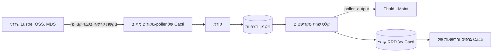

<!-- Source: README.md; SHA256: e88d6875d113220a91cfc0a9d230c829a78477b17e6aa7e44dda38c9591c86ad -->

<!-- translations:start -->
[English](../../../README.md) | [简体中文](../zh-CN/README.md) | [हिन्दी](../hi-IN/README.md) | [Español (España)](../es-ES/README.md) | [Español (Latinoamérica)](../es-419/README.md) | [العربية (السعودية)](../ar-SA/README.md) | [Afrikaans](../af-ZA/README.md) | [አማርኛ](../am-ET/README.md) | [العربية (مصر)](../ar-EG/README.md) | [العربية (المغرب)](../ar-MA/README.md) | [বাংলা](../bn-BD/README.md) | [Bosanski](../bs-BA/README.md) | [Deutsch](../de-DE/README.md) | [فارسی](../fa-IR/README.md) | [Filipino](../fil-PH/README.md) | [Français](../fr-FR/README.md) | [Français (Maroc)](../fr-MA/README.md) | [Français (Sénégal)](../fr-SN/README.md) | [Hausa](../ha-NG/README.md) | [עברית](README.md) | [Hrvatski](../hr-HR/README.md) | [Bahasa Indonesia](../id-ID/README.md) | [Igbo](../ig-NG/README.md) | [Italiano](../it-IT/README.md) | [日本語](../ja-JP/README.md) | [한국어](../ko-KR/README.md) | [Malagasy](../mg-MG/README.md) | [मराठी](../mr-IN/README.md) | [Bahasa Melayu](../ms-MY/README.md) | [Nederlands](../nl-NL/README.md) | [Polski](../pl-PL/README.md) | [Português (Brasil)](../pt-BR/README.md) | [Русский](../ru-RU/README.md) | [Kinyarwanda](../rw-RW/README.md) | [Soomaali](../so-SO/README.md) | [Српски](../sr-RS/README.md) | [Svenska](../sv-SE/README.md) | [Kiswahili](../sw-KE/README.md) | [தமிழ்](../ta-IN/README.md) | [తెలుగు](../te-IN/README.md) | [ไทย](../th-TH/README.md) | [Türkçe](../tr-TR/README.md) | [Українська](../uk-UA/README.md) | [اردو](../ur-PK/README.md) | [Tiếng Việt](../vi-VN/README.md) | [isiXhosa](../xh-ZA/README.md) | [Yorùbá](../yo-NG/README.md) | [繁體中文](../zh-TW/README.md) | [isiZulu](../zu-ZA/README.md)
<!-- translations:end -->

# plugin_pfs

תוסף עבור Cacti 1.2 המביא את תקינות מערכות הקבצים המקביליות והעומס עליהן אל תוך Cacti: קיבולת וחוסר איזון מילוי בין יעדים, תפוקה לפי יעד וקצבי פעולות מטא-נתונים. מערכת Lustre היא ה-backend הראשון. מערכות GPFS (IBM Storage Scale) ו-BeeGFS יצטרפו בהמשך מאחורי ממשק backend. הנתונים נשמרים בהתקנים, במקורות נתונים ובגרפים רגילים של Cacti, כך ש-Thold ו-Maint מתריעים עליהם ומשתיקים אותם ללא שינוי.

> **סטטוס: אבן דרך 4, הקוד לשלב 1 הושלם, טרם שוחרר.** אבני דרך 2 (תשתית), 3 (ניטור Lustre) ו-4 (התרעות והכנה לשחרור) הושלמו ב-`main` או נמצאות בסקירה. התוסף מותקן, משתדרג ומוסר דרך ממשק התוספים של Cacti ודוחה גרסאות PHP מתחת ל-8.2. קורא רקע בכל poller קורא משרתי Lustre על גבי SSH דרך סקריפט forced-command קבוע ([node/pfs-read.sh](../../../node/pfs-read.sh)) ושומר במטמון את המלאי, המצב, הקיבולת והמונים יחד עם מידת העדכניות שלהם. כל מערכת קבצים הופכת להתקן Cacti עם שאילתות נתונים של OST ו-MDT, חמישה גרפי סקירה כללית, גרפים לפי יעד לפי דרישה ומקור נתונים מסכם עבור Thold. התוספים Thold v1.8.2 ו-Maint v1.3, ללא כל שינוי, מתריעים על מדדי הסיכום ומשתיקים אותם בהרצה מקצה לקצה; ספי התרעה של Thold על מונים (counters) אינם נתמכים ב-Thold 1.8.2 ([docs/alerting.md](../../alerting.md)). כל בדיקה עד כה רצה על פלט דמה של צמתים בתוך סביבת Cacti זמנית: התוסף טרם רץ מול צומת Lustre אמיתי. עדיין פתוח לפני שחרור: פיילוטים על מערכות קבצים אמיתיות ([תוכנית הפיילוט](../../pilot-plan.md)), סקירת האבטחה החיצונית ([סקירה עצמית](../../security-review.md)) ומדידות קנה מידה על חומרה מתועדת ([קנה מידה](../../research/scale.md)). גרסה 0.1.0 מוכנה בקובץ `INFO` וב-[CHANGELOG.md](../../../CHANGELOG.md) אך טרם תויגה.

## תפקידי גישה

| הרשאה | גישה |
| --- | --- |
| Parallel Filesystem View | דפי הניטור הקיימים. |
| Parallel Filesystem Operator | ניטור בנוסף לדף התפעול ולאישורי מיון אישיים. |
| Parallel Filesystem Admin | גישת מפעיל בנוסף להגדרות הקיימות ולפעולות הניהוליות. |

לאחר העתקת קבצי השדרוג, פתחו את דף התוספים (Plugins) כמנהלי מערכת כדי לרשום
את ההרשאה החדשה. הקצו את הרשאת Operator במפורש תחת **Configuration > Users** או קבוצות משתמשים.
שדרוגים שומרים על מזהי ההרשאות והענקות הגישה הקיימות של View ו-Admin. גישת Admin
יורשת גישת Operator, וגישת Operator יורשת גישת View בכל בקשה;
פעולה זו אינה מוסיפה הרשאות שמורות למשתמשים או לקבוצות. הגדרות התוסף דורשות גם
גישת Parallel Filesystem Admin בנוסף להרשאת Settings של Cacti.

הרשאות ההתקנים של Cacti עדיין מגבילות את השורות והפעולות הזמינות לכל משתמש; אובייקטים שאינם ממופים דורשים מנהל מערכת.
פרטי גישה, תצורה, מיפוי, מחיקה ושינויים ניהוליים אחרים
נשארים בדפים הניהוליים. אישורי מיון (acknowledgments) תקפים רק בהפעלה (session) הנוכחית של המשתמש,
למשך שעה לכל היותר ורק כל עוד אותה תצפית נשארת עדכנית.
תצפיות חדשות או שהשתנו מבטלות אותם. הם לעולם אינם מסמנים מדידה שנכשלה
כתקינה ואינם משתיקים התרעות.

## למה

כאשר מערכת קבצים משותפת איטית, הראיות מפוזרות על פני שרתים שונים. Lustre שומרת את המונים שלה לפי צומת: `lctl get_param` מדווחת ערכים "בצומת המקומי", כך שכל שרת אחסון אובייקטים (OSS) ושרת מטא-נתונים (MDS) מחזיק רק את המספרים של היעדים שלו. מפעיל החוקר מערכת קבצים איטית זקוק לשלוש תשובות ממקומות שונים:

- **האם יעד אחד מתמלא בזמן שאחרים ריקים?** חוסר איזון במילוי משנה את המיקום שבו נוצרים קבצים חדשים ואת המועד שבו יעד יחיד מתמלא לחלוטין.
- **אילו יעדים או פעולות עמוסים?** מוני בתים לפי יעד ומוני פעולות לפי MDT מראים אם העומס נובע מתעבורת נתונים או מפעולות מטא-נתונים.
- **האם הניטור עצמו עדכני?** גרף שטוח מרגיע רק אם התוסף הצליח לתקשר עם השרתים.

Cacti מציגה גרפים של מארחים וקובעת ספים לערכים באמצעות Thold, ובארגון ה-GitHub של Cacti אין מאגר לניטור Lustre, GPFS או BeeGFS (נבדק ב-2026-11-14). התוסף סוגר פער זה על ידי קריאת ערכים מורשים (allowlisted) לקריאה בלבד מצמתי האחסון וייצוג כל מערכת קבצים כהתקן Cacti שהיעדים שלו הם האינדקסים של שאילתת נתונים. הוא עושה שימוש חוזר בגרפים, בהרשאות, באספני הנתונים המרוחקים של Cacti, ב-Thold וב-Maint במקום לבנות גרסאות מקבילות שלהם.

## היקף מתוכנן

| שלב | היקף | אבני דרך |
|---|---|---|
| 0, מחקר | מטריצת גרסאות, החלטה על גישה לצמתים, אימות התנהגות upstream, התנהגות מונים ו-failover, מדידות קנה מידה | [M1](https://github.com/somethingwithproof/plugin_pfs/milestone/1) |
| 1, תצפית | מלאי Lustre, קיבולת ומילוי, תפוקת OST, קצבי פעולות MDT, גרפים, התרעות Thold, השתקת Maint, דף תקינות | [M2](https://github.com/somethingwithproof/plugin_pfs/milestone/2), [M3](https://github.com/somethingwithproof/plugin_pfs/milestone/3), [M4](https://github.com/somethingwithproof/plugin_pfs/milestone/4) |
| 2, עומק | אספני נתונים מרוחקים של Cacti, תצוגות ברמת משימה וברמת לקוח במסגרת ספירת אובייקטים מוגבלת | [M5](https://github.com/somethingwithproof/plugin_pfs/milestone/5) |
| 3, backends | ממשקי backend עבור GPFS (IBM Storage Scale) ו-BeeGFS | [M6](https://github.com/somethingwithproof/plugin_pfs/milestone/6) |

מחוץ להיקף: כל פעולת כתיבה, ניקוי, איפוס או כוונון בצומת או במערכת קבצים; מנוע התרעות בבעלות התוסף; daemon או פרוטוקול רשת מותאמים אישית; מקורות נתונים ברמת משימה בודדת; שינויים בליבת Cacti, ב-Thold או ב-Maint.

## יעדי תאימות

| רכיב | יעד |
|---|---|
| Cacti | 1.2.31 ואילך, ללא טלאים לליבה |
| PHP | 8.2 ואילך; הקובץ `setup.php` נשאר תקין לניתוח ב-8.0 כך שסביבת ריצה שאינה נתמכת תקבל דחייה במקום ממשק Cacti שבור |
| Lustre | קווי הגרסה ייקבעו באבן דרך 1; קוד המקור והמדריכים שנבדקו עד כה הם בגרסה 2.17.0 |
| GPFS, BeeGFS | שלב 3; הגרסאות ייקבעו במחקר |
| Thold, Maint | אין צורך בשינויים |

## תכנון

- [docs/PLAN.md](../../PLAN.md) הוא התוכנית המלאה: ארכיטקטורה, עובדות upstream שעליהן היא מסתמכת (עם מקורות ומה שטרם אומת), סמנטיקת מונים, מודל מצבים, גבולות אבטחה, חישובי ביצועים, בדיקות וסיכונים.
- [docs/operator-guide.md](../../operator-guide.md) מכסה התקנה, את הגרפים והערכים, שדרוג, גיבוי ושחזור, הסרה ופתרון תקלות; [docs/alerting.md](../../alerting.md) מכסה את Thold ו-Maint.
- [docs/node-setup.md](../../node-setup.md) מתאר כיצד להכין שרת Lustre ו-poller עבור הקורא.
- [docs/decisions/](../../decisions) מחזיק תיעוד החלטות ארכיטקטוניות (ADR) עבור בחירות שכבר נעשו.
- [docs/REQUIREMENTS.md](../../REQUIREMENTS.md) ממפה כל מזהה דרישה אל ה-issue שלו.

## אופן מעקב העבודה

- **אבני דרך (Milestones)** עוקבות אחר אבני הדרך של התוכנית. לכל אחת יש epic issue המפרט את תתי-ה-issues וראיות הסיום שלה.
- **Issues** מסווגים לפי תווית: `type: requirement`, `type: research`, `type: decision`, `type: epic`. רשומות `requirement` מגדירות דרישות ממוספרות ובדיקות (`REQ-AREA-NNN`) וקריטריוני קבלה.
- **תוויות** נושאות גם `area:`, `phase:`, `priority:` ו-`status:`. ראו [CONTRIBUTING.md](../../../CONTRIBUTING.md#labels).
- [לוח הפרויקט](https://github.com/users/somethingwithproof/projects/11) מציג את כל ה-issues על פני אבני הדרך.

## תרומה לפרויקט

קראו את [CONTRIBUTING.md](../../../CONTRIBUTING.md). קומיטים דורשים חתימת DCO (`sign-off`). דיוני תכנון מתקיימים ב-issues; החלטות פתוחות נושאות את התווית `type: decision`.

## אבטחה

דווחו על פגיעויות באופן פרטי; ראו [SECURITY.md](../../../SECURITY.md).

## רישיון

GNU General Public License v2.0, אותו רישיון כמו של Cacti והתוספים שלה. ראו [LICENSE](../../../LICENSE).
