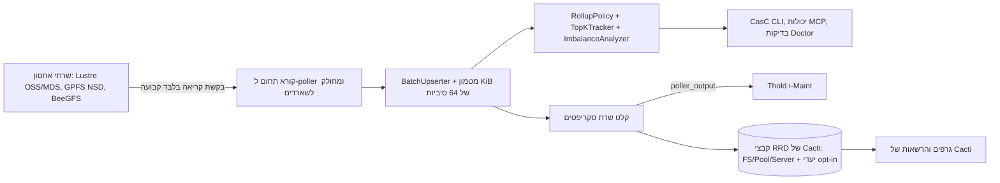

<!-- Source: README.md; SHA256: e88d6875d113220a91cfc0a9d230c829a78477b17e6aa7e44dda38c9591c86ad -->

<!-- translations:start -->
[English](../../../README.md) | [简体中文](../zh-CN/README.md) | [हिन्दी](../hi-IN/README.md) | [Español (España)](../es-ES/README.md) | [Español (Latinoamérica)](../es-419/README.md) | [العربية (السعودية)](../ar-SA/README.md) | [Afrikaans](../af-ZA/README.md) | [አማርኛ](../am-ET/README.md) | [العربية (مصر)](../ar-EG/README.md) | [العربية (المغرب)](../ar-MA/README.md) | [বাংলা](../bn-BD/README.md) | [Bosanski](../bs-BA/README.md) | [Deutsch](../de-DE/README.md) | [فارسی](../fa-IR/README.md) | [Filipino](../fil-PH/README.md) | [Français](../fr-FR/README.md) | [Français (Maroc)](../fr-MA/README.md) | [Français (Sénégal)](../fr-SN/README.md) | [Hausa](../ha-NG/README.md) | [עברית](README.md) | [Hrvatski](../hr-HR/README.md) | [Bahasa Indonesia](../id-ID/README.md) | [Igbo](../ig-NG/README.md) | [Italiano](../it-IT/README.md) | [日本語](../ja-JP/README.md) | [한국어](../ko-KR/README.md) | [Malagasy](../mg-MG/README.md) | [मराठी](../mr-IN/README.md) | [Bahasa Melayu](../ms-MY/README.md) | [Nederlands](../nl-NL/README.md) | [Polski](../pl-PL/README.md) | [Português (Brasil)](../pt-BR/README.md) | [Русский](../ru-RU/README.md) | [Kinyarwanda](../rw-RW/README.md) | [Soomaali](../so-SO/README.md) | [Српски](../sr-RS/README.md) | [Svenska](../sv-SE/README.md) | [Kiswahili](../sw-KE/README.md) | [தமிழ்](../ta-IN/README.md) | [తెలుగు](../te-IN/README.md) | [ไทย](../th-TH/README.md) | [Türkçe](../tr-TR/README.md) | [Українська](../uk-UA/README.md) | [اردو](../ur-PK/README.md) | [Tiếng Việt](../vi-VN/README.md) | [isiXhosa](../xh-ZA/README.md) | [Yorùbá](../yo-NG/README.md) | [繁體中文](../zh-TW/README.md) | [isiZulu](../zu-ZA/README.md)
<!-- translations:end -->

# plugin_pfs

תוסף עבור Cacti 1.2 המביא ל-Cacti את תקינות מערכות הקבצים המקביליות, הקיבולת, חוסר האיזון במילוי, התפוקה לפי יעד וקצבי פעולות המטא-נתונים עבור Lustre, IBM Storage Scale (GPFS) ו-BeeGFS מאחורי ממשק `Backend` אחיד. כל מערכת קבצים ממופה להתקן Cacti רגיל עם שאילתות נתונים, גרפי סקירה כללית וגרפים לפי יעד לפי דרישה, ומדדי סיכום כך ש-Thold ו-Maint מתריעים עליהם ומשתיקים אותם ללא שינוי.

> **סטטוס: שלבים 1 עד 3 ואבני הבניין לקנה מידה exascale מומשו בקוד, טרם שוחררו.** התשתית, ניטור Lustre, התרעות והשתקת Maint, מנהלי התקן לקריאה בלבד עבור GPFS ו-BeeGFS, ניתוח חוסר איזון OST/MDT עם שילוב Maint, תיחום אוספי נתונים מרוחקים (`replicate_out`, `remote_agent`), אבני בניין לקנה מידה של 100+ PB / exascale (`FramedReportParser`, סכמה v4 `value_kib`, `RollupPolicy`, `TopKTracker`, `ShardAssigner`, `BatchUpserter`), ממשק שורת הפקודה למפעילים של CasC (`cli/pfs.php`) ונקודות הרחבה באקוסיסטם (`abilities_register`, `doctor_register_checks`, `casc_register_providers`) מומשו ואומתו באמצעות בדיקות יחידה, אבטחה ואינטגרציה בסביבת Cacti זמנית. כל ההרצות עד כה משתמשות בפלט דמה של צמתים ולא בחומרת Lustre, GPFS או BeeGFS אמיתית. עדיין פתוח לפני תיוג גרסה לשחרור: פיילוטים על מערכות קבצים אמיתיות ([תוכנית הפיילוט](../../pilot-plan.md)), סקירת אבטחה חיצונית ([סקירה עצמית](../../security-review.md)) ומדידות קנה מידה על חומרה מתועדת ([קנה מידה](../../research/scale.md)). גרסה 0.1.0 מוכנה בקובץ `INFO` וב-[CHANGELOG.md](../../../CHANGELOG.md) אך טרם תויגה.

## תפקידי גישה

| הרשאה | גישה |
| --- | --- |
| Parallel Filesystem View | דפי הניטור הקיימים. |
| Parallel Filesystem Operator | ניטור בנוסף לדף התפעול ולאישורי מיון אישיים. |
| Parallel Filesystem Admin | גישת מפעיל בנוסף להגדרות הקיימות ולפעולות הניהוליות. |

לאחר העתקת קבצי השדרוג, פתחו את דף התוספים (Plugins) כמנהלי מערכת כדי לרשום
את ההרשאה החדשה. הקצו את הרשאת Operator במפורש תחת **Configuration > Users** או קבוצות משתמשים.
שדרוגים שומרים על מזהי ההרשאות והענקות הגישה הקיימות של View ו-Admin. גישת Admin
יורשת גישת Operator, וגישת Operator יורשת גישת View בכל בקשה;
פעולה זו אינה מוסיפה הרשאות שמורות למשתמשים או לקבוצות. הגדרות התוסף דורשות גם
גישת Parallel Filesystem Admin בנוסף להרשאת Settings של Cacti.

הרשאות ההתקנים של Cacti עדיין מגבילות את השורות והפעולות הזמינות לכל משתמש; אובייקטים שאינם ממופים דורשים מנהל מערכת.
פרטי גישה, תצורה, מיפוי, מחיקה ושינויים ניהוליים אחרים
נשארים בדפים הניהוליים. אישורי מיון (acknowledgments) תקפים רק בהפעלה (session) הנוכחית של המשתמש,
למשך שעה לכל היותר ורק כל עוד אותה תצפית נשארת עדכנית.
תצפיות חדשות או שהשתנו מבטלות אותם. הם לעולם אינם מסמנים מדידה שנכשלה
כתקינה ואינם משתיקים התרעות.

## למה

כאשר מערכת קבצים משותפת איטית, הראיות מפוזרות על פני שרתים שונים. Lustre שומרת את המונים שלה לפי צומת: `lctl get_param` מדווחת ערכים "בצומת המקומי", כך שכל שרת אחסון אובייקטים (OSS) ושרת מטא-נתונים (MDS) מחזיק רק את המספרים של היעדים שלו. מפעיל החוקר מערכת קבצים איטית זקוק לשלוש תשובות ממקומות שונים:

- **האם יעד אחד מתמלא בזמן שאחרים ריקים?** חוסר איזון במילוי משנה את המיקום שבו נוצרים קבצים חדשים ואת המועד שבו יעד יחיד מתמלא לחלוטין.
- **אילו יעדים או פעולות עמוסים?** מוני בתים לפי יעד ומוני פעולות לפי MDT מראים אם העומס נובע מתעבורת נתונים או מפעולות מטא-נתונים.
- **האם הניטור עצמו עדכני?** גרף שטוח מרגיע רק אם התוסף הצליח לתקשר עם השרתים.

Cacti מציגה גרפים של מארחים וקובעת ספים לערכים באמצעות Thold, ובארגון ה-GitHub של Cacti אין מאגר לניטור Lustre, GPFS או BeeGFS (נבדק ב-2026-11-14). התוסף סוגר פער זה על ידי קריאת ערכים מורשים (allowlisted) לקריאה בלבד מצמתי האחסון וייצוג כל מערכת קבצים כהתקן Cacti שהיעדים שלו הם האינדקסים של שאילתת נתונים. הוא עושה שימוש חוזר בגרפים, בהרשאות, באספני הנתונים המרוחקים של Cacti, ב-Thold וב-Maint במקום לבנות גרסאות מקבילות שלהם.

## היקף מתוכנן

| שלב | היקף | סטטוס | אבני דרך |
|---|---|---|---|
| 0, מחקר | מטריצת גרסאות, החלטה על גישה לצמתים, אימות התנהגות upstream, התנהגות מונים ו-failover, מדידות קנה מידה | הושלם | [M1](https://github.com/somethingwithproof/plugin_pfs/milestone/1) |
| 1, תצפית | מלאי Lustre, קיבולת ומילוי, חוסר איזון OST/MDT (`lib/ImbalanceAnalyzer.php`), שילוב Maint (`lib/HealthPage.php`), תפוקת OST, קצבי פעולות MDT, גרפים, התרעות Thold, דף תקינות | מומש (נבדק על דמה) | [M2](https://github.com/somethingwithproof/plugin_pfs/milestone/2), [M3](https://github.com/somethingwithproof/plugin_pfs/milestone/3), [M4](https://github.com/somethingwithproof/plugin_pfs/milestone/4) |
| 2, מרוחק וקנה מידה | איסוף מרוחק התחום ל-poller (`lib/Reader.php`, `lib/ReplicationRepository.php`, `replicate_out`, `remote_agent`), אבני בניין לקנה מידה 100+ PB (היגיינת KiB ב-64 סיביות + סכמה v4 `value_kib`, `lib/RollupPolicy.php`, `lib/TopKTracker.php`, `lib/ShardAssigner.php` + `poller_pfs.php --shard=K/N`, `lib/BatchUpserter.php`), ממשק CasC CLI (`cli/pfs.php`), נקודות הרחבה MCP/Doctor/CasC | מומש (נבדק בבדיקות יחידה ואינטגרציית CI) | [M5](https://github.com/somethingwithproof/plugin_pfs/milestone/5) |
| 3, backends | מנהלי התקן לקריאה בלבד של IBM Storage Scale (GPFS) (`lib/GpfsBackend.php`) ו-BeeGFS (`lib/BeegfsBackend.php`) הרשומים ב-`BackendRegistry::production()` | מומש (נבדק בבדיקות יחידה) | [M6](https://github.com/somethingwithproof/plugin_pfs/milestone/6) |

אבני בניין עיקריות למפעילים ולקנה מידה שמומשו:

- **מנהלי התקן לקריאה בלבד עבור מערכות קבצים מרובות:** `LustreBackend`, `GpfsBackend` (`mmpmon` ממוסגר של `fs_io_s`/`io_s` בלבד כאשר `reset` אסור, קיבולת ומצבי מאגר של `mmdf` וסיכומי ממתינים) ו-`BeegfsBackend` (יעדי אחסון ומטא-נתונים של BeeGFS 7.4 ו-8.x עם המרה מדויקת של בתים ל-KiB, מיפוי מצבי זמינות ועקביות וסמנטיקת מדידה לפי מרווח) החולקים את `lib/FramedReportParser.php`.
- **מודעות לחוסר איזון, למרווח פנוי ול-Maint:** המודול `lib/ImbalanceAnalyzer.php` מחשב יחסי מילוי של OST/MDT, מרווח פיזור, מדד חוסר איזון לפי סטיית תקן של האוכלוסייה, מרווח פנוי, אכיפת עדכניות של מרווח אחד (`missing_targets`), דגלי מצב לפי יעד ורשימת Top-K תחומה של יעדים לא מאוזנים. `HealthPage` (`pfs_health.php`) ו-`CascProvider::health()` מציגים חלונות תחזוקה של `Maint` ב-Cacti ומשתיקים התרעות כשל פעילות במהלך תחזוקה מתוזמנת.
- **קנה מידה של 100+ PB ו-exascale** ([docs/architecture/exascale-scaling.md](../../architecture/exascale-scaling.md)): המרה עשרונית מדויקת מבתים ל-KiB (`FramedReportParser::bytesToKibInt()`) שאומתה ב-500 PB וב-2 EB לצד עמודות `BIGINT UNSIGNED value_kib` (סכמה v4); אגרגציות RRD היררכיות `Filesystem -> Pool -> Storage Server` עם קידום תחום של יעדי opt-in/חמים/לא מאוזנים (`lib/RollupPolicy.php`); רשימת Top-K תחומה $O(K)$ של יעדים לא מאוזנים וסיכומים מאוגדים מראש של משימות/לקוחות כבדים (`lib/TopKTracker.php`, מבלי ליצור לעולם התקנים או קבצי RRD לפי לקוח); חלוקה דטרמיניסטית לשארדים מבוססת CRC32 של האוספים (`lib/ShardAssigner.php`, `php plugins/pfs/poller_pfs.php [--poller=N] [--shard=K/N] [--force] [--debug]`); ופעולות upsert של SQL באצוות של 500 שורות לצד דפדוף מבוסס מפתח (`lib/BatchUpserter.php`, `CacheRepository::upsertObservationsBatch()`, `TargetRepository::forFilesystemPage()`).
- **ממשק CasC CLI למפעילים ונקודות הרחבה באקוסיסטם:** `cli/pfs.php` תומך ב-`export [--format=yaml|xml]`, `validate <file> [--format=yaml|xml]`, `plan <file> [--format=yaml|xml] [--output=text|json]`, `apply <file> --confirm=<PLAN_HASH> [--format=yaml|xml]` ו-`health [--format=text|json]` ללא תלויות חיצוניות של Composer. הקבצים `setup.php` ו-`lib/EcosystemIntegration.php` רושמים את `abilities_register` (`pfs-list-filesystems`, `pfs-get-imbalance`, `pfs-get-health`; לקריאה בלבד, מותנה ב-`Parallel Filesystem View` ובהרשאות התקן של Cacti), את `doctor_register_checks` (`pfs_schema`, `pfs_reader_freshness`, `pfs_capacity_imbalance`), את `casc_register_providers`, את `replicate_out` ואת `remote_agent`.

מחוץ להיקף: כל פעולת כתיבה, ניקוי, איפוס או כוונון בצומת או במערכת קבצים; מנוע התרעות בבעלות התוסף; daemon או פרוטוקול רשת מותאמים אישית; התקנים או קבצי RRD של Cacti לפי משימה או לפי לקוח; שינויים בליבת Cacti, ב-Thold או ב-Maint.

## יעדי תאימות

| רכיב | יעד |
|---|---|
| Cacti | 1.2.31 ואילך, ללא טלאים לליבה |
| PHP | 8.2 ואילך; הקבצים `setup.php`, `poller_pfs.php` ו-`cli/pfs.php` נשארים תקינים לניתוח ב-8.0 כך שסביבת ריצה שאינה נתמכת תקבל דחייה במקום ממשק Cacti שבור |
| Lustre | קוד המקור והמדריכים נבדקו בגרסה 2.17.0; נבדק על נתוני דמה |
| GPFS, BeeGFS | מנהלי התקן לקריאה בלבד של IBM Storage Scale (GPFS) 5.x `mmpmon`/`mmdf` ו-BeeGFS 7.4 / 8.x מומשו ונבדקו על נתוני דמה |
| Thold, Maint | Thold 1.8.2 ו-Maint 1.3, ללא שינוי |

## תכנון

- [docs/architecture/exascale-scaling.md](../../architecture/exascale-scaling.md) מתעד את ארכיטקטורת הטלמטריה הדו-שכבתית של 100+ PB / exascale (שכבת שרת + אגרגציה + Top-K של Cacti/`plugin_pfs` בשילוב טלמטריית לקוח מחוץ לפס של LDMS/Darshan/TOKIO) ואת הקשרה בספרות האקדמית.
- [docs/PLAN.md](../../PLAN.md) הוא התוכנית המלאה: ארכיטקטורה, עובדות upstream שעליהן היא מסתמכת (עם מקורות ומה שטרם אומת), סמנטיקת מונים, מודל מצבים, גבולות אבטחה, חישובי ביצועים, בדיקות וסיכונים.
- [docs/operator-guide.md](../../operator-guide.md) מכסה התקנה, את הגרפים והערכים, שדרוג, גיבוי ושחזור, הסרה ופתרון תקלות; [docs/alerting.md](../../alerting.md) מכסה את Thold ו-Maint.
- [docs/node-setup.md](../../node-setup.md) מתאר כיצד להכין שרת Lustre ו-poller עבור הקורא.
- [docs/decisions/](../../decisions) מחזיק תיעוד החלטות ארכיטקטוניות (ADR) עבור בחירות שכבר נעשו.
- [docs/REQUIREMENTS.md](../../REQUIREMENTS.md) ממפה כל מזהה דרישה אל ה-issue שלו.

## אופן מעקב העבודה

- **אבני דרך (Milestones)** עוקבות אחר אבני הדרך של התוכנית. לכל אחת יש epic issue המפרט את תתי-ה-issues וראיות הסיום שלה.
- **Issues** מסווגים לפי תווית: `type: requirement`, `type: research`, `type: decision`, `type: epic`. רשומות `requirement` מגדירות דרישות ממוספרות ובדיקות (`REQ-AREA-NNN`) וקריטריוני קבלה.
- **תוויות** נושאות גם `area:`, `phase:`, `priority:` ו-`status:`. ראו [CONTRIBUTING.md](../../../CONTRIBUTING.md#labels).
- [לוח הפרויקט](https://github.com/users/somethingwithproof/projects/11) מציג את כל ה-issues על פני אבני הדרך.

## תרומה לפרויקט

קראו את [CONTRIBUTING.md](../../../CONTRIBUTING.md). קומיטים דורשים חתימת DCO (`sign-off`). דיוני תכנון מתקיימים ב-issues; החלטות פתוחות נושאות את התווית `type: decision`.

## אבטחה

דווחו על פגיעויות באופן פרטי; ראו [SECURITY.md](../../../SECURITY.md).

## רישיון

GNU General Public License v2.0, אותו רישיון כמו של Cacti והתוספים שלה. ראו [LICENSE](../../../LICENSE).
