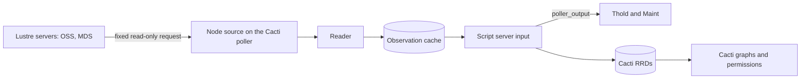

<!-- Source: README.md; SHA256: 40f2c5a5e9be97e4bd2b05a9ebab2a77de51de3af1b1c21dbeb5ee7f936cdd3b -->

<!-- translations:start -->
[English](../../../README.md) | [简体中文](../zh-CN/README.md) | [हिन्दी](README.md) | [Español (España)](../es-ES/README.md) | [Español (Latinoamérica)](../es-419/README.md) | [العربية (السعودية)](../ar-SA/README.md) | [Afrikaans](../af-ZA/README.md) | [አማርኛ](../am-ET/README.md) | [العربية (مصر)](../ar-EG/README.md) | [العربية (المغرب)](../ar-MA/README.md) | [বাংলা](../bn-BD/README.md) | [Deutsch](../de-DE/README.md) | [فارسی](../fa-IR/README.md) | [Filipino](../fil-PH/README.md) | [Français](../fr-FR/README.md) | [Français (Maroc)](../fr-MA/README.md) | [Français (Sénégal)](../fr-SN/README.md) | [Hausa](../ha-NG/README.md) | [עברית](../he-IL/README.md) | [Bahasa Indonesia](../id-ID/README.md) | [Igbo](../ig-NG/README.md) | [Italiano](../it-IT/README.md) | [日本語](../ja-JP/README.md) | [한국어](../ko-KR/README.md) | [Malagasy](../mg-MG/README.md) | [मराठी](../mr-IN/README.md) | [Bahasa Melayu](../ms-MY/README.md) | [Nederlands](../nl-NL/README.md) | [Polski](../pl-PL/README.md) | [Português (Brasil)](../pt-BR/README.md) | [Русский](../ru-RU/README.md) | [Kinyarwanda](../rw-RW/README.md) | [Soomaali](../so-SO/README.md) | [Svenska](../sv-SE/README.md) | [Kiswahili](../sw-KE/README.md) | [தமிழ்](../ta-IN/README.md) | [తెలుగు](../te-IN/README.md) | [ไทย](../th-TH/README.md) | [Türkçe](../tr-TR/README.md) | [Українська](../uk-UA/README.md) | [اردو](../ur-PK/README.md) | [Tiếng Việt](../vi-VN/README.md) | [isiXhosa](../xh-ZA/README.md) | [Yorùbá](../yo-NG/README.md) | [繁體中文](../zh-TW/README.md) | [isiZulu](../zu-ZA/README.md)
<!-- translations:end -->

# plugin_pfs

Cacti 1.2 प्लगइन जो समानांतर फ़ाइल सिस्टम का स्वास्थ्य और लोड लाता है: टारगेटों की क्षमता और भराव असंतुलन, प्रति-टारगेट थ्रूपुट तथा मेटाडेटा ऑपरेशन दर। Lustre पहला बैकएंड है; GPFS (IBM Storage Scale) और BeeGFS एक बैकएंड इंटरफ़ेस से बाद में आएँगे। डेटा साधारण Cacti डिवाइस, डेटा स्रोत और ग्राफ़ में जाता है, इसलिए Thold तथा Maint बिना बदलाव अलर्ट और उनका दमन करते हैं।

> **स्थिति: माइलस्टोन 4, चरण 1 का कोड पूरा, रिलीज़ नहीं।** माइलस्टोन 2 (आधार), 3 (Lustre अवलोकन) और 4 (अलर्ट और रिलीज़ तैयारी) `main` पर पूरे या समीक्षा में हैं। प्लगइन Cacti API से इंस्टॉल, अपग्रेड और अनइंस्टॉल होता है तथा PHP 8.2 से नीचे अस्वीकार करता है। हर पोलर का बैकग्राउंड रीडर निश्चित अनिवार्य-कमांड स्क्रिप्ट ([node/pfs-read.sh](../../../node/pfs-read.sh)) द्वारा SSH से Lustre सर्वर पढ़ता और सूची, स्थिति, क्षमता तथा काउंटर उनकी ताज़गी सहित कैश करता है। हर फ़ाइल सिस्टम एक Cacti डिवाइस बनता है, OST/MDT क्वेरी, पाँच अवलोकन ग्राफ़, माँग पर प्रति-टारगेट ग्राफ़ और Thold सारांश स्रोत सहित। अपरिवर्तित Thold v1.8.2 तथा Maint v1.3 संपूर्ण रन में सारांश gauge पर अलर्ट और दमन करते हैं; Thold 1.8.2 में काउंटर थ्रेशोल्ड समर्थित नहीं ([docs/alerting.md](docs/alerting.md))। अभी तक सभी परीक्षण अस्थायी Cacti में फ़िक्स्चर नोड आउटपुट पर हैं: असली Lustre नोड पर प्लगइन नहीं चला। रिलीज़ से पहले असली फ़ाइल सिस्टम पायलट ([पायलट योजना](../../pilot-plan.md)), बाहरी सुरक्षा समीक्षा ([स्व-समीक्षा](../../security-review.md)) और दस्तावेज़ित हार्डवेयर पर स्केल मापन ([पैमाना](../../research/scale.md)) बाकी हैं। संस्करण 0.1.0, `INFO` और [CHANGELOG.md](../../../CHANGELOG.md) में तैयार है पर टैग नहीं हुआ।

## पहुँच भूमिकाएँ

| Realm | पहुँच |
| --- | --- |
| Parallel Filesystem View | मौजूदा निगरानी पृष्ठ। |
| Parallel Filesystem Operator | निगरानी के साथ ऑपरेशन्स पृष्ठ और व्यक्तिगत ट्रायेज स्वीकृतियाँ। |
| Parallel Filesystem Admin | Operator पहुँच के साथ मौजूदा कॉन्फ़िगरेशन और प्रशासनिक कार्रवाइयाँ। |

अपग्रेड फ़ाइलें कॉपी करने के बाद प्रशासक के रूप में प्लगइन पृष्ठ खोलकर नया realm दर्ज करें। **कॉन्फ़िगरेशन > उपयोगकर्ता** या उपयोगकर्ता समूह में Operator realm स्पष्ट रूप से दें। अपग्रेड मौजूदा View और Admin realm ID तथा अनुमति बनाए रखते हैं। हर अनुरोध में Admin को Operator और Operator को View पहुँच विरासत में मिलती है; इससे उपयोगकर्ता या समूह में स्थायी अनुमति नहीं जुड़ती। प्लगइन सेटिंग के लिए Cacti Settings अनुमति के अतिरिक्त Parallel Filesystem Admin भी चाहिए।

Cacti डिवाइस अनुमतियाँ हर उपयोगकर्ता की पंक्तियाँ और कार्रवाइयाँ सीमित करती रहती हैं; बिना मैप किए ऑब्जेक्ट को प्रशासक चाहिए। क्रेडेंशियल, कॉन्फ़िगरेशन, मैपिंग, हटाना और अन्य प्रशासनिक बदलाव प्रशासनिक पृष्ठों पर रहते हैं। स्वीकृतियाँ केवल वर्तमान उपयोगकर्ता सत्र में, अधिकतम एक घंटे और उसी अवलोकन के ताज़ा रहने तक रहती हैं। नया या बदला अवलोकन उन्हें अमान्य करता है। वे विफल मापन को स्वस्थ नहीं बनातीं और अलर्ट नहीं दबातीं।

## कारण

साझा फ़ाइल सिस्टम धीमा हो तो प्रमाण सर्वरों में फैले होते हैं। Lustre काउंटर प्रति नोड रखता है: `lctl get_param` «स्थानीय नोड» के मान देता है, इसलिए हर ऑब्जेक्ट स्टोरेज सर्वर (OSS) और मेटाडेटा सर्वर (MDS) के पास अपने टारगेट के आँकड़े ही हैं। जाँच करने वाले ऑपरेटर को अलग जगहों से तीन उत्तर चाहिए:

- **क्या एक टारगेट भर रहा है और बाकी खाली हैं?** भराव असंतुलन नए फ़ाइलों के स्थान और किसी टारगेट की जगह खत्म होने का समय बदलता है।
- **कौन से टारगेट या ऑपरेशन व्यस्त हैं?** प्रति-टारगेट बाइट और प्रति-MDT ऑपरेशन काउंटर दिखाते हैं कि लोड डेटा पर निर्भर है या मेटाडेटा पर।
- **क्या निगरानी खुद वर्तमान है?** सपाट ग्राफ़ तभी भरोसेमंद है जब प्लगइन सर्वर देख पाया हो।

Cacti होस्ट ग्राफ़ और Thold थ्रेशोल्ड देता है, और Cacti GitHub संगठन में Lustre, GPFS या BeeGFS निगरानी रिपॉज़िटरी नहीं है (खोज 2026-11-14)। प्लगइन स्टोरेज नोड से अनुमति सूची के केवल-पढ़ने वाले मान लेकर और हर फ़ाइल सिस्टम को Cacti डिवाइस, उसके टारगेटों को डेटा क्वेरी इंडेक्स बनाकर कमी भरता है। यह Cacti ग्राफ़, अनुमति, दूरस्थ कलेक्टर, Thold और Maint का पुनः उपयोग करता है, समानांतर संस्करण नहीं बनाता।

## नियोजित दायरा

| चरण | दायरा | माइलस्टोन |
|---|---|---|
| 0, शोध | रिलीज़ मैट्रिक्स, नोड पहुँच निर्णय, मूल व्यवहार पुष्टि, काउंटर और फ़ेलओवर व्यवहार, स्केल मापन | [M1](https://github.com/somethingwithproof/plugin_pfs/milestone/1) |
| 1, अवलोकन | Lustre सूची, क्षमता/भराव, OST थ्रूपुट, MDT दर, ग्राफ़, Thold अलर्ट, Maint दमन, स्वास्थ्य पृष्ठ | [M2](https://github.com/somethingwithproof/plugin_pfs/milestone/2), [M3](https://github.com/somethingwithproof/plugin_pfs/milestone/3), [M4](https://github.com/somethingwithproof/plugin_pfs/milestone/4) |
| 2, विस्तार | Cacti दूरस्थ कलेक्टर, सीमित ऑब्जेक्ट संख्या में जॉब और क्लाइंट स्तर के व्यू | [M5](https://github.com/somethingwithproof/plugin_pfs/milestone/5) |
| 3, बैकएंड | GPFS (IBM Storage Scale) और BeeGFS बैकएंड | [M6](https://github.com/somethingwithproof/plugin_pfs/milestone/6) |

दायरे से बाहर: नोड या फ़ाइल सिस्टम पर लिखना, साफ़ करना, रीसेट या ट्यूनिंग; अपना अलर्ट इंजन; कस्टम डेमन या नेटवर्क प्रोटोकॉल; प्रति-जॉब डेटा स्रोत; Cacti कोर, Thold या Maint में बदलाव।

## अनुकूलता लक्ष्य

| घटक | लक्ष्य |
|---|---|
| Cacti | 1.2.31 या नया, कोर पैच नहीं |
| PHP | 8.2 या नया; `setup.php` 8.0 पर पार्स होने योग्य ताकि असमर्थित रनटाइम UI तोड़ने के बजाय अस्वीकृति दे |
| Lustre | रिलीज़ श्रृंखला माइलस्टोन 1 में तय होगी; अभी जाँचे स्रोत और मैनुअल 2.17.0 के हैं |
| GPFS, BeeGFS | चरण 3; रिलीज़ शोध में तय होंगी |
| Thold, Maint | बदलाव नहीं चाहिए |

## डिज़ाइन

- [docs/PLAN.md](../../PLAN.md) पूरी योजना है: आर्किटेक्चर, निर्भर मूल परियोजनाओं के तथ्य (स्रोत और अभी अपुष्ट बातें), काउंटर अर्थ, स्थिति मॉडल, सुरक्षा सीमाएँ, प्रदर्शन गणना, परीक्षण और जोखिम।
- [docs/operator-guide.md](docs/operator-guide.md) में इंस्टॉल, ग्राफ़/मान, अपग्रेड, बैकअप/बहाली, अनइंस्टॉल और समस्या निवारण हैं; [docs/alerting.md](docs/alerting.md) में Thold और Maint हैं।
- [docs/node-setup.md](docs/node-setup.md) रीडर के लिए Lustre सर्वर तथा पोलर तैयार करना बताता है।
- [docs/decisions/](../../decisions) में लिए गए वास्तुकला निर्णय हैं।
- [docs/REQUIREMENTS.md](../../REQUIREMENTS.md) हर आवश्यकता ID को मुद्दे से जोड़ता है।

## काम का ट्रैक रखना

- **माइलस्टोन** योजना का पालन करते हैं। हर एक का एपिक मुद्दा उपमुद्दे और पूरा होने के प्रमाण बताता है।
- **मुद्दे** लेबल से वर्गीकृत हैं: `type: requirement`, `type: research`, `type: decision`, `type: epic`। आवश्यकता मुद्दे क्रमांकित, जाँचने योग्य आवश्यकताएँ (`REQ-AREA-NNN`) और स्वीकृति मानदंड बताते हैं।
- **लेबल** में `area:`, `phase:`, `priority:` और `status:` भी हैं। [CONTRIBUTING.md](../../../CONTRIBUTING.md#labels) देखें।
- [प्रोजेक्ट बोर्ड](https://github.com/users/somethingwithproof/projects/11) सभी माइलस्टोन के मुद्दे दिखाता है।

## योगदान

[CONTRIBUTING.md](../../../CONTRIBUTING.md) पढ़ें। कमिट को DCO साइन-ऑफ़ चाहिए। डिज़ाइन चर्चा मुद्दों में होती है; खुले निर्णयों पर `type: decision` लेबल है।

## सुरक्षा

कमज़ोरियाँ निजी रूप से रिपोर्ट करें; [SECURITY.md](../../../SECURITY.md) देखें।

## लाइसेंस

GNU General Public License v2.0, Cacti और उसके प्लगइन वाला ही लाइसेंस। [LICENSE](../../../LICENSE) देखें।
