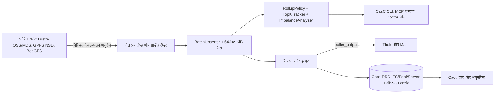

<!-- Source: README.md; SHA256: e88d6875d113220a91cfc0a9d230c829a78477b17e6aa7e44dda38c9591c86ad -->

<!-- translations:start -->
[English](../../../README.md) | [简体中文](../zh-CN/README.md) | [हिन्दी](README.md) | [Español (España)](../es-ES/README.md) | [Español (Latinoamérica)](../es-419/README.md) | [العربية (السعودية)](../ar-SA/README.md) | [Afrikaans](../af-ZA/README.md) | [አማርኛ](../am-ET/README.md) | [العربية (مصر)](../ar-EG/README.md) | [العربية (المغرب)](../ar-MA/README.md) | [Български](../bg-BG/README.md) | [বাংলা](../bn-BD/README.md) | [Bosanski](../bs-BA/README.md) | [Deutsch](../de-DE/README.md) | [Ελληνικά](../el-GR/README.md) | [فارسی](../fa-IR/README.md) | [Filipino](../fil-PH/README.md) | [Français](../fr-FR/README.md) | [Français (Maroc)](../fr-MA/README.md) | [Français (Sénégal)](../fr-SN/README.md) | [Hausa](../ha-NG/README.md) | [עברית](../he-IL/README.md) | [Hrvatski](../hr-HR/README.md) | [Bahasa Indonesia](../id-ID/README.md) | [Igbo](../ig-NG/README.md) | [Italiano](../it-IT/README.md) | [日本語](../ja-JP/README.md) | [ქართული](../ka-GE/README.md) | [한국어](../ko-KR/README.md) | [Latviešu](../lv-LV/README.md) | [Malagasy](../mg-MG/README.md) | [मराठी](../mr-IN/README.md) | [Bahasa Melayu](../ms-MY/README.md) | [Nederlands](../nl-NL/README.md) | [Polski](../pl-PL/README.md) | [Português (Brasil)](../pt-BR/README.md) | [Português (Portugal)](../pt-PT/README.md) | [Русский](../ru-RU/README.md) | [Kinyarwanda](../rw-RW/README.md) | [Soomaali](../so-SO/README.md) | [Српски](../sr-RS/README.md) | [Svenska](../sv-SE/README.md) | [Kiswahili](../sw-KE/README.md) | [தமிழ்](../ta-IN/README.md) | [తెలుగు](../te-IN/README.md) | [ไทย](../th-TH/README.md) | [Türkçe](../tr-TR/README.md) | [Українська](../uk-UA/README.md) | [اردو](../ur-PK/README.md) | [Tiếng Việt](../vi-VN/README.md) | [isiXhosa](../xh-ZA/README.md) | [Yorùbá](../yo-NG/README.md) | [繁體中文](../zh-TW/README.md) | [isiZulu](../zu-ZA/README.md)
<!-- translations:end -->

# plugin_pfs

एक Cacti 1.2 प्लगइन जो एकीकृत `Backend` इंटरफ़ेस के पीछे Lustre, IBM Storage Scale (GPFS), और BeeGFS के समानांतर फ़ाइल सिस्टम स्वास्थ्य, क्षमता, भराव असंतुलन, प्रति-टारगेट थ्रूपुट, तथा मेटाडेटा ऑपरेशन दरों को Cacti में लाता है। हर फ़ाइल सिस्टम डेटा क्वेरी, अवलोकन व माँग पर टारगेट ग्राफ़ और सारांश गेज वाले सामान्य Cacti डिवाइस के रूप में मैप होता है, ताकि Thold और Maint बिना बदलाव अलर्ट करें और उन्हें दबा सकें।

> **स्थिति: चरण 1 से 3 और एक्सास्केल स्केलिंग प्रिमिटिव कोड में लागू, अभी रिलीज़ नहीं।** आधार ढाँचा, Lustre अवलोकन, अलर्ट और Maint दमन, GPFS और BeeGFS रीड-ओनली ड्राइवर, Maint एकीकरण सहित OST/MDT असंतुलन विश्लेषण, दूरस्थ डेटा कलेक्टर स्कोपिंग (`replicate_out`, `remote_agent`), 100+ PB / एक्सास्केल स्केलिंग प्रिमिटिव (`FramedReportParser`, स्कीमा v4 `value_kib`, `RollupPolicy`, `TopKTracker`, `ShardAssigner`, `BatchUpserter`), CasC ऑपरेटर CLI (`cli/pfs.php`), और इकोसिस्टम हुक (`abilities_register`, `doctor_register_checks`, `casc_register_providers`) लागू हो चुके हैं और यूनिट, सुरक्षा तथा अस्थायी Cacti एकीकरण परीक्षणों से सत्यापित हैं। अभी तक सभी रन लाइव Lustre, GPFS, या BeeGFS हार्डवेयर के बजाय फ़िक्स्चर नोड आउटपुट का उपयोग करते हैं। रिलीज़ टैग करने से पहले अभी बाकी हैं: असली फ़ाइल सिस्टम पर पायलट ([पायलट योजना](../../pilot-plan.md)), बाहरी सुरक्षा समीक्षा ([स्व-समीक्षा](../../security-review.md)), और दस्तावेज़ित हार्डवेयर पर स्केल मापन ([पैमाना](../../research/scale.md))। संस्करण 0.1.0, `INFO` और [CHANGELOG.md](../../../CHANGELOG.md) में तैयार है पर टैग नहीं हुआ।

## पहुँच भूमिकाएँ

| Realm | पहुँच |
| --- | --- |
| Parallel Filesystem View | मौजूदा निगरानी पृष्ठ। |
| Parallel Filesystem Operator | निगरानी के साथ ऑपरेशन्स पृष्ठ और व्यक्तिगत ट्रायेज स्वीकृतियाँ। |
| Parallel Filesystem Admin | Operator पहुँच के साथ मौजूदा कॉन्फ़िगरेशन और प्रशासनिक कार्रवाइयाँ। |

अपग्रेड फ़ाइलें कॉपी करने के बाद प्रशासक के रूप में प्लगइन पृष्ठ खोलकर नया realm दर्ज करें। **कॉन्फ़िगरेशन > उपयोगकर्ता** या उपयोगकर्ता समूह में Operator realm स्पष्ट रूप से दें। अपग्रेड मौजूदा View और Admin realm ID तथा अनुमति बनाए रखते हैं। हर अनुरोध में Admin को Operator और Operator को View पहुँच विरासत में मिलती है; इससे उपयोगकर्ता या समूह में स्थायी अनुमति नहीं जुड़ती। प्लगइन सेटिंग के लिए Cacti Settings अनुमति के अतिरिक्त Parallel Filesystem Admin भी चाहिए।

Cacti डिवाइस अनुमतियाँ हर उपयोगकर्ता की पंक्तियाँ और कार्रवाइयाँ सीमित करती रहती हैं; बिना मैप किए ऑब्जेक्ट को प्रशासक चाहिए। क्रेडेंशियल, कॉन्फ़िगरेशन, मैपिंग, हटाना और अन्य प्रशासनिक बदलाव प्रशासनिक पृष्ठों पर रहते हैं। स्वीकृतियाँ केवल वर्तमान उपयोगकर्ता सत्र में, अधिकतम एक घंटे और उसी अवलोकन के ताज़ा रहने तक रहती हैं। नया या बदला अवलोकन उन्हें अमान्य करता है। वे विफल मापन को स्वस्थ नहीं बनातीं और अलर्ट नहीं दबातीं।

## कारण

साझा फ़ाइल सिस्टम धीमा हो तो प्रमाण सर्वरों में फैले होते हैं। Lustre काउंटर प्रति नोड रखता है: `lctl get_param` «स्थानीय नोड» के मान देता है, इसलिए हर ऑब्जेक्ट स्टोरेज सर्वर (OSS) और मेटाडेटा सर्वर (MDS) के पास अपने टारगेट के आँकड़े ही हैं। जाँच करने वाले ऑपरेटर को अलग जगहों से तीन उत्तर चाहिए:

- **क्या एक टारगेट भर रहा है और बाकी खाली हैं?** भराव असंतुलन नए फ़ाइलों के स्थान और किसी टारगेट की जगह खत्म होने का समय बदलता है।
- **कौन से टारगेट या ऑपरेशन व्यस्त हैं?** प्रति-टारगेट बाइट और प्रति-MDT ऑपरेशन काउंटर दिखाते हैं कि लोड डेटा पर निर्भर है या मेटाडेटा पर।
- **क्या निगरानी खुद वर्तमान है?** सपाट ग्राफ़ तभी भरोसेमंद है जब प्लगइन सर्वर देख पाया हो।

Cacti होस्ट ग्राफ़ और Thold थ्रेशोल्ड देता है, और Cacti GitHub संगठन में Lustre, GPFS या BeeGFS निगरानी रिपॉज़िटरी नहीं है (खोज 2026-11-14)। प्लगइन स्टोरेज नोड से अनुमति सूची के केवल-पढ़ने वाले मान लेकर और हर फ़ाइल सिस्टम को Cacti डिवाइस, उसके टारगेटों को डेटा क्वेरी इंडेक्स बनाकर कमी भरता है। यह Cacti ग्राफ़, अनुमति, दूरस्थ कलेक्टर, Thold और Maint का पुनः उपयोग करता है, समानांतर संस्करण नहीं बनाता।

## नियोजित दायरा

| चरण | दायरा | स्थिति | माइलस्टोन |
|---|---|---|---|
| 0, शोध | रिलीज़ मैट्रिक्स, नोड पहुँच निर्णय, मूल व्यवहार पुष्टि, काउंटर और फ़ेलओवर व्यवहार, स्केल मापन | पूर्ण | [M1](https://github.com/somethingwithproof/plugin_pfs/milestone/1) |
| 1, अवलोकन | Lustre सूची, क्षमता और भराव, OST/MDT असंतुलन (`lib/ImbalanceAnalyzer.php`), Maint एकीकरण (`lib/HealthPage.php`), OST थ्रूपुट, MDT ऑपरेशन दर, ग्राफ़, Thold अलर्ट, स्वास्थ्य पृष्ठ | लागू (फ़िक्स्चर-परीक्षित) | [M2](https://github.com/somethingwithproof/plugin_pfs/milestone/2), [M3](https://github.com/somethingwithproof/plugin_pfs/milestone/3), [M4](https://github.com/somethingwithproof/plugin_pfs/milestone/4) |
| 2, दूरस्थ और स्केल | पोलर-स्कोप्ड दूरस्थ संग्रह (`lib/Reader.php`, `lib/ReplicationRepository.php`, `replicate_out`, `remote_agent`), 100+ PB स्केलिंग प्रिमिटिव (64-बिट KiB स्वच्छता + स्कीमा v4 `value_kib`, `lib/RollupPolicy.php`, `lib/TopKTracker.php`, `lib/ShardAssigner.php` + `poller_pfs.php --shard=K/N`, `lib/BatchUpserter.php`), CasC CLI (`cli/pfs.php`), MCP/Doctor/CasC हुक | लागू (यूनिट और CI एकीकरण परीक्षित) | [M5](https://github.com/somethingwithproof/plugin_pfs/milestone/5) |
| 3, बैकएंड | `BackendRegistry::production()` में पंजीकृत रीड-ओनली IBM Storage Scale (GPFS) (`lib/GpfsBackend.php`) और BeeGFS (`lib/BeegfsBackend.php`) ड्राइवर | लागू (यूनिट-परीक्षित) | [M6](https://github.com/somethingwithproof/plugin_pfs/milestone/6) |

प्रमुख लागू ऑपरेटर और स्केलिंग प्रिमिटिव:

- **बहु-फ़ाइल सिस्टम रीड-ओनली ड्राइवर:** `LustreBackend`, `GpfsBackend` (केवल फ़्रेमयुक्त `mmpmon` `fs_io_s`/`io_s` जहाँ `reset` वर्जित है, `mmdf` पूल क्षमता/स्थितियाँ, और वेटर सारांश), तथा `BeegfsBackend` (सटीक बाइट-से-KiB रूपांतरण, पहुंच/स्थिरता स्थिति मैपिंग, और प्रति-अंतराल गेज अर्थ के साथ BeeGFS 7.4 और 8.x स्टोरेज/मेटाडेटा टारगेट) जो `lib/FramedReportParser.php` साझा करते हैं।
- **असंतुलन, हेडरूम, और Maint जागरूकता:** `lib/ImbalanceAnalyzer.php` OST/MDT भराव अनुपात, फैलाव, जनसंख्या मानक विचलन असंतुलन सूचकांक, हेडरूम, 1-अंतराल ताज़गी प्रवर्तन (`missing_targets`), प्रति-टारगेट स्थिति फ़्लैग, और सीमित Top-K विषम टारगेट की गणना करता है। `HealthPage` (`pfs_health.php`) और `CascProvider::health()` Cacti `Maint` रखरखाव विंडो दिखाते हैं और निर्धारित रखरखाव के दौरान सक्रिय विफलता चेतावनियाँ दबाते हैं।
- **100+ PB और एक्सास्केल स्केलिंग** ([docs/architecture/exascale-scaling.md](../../architecture/exascale-scaling.md)): स्कीमा v4 में `BIGINT UNSIGNED value_kib` कॉलम के साथ 500 PB और 2 EB पर सत्यापित सटीक दशमलव बाइट-से-KiB रूपांतरण (`FramedReportParser::bytesToKibInt()`); सीमित ऑप्ट-इन/हॉट/विषम टारगेट प्रमोशन के साथ पदानुक्रमित `Filesystem -> Pool -> Storage Server` RRD रोलअप (`lib/RollupPolicy.php`); सीमित $O(K)$ Top-K विषम टारगेट और पूर्व-संकलित भारी जॉब/क्लाइंट सारांश (`lib/TopKTracker.php`, जो कभी प्रति-क्लाइंट डिवाइस या RRD नहीं बनाते); निर्धारक CRC32 कलेक्टर शार्डिंग (`lib/ShardAssigner.php`, `php plugins/pfs/poller_pfs.php [--poller=N] [--shard=K/N] [--force] [--debug]`); तथा 500-पंक्ति बैच SQL अपसर्ट और कीसेट पेजिनेशन (`lib/BatchUpserter.php`, `CacheRepository::upsertObservationsBatch()`, `TargetRepository::forFilesystemPage()`)।
- **ऑपरेटर CasC CLI और इकोसिस्टम हुक:** `cli/pfs.php` शून्य बाहरी Composer निर्भरताओं के साथ `export [--format=yaml|xml]`, `validate <file> [--format=yaml|xml]`, `plan <file> [--format=yaml|xml] [--output=text|json]`, `apply <file> --confirm=<PLAN_HASH> [--format=yaml|xml]`, और `health [--format=text|json]` का समर्थन करता है। `setup.php` और `lib/EcosystemIntegration.php`, `abilities_register` (`pfs-list-filesystems`, `pfs-get-imbalance`, `pfs-get-health`; रीड-ओनली, `Parallel Filesystem View` और Cacti डिवाइस अनुमतियों पर नियंत्रित), `doctor_register_checks` (`pfs_schema`, `pfs_reader_freshness`, `pfs_capacity_imbalance`), `casc_register_providers`, `replicate_out`, और `remote_agent` पंजीकृत करते हैं।

दायरे से बाहर: नोड या फ़ाइल सिस्टम पर लिखना, साफ़ करना, रीसेट या ट्यूनिंग; अपना अलर्ट इंजन; कस्टम डेमन या नेटवर्क प्रोटोकॉल; प्रति-जॉब या प्रति-क्लाइंट Cacti डिवाइस/RRD; Cacti कोर, Thold या Maint में बदलाव।

## अनुकूलता लक्ष्य

| घटक | लक्ष्य |
|---|---|
| Cacti | 1.2.31 या नया, कोर पैच नहीं |
| PHP | 8.2 या नया; `setup.php`, `poller_pfs.php`, और `cli/pfs.php` 8.0 पर पार्स होने योग्य रहते हैं ताकि असमर्थित रनटाइम UI तोड़ने के बजाय अस्वीकृति दे |
| Lustre | स्रोत और मैनुअल 2.17.0 पर जाँचे गए; फ़िक्स्चर-परीक्षित |
| GPFS, BeeGFS | IBM Storage Scale (GPFS) 5.x `mmpmon`/`mmdf` और BeeGFS 7.4 / 8.x रीड-ओनली ड्राइवर लागू और फ़िक्स्चर-परीक्षित |
| Thold, Maint | Thold 1.8.2 और Maint 1.3, अपरिवर्तित |

## डिज़ाइन

- [docs/architecture/exascale-scaling.md](../../architecture/exascale-scaling.md) द्वि-स्तरीय 100+ PB / एक्सास्केल टेलीमेट्री आर्किटेक्चर (आउट-ऑफ़-बैंड LDMS/Darshan/TOKIO क्लाइंट टेलीमेट्री के साथ युग्मित Cacti/`plugin_pfs` सर्वर + रोलअप + Top-K स्तर) और इसके अकादमिक साहित्य संदर्भ का दस्तावेज़ीकरण करता है।
- [docs/PLAN.md](../../PLAN.md) पूरी योजना है: आर्किटेक्चर, निर्भर मूल परियोजनाओं के तथ्य (स्रोत और अभी अपुष्ट बातें), काउंटर अर्थ, स्थिति मॉडल, सुरक्षा सीमाएँ, प्रदर्शन गणना, परीक्षण और जोखिम।
- [docs/operator-guide.md](docs/operator-guide.md) में इंस्टॉल, ग्राफ़/मान, अपग्रेड, बैकअप/बहाली, अनइंस्टॉल और समस्या निवारण हैं; [docs/alerting.md](docs/alerting.md) में Thold और Maint हैं।
- [docs/node-setup.md](docs/node-setup.md) रीडर के लिए Lustre सर्वर तथा पोलर तैयार करना बताता है।
- [docs/decisions/](../../decisions) में लिए गए वास्तुकला निर्णय हैं।
- [docs/REQUIREMENTS.md](../../REQUIREMENTS.md) हर आवश्यकता ID को मुद्दे से जोड़ता है।

## काम का ट्रैक रखना

- **माइलस्टोन** योजना का पालन करते हैं। हर एक का एपिक मुद्दा उपमुद्दे और पूरा होने के प्रमाण बताता है।
- **मुद्दे** लेबल से वर्गीकृत हैं: `type: requirement`, `type: research`, `type: decision`, `type: epic`। आवश्यकता मुद्दे क्रमांकित, जाँचने योग्य आवश्यकताएँ (`REQ-AREA-NNN`) और स्वीकृति मानदंड बताते हैं।
- **लेबल** में `area:`, `phase:`, `priority:` और `status:` भी हैं। [CONTRIBUTING.md](../../../CONTRIBUTING.md#labels) देखें।
- [प्रोजेक्ट बोर्ड](https://github.com/users/somethingwithproof/projects/11) सभी माइलस्टोन के मुद्दे दिखाता है।

## योगदान

[CONTRIBUTING.md](../../../CONTRIBUTING.md) पढ़ें। कमिट को DCO साइन-ऑफ़ चाहिए। डिज़ाइन चर्चा मुद्दों में होती है; खुले निर्णयों पर `type: decision` लेबल है।

## सुरक्षा

कमज़ोरियाँ निजी रूप से रिपोर्ट करें; [SECURITY.md](../../../SECURITY.md) देखें।

## लाइसेंस

GNU General Public License v2.0, Cacti और उसके प्लगइन वाला ही लाइसेंस। [LICENSE](../../../LICENSE) देखें।
