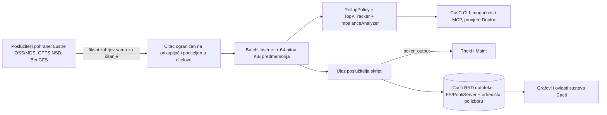

<!-- Source: README.md; SHA256: e88d6875d113220a91cfc0a9d230c829a78477b17e6aa7e44dda38c9591c86ad -->

<!-- translations:start -->
[English](../../../README.md) | [简体中文](../zh-CN/README.md) | [हिन्दी](../hi-IN/README.md) | [Español (España)](../es-ES/README.md) | [Español (Latinoamérica)](../es-419/README.md) | [العربية (السعودية)](../ar-SA/README.md) | [Afrikaans](../af-ZA/README.md) | [አማርኛ](../am-ET/README.md) | [العربية (مصر)](../ar-EG/README.md) | [العربية (المغرب)](../ar-MA/README.md) | [Български](../bg-BG/README.md) | [বাংলা](../bn-BD/README.md) | [Bosanski](../bs-BA/README.md) | [Deutsch](../de-DE/README.md) | [Ελληνικά](../el-GR/README.md) | [فارسی](../fa-IR/README.md) | [Filipino](../fil-PH/README.md) | [Français](../fr-FR/README.md) | [Français (Maroc)](../fr-MA/README.md) | [Français (Sénégal)](../fr-SN/README.md) | [Hausa](../ha-NG/README.md) | [עברית](../he-IL/README.md) | [Hrvatski](README.md) | [Bahasa Indonesia](../id-ID/README.md) | [Igbo](../ig-NG/README.md) | [Italiano](../it-IT/README.md) | [日本語](../ja-JP/README.md) | [ქართული](../ka-GE/README.md) | [한국어](../ko-KR/README.md) | [Latviešu](../lv-LV/README.md) | [Malagasy](../mg-MG/README.md) | [मराठी](../mr-IN/README.md) | [Bahasa Melayu](../ms-MY/README.md) | [Nederlands](../nl-NL/README.md) | [Polski](../pl-PL/README.md) | [Português (Brasil)](../pt-BR/README.md) | [Português (Portugal)](../pt-PT/README.md) | [Русский](../ru-RU/README.md) | [Kinyarwanda](../rw-RW/README.md) | [Soomaali](../so-SO/README.md) | [Српски](../sr-RS/README.md) | [Svenska](../sv-SE/README.md) | [Kiswahili](../sw-KE/README.md) | [தமிழ்](../ta-IN/README.md) | [తెలుగు](../te-IN/README.md) | [ไทย](../th-TH/README.md) | [Türkçe](../tr-TR/README.md) | [Українська](../uk-UA/README.md) | [اردو](../ur-PK/README.md) | [Tiếng Việt](../vi-VN/README.md) | [isiXhosa](../xh-ZA/README.md) | [Yorùbá](../yo-NG/README.md) | [繁體中文](../zh-TW/README.md) | [isiZulu](../zu-ZA/README.md)
<!-- translations:end -->

# plugin_pfs

Dodatak za Cacti 1.2 koji u Cacti unosi ispravnost paralelnih datotečnih sustava, kapacitet, neuravnoteženost popunjenosti, promet po odredištu te stope operacija metapodataka za sustave Lustre, IBM Storage Scale (GPFS) i BeeGFS iza jedinstvenog sučelja `Backend`. Svaki se datotečni sustav preslikava u uobičajeni Cacti uređaj s upitima podataka, preglednim grafovima i grafovima po odredištu na zahtjev te zbirnim pokazateljima tako da Thold i Maint na njima upozoravaju i potiskuju upozorenja bez ikakvih izmjena.

> **Status: faze 1 do 3 i gradivni elementi za exascale skaliranje implementirani su u kodu, još nije objavljeno.** Temelji, nadzor sustava Lustre, upozoravanje i potiskivanje putem Mainta, upravljački programi samo za čitanje za GPFS i BeeGFS, analiza neuravnoteženosti OST/MDT s integracijom Mainta, ograničavanje opsega udaljenih prikupljača podataka (`replicate_out`, `remote_agent`), gradivni elementi skaliranja za 100+ PB / exascale (`FramedReportParser`, shema v4 `value_kib`, `RollupPolicy`, `TopKTracker`, `ShardAssigner`, `BatchUpserter`), operaterski CasC CLI (`cli/pfs.php`) te kuke ekosustava (`abilities_register`, `doctor_register_checks`, `casc_register_providers`) implementirani su i provjereni jediničnim, sigurnosnim i integracijskim testovima u privremenoj instanci sustava Cacti. Sva dosadašnja izvođenja koriste ispitne izlaze čvorova umjesto stvarnog sklopovlja Lustre, GPFS ili BeeGFS. Prije označavanja izdanja ostaju otvoreni: probni rad na stvarnim datotečnim sustavima ([plan probnog rada](../../pilot-plan.md)), vanjska sigurnosna revizija ([samoprovjera](../../security-review.md)) i mjerenja skalabilnosti na dokumentiranom sklopovlju ([skalabilnost](../../research/scale.md)). Inačica 0.1.0 pripremljena je u datotekama `INFO` i [CHANGELOG.md](../../../CHANGELOG.md), ali još nije označena oznakom izdanja.

## Uloge pristupa

| Područje ovlasti | Pristup |
| --- | --- |
| Parallel Filesystem View | Postojeće stranice za nadzor. |
| Parallel Filesystem Operator | Nadzor uz stranicu Operacije i osobne potvrde trijaže. |
| Parallel Filesystem Admin | Pristup operatera uz postojeće postavke i administrativne postupke. |

Nakon kopiranja datoteka za nadogradnju otvorite stranicu Dodaci kao administrator kako biste registrirali novo područje ovlasti. Izričito dodijelite područje Operator u izborniku **Configuration > Users** ili korisničkim skupinama. Nadogradnje čuvaju postojeće identifikatore i ovlasti za područja View i Admin. Pristup Admin nasljeđuje pristup Operator, a pristup Operator nasljeđuje pristup View pri svakom zahtjevu; time se korisnicima ili skupinama ne dodaju trajno spremljene ovlasti. Postavke dodatka zahtijevaju i ovlast Parallel Filesystem Admin povrh Cacti ovlasti za postavke.

Ovlasti za uređaje u sustavu Cacti i dalje ograničavaju retke i postupke dostupne pojedinom korisniku; za nepridružene objekte potreban je administrator. Vjerodajnice, konfiguracija, pridruživanje, brisanje i ostale administrativne izmjene ostaju na administrativnim stranicama. Potvrde vrijede samo u trenutnoj korisničkoj sesiji, najdulje jedan sat i samo dok isto opažanje ostaje ažurno. Nova ili promijenjena opažanja ih poništavaju. One nikada ne označavaju neuspjelo mjerenje ispravnim niti potiskuju upozorenja.

## Zašto

Kada je dijeljeni datotečni sustav spor, dokazi su raspršeni na više poslužitelja. Lustre vodi svoje brojače po čvoru: `lctl get_param` ispisuje vrijednosti "na lokalnom čvoru", stoga svaki poslužitelj objektne pohrane (OSS) i poslužitelj metapodataka (MDS) raspolaže samo podacima svojih odredišta. Operater koji ispituje spor datotečni sustav treba tri odgovora s različitih mjesta:

- **Puni li se jedno odredište dok su druga prazna?** Neuravnoteženost popunjenosti utječe na to kamo se spremaju nove datoteke i kada će pojedino odredište ostati bez prostora.
- **Koja su odredišta ili operacije opterećena?** Brojači bajtova po odredištu i brojači operacija po MDT-u pokazuju je li opterećenje ograničeno podacima ili metapodacima.
- **Je li sam nadzor ažuran?** Ravan graf ulijeva povjerenje samo ako je dodatak doista mogao dosegnuti poslužitelje.

Cacti izrađuje grafove za računala i prati pragove putem dodatka Thold, a organizacija Cacti na GitHubu nema repozitorij za nadzor sustava Lustre, GPFS ili BeeGFS (pretraženo 2026-11-14). Ovaj dodatak popunjava tu prazninu očitavanjem dopuštenih vrijednosti samo za čitanje s čvorova pohrane i prikazivanjem svakog datotečnog sustava kao uređaja Cacti čija su odredišta indeksi upita podataka. Koristi postojeće grafove, ovlasti, udaljene prikupljače podataka, Thold i Maint sustava Cacti umjesto izgradnje usporednih rješenja.

## Planirani opseg

| Faza | Opseg | Status | Prekretnice |
|---|---|---|---|
| 0, istraživanje | Matrica izdanja, odluka o pristupu čvorovima, potvrda uzvodnog ponašanja, ponašanje brojača i prebacivanja pri kvaru, mjerenja skalabilnosti | Dovršeno | [M1](https://github.com/somethingwithproof/plugin_pfs/milestone/1) |
| 1, nadzor | Inventar sustava Lustre, kapacitet i popunjenost, neuravnoteženost OST/MDT (`lib/ImbalanceAnalyzer.php`), integracija s Maintom (`lib/HealthPage.php`), promet OST-a, stope operacija MDT-a, grafovi, upozoravanje putem Tholda, stranica ispravnosti | Implementirano (testirano na ispitnim izlazima) | [M2](https://github.com/somethingwithproof/plugin_pfs/milestone/2), [M3](https://github.com/somethingwithproof/plugin_pfs/milestone/3), [M4](https://github.com/somethingwithproof/plugin_pfs/milestone/4) |
| 2, udaljeno prikupljanje i skaliranje | Udaljeno prikupljanje ograničeno na prikupljač (`lib/Reader.php`, `lib/ReplicationRepository.php`, `replicate_out`, `remote_agent`), gradivni elementi za 100+ PB skaliranje (64-bitna KiB higijena + shema v4 `value_kib`, `lib/RollupPolicy.php`, `lib/TopKTracker.php`, `lib/ShardAssigner.php` + `poller_pfs.php --shard=K/N`, `lib/BatchUpserter.php`), CasC CLI (`cli/pfs.php`), kuke MCP/Doctor/CasC | Implementirano (testirano jediničnim i CI integracijskim testovima) | [M5](https://github.com/somethingwithproof/plugin_pfs/milestone/5) |
| 3, pozadinski sustavi | Upravljački programi samo za čitanje za IBM Storage Scale (GPFS) (`lib/GpfsBackend.php`) i BeeGFS (`lib/BeegfsBackend.php`) registrirani u `BackendRegistry::production()` | Implementirano (testirano jediničnim testovima) | [M6](https://github.com/somethingwithproof/plugin_pfs/milestone/6) |

Ključni implementirani operaterski i skalabilnosni gradivni elementi:

- **Upravljački programi samo za čitanje za više datotečnih sustava:** `LustreBackend`, `GpfsBackend` (isključivo uokvireni `mmpmon` `fs_io_s`/`io_s` sa zabranom za `reset`, kapacitet/stanja spremnika `mmdf` i sažeci čekanja) i `BeegfsBackend` (odredišta pohrane i metapodataka sustava BeeGFS 7.4 i 8.x s točnom pretvorbom bajtova u KiB, preslikavanjem stanja dostupnosti i dosljednosti te semantikom pokazivača po intervalu) koji dijele `lib/FramedReportParser.php`.
- **Svjesnost o neuravnoteženosti, zalihi prostora i Maintu:** `lib/ImbalanceAnalyzer.php` izračunava omjere popunjenosti OST/MDT, raspon, indeks neuravnoteženosti putem populacijske standardne devijacije, preostalu zalihu prostora, provjeru ažurnosti od jednog intervala (`missing_targets`), zastavice stanja po odredištu te ograničeni Top-K popis najneuravnoteženijih odredišta. `HealthPage` (`pfs_health.php`) i `CascProvider::health()` prikazuju prozore održavanja sustava Cacti `Maint` i potiskuju aktivna upozorenja o kvarovima tijekom zakazanog održavanja.
- **Skaliranje na 100+ PB i exascale** ([docs/architecture/exascale-scaling.md](../../architecture/exascale-scaling.md)): točna decimalna pretvorba bajtova u KiB (`FramedReportParser::bytesToKibInt()`) potvrđena na 500 PB i 2 EB uz stupce `BIGINT UNSIGNED value_kib` (shema v4); hijerarhijske RRD agregacije `Filesystem -> Pool -> Storage Server` s ograničenim promicanjem odredišta po izboru, vrućih ili neuravnoteženih odredišta (`lib/RollupPolicy.php`); ograničeni $O(K)$ Top-K neuravnoteženih odredišta i unaprijed agregirani sažeci opterećenih poslova i klijenata (`lib/TopKTracker.php`, bez stvaranja uređaja ili RRD datoteka po klijentu); determinističko CRC32 raspoređivanje prikupljača u dijelove (`lib/ShardAssigner.php`, `php plugins/pfs/poller_pfs.php [--poller=N] [--shard=K/N] [--force] [--debug]`); te skupno SQL umetanje/ažuriranje u serijama od 500 redaka uz straničenje po ključu (`lib/BatchUpserter.php`, `CacheRepository::upsertObservationsBatch()`, `TargetRepository::forFilesystemPage()`).
- **Operaterski CasC CLI i kuke ekosustava:** `cli/pfs.php` podržava `export [--format=yaml|xml]`, `validate <file> [--format=yaml|xml]`, `plan <file> [--format=yaml|xml] [--output=text|json]`, `apply <file> --confirm=<PLAN_HASH> [--format=yaml|xml]` i `health [--format=text|json]` bez ikakvih vanjskih Composer ovisnosti. `setup.php` i `lib/EcosystemIntegration.php` registriraju `abilities_register` (`pfs-list-filesystems`, `pfs-get-imbalance`, `pfs-get-health`; samo za čitanje, ograničeno na `Parallel Filesystem View` i ovlasti uređaja u sustavu Cacti), `doctor_register_checks` (`pfs_schema`, `pfs_reader_freshness`, `pfs_capacity_imbalance`), `casc_register_providers`, `replicate_out` i `remote_agent`.

Izvan opsega: bilo kakve radnje pisanja, brisanja, poništavanja ili ugađanja na čvoru ili datotečnom sustavu; vlastiti mehanizam upozoravanja u dodatku; prilagođeni pozadinski servis ili mrežni protokol; uređaji ili RRD datoteke u sustavu Cacti po poslu ili po klijentu; izmjene jezgre sustava Cacti, Tholda ili Mainta.

## Ciljevi kompatibilnosti

| Komponenta | Cilj |
|---|---|
| Cacti | 1.2.31 ili noviji, bez zakrpa jezgre |
| PHP | 8.2 ili noviji; `setup.php`, `poller_pfs.php` i `cli/pfs.php` ostaju sintaksno valjani u inačici 8.0 kako bi nepodržano izvodno okruženje dobilo odbijanje umjesto neispravnog sučelja sustava Cacti |
| Lustre | Izvorni kod i priručnici provjereni na inačici 2.17.0; testirano na ispitnim izlazima |
| GPFS, BeeGFS | Upravljački programi samo za čitanje za IBM Storage Scale (GPFS) 5.x `mmpmon`/`mmdf` i BeeGFS 7.4 / 8.x implementirani su i testirani na ispitnim izlazima |
| Thold, Maint | Thold 1.8.2 i Maint 1.3, neizmijenjeni |

## Dizajn

- [docs/architecture/exascale-scaling.md](../../architecture/exascale-scaling.md) dokumentira dvoslojnu telemetrijsku arhitekturu za 100+ PB / exascale (sloj poslužitelja, agregacije i Top-K u sustavu Cacti/`plugin_pfs` uparen s izvanpojasnom klijentskom telemetrijom LDMS/Darshan/TOKIO) i njezin kontekst u akademskoj literaturi.
- [docs/PLAN.md](../../PLAN.md) donosi cjelovit plan: arhitekturu, uzvodne činjenice na kojima se temelji (s izvorima i navodom što još nije potvrđeno), semantiku brojača, model stanja, sigurnosne granice, proračun učinkovitosti, testiranje i rizike.
- [docs/operator-guide.md](../../operator-guide.md) obuhvaća instalaciju, grafove i vrijednosti, nadogradnju, sigurnosnu kopiju i vraćanje, uklanjanje te otklanjanje pogrešaka; [docs/alerting.md](../../alerting.md) obuhvaća Thold i Maint.
- [docs/node-setup.md](../../node-setup.md) opisuje kako konfigurirati poslužitelj Lustre i prikupljač za čitač.
- [docs/decisions/](../../decisions) sadrži zapise o već donesenim arhitektonskim odlukama.
- [docs/REQUIREMENTS.md](../../REQUIREMENTS.md) povezuje svaki identifikator zahtjeva s pripadajućim predmetom.

## Kako se prati rad

- **Prekretnice** prate prekretnice iz plana. Svaka ima krovni predmet s popisom podpredmeta i izlaznim dokazima.
- **Predmeti** su razvrstani oznakama: `type: requirement`, `type: research`, `type: decision`, `type: epic`. Predmeti zahtjeva navode brojčano označene, provjerljive zahtjeve (`REQ-AREA-NNN`) i kriterije prihvaćanja.
- **Oznake** dodatno nose `area:`, `phase:`, `priority:` i `status:`. Pogledajte [CONTRIBUTING.md](../../../CONTRIBUTING.md#labels).
- [Ploča projekta](https://github.com/users/somethingwithproof/projects/11) prikazuje sve predmete kroz sve prekretnice.

## Doprinos

Pročitajte [CONTRIBUTING.md](../../../CONTRIBUTING.md). Zapisima promjena potreban je DCO potpis. Rasprave o dizajnu vode se u predmetima; otvorene odluke nose oznaku `type: decision`.

## Sigurnost

Sigurnosne ranjivosti prijavite povjerljivo; pogledajte [SECURITY.md](../../../SECURITY.md).

## Licencija

GNU General Public License v2.0, ista licencija kao za Cacti i njegove dodatke. Pogledajte [LICENSE](../../../LICENSE).
