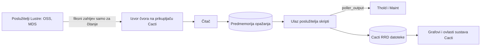

<!-- Source: README.md; SHA256: 40f2c5a5e9be97e4bd2b05a9ebab2a77de51de3af1b1c21dbeb5ee7f936cdd3b -->

<!-- translations:start -->
[English](../../../README.md) | [简体中文](../zh-CN/README.md) | [हिन्दी](../hi-IN/README.md) | [Español (España)](../es-ES/README.md) | [Español (Latinoamérica)](../es-419/README.md) | [العربية (السعودية)](../ar-SA/README.md) | [Afrikaans](../af-ZA/README.md) | [አማርኛ](../am-ET/README.md) | [العربية (مصر)](../ar-EG/README.md) | [العربية (المغرب)](../ar-MA/README.md) | [বাংলা](../bn-BD/README.md) | [Bosanski](../bs-BA/README.md) | [Deutsch](../de-DE/README.md) | [فارسی](../fa-IR/README.md) | [Filipino](../fil-PH/README.md) | [Français](../fr-FR/README.md) | [Français (Maroc)](../fr-MA/README.md) | [Français (Sénégal)](../fr-SN/README.md) | [Hausa](../ha-NG/README.md) | [עברית](../he-IL/README.md) | [Hrvatski](README.md) | [Bahasa Indonesia](../id-ID/README.md) | [Igbo](../ig-NG/README.md) | [Italiano](../it-IT/README.md) | [日本語](../ja-JP/README.md) | [한국어](../ko-KR/README.md) | [Malagasy](../mg-MG/README.md) | [मराठी](../mr-IN/README.md) | [Bahasa Melayu](../ms-MY/README.md) | [Nederlands](../nl-NL/README.md) | [Polski](../pl-PL/README.md) | [Português (Brasil)](../pt-BR/README.md) | [Русский](../ru-RU/README.md) | [Kinyarwanda](../rw-RW/README.md) | [Soomaali](../so-SO/README.md) | [Српски](../sr-RS/README.md) | [Svenska](../sv-SE/README.md) | [Kiswahili](../sw-KE/README.md) | [தமிழ்](../ta-IN/README.md) | [తెలుగు](../te-IN/README.md) | [ไทย](../th-TH/README.md) | [Türkçe](../tr-TR/README.md) | [Українська](../uk-UA/README.md) | [اردو](../ur-PK/README.md) | [Tiếng Việt](../vi-VN/README.md) | [isiXhosa](../xh-ZA/README.md) | [Yorùbá](../yo-NG/README.md) | [繁體中文](../zh-TW/README.md) | [isiZulu](../zu-ZA/README.md)
<!-- translations:end -->

# plugin_pfs

Dodatak za Cacti 1.2 koji u sustav Cacti unosi ispravnost i opterećenje paralelnih datotečnih sustava: kapacitet i neuravnoteženost popunjenosti po odredištima, promet po odredištu te stope operacija metapodataka. Lustre je prvi pozadinski sustav. GPFS (IBM Storage Scale) i BeeGFS slijede iza jedinstvenog sučelja pozadinskog sustava. Podaci se spremaju u uobičajene uređaje, izvore podataka i grafove sustava Cacti, pa Thold i Maint bez ikakvih izmjena upozoravaju na njih i potiskuju obavijesti.

> **Status: prekretnica 4, kod dovršen za fazu 1, još nije objavljeno.** Prekretnice 2 (temelji), 3 (nadzor sustava Lustre) i 4 (upozoravanje i priprema izdanja) dovršene su na grani `main` ili su u postupku pregleda. Dodatak se instalira, nadograđuje i uklanja putem sučelja za dodatke sustava Cacti te odbija inačice PHP-a starije od 8.2. Pozadinski čitač na svakom prikupljaču čita poslužitelje Lustre putem SSH-a uz fiksnu nametnutu naredbu ([node/pfs-read.sh](../../../node/pfs-read.sh)) i u predmemoriju sprema inventar, uvjet, kapacitet i brojače zajedno s njihovom ažurnošću. Svaki datotečni sustav postaje uređaj Cacti s OST i MDT upitima podataka, pet preglednih grafova, grafovima po odredištu na zahtjev i zbirnim izvorom podataka za Thold. Neizmijenjeni Thold v1.8.2 i Maint v1.3 u cjelovitom testnom izvođenju uredno upozoravaju i potiskuju upozorenja na zbirnim pokazateljima; pragovi sustava Thold na brojačima nisu podržani u inačici Thold 1.8.2 ([docs/alerting.md](../../alerting.md)). Svi dosadašnji testovi izvode se na ispitnim izlazima čvorova u privremenoj instanci sustava Cacti: dodatak još nije pokrenut na stvarnom čvoru Lustre. Prije objave ostaju otvoreni: probni rad na stvarnim datotečnim sustavima ([plan probnog rada](../../pilot-plan.md)), vanjska sigurnosna revizija ([samoprovjera](../../security-review.md)) i mjerenja skalabilnosti na dokumentiranoj sklopovskoj opremi ([skalabilnost](../../research/scale.md)). Inačica 0.1.0 pripremljena je u datotekama `INFO` i [CHANGELOG.md](../../../CHANGELOG.md), ali još nije označena oznakom izdanja.

## Uloge pristupa

| Područje ovlasti | Pristup |
| --- | --- |
| Parallel Filesystem View | Postojeće stranice za nadzor. |
| Parallel Filesystem Operator | Nadzor uz stranicu Operacije i osobne potvrde trijaže. |
| Parallel Filesystem Admin | Pristup operatera uz postojeće postavke i administrativne postupke. |

Nakon kopiranja datoteka za nadogradnju otvorite stranicu Dodaci kao administrator kako biste registrirali novo područje ovlasti. Izričito dodijelite područje Operator u izborniku **Configuration > Users** ili korisničkim skupinama. Nadogradnje čuvaju postojeće identifikatore i ovlasti za područja View i Admin. Pristup Admin nasljeđuje pristup Operator, a pristup Operator nasljeđuje pristup View pri svakom zahtjevu; time se korisnicima ili skupinama ne dodaju trajno spremljene ovlasti. Postavke dodatka zahtijevaju i ovlast Parallel Filesystem Admin povrh Cacti ovlasti za postavke.

Ovlasti za uređaje u sustavu Cacti i dalje ograničavaju retke i postupke dostupne pojedinom korisniku; za nepridružene objekte potreban je administrator. Vjerodajnice, konfiguracija, pridruživanje, brisanje i ostale administrativne izmjene ostaju na administrativnim stranicama. Potvrde vrijede samo u trenutnoj korisničkoj sesiji, najdulje jedan sat i samo dok isto opažanje ostaje ažurno. Nova ili promijenjena opažanja ih poništavaju. One nikada ne označavaju neuspjelo mjerenje ispravnim niti potiskuju upozorenja.

## Zašto

Kada je dijeljeni datotečni sustav spor, dokazi su raspršeni na više poslužitelja. Lustre vodi svoje brojače po čvoru: `lctl get_param` ispisuje vrijednosti "na lokalnom čvoru", stoga svaki poslužitelj objektne pohrane (OSS) i poslužitelj metapodataka (MDS) raspolaže samo podacima svojih odredišta. Operater koji ispituje spor datotečni sustav treba tri odgovora s različitih mjesta:

- **Puni li se jedno odredište dok su druga prazna?** Neuravnoteženost popunjenosti utječe na to kamo se spremaju nove datoteke i kada će pojedino odredište ostati bez prostora.
- **Koja su odredišta ili operacije opterećena?** Brojači bajtova po odredištu i brojači operacija po MDT-u pokazuju je li opterećenje ograničeno podacima ili metapodacima.
- **Je li sam nadzor ažuran?** Ravan graf ulijeva povjerenje samo ako je dodatak doista mogao dosegnuti poslužitelje.

Cacti izrađuje grafove za računala i prati pragove putem dodatka Thold, a organizacija Cacti na GitHubu nema repozitorij za nadzor sustava Lustre, GPFS ili BeeGFS (pretraženo 2026-11-14). Ovaj dodatak popunjava tu prazninu očitavanjem dopuštenih vrijednosti samo za čitanje s čvorova pohrane i prikazivanjem svakog datotečnog sustava kao uređaja Cacti čija su odredišta indeksi upita podataka. Koristi postojeće grafove, ovlasti, udaljene prikupljače podataka, Thold i Maint sustava Cacti umjesto izgradnje usporednih rješenja.

## Planirani opseg

| Faza | Opseg | Prekretnice |
|---|---|---|
| 0, istraživanje | Matrica izdanja, odluka o pristupu čvorovima, potvrda uzvodnog ponašanja, ponašanje brojača i prebacivanja pri kvaru, mjerenja skalabilnosti | [M1](https://github.com/somethingwithproof/plugin_pfs/milestone/1) |
| 1, nadzor | Inventar sustava Lustre, kapacitet i popunjenost, promet OST-a, stope operacija MDT-a, grafovi, upozoravanje putem Tholda, potiskivanje putem Mainta, stranica ispravnosti | [M2](https://github.com/somethingwithproof/plugin_pfs/milestone/2), [M3](https://github.com/somethingwithproof/plugin_pfs/milestone/3), [M4](https://github.com/somethingwithproof/plugin_pfs/milestone/4) |
| 2, dubina | Udaljeni prikupljači podataka sustava Cacti, prikazi na razini poslova i klijenata unutar ograničenog broja objekata | [M5](https://github.com/somethingwithproof/plugin_pfs/milestone/5) |
| 3, pozadinski sustavi | Pozadinski sustavi GPFS (IBM Storage Scale) i BeeGFS | [M6](https://github.com/somethingwithproof/plugin_pfs/milestone/6) |

Izvan opsega: bilo kakve radnje pisanja, brisanja, poništavanja ili ugađanja na čvoru ili datotečnom sustavu; vlastiti mehanizam upozoravanja u dodatku; prilagođeni pozadinski servis ili mrežni protokol; izvori podataka po poslu; izmjene jezgre sustava Cacti, Tholda ili Mainta.

## Ciljevi kompatibilnosti

| Komponenta | Cilj |
|---|---|
| Cacti | 1.2.31 ili noviji, bez zakrpa jezgre |
| PHP | 8.2 ili noviji; `setup.php` ostaje sintaksno valjan u inačici 8.0 kako bi nepodržano izvodno okruženje dobilo odbijanje umjesto neispravnog sučelja sustava Cacti |
| Lustre | Linije izdanja koje će se definirati do prekretnice 1; dosad provjereni izvorni kod i priručnici odnose se na inačicu 2.17.0 |
| GPFS, BeeGFS | Faza 3; izdanja će se definirati istraživanjem |
| Thold, Maint | Nisu potrebne izmjene |

## Dizajn

- [docs/PLAN.md](../../PLAN.md) donosi cjelovit plan: arhitekturu, uzvodne činjenice na kojima se temelji (s izvorima i navodom što još nije potvrđeno), semantiku brojača, model stanja, sigurnosne granice, proračun učinkovitosti, testiranje i rizike.
- [docs/operator-guide.md](../../operator-guide.md) obuhvaća instalaciju, grafove i vrijednosti, nadogradnju, sigurnosnu kopiju i vraćanje, uklanjanje te otklanjanje pogrešaka; [docs/alerting.md](../../alerting.md) obuhvaća Thold i Maint.
- [docs/node-setup.md](../../node-setup.md) opisuje kako konfigurirati poslužitelj Lustre i prikupljač za čitač.
- [docs/decisions/](../../decisions) sadrži zapise o već donesenim arhitektonskim odlukama.
- [docs/REQUIREMENTS.md](../../REQUIREMENTS.md) povezuje svaki identifikator zahtjeva s pripadajućim predmetom.

## Kako se prati rad

- **Prekretnice** prate prekretnice iz plana. Svaka ima krovni predmet s popisom podpredmeta i izlaznim dokazima.
- **Predmeti** su razvrstani oznakama: `type: requirement`, `type: research`, `type: decision`, `type: epic`. Predmeti zahtjeva navode brojčano označene, provjerljive zahtjeve (`REQ-AREA-NNN`) i kriterije prihvaćanja.
- **Oznake** dodatno nose `area:`, `phase:`, `priority:` i `status:`. Pogledajte [CONTRIBUTING.md](../../../CONTRIBUTING.md#labels).
- [Ploča projekta](https://github.com/users/somethingwithproof/projects/11) prikazuje sve predmete kroz sve prekretnice.

## Doprinos

Pročitajte [CONTRIBUTING.md](../../../CONTRIBUTING.md). Zapisima promjena potreban je DCO potpis. Rasprave o dizajnu vode se u predmetima; otvorene odluke nose oznaku `type: decision`.

## Sigurnost

Sigurnosne ranjivosti prijavite povjerljivo; pogledajte [SECURITY.md](../../../SECURITY.md).

## Licencija

GNU General Public License v2.0, ista licencija kao za Cacti i njegove dodatke. Pogledajte [LICENSE](../../../LICENSE).
