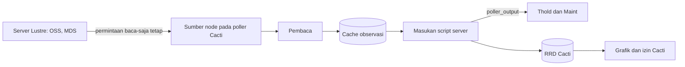

<!-- Source: README.md; SHA256: e88d6875d113220a91cfc0a9d230c829a78477b17e6aa7e44dda38c9591c86ad -->

<!-- translations:start -->
[English](../../../README.md) | [简体中文](../zh-CN/README.md) | [हिन्दी](../hi-IN/README.md) | [Español (España)](../es-ES/README.md) | [Español (Latinoamérica)](../es-419/README.md) | [العربية (السعودية)](../ar-SA/README.md) | [Afrikaans](../af-ZA/README.md) | [አማርኛ](../am-ET/README.md) | [العربية (مصر)](../ar-EG/README.md) | [العربية (المغرب)](../ar-MA/README.md) | [বাংলা](../bn-BD/README.md) | [Bosanski](../bs-BA/README.md) | [Deutsch](../de-DE/README.md) | [فارسی](../fa-IR/README.md) | [Filipino](../fil-PH/README.md) | [Français](../fr-FR/README.md) | [Français (Maroc)](../fr-MA/README.md) | [Français (Sénégal)](../fr-SN/README.md) | [Hausa](../ha-NG/README.md) | [עברית](../he-IL/README.md) | [Hrvatski](../hr-HR/README.md) | [Bahasa Indonesia](README.md) | [Igbo](../ig-NG/README.md) | [Italiano](../it-IT/README.md) | [日本語](../ja-JP/README.md) | [한국어](../ko-KR/README.md) | [Malagasy](../mg-MG/README.md) | [मराठी](../mr-IN/README.md) | [Bahasa Melayu](../ms-MY/README.md) | [Nederlands](../nl-NL/README.md) | [Polski](../pl-PL/README.md) | [Português (Brasil)](../pt-BR/README.md) | [Русский](../ru-RU/README.md) | [Kinyarwanda](../rw-RW/README.md) | [Soomaali](../so-SO/README.md) | [Српски](../sr-RS/README.md) | [Svenska](../sv-SE/README.md) | [Kiswahili](../sw-KE/README.md) | [தமிழ்](../ta-IN/README.md) | [తెలుగు](../te-IN/README.md) | [ไทย](../th-TH/README.md) | [Türkçe](../tr-TR/README.md) | [Українська](../uk-UA/README.md) | [اردو](../ur-PK/README.md) | [Tiếng Việt](../vi-VN/README.md) | [isiXhosa](../xh-ZA/README.md) | [Yorùbá](../yo-NG/README.md) | [繁體中文](../zh-TW/README.md) | [isiZulu](../zu-ZA/README.md)
<!-- translations:end -->

# plugin_pfs

Plugin Cacti 1.2 yang membawa pemantauan kesehatan dan beban sistem berkas paralel ke dalam Cacti: kapasitas dan ketidakseimbangan pengisian antar target, throughput per target, serta laju operasi metadata. Lustre merupakan backend pertama. GPFS (IBM Storage Scale) dan BeeGFS menyusul di balik antarmuka backend. Data disimpan ke dalam perangkat, sumber data, dan grafik Cacti biasa, sehingga Thold dan Maint dapat memicu peringatan dan menekannya tanpa perubahan.

> **Status: tonggak pencapaian 4, kode selesai untuk fase 1, belum dirilis.** Tonggak pencapaian 2 (fondasi), 3 (observasi Lustre), dan 4 (peringatan dan persiapan rilis) telah selesai pada cabang `main` atau sedang dalam peninjauan. Plugin ini dapat dipasang, ditingkatkan versinya, dan dicopot melalui API plugin Cacti serta menolak PHP di bawah versi 8.2. Pembaca latar belakang pada setiap poller membaca server Lustre melalui SSH menggunakan skrip forced-command tetap ([node/pfs-read.sh](../../../node/pfs-read.sh)) dan menyimpan inventaris, kondisi, kapasitas, serta penghitung beserta kesegaran datanya di cache. Setiap sistem berkas menjadi sebuah perangkat Cacti dengan kueri data OST dan MDT, lima grafik ikhtisar, grafik per target sesuai permintaan, dan satu sumber data ringkasan untuk Thold. Thold v1.8.2 dan Maint v1.3, tanpa modifikasi, memicu peringatan dan menekan pengukur ringkasan dalam pengujian menyeluruh; ambang batas Thold pada penghitung tidak didukung pada Thold 1.8.2 ([docs/alerting.md](../../alerting.md)). Seluruh pengujian sejauh ini dijalankan menggunakan keluaran node tiruan pada Cacti sementara: plugin ini belum pernah dijalankan pada node Lustre yang sebenarnya. Hal yang masih terbuka sebelum rilis: uji coba pada sistem berkas nyata ([rencana uji coba](../../pilot-plan.md)), tinjauan keamanan eksternal ([tinjauan mandiri](../../security-review.md)), dan pengukuran skala pada perangkat keras terdokumentasi ([skala](../../research/scale.md)). Versi 0.1.0 telah disiapkan pada `INFO` dan [CHANGELOG.md](../../../CHANGELOG.md), tetapi belum diberi tag.

## Peran akses

| Realm | Akses |
| --- | --- |
| Parallel Filesystem View | Halaman pemantauan yang ada. |
| Parallel Filesystem Operator | Pemantauan ditambah halaman Operasi dan pengakuan triase pribadi. |
| Parallel Filesystem Admin | Akses Operator ditambah konfigurasi yang ada dan tindakan administratif. |

Setelah menyalin berkas pembaruan, buka halaman Plugins sebagai administrator untuk
mendaftarkan realm baru. Tetapkan realm Operator secara eksplisit di bawah **Configuration > Users** atau grup pengguna.
Pembaruan mempertahankan ID realm dan izin View serta Admin yang sudah ada. Akses Admin
mewarisi akses Operator, dan akses Operator mewarisi akses View pada setiap permintaan;
hal ini tidak menambahkan izin tersimpan pada pengguna atau grup. Pengaturan plugin juga memerlukan
akses Parallel Filesystem Admin selain izin Settings milik Cacti.

Izin perangkat Cacti tetap membatasi baris dan tindakan yang tersedia bagi setiap pengguna; objek yang belum dipetakan memerlukan administrator.
Kredensial, konfigurasi, pemetaan, penghapusan, dan perubahan administratif lainnya
tetap berada di halaman administratif. Pengakuan hanya berlaku dalam sesi
pengguna saat ini, paling lama satu jam dan hanya selama observasi yang sama tetap
segar. Observasi baru atau yang berubah akan membatalkannya. Pengakuan tidak pernah menandai pengukuran
yang gagal sebagai sehat atau menekan peringatan.

## Latar belakang

Ketika sistem berkas bersama berjalan lambat, buktinya tersebar di beberapa server. Lustre menyimpan penghitungnya per node: `lctl get_param` melaporkan nilai "pada node lokal", sehingga setiap object storage server (OSS) dan metadata server (MDS) hanya menyimpan angka milik targetnya sendiri. Operator yang menyelidiki sistem berkas lambat memerlukan tiga jawaban dari tempat yang berbeda:

- **Apakah satu target terisi penuh sementara yang lain kosong?** Ketidakseimbangan pengisian memengaruhi tempat berkas baru ditempatkan dan kapan satu target kehabisan ruang.
- **Target atau operasi mana yang sibuk?** Penghitung byte per target dan penghitung operasi per MDT menunjukkan apakah beban terikat pada data atau terikat pada metadata.
- **Apakah pemantauannya sendiri masih mutakhir?** Grafik yang datar hanya meyakinkan apabila plugin benar-benar dapat menjangkau server.

Cacti membuat grafik host dan menetapkan ambang batas nilai menggunakan Thold, sementara organisasi GitHub Cacti tidak memiliki repositori untuk pemantauan Lustre, GPFS, atau BeeGFS (diperiksa pada 2026-11-14). Plugin ini menutup celah tersebut dengan membaca nilai baca-saja yang masuk daftar izin dari node penyimpanan dan merepresentasikan setiap sistem berkas sebagai perangkat Cacti yang targetnya menjadi indeks kueri data. Plugin ini memanfaatkan kembali pembuatan grafik, izin, pengumpul data jarak jauh, Thold, dan Maint milik Cacti alih-alih membangun versi paralelnya.

## Ruang lingkup yang direncanakan

| Fase | Ruang lingkup | Tonggak pencapaian |
|---|---|---|
| 0, riset | Matriks rilis, keputusan akses node, konfirmasi perilaku upstream, perilaku penghitung dan failover, pengukuran skala | [M1](https://github.com/somethingwithproof/plugin_pfs/milestone/1) |
| 1, observasi | Inventaris Lustre, kapasitas dan pengisian, throughput OST, laju operasi MDT, grafik, peringatan Thold, penekanan Maint, halaman kesehatan | [M2](https://github.com/somethingwithproof/plugin_pfs/milestone/2), [M3](https://github.com/somethingwithproof/plugin_pfs/milestone/3), [M4](https://github.com/somethingwithproof/plugin_pfs/milestone/4) |
| 2, kedalaman | Pengumpul data jarak jauh Cacti, tampilan tingkat pekerjaan dan tingkat klien dalam batas jumlah objek tertentu | [M5](https://github.com/somethingwithproof/plugin_pfs/milestone/5) |
| 3, backend | Backend GPFS (IBM Storage Scale) dan BeeGFS | [M6](https://github.com/somethingwithproof/plugin_pfs/milestone/6) |

Di luar ruang lingkup: operasi tulis, hapus, atur ulang, atau penyetelan apa pun pada node atau sistem berkas; mesin peringatan milik plugin sendiri; daemon atau protokol jaringan khusus; sumber data per pekerjaan; perubahan pada inti Cacti, Thold, atau Maint.

## Target kompatibilitas

| Komponen | Target |
|---|---|
| Cacti | 1.2.31 atau lebih baru, tanpa patch inti |
| PHP | 8.2 atau lebih baru; `setup.php` tetap dapat diurai pada 8.0 sehingga runtime yang tidak didukung menerima penolakan alih-alih merusak antarmuka Cacti |
| Lustre | Lini rilis akan ditetapkan pada tonggak pencapaian 1; sumber dan manual yang diperiksa sejauh ini berada pada versi 2.17.0 |
| GPFS, BeeGFS | Fase 3; rilis akan ditetapkan melalui riset |
| Thold, Maint | Tidak memerlukan perubahan |

## Desain

- [docs/PLAN.md](../../PLAN.md) adalah rencana lengkap: arsitektur, fakta upstream yang menjadi dasar (beserta sumber dan hal yang belum terverifikasi), semantik penghitung, model status, batas keamanan, perhitungan kinerja, pengujian, dan risiko.
- [docs/operator-guide.md](../../operator-guide.md) mencakup pemasangan, grafik dan nilai, pembaruan, pencadangan dan pemulihan, pencopotan, serta pemecahan masalah; [docs/alerting.md](../../alerting.md) mencakup Thold dan Maint.
- [docs/node-setup.md](../../node-setup.md) menjelaskan cara menyiapkan server Lustre dan poller untuk pembaca.
- [docs/decisions/](../../decisions) menyimpan catatan keputusan arsitektur untuk pilihan yang sudah ditetapkan.
- [docs/REQUIREMENTS.md](../../REQUIREMENTS.md) memetakan setiap ID persyaratan ke isu terkait.

## Cara kerja dilacak

- **Tonggak pencapaian** mengikuti tonggak pencapaian rencana. Masing-masing memiliki isu epik yang mencantumkan sub-isu serta bukti keluarannya.
- **Isu** dikategorikan berdasarkan label: `type: requirement`, `type: research`, `type: decision`, `type: epic`. Isu persyaratan menyatakan persyaratan bernomor yang dapat diuji (`REQ-AREA-NNN`) dan kriteria penerimaan.
- **Label** juga memuat `area:`, `phase:`, `priority:`, dan `status:`. Lihat [CONTRIBUTING.md](../../../CONTRIBUTING.md#labels).
- [Papan proyek](https://github.com/users/somethingwithproof/projects/11) menampilkan seluruh isu lintas tonggak pencapaian.

## Berkontribusi

Baca [CONTRIBUTING.md](../../../CONTRIBUTING.md). Commit memerlukan penandatanganan DCO. Diskusi desain berlangsung pada isu; keputusan yang masih terbuka membawa label `type: decision`.

## Keamanan

Laporkan kerentanan secara pribadi; lihat [SECURITY.md](../../../SECURITY.md).

## Lisensi

GNU General Public License v2.0, lisensi yang sama dengan Cacti dan pluginnya. Lihat [LICENSE](../../../LICENSE).
