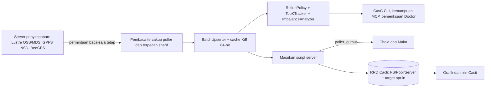

<!-- Source: README.md; SHA256: e88d6875d113220a91cfc0a9d230c829a78477b17e6aa7e44dda38c9591c86ad -->

<!-- translations:start -->
[English](../../../README.md) | [简体中文](../zh-CN/README.md) | [हिन्दी](../hi-IN/README.md) | [Español (España)](../es-ES/README.md) | [Español (Latinoamérica)](../es-419/README.md) | [العربية (السعودية)](../ar-SA/README.md) | [Afrikaans](../af-ZA/README.md) | [አማርኛ](../am-ET/README.md) | [العربية (مصر)](../ar-EG/README.md) | [العربية (المغرب)](../ar-MA/README.md) | [Български](../bg-BG/README.md) | [বাংলা](../bn-BD/README.md) | [Bosanski](../bs-BA/README.md) | [Deutsch](../de-DE/README.md) | [Ελληνικά](../el-GR/README.md) | [فارسی](../fa-IR/README.md) | [Filipino](../fil-PH/README.md) | [Français](../fr-FR/README.md) | [Français (Maroc)](../fr-MA/README.md) | [Français (Sénégal)](../fr-SN/README.md) | [Hausa](../ha-NG/README.md) | [עברית](../he-IL/README.md) | [Hrvatski](../hr-HR/README.md) | [Bahasa Indonesia](README.md) | [Igbo](../ig-NG/README.md) | [Italiano](../it-IT/README.md) | [日本語](../ja-JP/README.md) | [ქართული](../ka-GE/README.md) | [한국어](../ko-KR/README.md) | [Latviešu](../lv-LV/README.md) | [Malagasy](../mg-MG/README.md) | [मराठी](../mr-IN/README.md) | [Bahasa Melayu](../ms-MY/README.md) | [Nederlands](../nl-NL/README.md) | [Polski](../pl-PL/README.md) | [Português (Brasil)](../pt-BR/README.md) | [Português (Portugal)](../pt-PT/README.md) | [Русский](../ru-RU/README.md) | [Kinyarwanda](../rw-RW/README.md) | [Soomaali](../so-SO/README.md) | [Српски](../sr-RS/README.md) | [Svenska](../sv-SE/README.md) | [Kiswahili](../sw-KE/README.md) | [தமிழ்](../ta-IN/README.md) | [తెలుగు](../te-IN/README.md) | [ไทย](../th-TH/README.md) | [Türkçe](../tr-TR/README.md) | [Українська](../uk-UA/README.md) | [اردو](../ur-PK/README.md) | [Tiếng Việt](../vi-VN/README.md) | [isiXhosa](../xh-ZA/README.md) | [Yorùbá](../yo-NG/README.md) | [繁體中文](../zh-TW/README.md) | [isiZulu](../zu-ZA/README.md)
<!-- translations:end -->

# plugin_pfs

Plugin Cacti 1.2 yang membawa pemantauan kesehatan sistem berkas paralel, kapasitas, ketidakseimbangan pengisian, throughput per target, dan laju operasi metadata ke dalam Cacti di Lustre, IBM Storage Scale (GPFS), dan BeeGFS di balik antarmuka `Backend` terpadu. Setiap sistem berkas dipetakan ke perangkat Cacti biasa dengan kueri data, grafik ikhtisar dan grafik target sesuai permintaan, serta pengukur ringkasan sehingga Thold dan Maint dapat memicu peringatan dan menekannya tanpa perubahan.

> **Status: fase 1 hingga 3 dan primitif penskalaan exascale telah diimplementasikan dalam kode, belum dirilis.** Fondasi, observasi Lustre, peringatan dan penekanan Maint, driver baca-saja GPFS dan BeeGFS, analisis ketidakseimbangan OST/MDT dengan integrasi Maint, pembatasan cakupan pengumpul data jarak jauh (`replicate_out`, `remote_agent`), primitif penskalaan 100+ PB / exascale (`FramedReportParser`, Skema v4 `value_kib`, `RollupPolicy`, `TopKTracker`, `ShardAssigner`, `BatchUpserter`), CLI operator CasC (`cli/pfs.php`), dan hook ekosistem (`abilities_register`, `doctor_register_checks`, `casc_register_providers`) telah diimplementasikan dan diverifikasi melalui pengujian unit, keamanan, dan integrasi Cacti sementara. Seluruh pengujian sejauh ini menggunakan keluaran node tiruan alih-alih perangkat keras Lustre, GPFS, atau BeeGFS yang sebenarnya. Hal yang masih terbuka sebelum menandai rilis: uji coba pada sistem berkas nyata ([rencana uji coba](../../pilot-plan.md)), tinjauan keamanan eksternal ([tinjauan mandiri](../../security-review.md)), dan pengukuran skala pada perangkat keras terdokumentasi ([skala](../../research/scale.md)). Versi 0.1.0 telah disiapkan pada `INFO` dan [CHANGELOG.md](../../../CHANGELOG.md), tetapi belum diberi tag.

## Peran akses

| Realm | Akses |
| --- | --- |
| Parallel Filesystem View | Halaman pemantauan yang ada. |
| Parallel Filesystem Operator | Pemantauan ditambah halaman Operasi dan pengakuan triase pribadi. |
| Parallel Filesystem Admin | Akses Operator ditambah konfigurasi yang ada dan tindakan administratif. |

Setelah menyalin berkas pembaruan, buka halaman Plugins sebagai administrator untuk
mendaftarkan realm baru. Tetapkan realm Operator secara eksplisit di bawah **Configuration > Users** atau grup pengguna.
Pembaruan mempertahankan ID realm dan izin View serta Admin yang sudah ada. Akses Admin
mewarisi akses Operator, dan akses Operator mewarisi akses View pada setiap permintaan;
hal ini tidak menambahkan izin tersimpan pada pengguna atau grup. Pengaturan plugin juga memerlukan
akses Parallel Filesystem Admin selain izin Settings milik Cacti.

Izin perangkat Cacti tetap membatasi baris dan tindakan yang tersedia bagi setiap pengguna; objek yang belum dipetakan memerlukan administrator.
Kredensial, konfigurasi, pemetaan, penghapusan, dan perubahan administratif lainnya
tetap berada di halaman administratif. Pengakuan hanya berlaku dalam sesi
pengguna saat ini, paling lama satu jam dan hanya selama observasi yang sama tetap
segar. Observasi baru atau yang berubah akan membatalkannya. Pengakuan tidak pernah menandai pengukuran
yang gagal sebagai sehat atau menekan peringatan.

## Latar belakang

Ketika sistem berkas bersama berjalan lambat, buktinya tersebar di beberapa server. Lustre menyimpan penghitungnya per node: `lctl get_param` melaporkan nilai "pada node lokal", sehingga setiap object storage server (OSS) dan metadata server (MDS) hanya menyimpan angka milik targetnya sendiri. Operator yang menyelidiki sistem berkas lambat memerlukan tiga jawaban dari tempat yang berbeda:

- **Apakah satu target terisi penuh sementara yang lain kosong?** Ketidakseimbangan pengisian memengaruhi tempat berkas baru ditempatkan dan kapan satu target kehabisan ruang.
- **Target atau operasi mana yang sibuk?** Penghitung byte per target dan penghitung operasi per MDT menunjukkan apakah beban terikat pada data atau terikat pada metadata.
- **Apakah pemantauannya sendiri masih mutakhir?** Grafik yang datar hanya meyakinkan apabila plugin benar-benar dapat menjangkau server.

Cacti membuat grafik host dan menetapkan ambang batas nilai menggunakan Thold, sementara organisasi GitHub Cacti tidak memiliki repositori untuk pemantauan Lustre, GPFS, atau BeeGFS (diperiksa pada 2026-11-14). Plugin ini menutup celah tersebut dengan membaca nilai baca-saja yang masuk daftar izin dari node penyimpanan dan merepresentasikan setiap sistem berkas sebagai perangkat Cacti yang targetnya menjadi indeks kueri data. Plugin ini memanfaatkan kembali pembuatan grafik, izin, pengumpul data jarak jauh, Thold, dan Maint milik Cacti alih-alih membangun versi paralelnya.

## Ruang lingkup yang direncanakan

| Fase | Ruang lingkup | Status | Tonggak pencapaian |
|---|---|---|---|
| 0, riset | Matriks rilis, keputusan akses node, konfirmasi perilaku upstream, perilaku penghitung dan failover, pengukuran skala | Selesai | [M1](https://github.com/somethingwithproof/plugin_pfs/milestone/1) |
| 1, observasi | Inventaris Lustre, kapasitas dan pengisian, ketidakseimbangan OST/MDT (`lib/ImbalanceAnalyzer.php`), integrasi Maint (`lib/HealthPage.php`), throughput OST, laju operasi MDT, grafik, peringatan Thold, halaman kesehatan | Diimplementasikan (diuji dengan fixture) | [M2](https://github.com/somethingwithproof/plugin_pfs/milestone/2), [M3](https://github.com/somethingwithproof/plugin_pfs/milestone/3), [M4](https://github.com/somethingwithproof/plugin_pfs/milestone/4) |
| 2, jarak jauh dan skala | Pengumpulan jarak jauh tercakup pada poller (`lib/Reader.php`, `lib/ReplicationRepository.php`, `replicate_out`, `remote_agent`), primitif penskalaan 100+ PB (kebersihan KiB 64-bit + Skema v4 `value_kib`, `lib/RollupPolicy.php`, `lib/TopKTracker.php`, `lib/ShardAssigner.php` + `poller_pfs.php --shard=K/N`, `lib/BatchUpserter.php`), CLI CasC (`cli/pfs.php`), hook MCP/Doctor/CasC | Diimplementasikan (diuji unit dan integrasi CI) | [M5](https://github.com/somethingwithproof/plugin_pfs/milestone/5) |
| 3, backend | Driver baca-saja IBM Storage Scale (GPFS) (`lib/GpfsBackend.php`) dan BeeGFS (`lib/BeegfsBackend.php`) yang terdaftar pada `BackendRegistry::production()` | Diimplementasikan (diuji unit) | [M6](https://github.com/somethingwithproof/plugin_pfs/milestone/6) |

Primitif utama operator dan penskalaan yang telah diimplementasikan:

- **Driver baca-saja multi-sistem berkas:** `LustreBackend`, `GpfsBackend` (hanya `mmpmon` berbingkai `fs_io_s`/`io_s` dengan larangan `reset`, kapasitas/status pool `mmdf`, dan ringkasan waiter), dan `BeegfsBackend` (target penyimpanan/metadata BeeGFS 7.4 dan 8.x dengan konversi byte ke KiB yang tepat, pemetaan kondisi keterjangkauan/konsistensi, dan semantik pengukur per interval) yang berbagi `lib/FramedReportParser.php`.
- **Kesadaran ketidakseimbangan, ruang tersisa, dan Maint:** `lib/ImbalanceAnalyzer.php` menghitung rasio pengisian OST/MDT, sebaran, indeks ketidakseimbangan simpangan baku populasi, ruang tersisa, penegakan kesegaran 1 interval (`missing_targets`), penanda status per target, dan Top-K target timpang yang dibatasi. `HealthPage` (`pfs_health.php`) dan `CascProvider::health()` menampilkan jendela pemeliharaan `Maint` Cacti serta menekan peringatan kegagalan aktif selama pemeliharaan terjadwal.
- **Penskalaan 100+ PB dan exascale** ([docs/architecture/exascale-scaling.md](../../architecture/exascale-scaling.md)): konversi desimal byte ke KiB yang tepat (`FramedReportParser::bytesToKibInt()`) yang terverifikasi pada 500 PB dan 2 EB bersama kolom `BIGINT UNSIGNED value_kib` (Skema v4); rollup RRD hierarkis `Filesystem -> Pool -> Storage Server` dengan promosi target opt-in/sibuk/timpang yang dibatasi (`lib/RollupPolicy.php`); Top-K target timpang terbatas $O(K)$ serta ringkasan pekerjaan/klien berat yang telah diagregasi sebelumnya (`lib/TopKTracker.php`, tanpa pernah membuat perangkat atau RRD per klien); sharding pengumpul CRC32 deterministik (`lib/ShardAssigner.php`, `php plugins/pfs/poller_pfs.php [--poller=N] [--shard=K/N] [--force] [--debug]`); serta upsert SQL per batch berisi 500 baris ditambah paginasi keyset (`lib/BatchUpserter.php`, `CacheRepository::upsertObservationsBatch()`, `TargetRepository::forFilesystemPage()`).
- **CLI operator CasC dan hook ekosistem:** `cli/pfs.php` mendukung `export [--format=yaml|xml]`, `validate <file> [--format=yaml|xml]`, `plan <file> [--format=yaml|xml] [--output=text|json]`, `apply <file> --confirm=<PLAN_HASH> [--format=yaml|xml]`, dan `health [--format=text|json]` tanpa ketergantungan Composer eksternal. `setup.php` dan `lib/EcosystemIntegration.php` mendaftarkan `abilities_register` (`pfs-list-filesystems`, `pfs-get-imbalance`, `pfs-get-health`; baca-saja, dibatasi oleh `Parallel Filesystem View` dan izin perangkat Cacti), `doctor_register_checks` (`pfs_schema`, `pfs_reader_freshness`, `pfs_capacity_imbalance`), `casc_register_providers`, `replicate_out`, dan `remote_agent`.

Di luar ruang lingkup: operasi tulis, hapus, atur ulang, atau penyetelan apa pun pada node atau sistem berkas; mesin peringatan milik plugin sendiri; daemon atau protokol jaringan khusus; perangkat atau RRD Cacti per pekerjaan atau per klien; perubahan pada inti Cacti, Thold, atau Maint.

## Target kompatibilitas

| Komponen | Target |
|---|---|
| Cacti | 1.2.31 atau lebih baru, tanpa patch inti |
| PHP | 8.2 atau lebih baru; `setup.php`, `poller_pfs.php`, dan `cli/pfs.php` tetap dapat diurai pada 8.0 sehingga runtime yang tidak didukung menerima penolakan alih-alih merusak antarmuka Cacti |
| Lustre | Sumber dan manual diperiksa pada versi 2.17.0; diuji dengan fixture |
| GPFS, BeeGFS | Driver baca-saja IBM Storage Scale (GPFS) 5.x `mmpmon`/`mmdf` dan BeeGFS 7.4 / 8.x telah diimplementasikan dan diuji dengan fixture |
| Thold, Maint | Thold 1.8.2 dan Maint 1.3, tanpa perubahan |

## Desain

- [docs/architecture/exascale-scaling.md](../../architecture/exascale-scaling.md) mendokumentasikan arsitektur telemetri dua tingkat 100+ PB / exascale (tingkat server + rollup + Top-K Cacti/`plugin_pfs` yang dipasangkan dengan telemetri klien di luar jalur LDMS/Darshan/TOKIO) beserta konteks literatur akademisnya.
- [docs/PLAN.md](../../PLAN.md) adalah rencana lengkap: arsitektur, fakta upstream yang menjadi dasar (beserta sumber dan hal yang belum terverifikasi), semantik penghitung, model status, batas keamanan, perhitungan kinerja, pengujian, dan risiko.
- [docs/operator-guide.md](../../operator-guide.md) mencakup pemasangan, grafik dan nilai, pembaruan, pencadangan dan pemulihan, pencopotan, serta pemecahan masalah; [docs/alerting.md](../../alerting.md) mencakup Thold dan Maint.
- [docs/node-setup.md](../../node-setup.md) menjelaskan cara menyiapkan server Lustre dan poller untuk pembaca.
- [docs/decisions/](../../decisions) menyimpan catatan keputusan arsitektur untuk pilihan yang sudah ditetapkan.
- [docs/REQUIREMENTS.md](../../REQUIREMENTS.md) memetakan setiap ID persyaratan ke isu terkait.

## Cara kerja dilacak

- **Tonggak pencapaian** mengikuti tonggak pencapaian rencana. Masing-masing memiliki isu epik yang mencantumkan sub-isu serta bukti keluarannya.
- **Isu** dikategorikan berdasarkan label: `type: requirement`, `type: research`, `type: decision`, `type: epic`. Isu persyaratan menyatakan persyaratan bernomor yang dapat diuji (`REQ-AREA-NNN`) dan kriteria penerimaan.
- **Label** juga memuat `area:`, `phase:`, `priority:`, dan `status:`. Lihat [CONTRIBUTING.md](../../../CONTRIBUTING.md#labels).
- [Papan proyek](https://github.com/users/somethingwithproof/projects/11) menampilkan seluruh isu lintas tonggak pencapaian.

## Berkontribusi

Baca [CONTRIBUTING.md](../../../CONTRIBUTING.md). Commit memerlukan penandatanganan DCO. Diskusi desain berlangsung pada isu; keputusan yang masih terbuka membawa label `type: decision`.

## Keamanan

Laporkan kerentanan secara pribadi; lihat [SECURITY.md](../../../SECURITY.md).

## Lisensi

GNU General Public License v2.0, lisensi yang sama dengan Cacti dan pluginnya. Lihat [LICENSE](../../../LICENSE).
