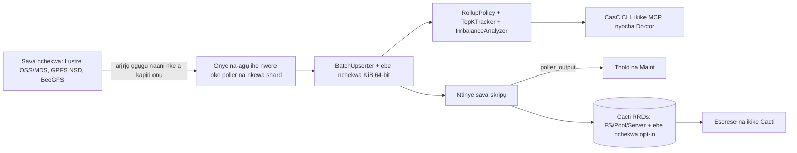

<!-- Source: README.md; SHA256: e88d6875d113220a91cfc0a9d230c829a78477b17e6aa7e44dda38c9591c86ad -->

<!-- translations:start -->
[English](../../../README.md) | [简体中文](../zh-CN/README.md) | [हिन्दी](../hi-IN/README.md) | [Español (España)](../es-ES/README.md) | [Español (Latinoamérica)](../es-419/README.md) | [العربية (السعودية)](../ar-SA/README.md) | [Afrikaans](../af-ZA/README.md) | [አማርኛ](../am-ET/README.md) | [العربية (مصر)](../ar-EG/README.md) | [العربية (المغرب)](../ar-MA/README.md) | [Български](../bg-BG/README.md) | [বাংলা](../bn-BD/README.md) | [Bosanski](../bs-BA/README.md) | [Deutsch](../de-DE/README.md) | [Ελληνικά](../el-GR/README.md) | [فارسی](../fa-IR/README.md) | [Filipino](../fil-PH/README.md) | [Français](../fr-FR/README.md) | [Français (Maroc)](../fr-MA/README.md) | [Français (Sénégal)](../fr-SN/README.md) | [Hausa](../ha-NG/README.md) | [עברית](../he-IL/README.md) | [Hrvatski](../hr-HR/README.md) | [Bahasa Indonesia](../id-ID/README.md) | [Igbo](README.md) | [Italiano](../it-IT/README.md) | [日本語](../ja-JP/README.md) | [ქართული](../ka-GE/README.md) | [한국어](../ko-KR/README.md) | [Latviešu](../lv-LV/README.md) | [Malagasy](../mg-MG/README.md) | [मराठी](../mr-IN/README.md) | [Bahasa Melayu](../ms-MY/README.md) | [Nederlands](../nl-NL/README.md) | [Polski](../pl-PL/README.md) | [Português (Brasil)](../pt-BR/README.md) | [Português (Portugal)](../pt-PT/README.md) | [Русский](../ru-RU/README.md) | [Kinyarwanda](../rw-RW/README.md) | [Soomaali](../so-SO/README.md) | [Српски](../sr-RS/README.md) | [Svenska](../sv-SE/README.md) | [Kiswahili](../sw-KE/README.md) | [தமிழ்](../ta-IN/README.md) | [తెలుగు](../te-IN/README.md) | [ไทย](../th-TH/README.md) | [Türkçe](../tr-TR/README.md) | [Українська](../uk-UA/README.md) | [اردو](../ur-PK/README.md) | [Tiếng Việt](../vi-VN/README.md) | [isiXhosa](../xh-ZA/README.md) | [Yorùbá](../yo-NG/README.md) | [繁體中文](../zh-TW/README.md) | [isiZulu](../zu-ZA/README.md)
<!-- translations:end -->

# plugin_pfs

Ngwa mgbakwunye Cacti 1.2 nke na-eweta ahụike sistemụ faịlụ yiri onwe ha (parallel filesystem), ikike nchekwa, enweghị nhata nke ndọju, ngafe data maka ebe nchekwa nke ọ bụla, na ọnụọgụgụ ọrụ metadata n'ime Cacti gafee Lustre, IBM Storage Scale (GPFS), na BeeGFS n'azụ njikọ `Backend` jikọtara ọnụ. Sistemụ faịlụ nke ọ bụla na-amapụ na ngwaọrụ Cacti nkịtị nwere ajụjụ data, eserese nchịkọta na eserese ebe nchekwa mgbe a chọrọ, na ihe nrịbama nchịkọta ka Thold na Maint wee na-ezipụ ọkwa ma na-egbochi ha n'agbanweghị ihe ọ bụla.

> **Ọnọdụ: etinyerela ngalaba 1 ruo 3 na ngwaọrụ mbuli oke exascale n'ime koodu, ewepụtabeghị ya.** Ntọala, nlele Lustre, ịkụ ọkwa na mgbochi Maint, draịva ọgụgụ naanị nke GPFS na BeeGFS, nyocha enweghị nhata OST/MDT jikọtara na Maint, nhazi mpaghara ndị na-anakọta data dịpụrụ adịpụ (`replicate_out`, `remote_agent`), ngwaọrụ mbuli oke 100+ PB / exascale (`FramedReportParser`, Schema v4 `value_kib`, `RollupPolicy`, `TopKTracker`, `ShardAssigner`, `BatchUpserter`), CasC operator CLI (`cli/pfs.php`), na njikọ gburugburu (`abilities_register`, `doctor_register_checks`, `casc_register_providers`) ka etinyere ma jiri nnwale nkeji (unit), nchekwa, na njikọta na Cacti a na-atụfu atụfu kwado. Nnwale niile ruo ugbu a na-eji mpụta nọdụ nyocha (fixture) kama iji ngwaike Lustre, GPFS, ma ọ bụ BeeGFS dị ndụ. Ihe ka ghere oghe tupu itinye akara mwepụta: nnwale mbụ na sistemụ faịlụ n'ezie ([atụmatụ nnwale mbụ](../../pilot-plan.md)), nnyocha nchekwa sitere n'èzí ([nnyocha onwe](../../security-review.md)), na nha oke na ngwaike e dekọrọ ([nha oke](../../research/scale.md)). A kwadebere ụdị 0.1.0 na `INFO` na [CHANGELOG.md](../../../CHANGELOG.md) mana etinyebeghị ya akara (tag).

## Ọrụ nnweta

| Mpaghara ikike | Nnweta |
| --- | --- |
| Parallel Filesystem View | Ibe nlekọta dị adị. |
| Parallel Filesystem Operator | Nlekọta tinyere ibe Ọrụ (Operations) na nkwenye nyocha nke onwe. |
| Parallel Filesystem Admin | Nnweta Operator tinyere nhazi dị adị na omume nchịkwa. |

Mgbe i mepụtara oyiri faịlụ nkwalite, mepee ibe Plugins dị ka onye nchịkwa iji debanye aha mpaghara ikike ọhụrụ ahụ. Nye mpaghara ikike Operator n'ụzọ doro anya n'okpuru **Configuration > Users** ma ọ bụ otu ndị ọrụ. Nkwalite na-ejigide ID mpaghara ikike View na Admin dị adị na ikike e nyere ha. Nnweta Admin na-eketa nnweta Operator, na nnweta Operator na-eketa nnweta View na arịrịọ nke ọ bụla; nke a anaghị agbakwunye ikike e chekwara nye ndị ọrụ ma ọ bụ otu. Ntọala ngwa mgbakwunye chọkwara nnweta Parallel Filesystem Admin na mgbakwunye na ikike Settings nke Cacti.

Ikike ngwaọrụ Cacti ka na-egbochi ahịrị na omume dịịrị onye ọrụ nke ọ bụla; ihe ndị na-enweghị njikọ (unmapped objects) chọrọ onye nchịkwa. Asambodo nzuzo, nhazi, njikọ, nhichapụ na mgbanwe nchịkwa ndị ọzọ ka nọ na ibe nchịkwa. Nkwenye (Acknowledgments) na-adịgide naanị n'oge nnọkọ onye ọrụ ugbu a, maka otu awa kachasị na naanị mgbe otu nlele ahụ ka dị ọhụrụ. Nlele ọhụrụ ma ọ bụ nke gbanwere agbanwe na-emebi ikike ha. Ha anaghị akara nha dara ada dị ka nke dị mma ma ọ bụ gbochie ọkwa.

## Ihe kpatara ya

Mgbe sistemụ faịlụ a na-ekerịta na-adị nwayọọ, ihe akaebe na-agbasa n'ofe sava dị iche iche. Lustre na-echekwa ndị na-agụ ọnụ ya maka nọdụ nke ọ bụla: `lctl get_param` na-akọ ọnụọgụgụ "na nọdụ mpaghara", ya mere sava nchekwa ihe nke ọ bụla (OSS) na sava metadata nke ọ bụla (MDS) na-ejide naanị ọnụọgụgụ nke ebe nchekwa nke ya. Onye ọrụ na-enyocha sistemụ faịlụ na-adị nwayọọ chọrọ azịza atọ sitere n'ebe dị iche iche:

- **Otu ebe nchekwa ọ na-eju ebe ndị ọzọ tọgbọrọ chakoo?** Enweghị nhata nke ndọju na-agbanwe ebe faịlụ ọhụrụ na-ada na mgbe otu ebe nchekwa ga-agwụcha ohere.
- **Ebe nchekwa ma ọ bụ ọrụ ndị dị aṅaa na-arụsi ọrụ ike?** Ndị na-agụ ọnụ byte maka ebe nchekwa nke ọ bụla na ndị na-agụ ọnụ ọrụ maka MDT nke ọ bụla na-egosi ma ibu ọrụ ọ bụ nke data ma ọ bụ nke metadata.
- **Nlekọta ahụ n'onwe ya ọ bụ nke ugbu a?** Eserese dị larịị na-enye nkasi obi naanị ma ọ bụrụ na ngwa mgbakwunye ahụ nwere ike ịhụ sava ndị ahụ.

Cacti na-ese eserese ndị ọbịa (hosts) ma na-edozi oke ọnụọgụgụ na Thold, na nzukọ GitHub nke Cacti enweghị ebe nchekwa koodu maka nlekọta Lustre, GPFS, ma ọ bụ BeeGFS (a chọrọ na 2026-11-14). Ngwa mgbakwunye a na-emechi oghere ahụ site n'ịgụ ọnụọgụgụ a kwadoro maka ọgụgụ naanị site na nọdụ nchekwa ma na-anọchi anya sistemụ faịlụ nke ọ bụla dị ka ngwaọrụ Cacti nke ebe nchekwa ya bụ ndị ntụaka nke ajụjụ data. Ọ na-eji usoro eserese, ikike, ndị na-anakọta data dịpụrụ adịpụ, Thold, na Maint nke Cacti eme ihe kama iwulite ụdị yiri ha dị iche.

## Oke ọrụ a tụrụ anya

| Ngalaba | Oke ọrụ | Ọnọdụ | Akụkụ ọrụ (Milestones) |
|---|---|---|---|
| 0, nnyocha | Tebụl mwepụta, mkpebi nnweta nọdụ, nkwenye omume upstream, omume ndị na-agụ ọnụ na failover, nha oke | Emechaala | [M1](https://github.com/somethingwithproof/plugin_pfs/milestone/1) |
| 1, nlele | Ndepụta ngwa Lustre, ikike nchekwa na ndọju, enweghị nhata OST/MDT (`lib/ImbalanceAnalyzer.php`), njikọ Maint (`lib/HealthPage.php`), ngafe data OST, ọnụọgụgụ ọrụ MDT, eserese, ịkụ ọkwa Thold, ibe ahụike | Etinyere (a nwalere na fixture) | [M2](https://github.com/somethingwithproof/plugin_pfs/milestone/2), [M3](https://github.com/somethingwithproof/plugin_pfs/milestone/3), [M4](https://github.com/somethingwithproof/plugin_pfs/milestone/4) |
| 2, nchịkọta dịpụrụ adịpụ na nha oke | Nchịkọta dịpụrụ adịpụ nwere oke poller (`lib/Reader.php`, `lib/ReplicationRepository.php`, `replicate_out`, `remote_agent`), ngwaọrụ mbuli oke 100+ PB (ịdị ọcha KiB 64-bit + Schema v4 `value_kib`, `lib/RollupPolicy.php`, `lib/TopKTracker.php`, `lib/ShardAssigner.php` + `poller_pfs.php --shard=K/N`, `lib/BatchUpserter.php`), CasC CLI (`cli/pfs.php`), njikọ MCP/Doctor/CasC | Etinyere (a nwalere na nnwale nkeji na njikọta CI) | [M5](https://github.com/somethingwithproof/plugin_pfs/milestone/5) |
| 3, backends | Draịva ọgụgụ naanị nke IBM Storage Scale (GPFS) (`lib/GpfsBackend.php`) na BeeGFS (`lib/BeegfsBackend.php`) edebanyere aha na `BackendRegistry::production()` | Etinyere (a nwalere na nnwale nkeji) | [M6](https://github.com/somethingwithproof/plugin_pfs/milestone/6) |

Isi ngwaọrụ onye ọrụ na mbuli oke etinyere n'ọrụ:

- **Draịva ọgụgụ naanị maka sistemụ faịlụ dị iche iche:** `LustreBackend`, `GpfsBackend` (`mmpmon` `fs_io_s`/`io_s` nwere okpokoro naanị ebe amachibidoro `reset`, ikike/ọnọdụ pool `mmdf`, na nchịkọta ndị na-eche), na `BeegfsBackend` (ebe nchekwa/metadata BeeGFS 7.4 na 8.x nwere ntụgharị byte gaa na KiB ziri ezi, njikọta ọnọdụ nnweta/nkwekọrịta, na nkọwa ihe nrịbama maka oge nke ọ bụla) na-ekerịta `lib/FramedReportParser.php`.
- **Nghọta enweghị nhata, ohere fọdụrụnụ, na Maint:** `lib/ImbalanceAnalyzer.php` na-agbakọ oke ndọju OST/MDT, mgbasa, nrịbama enweghị nhata site na standard deviation nke igwe, ohere fọdụrụnụ, mmanye ịdị ọhụrụ nke otu oge (`missing_targets`), akara ọnọdụ maka ebe nchekwa nke ọ bụla, na Top-K ebe nchekwa kachasị adịghị nhata nwere oke. `HealthPage` (`pfs_health.php`) na `CascProvider::health()` na-egosi oge mmezi `Maint` nke Cacti ma na-egbochi ịdọ aka ná ntị ọdịda na-arụ ọrụ n'oge mmezi a haziri ahazi.
- **Mbuli oke 100+ PB na exascale** ([docs/architecture/exascale-scaling.md](../../architecture/exascale-scaling.md)): ntụgharị decimal byte gaa na KiB ziri ezi (`FramedReportParser::bytesToKibInt()`) kwadoro na 500 PB na 2 EB n'akụkụ kọlụm `BIGINT UNSIGNED value_kib` (Schema v4); nchịkọta RRD nke nwere usoro ọkwa `Filesystem -> Pool -> Storage Server` nwere nkwado nkwalite ebe nchekwa opt-in/dị ọkụ/na-adịghị nhata nwere oke (`lib/RollupPolicy.php`); Top-K nwere oke $O(K)$ maka ebe nchekwa na-adịghị nhata na nchịkọta ọrụ/ndị ahịa dị arọ a chịkọtara tupu oge eruo (`lib/TopKTracker.php`, na-emepụtaghị ngwaọrụ ma ọ bụ RRD maka onye ahịa nke ọ bụla); nkewa CRC32 doro anya nke ndị na-anakọta data (`lib/ShardAssigner.php`, `php plugins/pfs/poller_pfs.php [--poller=N] [--shard=K/N] [--force] [--debug]`); na ntinye/mmelite SQL n'ìgwè nke ahịrị 500 tinyere keyset pagination (`lib/BatchUpserter.php`, `CacheRepository::upsertObservationsBatch()`, `TargetRepository::forFilesystemPage()`).
- **CasC CLI onye ọrụ na njikọ gburugburu:** `cli/pfs.php` na-akwado `export [--format=yaml|xml]`, `validate <file> [--format=yaml|xml]`, `plan <file> [--format=yaml|xml] [--output=text|json]`, `apply <file> --confirm=<PLAN_HASH> [--format=yaml|xml]`, na `health [--format=text|json]` n'enweghị ndabere Composer si n'èzí. `setup.php` na `lib/EcosystemIntegration.php` na-edebanye aha `abilities_register` (`pfs-list-filesystems`, `pfs-get-imbalance`, `pfs-get-health`; ọgụgụ naanị, nke `Parallel Filesystem View` na ikike ngwaọrụ Cacti na-achịkwa), `doctor_register_checks` (`pfs_schema`, `pfs_reader_freshness`, `pfs_capacity_imbalance`), `casc_register_providers`, `replicate_out`, na `remote_agent`.

Ihe na-abụghị n'oke ọrụ: ọrụ ide ihe, ihichapụ, ịtọgharị, ma ọ bụ idozi ihe ọ bụla na nọdụ ma ọ bụ sistemụ faịlụ; injin ịkụ ọkwa nke ngwa mgbakwunye nwe; daemon pụrụ iche ma ọ bụ usoro netwọkụ; ngwaọrụ Cacti ma ọ bụ RRD maka ọrụ nke ọ bụla ma ọ bụ onye ahịa nke ọ bụla; mgbanwe na isi Cacti, Thold, ma ọ bụ Maint.

## Ebe ndakọrịta ezubere

| Akụrụngwa | Ebumnuche |
|---|---|
| Cacti | 1.2.31 ma ọ bụ karịa, enweghị mgbanwe isi koodu (core patches) |
| PHP | 8.2 ma ọ bụ karịa; `setup.php`, `poller_pfs.php`, na `cli/pfs.php` na-anọgide na-enwe ike ịgụ na 8.0 ka usoro runtime na-akwadoghị wee nata ajụ kama imebi ihu njikọ Cacti |
| Lustre | E nyochara koodu isi mmalite na akwụkwọ ntuziaka na 2.17.0; a nwalere na fixture |
| GPFS, BeeGFS | Etinyere ma nwalee draịva ọgụgụ naanị nke IBM Storage Scale (GPFS) 5.x `mmpmon`/`mmdf` na BeeGFS 7.4 / 8.x na fixture |
| Thold, Maint | Thold 1.8.2 na Maint 1.3, agbanwebeghị ha |

## Nhazi usoro

- [docs/architecture/exascale-scaling.md](../../architecture/exascale-scaling.md) na-edekọ nhazi usoro telemetry ọkwa abụọ maka 100+ PB / exascale (sava Cacti/`plugin_pfs` + nchịkọta + ọkwa Top-K jikọtara na telemetry onye ahịa na-abụghị band nke LDMS/Darshan/TOKIO) na ọnọdụ ya n'akwụkwọ agụmakwụkwọ.
- [docs/PLAN.md](../../PLAN.md) bụ atụmatụ zuru oke: nhazi usoro, eziokwu upstream ọ dabere na ya (ya na isi mmalite na ihe ndị a na-enyochabeghị), nkọwa ndị na-agụ ọnụ, ụdị ọnọdụ, oke nchekwa, mgbakọ na mwepụ arụmọrụ, nnwale, na ihe ize ndụ.
- [docs/operator-guide.md](../../operator-guide.md) na-ekpuchi ntinye, eserese na ọnụọgụgụ, nkwalite, ndabere (backup) na iweghachi, mwepụ, na idozi nsogbu; [docs/alerting.md](../../alerting.md) na-ekpuchi Thold na Maint.
- [docs/node-setup.md](../../node-setup.md) na-akọwa otu esi akwado sava Lustre na poller maka onye na-agụ ihe.
- [docs/decisions/](../../decisions) nwere ndekọ mkpebi nhazi usoro maka nhọrọ ndị e merela.
- [docs/REQUIREMENTS.md](../../REQUIREMENTS.md) na-ejikọ ID ihe achọrọ nke ọ bụla na okwu (issue) ya.

## Otu esi eso ọrụ

- **Akụkụ ọrụ (Milestones)** na-eso akụkụ ọrụ nke atụmatụ ahụ. Nke ọ bụla nwere okwu epic nke depụtara okwu nta ya na ihe akaebe mmecha.
- **Okwu (Issues)** ka e ji akara hazie: `type: requirement`, `type: research`, `type: decision`, `type: epic`. Okwu ihe achọrọ na-ekwu ihe achọrọ nwere nọmba nke a pụrụ ịnwale (`REQ-AREA-NNN`) na ụkpụrụ nnabata.
- **Akara (Labels)** na-ebukwa `area:`, `phase:`, `priority:`, na `status:`. Hụ [CONTRIBUTING.md](../../../CONTRIBUTING.md#labels).
- [Bọọdụ ọrụ](https://github.com/users/somethingwithproof/projects/11) na-egosi okwu niile gafee akụkụ ọrụ dị iche iche.

## Ntinye aka

Gụọ [CONTRIBUTING.md](../../../CONTRIBUTING.md). Ntinye koodu (commits) chọrọ nkwenye mbinye aka DCO. Mkparịta ụka nhazi usoro na-eme na okwu (issues); mkpebi ghere oghe na-ebu akara `type: decision`.

## Nchekwa

Kọọ adịghị ike nchekwa na nzuzo; hụ [SECURITY.md](../../../SECURITY.md).

## Ikikere

GNU General Public License v2.0, otu ikikere ahụ dị ka Cacti na ngwa mgbakwunye ya. Hụ [LICENSE](../../../LICENSE).
