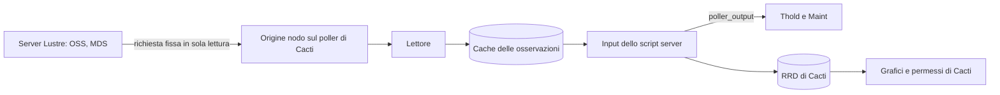

<!-- Source: README.md; SHA256: 40f2c5a5e9be97e4bd2b05a9ebab2a77de51de3af1b1c21dbeb5ee7f936cdd3b -->

<!-- translations:start -->
[English](../../../README.md) | [简体中文](../zh-CN/README.md) | [हिन्दी](../hi-IN/README.md) | [Español (España)](../es-ES/README.md) | [Español (Latinoamérica)](../es-419/README.md) | [العربية (السعودية)](../ar-SA/README.md) | [Afrikaans](../af-ZA/README.md) | [አማርኛ](../am-ET/README.md) | [العربية (مصر)](../ar-EG/README.md) | [العربية (المغرب)](../ar-MA/README.md) | [বাংলা](../bn-BD/README.md) | [Bosanski](../bs-BA/README.md) | [Deutsch](../de-DE/README.md) | [فارسی](../fa-IR/README.md) | [Filipino](../fil-PH/README.md) | [Français](../fr-FR/README.md) | [Français (Maroc)](../fr-MA/README.md) | [Français (Sénégal)](../fr-SN/README.md) | [Hausa](../ha-NG/README.md) | [עברית](../he-IL/README.md) | [Hrvatski](../hr-HR/README.md) | [Bahasa Indonesia](../id-ID/README.md) | [Igbo](../ig-NG/README.md) | [Italiano](README.md) | [日本語](../ja-JP/README.md) | [한국어](../ko-KR/README.md) | [Malagasy](../mg-MG/README.md) | [मराठी](../mr-IN/README.md) | [Bahasa Melayu](../ms-MY/README.md) | [Nederlands](../nl-NL/README.md) | [Polski](../pl-PL/README.md) | [Português (Brasil)](../pt-BR/README.md) | [Русский](../ru-RU/README.md) | [Kinyarwanda](../rw-RW/README.md) | [Soomaali](../so-SO/README.md) | [Српски](../sr-RS/README.md) | [Svenska](../sv-SE/README.md) | [Kiswahili](../sw-KE/README.md) | [தமிழ்](../ta-IN/README.md) | [తెలుగు](../te-IN/README.md) | [ไทย](../th-TH/README.md) | [Türkçe](../tr-TR/README.md) | [Українська](../uk-UA/README.md) | [اردو](../ur-PK/README.md) | [Tiếng Việt](../vi-VN/README.md) | [isiXhosa](../xh-ZA/README.md) | [Yorùbá](../yo-NG/README.md) | [繁體中文](../zh-TW/README.md) | [isiZulu](../zu-ZA/README.md)
<!-- translations:end -->

# plugin_pfs

Un plugin per Cacti 1.2 che porta in Cacti lo stato di salute e il carico dei filesystem paralleli: capacità e squilibrio di riempimento tra i target, throughput per singolo target e frequenza delle operazioni sui metadati. Lustre è il primo backend. GPFS (IBM Storage Scale) e BeeGFS seguono dietro un'interfaccia di backend. I dati confluiscono nei normali dispositivi, origini dati e grafici di Cacti, così Thold e Maint generano avvisi e li sopprimono senza alcuna modifica.

> **Stato: milestone 4, codice completo per la fase 1, non ancora rilasciato.** Le milestone 2 (fondamenta), 3 (osservazione di Lustre) e 4 (alerting e preparazione al rilascio) sono completate su `main` o in fase di revisione. Il plugin si installa, si aggiorna e si disinstalla tramite l'API dei plugin di Cacti e rifiuta versioni di PHP inferiori alla 8.2. Un lettore in background su ciascun poller legge i server Lustre tramite SSH utilizzando uno script fisso con forced-command ([node/pfs-read.sh](../../../node/pfs-read.sh)) e memorizza nella cache inventario, stato, capacità e contatori con il relativo livello di aggiornamento. Ciascun filesystem diventa un dispositivo Cacti con query dati OST e MDT, cinque grafici panoramici, grafici per singolo target su richiesta e un'origine dati riepilogativa per Thold. Thold v1.8.2 e Maint v1.3, senza modifiche, generano avvisi e sopprimono gli indicatori riepilogativi nell'esecuzione end-to-end; le soglie Thold sui contatori non sono supportate con Thold 1.8.2 ([docs/alerting.md](../../alerting.md)). Tutti i test finora eseguiti utilizzano output simulati di nodi in un'istanza Cacti usa e getta: il plugin non è ancora stato eseguito su un nodo Lustre reale. Restano aperti prima del rilascio: i progetti pilota su filesystem reali ([piano pilota](../../pilot-plan.md)), la revisione di sicurezza esterna ([autovalutazione](../../security-review.md)) e le misurazioni di scalabilità su hardware documentato ([scalabilità](../../research/scale.md)). La versione 0.1.0 è predisposta in `INFO` e [CHANGELOG.md](../../../CHANGELOG.md), ma non ancora taggata.

## Ruoli di accesso

| Ambito | Accesso |
| --- | --- |
| Parallel Filesystem View | Pagine di monitoraggio esistenti. |
| Parallel Filesystem Operator | Monitoraggio più la pagina Operations e le prese in carico personali per il triage. |
| Parallel Filesystem Admin | Accesso Operator più le pagine di configurazione esistenti e le azioni amministrative. |

Dopo aver copiato i file di aggiornamento, aprire la pagina Plugins come amministratore per registrare
il nuovo realm. Assegnare esplicitamente il realm Operator in **Configuration > Users** o nei gruppi di utenti.
Gli aggiornamenti mantengono gli ID e le autorizzazioni esistenti dei realm View e Admin. L'accesso Admin
eredita l'accesso Operator e l'accesso Operator eredita l'accesso View a ogni richiesta;
ciò non aggiunge autorizzazioni salvate a utenti o gruppi. Le impostazioni del plugin richiedono inoltre
l'accesso Parallel Filesystem Admin in aggiunta al permesso Settings di Cacti.

I permessi sui dispositivi di Cacti continuano a limitare le righe e le azioni disponibili per ciascun utente; gli oggetti non mappati richiedono un amministratore.
Credenziali, configurazione, mappatura, eliminazione e altre modifiche amministrative
restano nelle pagine di amministrazione. Le prese in carico (acknowledgment) durano solo nella sessione corrente
dell'utente, per al massimo un'ora e solo finché la stessa osservazione rimane
aggiornata. Osservazioni nuove o modificate le invalidano. Non contrassegnano mai come sana una misurazione
fallita né sopprimono gli avvisi.

## Motivazioni

Quando un filesystem condiviso è lento, le evidenze sono distribuite su più server. Lustre mantiene i propri contatori per singolo nodo: `lctl get_param` riporta i valori "sul nodo locale", quindi ciascun object storage server (OSS) e metadata server (MDS) conserva soltanto i dati dei propri target. Un operatore che indaga su un filesystem lento ha bisogno di tre risposte provenienti da punti diversi:

- **Un target si sta riempiendo mentre gli altri sono vuoti?** Lo squilibrio di riempimento influisce su dove vengono scritti i nuovi file e su quando un singolo target esaurisce lo spazio.
- **Quali target o operazioni sono più carichi?** I contatori di byte per singolo target e i contatori di operazioni per singolo MDT mostrano se il carico è dovuto ai dati o ai metadati.
- **Il monitoraggio stesso è aggiornato?** Un grafico piatto è rassicurante solo se il plugin è riuscito a contattare i server.

Cacti genera grafici per gli host e applica soglie ai valori con Thold, e l'organizzazione GitHub di Cacti non dispone di alcun repository per il monitoraggio di Lustre, GPFS o BeeGFS (verifica del 2026-11-14). Il plugin colma questa lacuna leggendo valori in sola lettura inclusi in una lista consentita dai nodi di storage e rappresentando ciascun filesystem come un dispositivo Cacti i cui target sono gli indici di una query dati. Riutilizza la generazione dei grafici, i permessi, i collettori di dati remoti, Thold e Maint di Cacti anziché costruirne versioni parallele.

## Ambito pianificato

| Fase | Ambito | Milestone |
|---|---|---|
| 0, ricerca | Matrice di rilascio, decisione sull'accesso ai nodi, conferma del comportamento upstream, comportamento di contatori e failover, misurazioni di scalabilità | [M1](https://github.com/somethingwithproof/plugin_pfs/milestone/1) |
| 1, osservazione | Inventario Lustre, capacità e riempimento, throughput OST, frequenza delle operazioni MDT, grafici, alerting con Thold, soppressione con Maint, pagina sullo stato di salute | [M2](https://github.com/somethingwithproof/plugin_pfs/milestone/2), [M3](https://github.com/somethingwithproof/plugin_pfs/milestone/3), [M4](https://github.com/somethingwithproof/plugin_pfs/milestone/4) |
| 2, approfondimento | Collettori di dati remoti di Cacti, viste a livello di job e di client entro un numero limitato di oggetti | [M5](https://github.com/somethingwithproof/plugin_pfs/milestone/5) |
| 3, backend | Backend GPFS (IBM Storage Scale) e BeeGFS | [M6](https://github.com/somethingwithproof/plugin_pfs/milestone/6) |

Fuori ambito: qualsiasi operazione di scrittura, azzeramento, ripristino o ottimizzazione su un nodo o filesystem; un motore di alerting proprio del plugin; un demone o protocollo di rete personalizzato; origini dati per singolo job; modifiche al core di Cacti, a Thold o a Maint.

## Obiettivi di compatibilità

| Componente | Obiettivo |
|---|---|
| Cacti | 1.2.31 o successive, senza patch al core |
| PHP | 8.2 o successive; `setup.php` rimane analizzabile su 8.0 in modo che un runtime non supportato riceva un rifiuto anziché compromettere l'interfaccia utente di Cacti |
| Lustre | Linee di rilascio da definire entro la milestone 1; i sorgenti e i manuali verificati finora sono alla versione 2.17.0 |
| GPFS, BeeGFS | Fase 3; versioni da definire mediante attività di ricerca |
| Thold, Maint | Nessuna modifica richiesta |

## Progettazione

- [docs/PLAN.md](../../PLAN.md) contiene il piano completo: architettura, fatti upstream da cui dipende (con fonti e aspetti ancora non verificati), semantica dei contatori, modello di stato, confini di sicurezza, analisi delle prestazioni, test e rischi.
- [docs/operator-guide.md](../../operator-guide.md) tratta l'installazione, i grafici e i valori, l'aggiornamento, il backup e il ripristino, la disinstallazione e la risoluzione dei problemi; [docs/alerting.md](../../alerting.md) tratta Thold e Maint.
- [docs/node-setup.md](../../node-setup.md) descrive come preparare un server Lustre e un poller per il lettore.
- [docs/decisions/](../../decisions) raccoglie gli architecture decision record delle scelte già effettuate.
- [docs/REQUIREMENTS.md](../../REQUIREMENTS.md) associa ogni ID di requisito alla relativa issue.

## Monitoraggio delle attività

- **Milestone**: seguono le milestone del piano. Ciascuna dispone di una issue epic che elenca le sotto-issue e le evidenze di chiusura.
- **Issue**: sono classificate tramite etichette: `type: requirement`, `type: research`, `type: decision`, `type: epic`. Le issue di tipo requirement definiscono requisiti numerati e verificabili (`REQ-AREA-NNN`) e criteri di accettazione.
- **Etichette**: includono inoltre `area:`, `phase:`, `priority:` e `status:`. Vedere [CONTRIBUTING.md](../../../CONTRIBUTING.md#labels).
- La [bacheca di progetto](https://github.com/users/somethingwithproof/projects/11) mostra tutte le issue suddivise per milestone.

## Contributi

Leggere [CONTRIBUTING.md](../../../CONTRIBUTING.md). I commit richiedono una firma DCO (sign-off). Le discussioni di progettazione si svolgono nelle issue; le decisioni aperte riportano l'etichetta `type: decision`.

## Sicurezza

Segnalare le vulnerabilità in privato; vedere [SECURITY.md](../../../SECURITY.md).

## Licenza

GNU General Public License v2.0, la stessa licenza di Cacti e dei suoi plugin. Vedere [LICENSE](../../../LICENSE).
