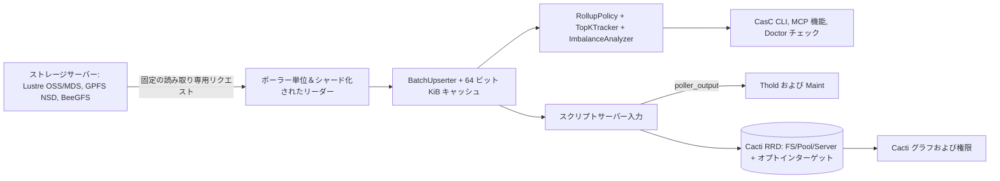

<!-- Source: README.md; SHA256: e88d6875d113220a91cfc0a9d230c829a78477b17e6aa7e44dda38c9591c86ad -->

<!-- translations:start -->
[English](../../../README.md) | [简体中文](../zh-CN/README.md) | [हिन्दी](../hi-IN/README.md) | [Español (España)](../es-ES/README.md) | [Español (Latinoamérica)](../es-419/README.md) | [العربية (السعودية)](../ar-SA/README.md) | [Afrikaans](../af-ZA/README.md) | [አማርኛ](../am-ET/README.md) | [العربية (مصر)](../ar-EG/README.md) | [العربية (المغرب)](../ar-MA/README.md) | [বাংলা](../bn-BD/README.md) | [Bosanski](../bs-BA/README.md) | [Deutsch](../de-DE/README.md) | [فارسی](../fa-IR/README.md) | [Filipino](../fil-PH/README.md) | [Français](../fr-FR/README.md) | [Français (Maroc)](../fr-MA/README.md) | [Français (Sénégal)](../fr-SN/README.md) | [Hausa](../ha-NG/README.md) | [עברית](../he-IL/README.md) | [Hrvatski](../hr-HR/README.md) | [Bahasa Indonesia](../id-ID/README.md) | [Igbo](../ig-NG/README.md) | [Italiano](../it-IT/README.md) | [日本語](README.md) | [한국어](../ko-KR/README.md) | [Malagasy](../mg-MG/README.md) | [मराठी](../mr-IN/README.md) | [Bahasa Melayu](../ms-MY/README.md) | [Nederlands](../nl-NL/README.md) | [Polski](../pl-PL/README.md) | [Português (Brasil)](../pt-BR/README.md) | [Русский](../ru-RU/README.md) | [Kinyarwanda](../rw-RW/README.md) | [Soomaali](../so-SO/README.md) | [Српски](../sr-RS/README.md) | [Svenska](../sv-SE/README.md) | [Kiswahili](../sw-KE/README.md) | [தமிழ்](../ta-IN/README.md) | [తెలుగు](../te-IN/README.md) | [ไทย](../th-TH/README.md) | [Türkçe](../tr-TR/README.md) | [Українська](../uk-UA/README.md) | [اردو](../ur-PK/README.md) | [Tiếng Việt](../vi-VN/README.md) | [isiXhosa](../xh-ZA/README.md) | [Yorùbá](../yo-NG/README.md) | [繁體中文](../zh-TW/README.md) | [isiZulu](../zu-ZA/README.md)
<!-- translations:end -->

# plugin_pfs

並列ファイルシステムの健全性、容量、使用率の偏り、ターゲットごとのスループット、およびメタデータ操作レートを、統合された `Backend` インターフェース配下の Lustre、IBM Storage Scale（GPFS）、および BeeGFS にわたって Cacti に取り込む Cacti 1.2 プラグインです。各ファイルシステムは、データクエリ、概要およびオンデマンドのターゲット別グラフ、サマリーゲージを備えた通常の Cacti デバイスにマッピングされるため、Thold や Maint は変更なしでそのままアラート通知や抑制を行えます。

> **ステータス: フェーズ 1〜3 およびエクサスケール拡張プリミティブをコード実装済み（未リリース）。** 基盤、Lustre 監視、アラート通知と Maint 抑制、GPFS および BeeGFS の読み取り専用ドライバ、Maint 連携を備えた OST/MDT 不均衡分析、リモートデータコレクターのスコープ分離（`replicate_out`、`remote_agent`）、100+ PB / エクサスケール対応プリミティブ（`FramedReportParser`、Schema v4 `value_kib`、`RollupPolicy`、`TopKTracker`、`ShardAssigner`、`BatchUpserter`）、CasC 運用 CLI（`cli/pfs.php`）、およびエコシステムフック（`abilities_register`、`doctor_register_checks`、`casc_register_providers`）が実装され、単体テスト、セキュリティテスト、使い捨て Cacti 統合テストで検証されています。これまでの実行はすべて、実機の Lustre、GPFS、または BeeGFS ハードウェアではなくフィクスチャのノード出力を使用しています。リリースのタグ付け前に残っている課題は、実ファイルシステムでのパイロット運用（[パイロット計画](../../pilot-plan.md)）、外部セキュリティレビュー（[自己レビュー](../../security-review.md)）、および文書化されたハードウェア上でのスケール測定（[スケール測定](../../research/scale.md)）です。バージョン 0.1.0 は `INFO` および [CHANGELOG.md](../../../CHANGELOG.md) に準備されていますが、まだタグ付けされていません。

## アクセスロール

| レルム | アクセス権限 |
| --- | --- |
| Parallel Filesystem View | 既存の監視ページ。 |
| Parallel Filesystem Operator | 監視ページに加え、Operations ページおよび個人用のトリアージ確認応答（acknowledgment）。 |
| Parallel Filesystem Admin | Operator の権限に加え、既存の設定および管理操作。 |

アップグレード用ファイルをコピーした後、管理者として Plugins ページを開き、新しいレルムを登録してください。Operator レルムは **Configuration > Users** またはユーザーグループから明示的に割り当てます。アップグレード後も既存の View および Admin レルムの ID と付与権限は保持されます。Admin アクセスはリクエストごとに Operator アクセスを継承し、Operator アクセスは View アクセスを継承します。これにより、ユーザーやグループへ保存済みの権限付与が追加されることはありません。プラグイン設定には、Cacti の Settings 権限に加えて Parallel Filesystem Admin アクセスも必要です。

Cacti のデバイス権限によって各ユーザーが利用できる行や操作は引き続き制限され、未マッピングのオブジェクトには管理者権限が必要です。認証情報、設定、マッピング、削除、その他の管理上の変更は管理ページに残ります。確認応答（acknowledgment）は現在のユーザーセッション内でのみ、最大 1 時間、かつ同じ観測データが最新の状態である間のみ有効です。観測データが新規取得または更新されると無効になります。また、失敗した計測を正常とみなしたり、アラートを抑制したりすることは一切ありません。

## 背景と目的

共有ファイルシステムが遅い場合、その原因を示す根拠は複数のサーバーに分散しています。Lustre はノードごとにカウンタを保持しており、`lctl get_param` は「ローカルノード上」の値を報告するため、各オブジェクトストレージサーバー（OSS）およびメタデータサーバー（MDS）は自身のターゲットの数値しか保持していません。低速なファイルシステムを調査する運用担当者は、異なる場所から次の 3 つの答えを得る必要があります。

- **他のターゲットが空いているのに、1 つのターゲットだけ容量が増えていないか？** 使用率の偏り（fill imbalance）は、新しいファイルが配置される場所や、単一ターゲットが容量不足になるタイミングに影響します。
- **どのターゲットまたはどの操作がビジー状態か？** ターゲットごとのバイトカウンタおよび MDT ごとの操作カウンタを見ることで、負荷がデータ処理に起因するのかメタデータ処理に起因するのかを判別できます。
- **監視データ自体が最新か？** グラフが平坦であることは、プラグインがサーバーを正常に参照できている場合にのみ安心材料になります。

Cacti はホストのグラフ化や Thold によるしきい値監視を行えますが、Cacti の GitHub 組織には Lustre、GPFS、または BeeGFS を監視するためのリポジトリが存在しません（2026-11-14 調査時点）。本プラグインは、ストレージノードから許可リストに登録された読み取り専用の値を取得し、各ファイルシステムをデータクエリのインデックスとしてターゲットを持つ Cacti デバイスとして表現することで、このギャップを埋めます。独自の同等機能を別途構築するのではなく、Cacti のグラフ機能、権限管理、リモートデータコレクター、Thold、および Maint をそのまま再利用します。

## 計画されているスコープ

| フェーズ | スコープ | ステータス | マイルストーン |
|---|---|---|---|
| 0, 調査 | リリース対象マトリクス、ノードアクセス方式の決定、アップストリーム挙動の確認、カウンタおよびフェイルオーバーの挙動、スケール測定 | 完了 | [M1](https://github.com/somethingwithproof/plugin_pfs/milestone/1) |
| 1, 監視 | Lustre インベントリ、容量と使用率、OST/MDT 不均衡（`lib/ImbalanceAnalyzer.php`）、Maint 連携（`lib/HealthPage.php`）、OST スループット、MDT 操作レート、グラフ、Thold アラート通知、健全性ページ | 実装済み（フィクスチャ検証済み） | [M2](https://github.com/somethingwithproof/plugin_pfs/milestone/2), [M3](https://github.com/somethingwithproof/plugin_pfs/milestone/3), [M4](https://github.com/somethingwithproof/plugin_pfs/milestone/4) |
| 2, リモートおよびスケール | ポーラー単位のリモート収集（`lib/Reader.php`、`lib/ReplicationRepository.php`、`replicate_out`、`remote_agent`）、100+ PB スケーリングプリミティブ（64 ビット KiB 衛生処理 + Schema v4 `value_kib`、`lib/RollupPolicy.php`、`lib/TopKTracker.php`、`lib/ShardAssigner.php` + `poller_pfs.php --shard=K/N`、`lib/BatchUpserter.php`）、CasC CLI（`cli/pfs.php`）、MCP/Doctor/CasC フック | 実装済み（単体および CI 統合テスト済み） | [M5](https://github.com/somethingwithproof/plugin_pfs/milestone/5) |
| 3, バックエンド | `BackendRegistry::production()` に登録された IBM Storage Scale（GPFS）（`lib/GpfsBackend.php`）および BeeGFS（`lib/BeegfsBackend.php`）の読み取り専用ドライバ | 実装済み（単体テスト済み） | [M6](https://github.com/somethingwithproof/plugin_pfs/milestone/6) |

実装済みの主な運用およびスケーリングプリミティブ:

- **マルチファイルシステム読み取り専用ドライバ:** `LustreBackend`、`GpfsBackend`（`reset` を禁止したフレーミング済み `mmpmon` `fs_io_s`/`io_s` のみ、`mmdf` のプール容量/状態、およびウェイターサマリー）、および `BeegfsBackend`（正確なバイトから KiB への変換、到達性/整合性状態マッピング、およびインターバル単位のゲージセマンティクスを備えた BeeGFS 7.4 および 8.x のストレージ/メタデータターゲット）が `lib/FramedReportParser.php` を共有しています。
- **不均衡、ヘッドルーム、および Maint 連携:** `lib/ImbalanceAnalyzer.php` は OST/MDT 使用率、スプレッド、母標準偏差による不均衡指数、ヘッドルーム、1 インターバル鮮度強制（`missing_targets`）、ターゲットごとの状態フラグ、および上限付き Top-K 偏りターゲットを計算します。`HealthPage`（`pfs_health.php`）および `CascProvider::health()` は Cacti の `Maint` メンテナンスウィンドウを表示し、予定メンテナンス中はアクティブな障害警告を抑制します。
- **100+ PB およびエクサスケール拡張**（[docs/architecture/exascale-scaling.md](../../architecture/exascale-scaling.md)）: `BIGINT UNSIGNED value_kib` 列（Schema v4）と併用し 500 PB および 2 EB で検証された正確な 10 進バイトから KiB への変換（`FramedReportParser::bytesToKibInt()`）、上限付きのオプトイン/ホット/偏りターゲット昇格を備えた階層型 `Filesystem -> Pool -> Storage Server` RRD ロールアップ（`lib/RollupPolicy.php`）、上限付き $O(K)$ の Top-K 偏りターゲットおよび事前集約された高負荷ジョブ/クライアントサマリー（`lib/TopKTracker.php`、クライアント単位のデバイスや RRD は一切作成しません）、決定論的 CRC32 コレクターシャーディング（`lib/ShardAssigner.php`、`php plugins/pfs/poller_pfs.php [--poller=N] [--shard=K/N] [--force] [--debug]`）、およびキーセットページネーションを伴う 500 行単位のバッチ SQL アップサート（`lib/BatchUpserter.php`、`CacheRepository::upsertObservationsBatch()`、`TargetRepository::forFilesystemPage()`）を備えています。
- **運用 CasC CLI およびエコシステムフック:** `cli/pfs.php` は外部 Composer 依存なしで `export [--format=yaml|xml]`、`validate <file> [--format=yaml|xml]`、`plan <file> [--format=yaml|xml] [--output=text|json]`、`apply <file> --confirm=<PLAN_HASH> [--format=yaml|xml]`、および `health [--format=text|json]` をサポートします。`setup.php` と `lib/EcosystemIntegration.php` は `abilities_register`（`pfs-list-filesystems`、`pfs-get-imbalance`、`pfs-get-health`。読み取り専用、`Parallel Filesystem View` および Cacti デバイス権限でゲート制御）、`doctor_register_checks`（`pfs_schema`、`pfs_reader_freshness`、`pfs_capacity_imbalance`）、`casc_register_providers`、`replicate_out`、および `remote_agent` を登録します。

スコープ外: ノードまたはファイルシステムに対する書き込み、クリア、リセット、チューニング操作、プラグイン独自のアラートエンジン、カスタムデーモンまたはネットワークプロトコル、ジョブ単位またはクライアント単位の Cacti デバイス/RRD、Cacti コア・Thold・Maint への変更。

## 互換性ターゲット

| コンポーネント | ターゲット |
|---|---|
| Cacti | 1.2.31 以降、コアへのパッチ不要 |
| PHP | 8.2 以降。`setup.php`、`poller_pfs.php`、および `cli/pfs.php` は 8.0 でも構文解析可能な状態を維持し、サポート外のランタイムでは Cacti UI を壊すのではなく動作拒否を返します |
| Lustre | 2.17.0 でソースおよびマニュアルを確認済み。フィクスチャ検証済み |
| GPFS, BeeGFS | IBM Storage Scale（GPFS）5.x `mmpmon`/`mmdf` および BeeGFS 7.4 / 8.x の読み取り専用ドライバを実装し、フィクスチャ検証済み |
| Thold, Maint | Thold 1.8.2 および Maint 1.3、変更なし |

## 設計

- [docs/architecture/exascale-scaling.md](../../architecture/exascale-scaling.md) では、100+ PB / エクサスケール向けの 2 階層テレメトリアーキテクチャ（Cacti/`plugin_pfs` のサーバー＋ロールアップ＋Top-K 階層と帯域外 LDMS/Darshan/TOKIO クライアントテレメトリの組み合わせ）およびその学術文献上の背景を文書化しています。
- [docs/PLAN.md](../../PLAN.md) は全体計画書です。アーキテクチャ、依存するアップストリームの仕様（出典および未検証事項を含む）、カウンタのセマンティクス、状態モデル、セキュリティ境界、パフォーマンス計算、テスト、およびリスクを記載しています。
- [docs/operator-guide.md](../../operator-guide.md) ではインストール、グラフと取得値、アップグレード、バックアップとリストア、アンインストール、およびトラブルシューティングを扱い、[docs/alerting.md](../../alerting.md) では Thold と Maint について説明しています。
- [docs/node-setup.md](../../node-setup.md) では、リーダー向けに Lustre サーバーとポーラーを準備する手順を説明しています。
- [docs/decisions/](../../decisions) には、決定済みの選択に関するアーキテクチャ決定記録（ADR）を格納しています。
- [docs/REQUIREMENTS.md](../../REQUIREMENTS.md) は、すべての要件 ID と対応する Issue を対応付けています。

## 作業の管理方法

- **マイルストーン** は計画書のマイルストーンに対応しています。各マイルストーンには、サブ Issue と完了エビデンスをまとめたエピック Issue があります。
- **Issue** はラベルで分類されています（`type: requirement`、`type: research`、`type: decision`、`type: epic`）。要件 Issue には、番号付きのテスト可能な要件（`REQ-AREA-NNN`）と受け入れ基準が記載されています。
- **ラベル** には `area:`、`phase:`、`priority:`、`status:` も使用されます。詳細は [CONTRIBUTING.md](../../../CONTRIBUTING.md#labels) を参照してください。
- [プロジェクトボード](https://github.com/users/somethingwithproof/projects/11) では、全マイルストーンにわたるすべての Issue を確認できます。

## コントリビューション

[CONTRIBUTING.md](../../../CONTRIBUTING.md) をお読みください。コミットには DCO サインオフが必要です。設計に関する議論は Issue 上で行い、未決定事項には `type: decision` ラベルを付与します。

## セキュリティ

脆弱性は非公開で報告してください。詳細は [SECURITY.md](../../../SECURITY.md) を参照してください。

## ライセンス

Cacti およびそのプラグインと同じ GNU General Public License v2.0 です。詳細は [LICENSE](../../../LICENSE) を参照してください。
