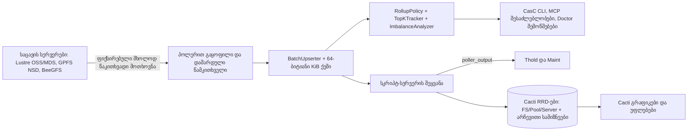

<!-- Source: README.md; SHA256: e88d6875d113220a91cfc0a9d230c829a78477b17e6aa7e44dda38c9591c86ad -->

<!-- translations:start -->
[English](../../../README.md) | [简体中文](../zh-CN/README.md) | [हिन्दी](../hi-IN/README.md) | [Español (España)](../es-ES/README.md) | [Español (Latinoamérica)](../es-419/README.md) | [العربية (السعودية)](../ar-SA/README.md) | [Afrikaans](../af-ZA/README.md) | [አማርኛ](../am-ET/README.md) | [العربية (مصر)](../ar-EG/README.md) | [العربية (المغرب)](../ar-MA/README.md) | [Български](../bg-BG/README.md) | [বাংলা](../bn-BD/README.md) | [Bosanski](../bs-BA/README.md) | [Deutsch](../de-DE/README.md) | [Ελληνικά](../el-GR/README.md) | [فارسی](../fa-IR/README.md) | [Filipino](../fil-PH/README.md) | [Français](../fr-FR/README.md) | [Français (Maroc)](../fr-MA/README.md) | [Français (Sénégal)](../fr-SN/README.md) | [Hausa](../ha-NG/README.md) | [עברית](../he-IL/README.md) | [Hrvatski](../hr-HR/README.md) | [Bahasa Indonesia](../id-ID/README.md) | [Igbo](../ig-NG/README.md) | [Italiano](../it-IT/README.md) | [日本語](../ja-JP/README.md) | [ქართული](README.md) | [한국어](../ko-KR/README.md) | [Latviešu](../lv-LV/README.md) | [Malagasy](../mg-MG/README.md) | [मराठी](../mr-IN/README.md) | [Bahasa Melayu](../ms-MY/README.md) | [Nederlands](../nl-NL/README.md) | [Polski](../pl-PL/README.md) | [Português (Brasil)](../pt-BR/README.md) | [Português (Portugal)](../pt-PT/README.md) | [Русский](../ru-RU/README.md) | [Kinyarwanda](../rw-RW/README.md) | [Soomaali](../so-SO/README.md) | [Српски](../sr-RS/README.md) | [Svenska](../sv-SE/README.md) | [Kiswahili](../sw-KE/README.md) | [தமிழ்](../ta-IN/README.md) | [తెలుగు](../te-IN/README.md) | [ไทย](../th-TH/README.md) | [Türkçe](../tr-TR/README.md) | [Українська](../uk-UA/README.md) | [اردو](../ur-PK/README.md) | [Tiếng Việt](../vi-VN/README.md) | [isiXhosa](../xh-ZA/README.md) | [Yorùbá](../yo-NG/README.md) | [繁體中文](../zh-TW/README.md) | [isiZulu](../zu-ZA/README.md)
<!-- translations:end -->

# plugin_pfs

Cacti 1.2-ის დანამატი, რომელიც Cacti-ში ასახავს პარალელური ფაილური სისტემების მდგომარეობას, ტევადობას, შევსების დისბალანსს, თითოეული სამიზნის გამტარუნარიანობასა და მეტამონაცემების ოპერაციების სიხშირეს Lustre, IBM Storage Scale (GPFS) და BeeGFS სისტემებისთვის ერთიანი `Backend` ინტერფეისის მიღმა. თითოეული ფაილური სისტემა ებმის ჩვეულებრივ Cacti მოწყობილობას მონაცემთა მოთხოვნებით, მიმოხილვითი და მოთხოვნითი სამიზნის გრაფიკებით და შემაჯამებელი მაჩვენებლებით, რათა Thold-მა და Maint-მა უცვლელად განახორციელონ გაფრთხილება და დათრგუნვა.

> **სტატუსი: 1-დან მე-3 ფაზამდე და ექსამასშტაბიანი გაფართოების პრიმიტივები რეალიზებულია კოდში, მაგრამ ჯერ არ გამოქვეყნებულა.** ფუნდამენტი, Lustre-ზე დაკვირვება, გაფრთხილებები და Maint დათრგუნვა, GPFS და BeeGFS მხოლოდ წაკითხვადი დრაივერები, OST/MDT დისბალანსის ანალიზი Maint ინტეგრაციით, დაშორებული მონაცემთა შემგროვებლების გაყოფა (`replicate_out`, `remote_agent`), 100+ PB / ექსამასშტაბიანი გაფართოების პრიმიტივები (`FramedReportParser`, Schema v4 `value_kib`, `RollupPolicy`, `TopKTracker`, `ShardAssigner`, `BatchUpserter`), CasC ოპერატორის CLI (`cli/pfs.php`) და ეკოსისტემის ჰუკები (`abilities_register`, `doctor_register_checks`, `casc_register_providers`) რეალიზებულია და დადასტურებულია ერთეულოვანი, უსაფრთხოებისა და ერთჯერადი Cacti-ის ინტეგრაციული ტესტებით. აქამდე ყველა გაშვება იყენებს სატესტო კვანძის გამომავალს და არა რეალურ Lustre, GPFS ან BeeGFS აპარატურას. გამოშვების ტეგირებამდე ღია რჩება: საპილოტე გაშვებები რეალურ ფაილურ სისტემებზე ([საპილოტე გეგმა](../../pilot-plan.md)), გარე უსაფრთხოების მიმოხილვა ([თვითშემოწმება](../../security-review.md)) და მასშტაბირების გაზომვები დოკუმენტირებულ აპარატურაზე ([მასშტაბირება](../../research/scale.md)). ვერსია 0.1.0 მომზადებულია `INFO`-სა და [CHANGELOG.md](../../../CHANGELOG.md)-ში, მაგრამ ტეგირებული არ არის.

## წვდომის როლები

| უფლებების ზონა | წვდომა |
| --- | --- |
| Parallel Filesystem View | არსებული მონიტორინგის გვერდები. |
| Parallel Filesystem Operator | მონიტორინგი, ოპერაციების გვერდი და პერსონალური სორტირების დადასტურებები. |
| Parallel Filesystem Admin | ოპერატორის წვდომა, ასევე არსებული კონფიგურაცია და ადმინისტრაციული მოქმედებები. |

განახლების ფაილების კოპირების შემდეგ ადმინისტრატორის სტატუსით გახსენით დანამატების (Plugins) გვერდი ახალი უფლებების ზონის დასარეგისტრირებლად. Operator უფლებების ზონა მიანიჭეთ პირდაპირ განყოფილებაში **Configuration > Users** ან მომხმარებელთა ჯგუფებში. განახლებები ინარჩუნებს არსებულ View და Admin უფლებების ზონის ID-ებსა და მინიჭებებს. ყოველ მოთხოვნაზე Admin წვდომა მემკვიდრეობით იღებს Operator წვდომას, ხოლო Operator წვდომა — View წვდომას; ეს არ ამატებს შენახულ უფლებებს მომხმარებლებისთვის ან ჯგუფებისთვის. დანამატის პარამეტრები ასევე მოითხოვს Parallel Filesystem Admin წვდომას Cacti-ს პარამეტრების (Settings) უფლებასთან ერთად.

Cacti-ს მოწყობილობის უფლებები კვლავ ზღუდავს თითოეული მომხმარებლისთვის ხელმისაწვდომ სტრიქონებსა და მოქმედებებს; მიუბმელი ობიექტები საჭიროებს ადმინისტრატორს. ავტორიზაციის მონაცემები, კონფიგურაცია, მიბმა, წაშლა და სხვა ადმინისტრაციული ცვლილებები რჩება ადმინისტრაციულ გვერდებზე. დადასტურებები მოქმედებს მხოლოდ მიმდინარე მომხმარებლის სესიაში, არაუმეტეს ერთი საათის განმავლობაში და მხოლოდ მანამ, სანამ იგივე დაკვირვება აქტუალური რჩება. ახალი ან შეცვლილი დაკვირვებები აუქმებს მათ. ისინი არასდროს მონიშნავს ჩაშლილ გაზომვას გამართულად და არ თრგუნავს გაფრთხილებებს.

## რატომ

როდესაც გაზიარებული ფაილური სისტემა შენელებულია, მტკიცებულებები გაბნეულია სერვერებზე. Lustre თავის მთვლელებს ინახავს თითოეულ კვანძზე: `lctl get_param` აბრუნებს მნიშვნელობებს „ლოკალურ კვანძზე“, ამიტომ თითოეული ობიექტური საცავის სერვერი (OSS) და მეტამონაცემების სერვერი (MDS) ინახავს მხოლოდ საკუთარი სამიზნეების რიცხვებს. შენელებული ფაილური სისტემის გამომკვლევ ოპერატორს სხვადასხვა ადგილიდან სამი პასუხი სჭირდება:

- **ივსება თუ არა ერთი სამიზნე, სანამ სხვები ცარიელია?** შევსების დისბალანსი ცვლის, სად ხვდება ახალი ფაილები და როდის ეწურება ადგილი ცალკეულ სამიზნეს.
- **რომელი სამიზნეები ან ოპერაციებია დატვირთული?** თითოეული სამიზნის ბაიტების მთვლელები და თითოეული MDT-ის ოპერაციების მთვლელები აჩვენებს, დატვირთვა მონაცემებზეა შეზღუდული თუ მეტამონაცემებზე.
- **აქტუალურია თუ არა თავად მონიტორინგი?** სწორი გრაფიკი დამამშვიდებელია მხოლოდ მაშინ, თუ დანამატი ხედავდა სერვერებს.

Cacti აგებს ჰოსტების გრაფიკებს და Thold-ით აკონტროლებს ზღურბლებს, ხოლო Cacti-ს GitHub ორგანიზაციაში Lustre, GPFS ან BeeGFS მონიტორინგის რეპოზიტორი არ არსებობს (შემოწმებულია 2026-11-14-ში). დანამატი ავსებს ამ ხარვეზს საცავის კვანძებიდან დაშვებულთა სიაში მყოფი, მხოლოდ წაკითხვადი მნიშვნელობების წაკითხვით და თითოეული ფაილური სისტემის წარმოდგენით Cacti მოწყობილობად, რომლის სამიზნეებიც მონაცემთა მოთხოვნის ინდექსებია. იგი იყენებს Cacti-ს გრაფიკებს, უფლებებს, დაშორებულ მონაცემთა შემგროვებლებს, Thold-სა და Maint-ს, მათი პარალელური ვერსიების აგების ნაცვლად.

## დაგეგმილი ფარგლები

| ფაზა | ფარგლები | სტატუსი | ეტაპები |
|---|---|---|---|
| 0, კვლევა | გამოშვებების მატრიცა, კვანძზე წვდომის გადაწყვეტილება, ზემდგომი ქცევის დადასტურება, მთვლელებისა და გადართვის ქცევა, მასშტაბირების გაზომვები | დასრულებულია | [M1](https://github.com/somethingwithproof/plugin_pfs/milestone/1) |
| 1, დაკვირვება | Lustre ინვენტარი, ტევადობა და შევსება, OST/MDT დისბალანსი (`lib/ImbalanceAnalyzer.php`), Maint ინტეგრაცია (`lib/HealthPage.php`), OST გამტარუნარიანობა, MDT ოპერაციების სიხშირე, გრაფიკები, Thold გაფრთხილებები, მდგომარეობის გვერდი | რეალიზებულია (სატესტო ფიქსტურებით შემოწმებული) | [M2](https://github.com/somethingwithproof/plugin_pfs/milestone/2), [M3](https://github.com/somethingwithproof/plugin_pfs/milestone/3), [M4](https://github.com/somethingwithproof/plugin_pfs/milestone/4) |
| 2, დაშორებული და მასშტაბი | პოლერით გაყოფილი დაშორებული შეგროვება (`lib/Reader.php`, `lib/ReplicationRepository.php`, `replicate_out`, `remote_agent`), 100+ PB მასშტაბირების პრიმიტივები (64-ბიტიანი KiB სიზუსტე + Schema v4 `value_kib`, `lib/RollupPolicy.php`, `lib/TopKTracker.php`, `lib/ShardAssigner.php` + `poller_pfs.php --shard=K/N`, `lib/BatchUpserter.php`), CasC CLI (`cli/pfs.php`), MCP/Doctor/CasC ჰუკები | რეალიზებულია (ერთეულოვანი და CI ინტეგრაციული ტესტებით შემოწმებული) | [M5](https://github.com/somethingwithproof/plugin_pfs/milestone/5) |
| 3, ბექენდები | მხოლოდ წაკითხვადი IBM Storage Scale (GPFS) (`lib/GpfsBackend.php`) და BeeGFS (`lib/BeegfsBackend.php`) დრაივერები რეგისტრირებული `BackendRegistry::production()`-ში | რეალიზებულია (ერთეულოვანი ტესტებით შემოწმებული) | [M6](https://github.com/somethingwithproof/plugin_pfs/milestone/6) |

ძირითადი რეალიზებული ოპერატორისა და მასშტაბირების პრიმიტივები:

- **მრავალფაილურსისტემიანი მხოლოდ წაკითხვადი დრაივერები:** `LustreBackend`, `GpfsBackend` (ჩარჩოიანი `mmpmon` მხოლოდ `fs_io_s`/`io_s` აკრძალული `reset`-ით, `mmdf` პულის ტევადობა/მდგომარეობები და მოლოდინის შეჯამებები) და `BeegfsBackend` (BeeGFS 7.4 და 8.x საცავის/მეტამონაცემების სამიზნეები ზუსტი ბაიტიდან KiB-ში გადაყვანით, ხელმისაწვდომობის/თანმიმდევრულობის პირობების შესაბამისობით და ინტერვალზე გათვლილი მაჩვენებლის სემანტიკით), რომლებიც იზიარებენ `lib/FramedReportParser.php`-ს.
- **დისბალანსი, მარაგი და Maint ინფორმირებულობა:** `lib/ImbalanceAnalyzer.php` ითვლის OST/MDT შევსების თანაფარდობებს, გაშლას, პოპულაციის სტანდარტული გადახრის დისბალანსის ინდექსს, მარაგს, 1-ინტერვალიანი აქტუალობის კონტროლს (`missing_targets`), თითოეული სამიზნის სტატუსის ალმებს და შეზღუდულ Top-K გადახრილ სამიზნეებს. `HealthPage` (`pfs_health.php`) და `CascProvider::health()` აჩვენებს Cacti `Maint` ტექნიკური მომსახურების ფანჯრებს და თრგუნავს აქტიურ შეცდომის გაფრთხილებებს დაგეგმილი ტექნიკური მომსახურების დროს.
- **100+ PB და ექსამასშტაბიანი გაფართოება** ([docs/architecture/exascale-scaling.md](../../architecture/exascale-scaling.md)): ზუსტი ათობითი ბაიტიდან KiB-ში გარდაქმნა (`FramedReportParser::bytesToKibInt()`), შემოწმებული 500 PB და 2 EB-ზე, `BIGINT UNSIGNED value_kib` სვეტებთან (Schema v4) ერთად; იერარქიული `Filesystem -> Pool -> Storage Server` RRD შეჯამებები შეზღუდული არჩევითი/დატვირთული/გადახრილი სამიზნეების დაწინაურებით (`lib/RollupPolicy.php`); შეზღუდული $O(K)$ Top-K გადახრილი სამიზნეები და წინასწარ აგრეგირებული მძიმე ამოცანების/კლიენტების შეჯამებები (`lib/TopKTracker.php`, კლიენტზე გათვლილი მოწყობილობების ან RRD-ების შექმნის გარეშე); დეტერმინისტული CRC32 შემგროვებლის შარდინგი (`lib/ShardAssigner.php`, `php plugins/pfs/poller_pfs.php [--poller=N] [--shard=K/N] [--force] [--debug]`); და 500-სტრიქონიანი პაკეტური SQL განახლებები პლუს keyset პაგინაცია (`lib/BatchUpserter.php`, `CacheRepository::upsertObservationsBatch()`, `TargetRepository::forFilesystemPage()`).
- **ოპერატორის CasC CLI და ეკოსისტემის ჰუკები:** `cli/pfs.php` მხარს უჭერს `export [--format=yaml|xml]`, `validate <file> [--format=yaml|xml]`, `plan <file> [--format=yaml|xml] [--output=text|json]`, `apply <file> --confirm=<PLAN_HASH> [--format=yaml|xml]` და `health [--format=text|json]` ბრძანებებს გარე Composer დამოკიდებულებების გარეშე. `setup.php` და `lib/EcosystemIntegration.php` არეგისტრირებს `abilities_register` (`pfs-list-filesystems`, `pfs-get-imbalance`, `pfs-get-health`; მხოლოდ წაკითხვადი, შეზღუდული `Parallel Filesystem View`-ით და Cacti მოწყობილობის უფლებებით), `doctor_register_checks` (`pfs_schema`, `pfs_reader_freshness`, `pfs_capacity_imbalance`), `casc_register_providers`, `replicate_out` და `remote_agent`.

ფარგლებს გარეთაა: ნებისმიერი ჩაწერის, გასუფთავების, განულების ან მორგების ოპერაცია კვანძზე ან ფაილურ სისტემაზე; დანამატის საკუთარი გაფრთხილების ძრავა; მორგებული დემონი ან ქსელური პროტოკოლი; თითოეული ამოცანის ან კლიენტის Cacti მოწყობილობები/RRD-ები; ცვლილებები Cacti-ს ბირთვში, Thold-ში ან Maint-ში.

## თავსებადობის მიზნები

| კომპონენტი | მიზანი |
|---|---|
| Cacti | 1.2.31 ან უფრო ახალი, ბირთვის პატჩების გარეშე |
| PHP | 8.2 ან უფრო ახალი; `setup.php`, `poller_pfs.php` და `cli/pfs.php` რჩება წაკითხვადი 8.0-ზე, რათა მხარდაუჭერელ გარემოში მიიღოთ უარი და არა დაზიანებული Cacti UI |
| Lustre | კოდი და სახელმძღვანელოები შემოწმებულია 2.17.0-ზე; შემოწმებულია სატესტო ფიქსტურებით |
| GPFS, BeeGFS | IBM Storage Scale (GPFS) 5.x `mmpmon`/`mmdf` და BeeGFS 7.4 / 8.x მხოლოდ წაკითხვადი დრაივერები რეალიზებულია და შემოწმებულია სატესტო ფიქსტურებით |
| Thold, Maint | Thold 1.8.2 და Maint 1.3, უცვლელად |

## დიზაინი

- [docs/architecture/exascale-scaling.md](../../architecture/exascale-scaling.md) აღწერს ორდონიან 100+ PB / ექსამასშტაბიან ტელემეტრიის არქიტექტურას (Cacti/`plugin_pfs` სერვერი + შეჯამება + Top-K დონე, შეწყვილებული არხგარე LDMS/Darshan/TOKIO კლიენტის ტელემეტრიასთან) და მის აკადემიურ ლიტერატურულ კონტექსტს.
- [docs/PLAN.md](../../PLAN.md) არის სრული გეგმა: არქიტექტურა, ზემდგომი ფაქტები, რომლებზეც იგი ეყრდნობა (წყაროებით და იმით, რაც ჯერ გადაუმოწმებელია), მთვლელების სემანტიკა, მდგომარეობის მოდელი, უსაფრთხოების საზღვრები, წარმადობის არითმეტიკა, ტესტირება და რისკები.
- [docs/operator-guide.md](../../operator-guide.md) მოიცავს ინსტალაციას, გრაფიკებსა და მნიშვნელობებს, განახლებას, სარეზერვო ასლსა და აღდგენას, დეინსტალაციას და პრობლემების აღმოფხვრას; [docs/alerting.md](../../alerting.md) მოიცავს Thold-სა და Maint-ს.
- [docs/node-setup.md](../../node-setup.md) აღწერს, როგორ მოამზადოთ Lustre სერვერი და პოლერი წამკითხველისთვის.
- [docs/decisions/](../../decisions/) შეიცავს არქიტექტურული გადაწყვეტილებების ჩანაწერებს უკვე მიღებული არჩევანებისთვის.
- [docs/REQUIREMENTS.md](../../REQUIREMENTS.md) აკავშირებს თითოეულ მოთხოვნის ID-ს მის საკითხთან.

## როგორ მიმდინარეობს სამუშაოს აღრიცხვა

- **ეტაპები (Milestones)** მიჰყვება გეგმის ეტაპებს. თითოეულს აქვს ეპიკური საკითხი, სადაც ჩამოთვლილია ქვესაკითხები და დასრულების მტკიცებულებები.
- **საკითხები (Issues)** კლასიფიცირებულია ჭდეებით: `type: requirement`, `type: research`, `type: decision`, `type: epic`. მოთხოვნის საკითხები განსაზღვრავს დანომრილ, ტესტირებად მოთხოვნებს (`REQ-AREA-NNN`) და მიღების კრიტერიუმებს.
- **ჭდეები (Labels)** ასევე ატარებს `area:`, `phase:`, `priority:` და `status:` ნიშნულებს. იხილეთ [CONTRIBUTING.md](../../../CONTRIBUTING.md#labels).
- [პროექტის დაფა](https://github.com/users/somethingwithproof/projects/11) აჩვენებს ყველა საკითხს ყველა ეტაპზე.

## წვლილის შეტანა

წაიკითხეთ [CONTRIBUTING.md](../../../CONTRIBUTING.md). კომიტებს სჭირდება DCO ხელმოწერა. დიზაინის განხილვა მიმდინარეობს საკითხებში; ღია გადაწყვეტილებებს აქვს ჭდე `type: decision`.

## უსაფრთხოება

მოწყვლადობების შესახებ შეგვატყობინეთ კონფიდენციალურად; იხილეთ [SECURITY.md](../../../SECURITY.md).

## ლიცენზია

GNU General Public License v2.0 — იგივე ლიცენზია, რაც Cacti-სა და მის დანამატებს აქვთ. იხილეთ [LICENSE](../../../LICENSE).
