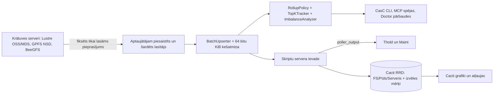

<!-- Source: README.md; SHA256: e88d6875d113220a91cfc0a9d230c829a78477b17e6aa7e44dda38c9591c86ad -->

<!-- translations:start -->
[English](../../../README.md) | [简体中文](../zh-CN/README.md) | [हिन्दी](../hi-IN/README.md) | [Español (España)](../es-ES/README.md) | [Español (Latinoamérica)](../es-419/README.md) | [العربية (السعودية)](../ar-SA/README.md) | [Afrikaans](../af-ZA/README.md) | [አማርኛ](../am-ET/README.md) | [العربية (مصر)](../ar-EG/README.md) | [العربية (المغرب)](../ar-MA/README.md) | [Български](../bg-BG/README.md) | [বাংলা](../bn-BD/README.md) | [Bosanski](../bs-BA/README.md) | [Deutsch](../de-DE/README.md) | [Ελληνικά](../el-GR/README.md) | [فارسی](../fa-IR/README.md) | [Filipino](../fil-PH/README.md) | [Français](../fr-FR/README.md) | [Français (Maroc)](../fr-MA/README.md) | [Français (Sénégal)](../fr-SN/README.md) | [Hausa](../ha-NG/README.md) | [עברית](../he-IL/README.md) | [Hrvatski](../hr-HR/README.md) | [Bahasa Indonesia](../id-ID/README.md) | [Igbo](../ig-NG/README.md) | [Italiano](../it-IT/README.md) | [日本語](../ja-JP/README.md) | [ქართული](../ka-GE/README.md) | [한국어](../ko-KR/README.md) | [Latviešu](README.md) | [Malagasy](../mg-MG/README.md) | [मराठी](../mr-IN/README.md) | [Bahasa Melayu](../ms-MY/README.md) | [Nederlands](../nl-NL/README.md) | [Polski](../pl-PL/README.md) | [Português (Brasil)](../pt-BR/README.md) | [Português (Portugal)](../pt-PT/README.md) | [Русский](../ru-RU/README.md) | [Kinyarwanda](../rw-RW/README.md) | [Soomaali](../so-SO/README.md) | [Српски](../sr-RS/README.md) | [Svenska](../sv-SE/README.md) | [Kiswahili](../sw-KE/README.md) | [தமிழ்](../ta-IN/README.md) | [తెలుగు](../te-IN/README.md) | [ไทย](../th-TH/README.md) | [Türkçe](../tr-TR/README.md) | [Українська](../uk-UA/README.md) | [اردو](../ur-PK/README.md) | [Tiếng Việt](../vi-VN/README.md) | [isiXhosa](../xh-ZA/README.md) | [Yorùbá](../yo-NG/README.md) | [繁體中文](../zh-TW/README.md) | [isiZulu](../zu-ZA/README.md)
<!-- translations:end -->

# plugin_pfs

Cacti 1.2 spraudnis, kas ienes paralēlo failu sistēmu veselību, ietilpību, aizpildījuma nelīdzsvarotību, atsevišķu mērķu caurlaidspēju un metadatu operāciju ātrumus Cacti vidē Lustre, IBM Storage Scale (GPFS) un BeeGFS sistēmām aiz vienotas `Backend` saskarnes. Katra failu sistēma tiek piesaistīta parastai Cacti ierīcei ar datu vaicājumiem, pārskata un pēc pieprasījuma veidojamiem mērķu grafikiem, kā arī kopsavilkuma rādītājiem, lai Thold un Maint varētu bez izmaiņām sūtīt brīdinājumus un tos apslāpēt.

> **Statuss: 1. līdz 3. posms un eksamēroga mērogošanas primitīvi ir ieviesti kodā, bet vēl nav izlaisti.** Pamatsistēma, Lustre novērošana, brīdinājumi un Maint apslāpēšana, GPFS un BeeGFS tikai lasāmi draiveri, OST/MDT nelīdzsvarotības analīze ar Maint integrāciju, attālo datu vācēju darbības joma (`replicate_out`, `remote_agent`), 100+ PB / eksamēroga mērogošanas primitīvi (`FramedReportParser`, 4. shēmas versijas `value_kib`, `RollupPolicy`, `TopKTracker`, `ShardAssigner`, `BatchUpserter`), CasC operatora CLI (`cli/pfs.php`) un ekosistēmas āķi (`abilities_register`, `doctor_register_checks`, `casc_register_providers`) ir ieviesti un pārbaudīti ar vienībtestiem, drošības testiem un vienreizējās Cacti vides integrācijas testiem. Visas līdzšinējās pārbaudes izmanto sagatavotu mezglu izvadi, nevis reālu Lustre, GPFS vai BeeGFS aparatūru. Pirms laidiena marķēšanas vēl atvērts: pilotprojekti reālās failu sistēmās ([pilotprojekta plāns](../../pilot-plan.md)), ārēja drošības pārbaude ([pašpārbaude](../../security-review.md)) un mēroga mērījumi uz dokumentētas aparatūras ([mērogošana](../../research/scale.md)). Versija 0.1.0 ir sagatavota failā `INFO` un [CHANGELOG.md](../../../CHANGELOG.md), bet vēl nav marķēta.

## Piekļuves lomas

| Tiesību joma | Piekļuve |
| --- | --- |
| Parallel Filesystem View | Esošās uzraudzības lapas. |
| Parallel Filesystem Operator | Uzraudzība, kā arī Darbību lapa un personīgie šķirošanas apstiprinājumi. |
| Parallel Filesystem Admin | Operatora piekļuve, kā arī esošā konfigurācija un administratīvās darbības. |

Pēc jaunināšanas failu nokopēšanas atveriet spraudņu (Plugins) lapu kā administrators, lai reģistrētu
jauno tiesību jomu. Operatora tiesību jomu piešķiriet tieši sadaļā **Configuration > Users** vai lietotāju grupās.
Jauninājumi saglabā esošos View un Admin tiesību jomu ID un piešķīrumus. Admin piekļuve
katrā pieprasījumā manto Operator piekļuvi, un Operator piekļuve manto View piekļuvi;
tas nepievieno saglabātus piešķīrumus lietotājiem vai grupām. Spraudņa iestatījumiem papildus
Cacti iestatījumu atļaujai ir nepieciešama arī Parallel Filesystem Admin piekļuve.

Cacti ierīču atļaujas joprojām ierobežo katram lietotājam pieejamās rindas un darbības; nepiesaistītiem objektiem nepieciešams administrators.
Akreditācijas dati, konfigurācija, piesaiste, dzēšana un citas administratīvās izmaiņas
paliek administratīvajās lapās. Apstiprinājumi ir spēkā tikai pašreizējā
lietotāja sesijā, ne ilgāk par vienu stundu un tikai tikmēr, kamēr tas pats novērojums paliek
aktuāls. Jauni vai mainīti novērojumi padara tos nederīgus. Tie nekad neatzīmē neveiksmīgu
mērījumu kā veselu un neapslāpē brīdinājumus.

## Kāpēc

Kad koplietojamā failu sistēma darbojas lēni, pierādījumi ir izkliedēti pa dažādiem serveriem. Lustre glabā skaitītājus katrā mezglā atsevišķi: `lctl get_param` ziņo vērtības "lokālajā mezglā", tāpēc katrs objektu krātuves serveris (OSS) un metadatu serveris (MDS) satur tikai savu mērķu datus. Operatoram, kas izmeklē lēnu failu sistēmu, nepieciešamas trīs atbildes no dažādām vietām:

- **Vai viens mērķis piepildās, kamēr citi ir tukši?** Aizpildījuma nelīdzsvarotība maina to, kur nonāk jauni faili un kad atsevišķā mērķī beidzas vieta.
- **Kuri mērķi vai operācijas ir noslogotas?** Katra mērķa baitu skaitītāji un katra MDT operāciju skaitītāji parāda, vai slodzi ierobežo dati vai metadati.
- **Vai pati uzraudzība ir aktuāla?** Taisna līnija grafikā ir nomierinoša tikai tad, ja spraudnis spēj redzēt serverus.

Cacti zīmē resursdatoru grafikus un ar Thold nosaka vērtību sliekšņus, taču Cacti GitHub organizācijā nav repozitorija Lustre, GPFS vai BeeGFS uzraudzībai (pārbaudīts 2026-11-14). Spraudnis aizpilda šo robu, nolasot atļauto sarakstā iekļautas, tikai lasāmas vērtības no krātuves mezgliem un attēlojot katru failu sistēmu kā Cacti ierīci, kuras mērķi ir datu vaicājuma indeksi. Tas atkārtoti izmanto Cacti grafikus, atļaujas, attālos datu vācējus, Thold un Maint, nevis veido to paralēlas versijas.

## Plānotais tvērums

| Posms | Tvērums | Statuss | Atskaite |
|---|---|---|---|
| 0, izpēte | Laidienu matrica, lēmums par piekļuvi mezgliem, augšupējās darbības apstiprināšana, skaitītāju un kļūmjpārlēces uzvedība, mēroga mērījumi | Pabeigts | [M1](https://github.com/somethingwithproof/plugin_pfs/milestone/1) |
| 1, novērošana | Lustre inventārs, ietilpība un aizpildījums, OST/MDT nelīdzsvarotība (`lib/ImbalanceAnalyzer.php`), Maint integrācija (`lib/HealthPage.php`), OST caurlaidspēja, MDT operāciju ātrumi, grafiki, Thold brīdinājumi, veselības lapa | Ieviests (pārbaudīts ar fiksētiem datiem) | [M2](https://github.com/somethingwithproof/plugin_pfs/milestone/2), [M3](https://github.com/somethingwithproof/plugin_pfs/milestone/3), [M4](https://github.com/somethingwithproof/plugin_pfs/milestone/4) |
| 2, attālā vākšana un mērogošana | Aptaujātājam piesaistīta attālā vākšana (`lib/Reader.php`, `lib/ReplicationRepository.php`, `replicate_out`, `remote_agent`), 100+ PB mērogošanas primitīvi (64 bitu KiB higiēna + 4. shēmas `value_kib`, `lib/RollupPolicy.php`, `lib/TopKTracker.php`, `lib/ShardAssigner.php` + `poller_pfs.php --shard=K/N`, `lib/BatchUpserter.php`), CasC CLI (`cli/pfs.php`), MCP/Doctor/CasC āķi | Ieviests (pārbaudīts ar vienībtestiem un CI integrācijas testiem) | [M5](https://github.com/somethingwithproof/plugin_pfs/milestone/5) |
| 3, aizmugursistēmas | Tikai lasāmi IBM Storage Scale (GPFS) (`lib/GpfsBackend.php`) un BeeGFS (`lib/BeegfsBackend.php`) draiveri, reģistrēti `BackendRegistry::production()` | Ieviests (pārbaudīts ar vienībtestiem) | [M6](https://github.com/somethingwithproof/plugin_pfs/milestone/6) |

Galvenie ieviestie operatora un mērogošanas primitīvi:

- **Vairāku failu sistēmu tikai lasāmi draiveri:** `LustreBackend`, `GpfsBackend` (ietvertas `mmpmon` `fs_io_s`/`io_s` komandas ar aizliegtu `reset`, `mmdf` pūlu ietilpība/stāvokļi un gaidītāju kopsavilkumi) un `BeegfsBackend` (BeeGFS 7.4 un 8.x krātuves/metadatu mērķi ar precīzu baitu pārvēršanu KiB, sasniedzamības/konsekvences stāvokļu kartēšanu un intervāla rādītāju semantiku), kuri koplieto `lib/FramedReportParser.php`.
- **Nelīdzsvarotība, rezerve un Maint integrācija:** `lib/ImbalanceAnalyzer.php` aprēķina OST/MDT aizpildījuma attiecības, izkliedi, populācijas standartnovirzes nelīdzsvarotības indeksu, brīvo rezervi, 1 intervāla aktualitātes kontroli (`missing_targets`), atsevišķu mērķu stāvokļa karodziņus un ierobežotu Top-K šķībo mērķu sarakstu. `HealthPage` (`pfs_health.php`) un `CascProvider::health()` atspoguļo Cacti `Maint` apkopes logus un apslāpē aktīvos kļūmju brīdinājumus plānotās apkopes laikā.
- **100+ PB un eksamēroga mērogošana** ([docs/architecture/exascale-scaling.md](../../architecture/exascale-scaling.md)): precīza decimālā baitu pārvēršana KiB (`FramedReportParser::bytesToKibInt()`), kas pārbaudīta pie 500 PB un 2 EB kopā ar `BIGINT UNSIGNED value_kib` kolonnām (4. shēmas versija); hierarhiski `Filesystem -> Pool -> Storage Server` RRD apkopojumi ar ierobežotu izvēles/karsto/šķībo mērķu paaugstināšanu (`lib/RollupPolicy.php`); ierobežoti $O(K)$ Top-K šķībie mērķi un iepriekš apkopoti noslogotāko uzdevumu/klientu kopsavilkumi (`lib/TopKTracker.php`, nekad neveidojot atsevišķu klientu ierīces vai RRD failus); deterministiska CRC32 vācēja šardēšana (`lib/ShardAssigner.php`, `php plugins/pfs/poller_pfs.php [--poller=N] [--shard=K/N] [--force] [--debug]`); un 500 rindu pakešu SQL ievietošana/atjaunināšana ar atslēgu kopas lapošanu (`lib/BatchUpserter.php`, `CacheRepository::upsertObservationsBatch()`, `TargetRepository::forFilesystemPage()`).
- **Operatora CasC CLI un ekosistēmas āķi:** `cli/pfs.php` atbalsta `export [--format=yaml|xml]`, `validate <file> [--format=yaml|xml]`, `plan <file> [--format=yaml|xml] [--output=text|json]`, `apply <file> --confirm=<PLAN_HASH> [--format=yaml|xml]` un `health [--format=text|json]` bez ārējām Composer atkarībām. `setup.php` un `lib/EcosystemIntegration.php` reģistrē `abilities_register` (`pfs-list-filesystems`, `pfs-get-imbalance`, `pfs-get-health`; tikai lasāmas, ierobežotas ar `Parallel Filesystem View` un Cacti ierīču atļaujām), `doctor_register_checks` (`pfs_schema`, `pfs_reader_freshness`, `pfs_capacity_imbalance`), `casc_register_providers`, `replicate_out` un `remote_agent`.

Ārpus tvēruma: jebkuras rakstīšanas, dzēšanas, atiestatīšanas vai regulēšanas darbības mezglā vai failu sistēmā; spraudnim piederošs brīdinājumu dzinis; pielāgots dēmons vai tīkla protokols; atsevišķu uzdevumu vai klientu Cacti ierīces/RRD; izmaiņas Cacti kodolā, Thold vai Maint.

## Saderības mērķi

| Komponents | Mērķis |
|---|---|
| Cacti | 1.2.31 vai jaunāks, bez kodola ielāpiem |
| PHP | 8.2 vai jaunāks; `setup.php`, `poller_pfs.php` un `cli/pfs.php` paliek parsējami PHP 8.0, lai neatbalstīta izpildvide saņemtu atteikumu, nevis bojātu Cacti lietotāja saskarni |
| Lustre | Pirmkods un rokasgrāmatas pārbaudītas versijai 2.17.0; pārbaudīts ar fiksētiem datiem |
| GPFS, BeeGFS | Ieviesti un ar fiksētiem datiem pārbaudīti tikai lasāmi IBM Storage Scale (GPFS) 5.x `mmpmon`/`mmdf` un BeeGFS 7.4 / 8.x draiveri |
| Thold, Maint | Thold 1.8.2 un Maint 1.3 bez izmaiņām |

## Dizains

- [docs/architecture/exascale-scaling.md](../../architecture/exascale-scaling.md) dokumentē divu līmeņu 100+ PB / eksamēroga telemetrijas arhitektūru (Cacti/`plugin_pfs` servera + apkopojumu + Top-K līmenis apvienojumā ar ārpusjoslas LDMS/Darshan/TOKIO klientu telemetriju) un tās akadēmiskās literatūras kontekstu.
- [docs/PLAN.md](../../PLAN.md) ir pilns plāns: arhitektūra, augšupējie fakti, no kuriem tā atkarīga (ar avotiem un vēl nepārbaudīto), skaitītāju semantika, stāvokļa modelis, drošības robežas, veiktspējas aprēķini, testēšana un riski.
- [docs/operator-guide.md](../../operator-guide.md) aptver instalēšanu, grafikus un vērtības, jaunināšanu, dublēšanu un atjaunošanu, atinstalēšanu un problēmu novēršanu; [docs/alerting.md](../../alerting.md) aptver Thold un Maint.
- [docs/node-setup.md](../../node-setup.md) apraksta, kā sagatavot Lustre serveri un aptaujātāju lasītājam.
- [docs/decisions/](../../decisions/) satur arhitektūras lēmumu ierakstus par jau pieņemtajām izvēlēm.
- [docs/REQUIREMENTS.md](../../REQUIREMENTS.md) sasaista katru prasības ID ar tā uzdevumu.

## Kā tiek sekots darbam

- **Atskaites (Milestones)** seko plāna atskaitēm. Katrai ir episkais uzdevums ar apakšuzdevumu sarakstu un pabeigšanas pierādījumiem.
- **Uzdevumi (Issues)** tiek klasificēti ar birkām: `type: requirement`, `type: research`, `type: decision`, `type: epic`. Prasību uzdevumos norādītas numurētas, pārbaudāmas prasības (`REQ-AREA-NNN`) un pieņemšanas kritēriji.
- **Birkas (Labels)** satur arī `area:`, `phase:`, `priority:` un `status:`. Skatiet [CONTRIBUTING.md](../../../CONTRIBUTING.md#labels).
- [Projekta tāfele](https://github.com/users/somethingwithproof/projects/11) parāda visus uzdevumus visās atskaitēs.

## Līdzdalība

Izlasiet [CONTRIBUTING.md](../../../CONTRIBUTING.md). Iesniegumiem (commits) nepieciešams DCO paraksts. Dizaina diskusijas notiek uzdevumos; atvērtie lēmumi ir marķēti ar birku `type: decision`.

## Drošība

Par ievainojamībām ziņojiet privāti; skatiet [SECURITY.md](../../../SECURITY.md).

## Licence

GNU General Public License v2.0 — tā pati licence, kas Cacti un tā spraudņiem. Skatiet [LICENSE](../../../LICENSE).
