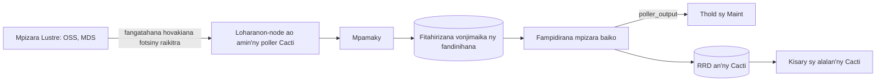

<!-- Source: README.md; SHA256: 40f2c5a5e9be97e4bd2b05a9ebab2a77de51de3af1b1c21dbeb5ee7f936cdd3b -->

<!-- translations:start -->
[English](../../../README.md) | [简体中文](../zh-CN/README.md) | [हिन्दी](../hi-IN/README.md) | [Español (España)](../es-ES/README.md) | [Español (Latinoamérica)](../es-419/README.md) | [العربية (السعودية)](../ar-SA/README.md) | [Afrikaans](../af-ZA/README.md) | [አማርኛ](../am-ET/README.md) | [العربية (مصر)](../ar-EG/README.md) | [العربية (المغرب)](../ar-MA/README.md) | [বাংলা](../bn-BD/README.md) | [Bosanski](../bs-BA/README.md) | [Deutsch](../de-DE/README.md) | [فارسی](../fa-IR/README.md) | [Filipino](../fil-PH/README.md) | [Français](../fr-FR/README.md) | [Français (Maroc)](../fr-MA/README.md) | [Français (Sénégal)](../fr-SN/README.md) | [Hausa](../ha-NG/README.md) | [עברית](../he-IL/README.md) | [Hrvatski](../hr-HR/README.md) | [Bahasa Indonesia](../id-ID/README.md) | [Igbo](../ig-NG/README.md) | [Italiano](../it-IT/README.md) | [日本語](../ja-JP/README.md) | [한국어](../ko-KR/README.md) | [Malagasy](README.md) | [मराठी](../mr-IN/README.md) | [Bahasa Melayu](../ms-MY/README.md) | [Nederlands](../nl-NL/README.md) | [Polski](../pl-PL/README.md) | [Português (Brasil)](../pt-BR/README.md) | [Русский](../ru-RU/README.md) | [Kinyarwanda](../rw-RW/README.md) | [Soomaali](../so-SO/README.md) | [Српски](../sr-RS/README.md) | [Svenska](../sv-SE/README.md) | [Kiswahili](../sw-KE/README.md) | [தமிழ்](../ta-IN/README.md) | [తెలుగు](../te-IN/README.md) | [ไทย](../th-TH/README.md) | [Türkçe](../tr-TR/README.md) | [Українська](../uk-UA/README.md) | [اردو](../ur-PK/README.md) | [Tiếng Việt](../vi-VN/README.md) | [isiXhosa](../xh-ZA/README.md) | [Yorùbá](../yo-NG/README.md) | [繁體中文](../zh-TW/README.md) | [isiZulu](../zu-ZA/README.md)
<!-- translations:end -->

# plugin_pfs

Plugin Cacti 1.2 izay mitondra ny fahasalamana sy ny enta-mavesatry ny rafi-drakitra mifanila ho ao anatin'ny Cacti: ny fahafaha-mitahiry sy ny tsy fitovian'ny famenoana amin'ny lasibatra samihafa, ny taham-pifindran'ny angona isaky ny lasibatra, ary ny taham-panaovana asa amin'ny metadata. Ny Lustre no backend voalohany. Manaraka ao ambadiky ny fifandraisana backend ny GPFS (IBM Storage Scale) sy ny BeeGFS. Ny angona dia tonga ao amin'ny fitaovana, loharanon'angona ary kisary mahazatra an'ny Cacti, ka mandefa fampitandremana sy manakana izany tsy misy fanovana ny Thold sy ny Maint.

> **Sata: dingana faha-4, vita ny kaody ho an'ny dingana 1, mbola tsy navoaka.** Vita ao amin'ny `main` na eo am-pandinihana ny dingana faha-2 (fototra), faha-3 (fanaraha-maso Lustre), ary faha-4 (fampitandremana sy fanomanana ny famoahana). Mametraka, manavao, ary manala ny tenany amin'ny alalan'ny API plugin an'ny Cacti ity plugin ity ary mandà ny PHP ambanin'ny 8.2. Misy mpamaky ambadika eo amin'ny poller tsirairay izay mamaky ny mpizara Lustre amin'ny alalan'ny SSH amin'ny alalan'ny baiko raikitra voafetra ([node/pfs-read.sh](../../../node/pfs-read.sh)) ary mitahiry vonjimaika ny lisitry ny singa, ny toe-javatra, ny fahafaha-mitahiry, ary ny mpanisa miaraka amin'ny fahavaozany. Ny rafi-drakitra tsirairay dia lasa fitaovana Cacti misy fanontaniana angona OST sy MDT, kisary famintinana dimy, kisary isaky ny lasibatra araka izay ilaina, ary loharanon'angona famintinana ho an'ny Thold. Ny Thold v1.8.2 sy ny Maint v1.3, tsy misy fanovana, dia mandefa fampitandremana sy manakana ny mari-pandrefesana famintinana ao amin'ny fitsapana feno; tsy tohana miaraka amin'ny Thold 1.8.2 ny fetran'ny Thold amin'ny mpanisa ([docs/alerting.md](../../alerting.md)). Ny fitsapana rehetra hatreto dia mandeha amin'ny valin'ny node fitsapana ao amin'ny Cacti azo ariana: mbola tsy nandeha tamin'ny node Lustre tena izy ity plugin ity. Mbola misokatra alohan'ny famoahana: ny fitsapana voalohany amin'ny rafi-drakitra tena izy ([drafitry ny fitsapana voalohany](../../pilot-plan.md)), ny fanamarinana fiarovana ivelany ([fandinihana ataon'ny tena](../../security-review.md)), ary ny fandrefesana ny habe amin'ny fitaovana voarakitra ([refy](../../research/scale.md)). Voahomana ao amin'ny `INFO` sy [CHANGELOG.md](../../../CHANGELOG.md) ny kinova 0.1.0 fa mbola tsy nasiana marika.

## Anjara asan'ny fidirana

| Sehatra | Fidirana |
| --- | --- |
| Parallel Filesystem View | Pejy fanaraha-maso efa misy. |
| Parallel Filesystem Operator | Fanaraha-maso miampy ny pejy Asa (Operations) sy ny faneken'ny tena manokana ho an'ny fitsirihana. |
| Parallel Filesystem Admin | Fidiran'ny Operator miampy ny fikirakirana efa misy sy ny hetsika fitantanana. |

Rehefa avy nandika ny rakitra fanavaozana, sokafy amin'ny maha-mpitantana ny pejy Plugins mba hisoratra anarana
ny sehatra vaovao. Omeo mazava tsara ny sehatra Operator ao amin'ny **Configuration > Users** na vondrona mpampiasa.
Mitazona ny ID-n'ny sehatra View sy Admin efa misy sy ny alalana nomena ny fanavaozana. Ny fidiran'ny Admin
dia mandova ny fidiran'ny Operator, ary ny fidiran'ny Operator dia mandova ny fidiran'ny View amin'ny fangatahana tsirairay;
tsy manampy alalana voatahiry ho an'ny mpampiasa na vondrona izany. Mitaky koa ny fidirana
Parallel Filesystem Admin ankoatra ny alalana Settings an'ny Cacti ny fikirakirana ny plugin.

Mbola mametra ny andalana sy ny hetsika azo ampiasain'ny mpampiasa tsirairay ny alalan'ny fitaovana Cacti; mitaky mpitantana ny zavatra tsy voatondro.
Ny mari-pamantarana, ny fikirakirana, ny fampifandraisana, ny famafana ary ny fanovana fitantanana hafa
dia mijanona ao amin'ny pejy fitantanana. Maharitra ao amin'ny fotoam-pivoriana ankehitriny an'ny mpampiasa ihany ny fanekena,
mandritra ny adiny iray fara fahabetsany ary raha mbola vaovao ihany ilay fandinihana iray ihany.
Ny fandinihana vaovao na niova dia manafoana azy ireo. Tsy manamarika na oviana na oviana ny fandrefesana tsy nahomby ho salama na manakana ny fampitandremana izy ireo.

## Antony

Rehefa miadana ny rafi-drakitra iombonana, dia miparitaka amin'ny mpizara maro ny porofo. Mitazona ny mpanisany isaky ny node ny Lustre: mitatitra ny sanda "ao amin'ny node eo an-toerana" ny `lctl get_param`, ka ny mpizara fitahirizana zavatra (OSS) sy ny mpizara metadata (MDS) tsirairay dia tsy mitazona afa-tsy ny isan'ny lasibatra ao aminy ihany. Ny mpandraharaha iray manadihady rafi-drakitra miadana dia mila valiny telo avy amin'ny toerana samihafa:

- **Moa ve feno ny lasibatra iray raha mbola foana ny hafa?** Manova ny toerana iafaran'ny rakitra vaovao sy ny fotoana ahataperan'ny habaka amin'ny lasibatra tokana ny tsy fitovian'ny famenoana.
- **Iza amin'ireo lasibatra na asa no be atao?** Mampiseho raha mifandray amin'ny angona na amin'ny metadata ny enta-mavesatra ny mpanisa octet isaky ny lasibatra sy ny mpanisa asa isaky ny MDT.
- **Moa ve ara-potoana ny fanaraha-maso?** Ny kisary fisaka dia mampitony ihany raha toa ka afaka mahita ny mpizara ilay plugin.

Manao kisary ny mpampiantrano sy mametraka fetra amin'ny sanda amin'ny alalan'ny Thold ny Cacti, ary tsy manana tahiry ho an'ny fanaraha-maso Lustre, GPFS, na BeeGFS ny fikambanana GitHub an'ny Cacti (nokarohina tamin'ny 2026-11-14). Mameno izany banga izany ity plugin ity amin'ny alalan'ny famakiana ny sanda nahazoana alalana sy hovakiana fotsiny avy amin'ny node fitahirizana ary maneho ny rafi-drakitra tsirairay ho toy ny fitaovana Cacti izay ny lasibany dia ny tondron'ny fanontaniana angona. Mampiasa indray ny kisary, ny alalana, ny mpangona angona lavitra, ny Thold, ary ny Maint an'ny Cacti izy fa tsy manamboatra kinova mifanila amin'izany.

## Sahan'asa nomanina

| Dingana | Sahan'asa | Dingana lehibe |
|---|---|---|
| 0, fikarohana | Tabilao famoahana, fanapahan-kevitra momba ny fidirana amin'ny node, fanamafisana ny fihetsiky ny loharano ambony, fihetsiky ny mpanisa sy ny fifindran'ny asa raha misy olana, fandrefesana ny habe | [M1](https://github.com/somethingwithproof/plugin_pfs/milestone/1) |
| 1, fandinihana | Lisitry ny Lustre, fahafaha-mitahiry sy famenoana, taham-pifindran'ny OST, taham-panaovana asa MDT, kisary, fampitandremana Thold, fanakanana Maint, pejy fahasalamana | [M2](https://github.com/somethingwithproof/plugin_pfs/milestone/2), [M3](https://github.com/somethingwithproof/plugin_pfs/milestone/3), [M4](https://github.com/somethingwithproof/plugin_pfs/milestone/4) |
| 2, halalin'ny asa | Mpangona angona lavitra Cacti, fomba fijery amin'ny ambaratongan'ny asa sy ny mpanjifa ao anatin'ny isan'ny zavatra voafetra | [M5](https://github.com/somethingwithproof/plugin_pfs/milestone/5) |
| 3, backend | Backend GPFS (IBM Storage Scale) sy BeeGFS | [M6](https://github.com/somethingwithproof/plugin_pfs/milestone/6) |

Ivelan'ny sahan'asa: izay rehetra fanoratana, famafana, famerenana amin'ny laoniny, na fanitsiana eo amin'ny node na rafi-drakitra; motera fampitandremana an'ny plugin manokana; daemon na fifandraisana tambajotra manokana; loharanon'angona isaky ny asa; fanovana ao amin'ny fototry ny Cacti, Thold, na Maint.

## Tanjona fifanarahana

| Singa | Tanjona |
|---|---|
| Cacti | 1.2.31 na aoriana, tsy misy fanitsiana fototra |
| PHP | 8.2 na aoriana; mijanona ho azo vakiana amin'ny 8.0 ny `setup.php` mba hahazo fandavana ny tontolo fampiasana tsy tohana fa tsy UI Cacti simba |
| Lustre | Kinova hapetraka amin'ny dingana lehibe 1; ny loharano sy ny boky torolalana voamarina hatreto dia amin'ny 2.17.0 |
| GPFS, BeeGFS | Dingana 3; kinova hapetraka amin'ny fikarohana |
| Thold, Maint | Tsy mila fanovana |

## Rafitra

- [docs/PLAN.md](../../PLAN.md) no drafitra feno: ny maritrano, ny zava-misy avy any ambony iankinany (miaraka amin'ny loharano sy izay mbola tsy voamarina), ny hevitry ny mpanisa, ny modely toe-javatra, ny fetran'ny fiarovana, ny kajy fampandehanana, ny fitsapana, ary ny loza mety hitranga.
- [docs/operator-guide.md](../../operator-guide.md) dia mirakitra ny fametrahana, ny kisary sy ny sanda, ny fanavaozana, ny tahiry fiarovana sy ny famerenana, ny fanalana, ary ny famahana olana; [docs/alerting.md](../../alerting.md) dia mirakitra ny Thold sy ny Maint.
- [docs/node-setup.md](../../node-setup.md) dia mamaritra ny fomba fanomanana mpizara Lustre sy poller iray ho an'ny mpamaky.
- [docs/decisions/](../../decisions) dia mitahiry ny firaketana fanapahan-kevitra momba ny maritrano ho an'ny safidy efa vita.
- [docs/REQUIREMENTS.md](../../REQUIREMENTS.md) dia mampifandray ny ID-n'ny fepetra tsirairay amin'ny olana mifanaraka aminy.

## Fomba fanaraha-maso ny asa

- **Dingana lehibe** dia manaraka ny dingana lehiben'ny drafitra. Ny tsirairay dia manana olana lehibe (epic) izay mitanisa ny zana-bolana ao aminy sy ny porofo fivoahana.
- **Olana** dia sokajiana amin'ny alalan'ny marika: `type: requirement`, `type: research`, `type: decision`, `type: epic`. Ny olana momba ny fepetra dia milaza ny fepetra voaisa sy azo tsapaina (`REQ-AREA-NNN`) ary ny mason-tsivana fanekena.
- **Marika** dia mitondra ihany koa ny `area:`, `phase:`, `priority:`, ary `status:`. Jereo ny [CONTRIBUTING.md](../../../CONTRIBUTING.md#labels).
- Ny [tabilaon'ny tetikasa](https://github.com/users/somethingwithproof/projects/11) dia mampiseho ny olana rehetra manerana ny dingana lehibe.

## Fandraisana anjara

Vakio ny [CONTRIBUTING.md](../../../CONTRIBUTING.md). Mila sonia DCO ny commit. Ao amin'ny olana (issues) no anaovana ny fifanakalozan-kevitra momba ny famolavolana; mitondra ny marika `type: decision` ny fanapahan-kevitra mbola misokatra.

## Fiarovana

Tatitrao mangingina ny lesoka ara-piarovana; jereo ny [SECURITY.md](../../../SECURITY.md).

## Lisansa

GNU General Public License v2.0, lisansa mitovy amin'ny an'ny Cacti sy ny plugin-ny. Jereo ny [LICENSE](../../../LICENSE).
