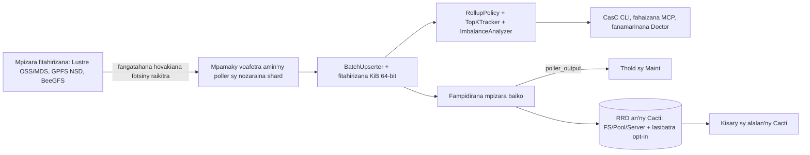

<!-- Source: README.md; SHA256: e88d6875d113220a91cfc0a9d230c829a78477b17e6aa7e44dda38c9591c86ad -->

<!-- translations:start -->
[English](../../../README.md) | [简体中文](../zh-CN/README.md) | [हिन्दी](../hi-IN/README.md) | [Español (España)](../es-ES/README.md) | [Español (Latinoamérica)](../es-419/README.md) | [العربية (السعودية)](../ar-SA/README.md) | [Afrikaans](../af-ZA/README.md) | [አማርኛ](../am-ET/README.md) | [العربية (مصر)](../ar-EG/README.md) | [العربية (المغرب)](../ar-MA/README.md) | [Български](../bg-BG/README.md) | [বাংলা](../bn-BD/README.md) | [Bosanski](../bs-BA/README.md) | [Deutsch](../de-DE/README.md) | [Ελληνικά](../el-GR/README.md) | [فارسی](../fa-IR/README.md) | [Filipino](../fil-PH/README.md) | [Français](../fr-FR/README.md) | [Français (Maroc)](../fr-MA/README.md) | [Français (Sénégal)](../fr-SN/README.md) | [Hausa](../ha-NG/README.md) | [עברית](../he-IL/README.md) | [Hrvatski](../hr-HR/README.md) | [Bahasa Indonesia](../id-ID/README.md) | [Igbo](../ig-NG/README.md) | [Italiano](../it-IT/README.md) | [日本語](../ja-JP/README.md) | [ქართული](../ka-GE/README.md) | [한국어](../ko-KR/README.md) | [Latviešu](../lv-LV/README.md) | [Malagasy](README.md) | [मराठी](../mr-IN/README.md) | [Bahasa Melayu](../ms-MY/README.md) | [Nederlands](../nl-NL/README.md) | [Polski](../pl-PL/README.md) | [Português (Brasil)](../pt-BR/README.md) | [Português (Portugal)](../pt-PT/README.md) | [Русский](../ru-RU/README.md) | [Kinyarwanda](../rw-RW/README.md) | [Soomaali](../so-SO/README.md) | [Српски](../sr-RS/README.md) | [Svenska](../sv-SE/README.md) | [Kiswahili](../sw-KE/README.md) | [தமிழ்](../ta-IN/README.md) | [తెలుగు](../te-IN/README.md) | [ไทย](../th-TH/README.md) | [Türkçe](../tr-TR/README.md) | [Українська](../uk-UA/README.md) | [اردو](../ur-PK/README.md) | [Tiếng Việt](../vi-VN/README.md) | [isiXhosa](../xh-ZA/README.md) | [Yorùbá](../yo-NG/README.md) | [繁體中文](../zh-TW/README.md) | [isiZulu](../zu-ZA/README.md)
<!-- translations:end -->

# plugin_pfs

Plugin Cacti 1.2 izay mitondra ny fahasalamana, ny fahafaha-mitahiry, ny tsy fitovian'ny famenoana, ny taham-pifindran'ny angona isaky ny lasibatra, ary ny taham-panaovana asa amin'ny metadata ho an'ny rafi-drakitra mifanila ao anatin'ny Cacti manerana ny Lustre, IBM Storage Scale (GPFS), ary BeeGFS ao ambadiky ny fifandraisana `Backend` tokana. Ny rafi-drakitra tsirairay dia mifandray amin'ny fitaovana Cacti mahazatra misy fanontaniana angona, kisary famintinana sy kisary isaky ny lasibatra araka izay ilaina, ary mari-pandrefesana famintinana mba handefasan'ny Thold sy Maint fampitandremana sy hanakanany izany tsy misy fanovana.

> **Sata: dingana faha-1 ka hatramin'ny faha-3 sy ny singa fototra ho an'ny fanitarana exascale efa vita ao anaty kaody, mbola tsy navoaka.** Ny fototra, ny fanaraha-maso Lustre, ny fampitandremana sy ny fanakanana Maint, ny mpamily vakiana fotsiny ho an'ny GPFS sy BeeGFS, ny famakafakana ny tsy fitovian'ny OST/MDT miaraka amin'ny fampidirana Maint, ny famerana ny fanangonana angona lavitra (`replicate_out`, `remote_agent`), ny singa fototra ho an'ny 100+ PB / exascale (`FramedReportParser`, Schema v4 `value_kib`, `RollupPolicy`, `TopKTracker`, `ShardAssigner`, `BatchUpserter`), ny CLI CasC ho an'ny mpandraharaha (`cli/pfs.php`), ary ny hook tontolo iainana (`abilities_register`, `doctor_register_checks`, `casc_register_providers`) dia efa voaorina sy voamarina tamin'ny fitsapana singa, fiarovana, ary fampidirana amin'ny Cacti azo ariana. Ny fitsapana rehetra hatreto dia mampiasa valin'ny node fitsapana fa tsy fitaovana Lustre, GPFS, na BeeGFS tena izy. Mbola misokatra alohan'ny fanamarihana famoahana: ny fitsapana voalohany amin'ny rafi-drakitra tena izy ([drafitry ny fitsapana voalohany](../../pilot-plan.md)), ny fanamarinana fiarovana ivelany ([fandinihana ataon'ny tena](../../security-review.md)), ary ny fandrefesana ny habe amin'ny fitaovana voarakitra ([refy](../../research/scale.md)). Voahomana ao amin'ny `INFO` sy [CHANGELOG.md](../../../CHANGELOG.md) ny kinova 0.1.0 fa mbola tsy nasiana marika.

## Anjara asan'ny fidirana

| Sehatra | Fidirana |
| --- | --- |
| Parallel Filesystem View | Pejy fanaraha-maso efa misy. |
| Parallel Filesystem Operator | Fanaraha-maso miampy ny pejy Asa (Operations) sy ny faneken'ny tena manokana ho an'ny fitsirihana. |
| Parallel Filesystem Admin | Fidiran'ny Operator miampy ny fikirakirana efa misy sy ny hetsika fitantanana. |

Rehefa avy nandika ny rakitra fanavaozana, sokafy amin'ny maha-mpitantana ny pejy Plugins mba hisoratra anarana
ny sehatra vaovao. Omeo mazava tsara ny sehatra Operator ao amin'ny **Configuration > Users** na vondrona mpampiasa.
Mitazona ny ID-n'ny sehatra View sy Admin efa misy sy ny alalana nomena ny fanavaozana. Ny fidiran'ny Admin
dia mandova ny fidiran'ny Operator, ary ny fidiran'ny Operator dia mandova ny fidiran'ny View amin'ny fangatahana tsirairay;
tsy manampy alalana voatahiry ho an'ny mpampiasa na vondrona izany. Mitaky koa ny fidirana
Parallel Filesystem Admin ankoatra ny alalana Settings an'ny Cacti ny fikirakirana ny plugin.

Mbola mametra ny andalana sy ny hetsika azo ampiasain'ny mpampiasa tsirairay ny alalan'ny fitaovana Cacti; mitaky mpitantana ny zavatra tsy voatondro.
Ny mari-pamantarana, ny fikirakirana, ny fampifandraisana, ny famafana ary ny fanovana fitantanana hafa
dia mijanona ao amin'ny pejy fitantanana. Maharitra ao amin'ny fotoam-pivoriana ankehitriny an'ny mpampiasa ihany ny fanekena,
mandritra ny adiny iray fara fahabetsany ary raha mbola vaovao ihany ilay fandinihana iray ihany.
Ny fandinihana vaovao na niova dia manafoana azy ireo. Tsy manamarika na oviana na oviana ny fandrefesana tsy nahomby ho salama na manakana ny fampitandremana izy ireo.

## Antony

Rehefa miadana ny rafi-drakitra iombonana, dia miparitaka amin'ny mpizara maro ny porofo. Mitazona ny mpanisany isaky ny node ny Lustre: mitatitra ny sanda "ao amin'ny node eo an-toerana" ny `lctl get_param`, ka ny mpizara fitahirizana zavatra (OSS) sy ny mpizara metadata (MDS) tsirairay dia tsy mitazona afa-tsy ny isan'ny lasibatra ao aminy ihany. Ny mpandraharaha iray manadihady rafi-drakitra miadana dia mila valiny telo avy amin'ny toerana samihafa:

- **Moa ve feno ny lasibatra iray raha mbola foana ny hafa?** Manova ny toerana iafaran'ny rakitra vaovao sy ny fotoana ahataperan'ny habaka amin'ny lasibatra tokana ny tsy fitovian'ny famenoana.
- **Iza amin'ireo lasibatra na asa no be atao?** Mampiseho raha mifandray amin'ny angona na amin'ny metadata ny enta-mavesatra ny mpanisa octet isaky ny lasibatra sy ny mpanisa asa isaky ny MDT.
- **Moa ve ara-potoana ny fanaraha-maso?** Ny kisary fisaka dia mampitony ihany raha toa ka afaka mahita ny mpizara ilay plugin.

Manao kisary ny mpampiantrano sy mametraka fetra amin'ny sanda amin'ny alalan'ny Thold ny Cacti, ary tsy manana tahiry ho an'ny fanaraha-maso Lustre, GPFS, na BeeGFS ny fikambanana GitHub an'ny Cacti (nokarohina tamin'ny 2026-11-14). Mameno izany banga izany ity plugin ity amin'ny alalan'ny famakiana ny sanda nahazoana alalana sy hovakiana fotsiny avy amin'ny node fitahirizana ary maneho ny rafi-drakitra tsirairay ho toy ny fitaovana Cacti izay ny lasibany dia ny tondron'ny fanontaniana angona. Mampiasa indray ny kisary, ny alalana, ny mpangona angona lavitra, ny Thold, ary ny Maint an'ny Cacti izy fa tsy manamboatra kinova mifanila amin'izany.

## Sahan'asa nomanina

| Dingana | Sahan'asa | Sata | Dingana lehibe |
|---|---|---|---|
| 0, fikarohana | Tabilao famoahana, fanapahan-kevitra momba ny fidirana amin'ny node, fanamafisana ny fihetsiky ny loharano ambony, fihetsiky ny mpanisa sy ny fifindran'ny asa raha misy olana, fandrefesana ny habe | Vita | [M1](https://github.com/somethingwithproof/plugin_pfs/milestone/1) |
| 1, fandinihana | Lisitry ny Lustre, fahafaha-mitahiry sy famenoana, tsy fitovian'ny OST/MDT (`lib/ImbalanceAnalyzer.php`), fampidirana Maint (`lib/HealthPage.php`), taham-pifindran'ny OST, taham-panaovana asa MDT, kisary, fampitandremana Thold, pejy fahasalamana | Voaorina (voatsapa tamin'ny fixture) | [M2](https://github.com/somethingwithproof/plugin_pfs/milestone/2), [M3](https://github.com/somethingwithproof/plugin_pfs/milestone/3), [M4](https://github.com/somethingwithproof/plugin_pfs/milestone/4) |
| 2, lavitra sy fanitarana | Fanangonana lavitra voafetra amin'ny poller (`lib/Reader.php`, `lib/ReplicationRepository.php`, `replicate_out`, `remote_agent`), singa fototra ho an'ny 100+ PB (fahadiovana KiB 64-bit + Schema v4 `value_kib`, `lib/RollupPolicy.php`, `lib/TopKTracker.php`, `lib/ShardAssigner.php` + `poller_pfs.php --shard=K/N`, `lib/BatchUpserter.php`), CasC CLI (`cli/pfs.php`), hook MCP/Doctor/CasC | Voaorina (voatsapa tamin'ny fitsapana singa sy fampidirana CI) | [M5](https://github.com/somethingwithproof/plugin_pfs/milestone/5) |
| 3, backend | Mpamily vakiana fotsiny IBM Storage Scale (GPFS) (`lib/GpfsBackend.php`) sy BeeGFS (`lib/BeegfsBackend.php`) voasoratra ao amin'ny `BackendRegistry::production()` | Voaorina (voatsapa tamin'ny fitsapana singa) | [M6](https://github.com/somethingwithproof/plugin_pfs/milestone/6) |

Singa fototra ho an'ny mpandraharaha sy ny fanitarana efa voaorina:

- **Mpamily vakiana fotsiny ho an'ny rafi-drakitra maro:** `LustreBackend`, `GpfsBackend` (`mmpmon` `fs_io_s`/`io_s` voafehy ihany miaraka amin'ny fandrarana ny `reset`, fahafaha-mitahiry/toe-javatra pool `mmdf`, ary famintinana mpiandry), ary `BeegfsBackend` (lasibatra fitahirizana/metadata BeeGFS 7.4 sy 8.x miaraka amin'ny fiovana marina avy amin'ny byte mankany amin'ny KiB, fampifandraisana ny toe-javatra fahazoana/fifanarahana, ary dikany mari-pandrefesana isaky ny elanelam-potoana) izay mizara ny `lib/FramedReportParser.php`.
- **Fahalalana ny tsy fitoviana, ny habaka malalaka ary ny Maint:** `lib/ImbalanceAnalyzer.php` dia manisa ny taham-pamenoana OST/MDT, ny elanelana, ny tondro tsy fitovian'ny fivilian-tsarina amin'ny mponina, ny habaka malalaka (headroom), ny fanamarinana ny fahavaozana 1-elanelam-potoana (`missing_targets`), ny saina toe-javatra isaky ny lasibatra, ary ny lasibatra mitongilana Top-K voafetra. `HealthPage` (`pfs_health.php`) sy `CascProvider::health()` dia mampiseho ny varavarankelin'ny fikojakojana `Maint` an'ny Cacti ary manakana ny fampitandremana tsy fahombiazana mavitrika mandritra ny fikojakojana voalahatra.
- **Fanitarana 100+ PB sy exascale** ([docs/architecture/exascale-scaling.md](../../architecture/exascale-scaling.md)): fiovana desimaly marina avy amin'ny byte mankany amin'ny KiB (`FramedReportParser::bytesToKibInt()`) voamarina tamin'ny 500 PB sy 2 EB miaraka amin'ny tsanganana `BIGINT UNSIGNED value_kib` (Schema v4); famintinana RRD ambaratonga `Filesystem -> Pool -> Storage Server` miaraka amin'ny fampisondrotana lasibatra voafetra ho an'ny opt-in/mafana/mitongilana (`lib/RollupPolicy.php`); lasibatra mitongilana Top-K voafetra $O(K)$ sy famintinana asa/mpanjifa mavesatra efa natambatra mialoha (`lib/TopKTracker.php`, tsy mamorona fitaovana na RRD isaky ny mpanjifa na oviana na oviana); fizarana sharding CRC32 voafaritra ho an'ny mpangona (`lib/ShardAssigner.php`, `php plugins/pfs/poller_pfs.php [--poller=N] [--shard=K/N] [--force] [--debug]`); ary fanavaozana SQL mitambatra andalana 500 miampy pagination keyset (`lib/BatchUpserter.php`, `CacheRepository::upsertObservationsBatch()`, `TargetRepository::forFilesystemPage()`).
- **CasC CLI ho an'ny mpandraharaha sy hook tontolo iainana:** `cli/pfs.php` dia manohana `export [--format=yaml|xml]`, `validate <file> [--format=yaml|xml]`, `plan <file> [--format=yaml|xml] [--output=text|json]`, `apply <file> --confirm=<PLAN_HASH> [--format=yaml|xml]`, ary `health [--format=text|json]` tsy misy fiankinan-doha amin'ny Composer ivelany. `setup.php` sy `lib/EcosystemIntegration.php` dia manoratra `abilities_register` (`pfs-list-filesystems`, `pfs-get-imbalance`, `pfs-get-health`; vakiana fotsiny, voafehy amin'ny `Parallel Filesystem View` sy ny alalan'ny fitaovana Cacti), `doctor_register_checks` (`pfs_schema`, `pfs_reader_freshness`, `pfs_capacity_imbalance`), `casc_register_providers`, `replicate_out`, ary `remote_agent`.

Ivelan'ny sahan'asa: izay rehetra fanoratana, famafana, famerenana amin'ny laoniny, na fanitsiana eo amin'ny node na rafi-drakitra; motera fampitandremana an'ny plugin manokana; daemon na fifandraisana tambajotra manokana; fitaovana/RRD Cacti isaky ny asa na isaky ny mpanjifa; fanovana ao amin'ny fototry ny Cacti, Thold, na Maint.

## Tanjona fifanarahana

| Singa | Tanjona |
|---|---|
| Cacti | 1.2.31 na aoriana, tsy misy fanitsiana fototra |
| PHP | 8.2 na aoriana; mijanona ho azo vakiana amin'ny 8.0 ny `setup.php`, `poller_pfs.php`, ary `cli/pfs.php` mba hahazo fandavana ny tontolo fampiasana tsy tohana fa tsy UI Cacti simba |
| Lustre | Voamarina tamin'ny 2.17.0 ny loharano sy ny boky torolalana; voatsapa tamin'ny fixture |
| GPFS, BeeGFS | Voaorina sy voatsapa tamin'ny fixture ny mpamily vakiana fotsiny IBM Storage Scale (GPFS) 5.x `mmpmon`/`mmdf` sy BeeGFS 7.4 / 8.x |
| Thold, Maint | Thold 1.8.2 sy Maint 1.3, tsy misy fanovana |

## Rafitra

- [docs/architecture/exascale-scaling.md](../../architecture/exascale-scaling.md) dia mirakitra ny maritrano telemetria 100+ PB / exascale misy ambaratonga roa (mpizara Cacti/`plugin_pfs` + famintinana + ambaratonga Top-K ampiarahina amin'ny telemetria mpanjifa LDMS/Darshan/TOKIO ivelan'ny zotra) sy ny tontolon'ny literatiora akademika.
- [docs/PLAN.md](../../PLAN.md) no drafitra feno: ny maritrano, ny zava-misy avy any ambony iankinany (miaraka amin'ny loharano sy izay mbola tsy voamarina), ny hevitry ny mpanisa, ny modely toe-javatra, ny fetran'ny fiarovana, ny kajy fampandehanana, ny fitsapana, ary ny loza mety hitranga.
- [docs/operator-guide.md](../../operator-guide.md) dia mirakitra ny fametrahana, ny kisary sy ny sanda, ny fanavaozana, ny tahiry fiarovana sy ny famerenana, ny fanalana, ary ny famahana olana; [docs/alerting.md](../../alerting.md) dia mirakitra ny Thold sy ny Maint.
- [docs/node-setup.md](../../node-setup.md) dia mamaritra ny fomba fanomanana mpizara Lustre sy poller iray ho an'ny mpamaky.
- [docs/decisions/](../../decisions) dia mitahiry ny firaketana fanapahan-kevitra momba ny maritrano ho an'ny safidy efa vita.
- [docs/REQUIREMENTS.md](../../REQUIREMENTS.md) dia mampifandray ny ID-n'ny fepetra tsirairay amin'ny olana mifanaraka aminy.

## Fomba fanaraha-maso ny asa

- **Dingana lehibe** dia manaraka ny dingana lehiben'ny drafitra. Ny tsirairay dia manana olana lehibe (epic) izay mitanisa ny zana-bolana ao aminy sy ny porofo fivoahana.
- **Olana** dia sokajiana amin'ny alalan'ny marika: `type: requirement`, `type: research`, `type: decision`, `type: epic`. Ny olana momba ny fepetra dia milaza ny fepetra voaisa sy azo tsapaina (`REQ-AREA-NNN`) ary ny mason-tsivana fanekena.
- **Marika** dia mitondra ihany koa ny `area:`, `phase:`, `priority:`, ary `status:`. Jereo ny [CONTRIBUTING.md](../../../CONTRIBUTING.md#labels).
- Ny [tabilaon'ny tetikasa](https://github.com/users/somethingwithproof/projects/11) dia mampiseho ny olana rehetra manerana ny dingana lehibe.

## Fandraisana anjara

Vakio ny [CONTRIBUTING.md](../../../CONTRIBUTING.md). Mila sonia DCO ny commit. Ao amin'ny olana (issues) no anaovana ny fifanakalozan-kevitra momba ny famolavolana; mitondra ny marika `type: decision` ny fanapahan-kevitra mbola misokatra.

## Fiarovana

Tatitrao mangingina ny lesoka ara-piarovana; jereo ny [SECURITY.md](../../../SECURITY.md).

## Lisansa

GNU General Public License v2.0, lisansa mitovy amin'ny an'ny Cacti sy ny plugin-ny. Jereo ny [LICENSE](../../../LICENSE).
