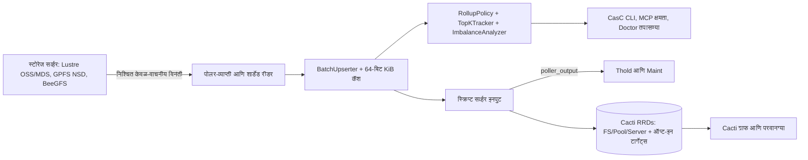

<!-- Source: README.md; SHA256: e88d6875d113220a91cfc0a9d230c829a78477b17e6aa7e44dda38c9591c86ad -->

<!-- translations:start -->
[English](../../../README.md) | [简体中文](../zh-CN/README.md) | [हिन्दी](../hi-IN/README.md) | [Español (España)](../es-ES/README.md) | [Español (Latinoamérica)](../es-419/README.md) | [العربية (السعودية)](../ar-SA/README.md) | [Afrikaans](../af-ZA/README.md) | [አማርኛ](../am-ET/README.md) | [العربية (مصر)](../ar-EG/README.md) | [العربية (المغرب)](../ar-MA/README.md) | [বাংলা](../bn-BD/README.md) | [Bosanski](../bs-BA/README.md) | [Deutsch](../de-DE/README.md) | [فارسی](../fa-IR/README.md) | [Filipino](../fil-PH/README.md) | [Français](../fr-FR/README.md) | [Français (Maroc)](../fr-MA/README.md) | [Français (Sénégal)](../fr-SN/README.md) | [Hausa](../ha-NG/README.md) | [עברית](../he-IL/README.md) | [Hrvatski](../hr-HR/README.md) | [Bahasa Indonesia](../id-ID/README.md) | [Igbo](../ig-NG/README.md) | [Italiano](../it-IT/README.md) | [日本語](../ja-JP/README.md) | [한국어](../ko-KR/README.md) | [Malagasy](../mg-MG/README.md) | [मराठी](README.md) | [Bahasa Melayu](../ms-MY/README.md) | [Nederlands](../nl-NL/README.md) | [Polski](../pl-PL/README.md) | [Português (Brasil)](../pt-BR/README.md) | [Русский](../ru-RU/README.md) | [Kinyarwanda](../rw-RW/README.md) | [Soomaali](../so-SO/README.md) | [Српски](../sr-RS/README.md) | [Svenska](../sv-SE/README.md) | [Kiswahili](../sw-KE/README.md) | [தமிழ்](../ta-IN/README.md) | [తెలుగు](../te-IN/README.md) | [ไทย](../th-TH/README.md) | [Türkçe](../tr-TR/README.md) | [Українська](../uk-UA/README.md) | [اردو](../ur-PK/README.md) | [Tiếng Việt](../vi-VN/README.md) | [isiXhosa](../xh-ZA/README.md) | [Yorùbá](../yo-NG/README.md) | [繁體中文](../zh-TW/README.md) | [isiZulu](../zu-ZA/README.md)
<!-- translations:end -->

# plugin_pfs

Cacti 1.2 साठी एक प्लगइन जे एकात्मिक `Backend` इंटरफेसच्या मागे Lustre, IBM Storage Scale (GPFS), आणि BeeGFS मधील पॅरलल फाइलसिस्टमची स्थिती, क्षमता, भराव असमतोल, प्रति-टार्गेट थ्रूपुट, आणि मेटाडेटा ऑपरेशन दर Cacti मध्ये आणते. प्रत्येक फाइलसिस्टम डेटा क्वेरी, ओव्हरव्ह्यू आणि मागणीनुसार टार्गेट ग्राफ, तसेच सारांश गेज असलेल्या नेहमीच्या Cacti डिव्हाइसवर मॅप केली जाते, त्यामुळे Thold आणि Maint त्यावर कोणताही बदल न करता अलर्ट देतात आणि सप्रेशन करतात.

> **स्थिती: टप्पा 1 ते 3 आणि एक्सास्केल स्केलिंग प्रिमिटिव्ह्ज कोडमध्ये कार्यान्वित, अद्याप प्रकाशित नाही.** पायाभूत रचना, Lustre निरीक्षण, अलर्टिंग आणि Maint सप्रेशन, GPFS आणि BeeGFS केवळ-वाचनीय ड्रायव्हर्स, Maint एकत्रीकरणासह OST/MDT असमतोल विश्लेषण, रिमोट डेटा कलेक्टर स्कोपिंग (`replicate_out`, `remote_agent`), 100+ PB / एक्सास्केल स्केलिंग प्रिमिटिव्ह्ज (`FramedReportParser`, Schema v4 `value_kib`, `RollupPolicy`, `TopKTracker`, `ShardAssigner`, `BatchUpserter`), CasC ऑपरेटर CLI (`cli/pfs.php`), आणि इकोसिस्टम हूक्स (`abilities_register`, `doctor_register_checks`, `casc_register_providers`) कार्यान्वित केलेले असून युनिट, सुरक्षा आणि डिस्पोजेबल-Cacti एकत्रीकरण चाचण्यांद्वारे पडताळलेले आहेत. आतापर्यंतच्या सर्व चाचण्या प्रत्यक्ष Lustre, GPFS किंवा BeeGFS हार्डवेअरऐवजी फिक्स्चर नोड आउटपुट वापरून केल्या आहेत. रिलीज टॅग करण्यापूर्वी अद्याप प्रलंबित कामे: प्रत्यक्ष फाइलसिस्टमवरील पायलट चाचण्या ([पायलट योजना](../../pilot-plan.md)), बाह्य सुरक्षा पुनरावलोकन ([स्वयं-पुनरावलोकन](../../security-review.md)), आणि दस्तऐवजीकरण केलेल्या हार्डवेअरवर स्केल मोजमाप ([स्केल मोजमाप](../../research/scale.md)). आवृत्ती 0.1.0 `INFO` आणि [CHANGELOG.md](../../../CHANGELOG.md) मध्ये तयार आहे परंतु टॅग केलेली नाही.

## प्रवेश भूमिका

| कार्यक्षेत्र (Realm) | प्रवेश |
| --- | --- |
| Parallel Filesystem View | विद्यमान देखरेख पृष्ठे. |
| Parallel Filesystem Operator | देखरेख तसेच Operations पृष्ठ आणि वैयक्तिक ट्रायएज पोचपावत्या. |
| Parallel Filesystem Admin | Operator प्रवेश तसेच विद्यमान कॉन्फिगरेशन आणि प्रशासकीय क्रिया. |

अपग्रेड फायली कॉपी केल्यानंतर, नवीन कार्यक्षेत्र नोंदणीकृत करण्यासाठी प्रशासक म्हणून Plugins पृष्ठ उघडा. **Configuration > Users** किंवा वापरकर्ता गटांअंतर्गत Operator कार्यक्षेत्र स्पष्टपणे नियुक्त करा. अपग्रेड्स विद्यमान View आणि Admin कार्यक्षेत्र आयडी आणि परवानग्या कायम ठेवतात. प्रत्येक विनंतीवर Admin प्रवेशामध्ये Operator प्रवेश अंतर्भूत असतो आणि Operator प्रवेशामध्ये View प्रवेश अंतर्भूत असतो; हे वापरकर्त्यांना किंवा गटांना संग्रहित परवानग्या जोडत नाही. प्लगइन सेटिंग्जसाठी Cacti च्या Settings परवानगीव्यतिरिक्त Parallel Filesystem Admin प्रवेश देखील आवश्यक आहे.

Cacti डिव्हाइस परवानग्या अजूनही प्रत्येक वापरकर्त्यासाठी उपलब्ध असलेल्या ओळी आणि क्रिया मर्यादित करतात; मॅप न केलेल्या ऑब्जेक्ट्ससाठी प्रशासकाची आवश्यकता असते. क्रेडेन्शियल्स, कॉन्फिगरेशन, मॅपिंग, हटवणे आणि इतर प्रशासकीय बदल प्रशासकीय पृष्ठांवरच राहतात. पोचपावत्या केवळ सध्याच्या वापरकर्त्याच्या सत्रापुरत्या, जास्तीत जास्त एक तासासाठी आणि केवळ तेच निरीक्षण ताजे असेपर्यंत टिकतात. नवीन किंवा बदललेली निरीक्षणे त्यांना अवैध ठरवतात. त्या कधीही अयशस्वी मोजमापाला निरोगी म्हणून चिन्हांकित करत नाहीत किंवा अलर्ट दाबत नाहीत.

## हे का आवश्यक आहे

जेव्हा शेअर्ड फाइलसिस्टम मंद असते, तेव्हा त्याचे पुरावे सर्व्हरवर विखुरलेले असतात. Lustre आपले काउंटर्स प्रति-नोड ठेवते: `lctl get_param` मूल्ये "स्थानिक नोडवर" नोंदवते, त्यामुळे प्रत्येक ऑब्जेक्ट स्टोरेज सर्व्हर (OSS) आणि मेटाडेटा सर्व्हर (MDS) कडे फक्त स्वतःच्या टार्गेट्सचीच आकडेवारी असते. मंद फाइलसिस्टमची तपासणी करणाऱ्या ऑपरेटरला वेगवेगळ्या ठिकाणांहून तीन उत्तरांची आवश्यकता असते:

- **एखादे टार्गेट भरत असताना इतर रिकामे आहेत का?** भराव असमतोल नवीन फायली कोठे तयार होतात आणि एखाद्या टार्गेटची जागा कधी संपेल हे बदलतो.
- **कोणते टार्गेट्स किंवा ऑपरेशन्स व्यस्त आहेत?** प्रति-टार्गेट बाइट काउंटर्स आणि प्रति-MDT ऑपरेशन काउंटर्स भार डेटा-बाउंड आहे की मेटाडेटा-बाउंड आहे हे दर्शवतात.
- **देखरेख स्वतः अद्ययावत आहे का?** जर प्लगइन सर्व्हर पाहू शकत असेल तरच सपाट ग्राफ आश्वासक ठरतो.

Cacti होस्टचे ग्राफ काढते आणि Thold सह मूल्यांवर थ्रेशोल्ड लावते, आणि Cacti GitHub संस्थेकडे Lustre, GPFS किंवा BeeGFS देखरेखीसाठी कोणतीही रिपॉझिटरी नाही (2026-11-14 रोजी शोधलेले). स्टोरेज नोड्सवरून अनुमती सूचीतील, केवळ-वाचनीय मूल्ये वाचून आणि प्रत्येक फाइलसिस्टमला एक Cacti डिव्हाइस म्हणून दर्शवून (ज्याचे टार्गेट्स डेटा क्वेरीचे इंडेक्स असतात) हे प्लगइन ती उणीव भरून काढते. ते त्यांच्या समांतर आवृत्त्या तयार करण्याऐवजी Cacti चे ग्राफिंग, परवानग्या, रिमोट डेटा कलेक्टर्स, Thold आणि Maint यांचा पुनर्वापर करते.

## नियोजित व्याप्ती

| टप्पा | व्याप्ती | स्थिती | माइलस्टोन्स |
|---|---|---|---|
| 0, संशोधन | रिलीज मॅट्रिक्स, नोड प्रवेश निर्णय, अपस्ट्रीम वर्तन पुष्टीकरण, काउंटर आणि फेलओव्हर वर्तन, स्केल मोजमाप | पूर्ण | [M1](https://github.com/somethingwithproof/plugin_pfs/milestone/1) |
| 1, निरीक्षण | Lustre इन्व्हेंटरी, क्षमता आणि भराव, OST/MDT असमतोल (`lib/ImbalanceAnalyzer.php`), Maint एकत्रीकरण (`lib/HealthPage.php`), OST थ्रूपुट, MDT ऑपरेशन दर, ग्राफ, Thold अलर्टिंग, हेल्थ पृष्ठ | कार्यान्वित (फिक्स्चर-चाचणीकृत) | [M2](https://github.com/somethingwithproof/plugin_pfs/milestone/2), [M3](https://github.com/somethingwithproof/plugin_pfs/milestone/3), [M4](https://github.com/somethingwithproof/plugin_pfs/milestone/4) |
| 2, रिमोट आणि स्केल | पोलर-व्याप्तीचे रिमोट संकलन (`lib/Reader.php`, `lib/ReplicationRepository.php`, `replicate_out`, `remote_agent`), 100+ PB स्केलिंग प्रिमिटिव्ह्ज (64-बिट KiB स्वच्छता + Schema v4 `value_kib`, `lib/RollupPolicy.php`, `lib/TopKTracker.php`, `lib/ShardAssigner.php` + `poller_pfs.php --shard=K/N`, `lib/BatchUpserter.php`), CasC CLI (`cli/pfs.php`), MCP/Doctor/CasC हूक्स | कार्यान्वित (युनिट आणि CI एकत्रीकरण चाचणीकृत) | [M5](https://github.com/somethingwithproof/plugin_pfs/milestone/5) |
| 3, बॅकएंड्स | `BackendRegistry::production()` मध्ये नोंदणीकृत केवळ-वाचनीय IBM Storage Scale (GPFS) (`lib/GpfsBackend.php`) आणि BeeGFS (`lib/BeegfsBackend.php`) ड्रायव्हर्स | कार्यान्वित (युनिट-चाचणीकृत) | [M6](https://github.com/somethingwithproof/plugin_pfs/milestone/6) |

कार्यान्वित केलेली प्रमुख ऑपरेटर आणि स्केलिंग प्रिमिटिव्ह्ज:

- **बहु-फाइलसिस्टम केवळ-वाचनीय ड्रायव्हर्स:** `lib/FramedReportParser.php` सामायिक करणारे `LustreBackend`, `GpfsBackend` (`reset` प्रतिबंधित असलेले केवळ फ्रेम केलेले `mmpmon` `fs_io_s`/`io_s`, `mmdf` पूल क्षमता/स्थिती, आणि वेटर सारांश), आणि `BeegfsBackend` (अचूक बाइट-ते-KiB रूपांतरण, पोहोचण्यायोग्यता/सुसंगतता स्थिती मॅपिंग आणि प्रति-अंतराल गेज अर्थशास्त्रासह BeeGFS 7.4 आणि 8.x स्टोरेज/मेटाडेटा टार्गेट्स).
- **असमतोल, हेडरूम आणि Maint जागरूकता:** `lib/ImbalanceAnalyzer.php` OST/MDT भराव गुणोत्तर, विस्तार (spread), लोकसंख्या मानक विचलन असमतोल निर्देशांक, हेडरूम, 1-अंतराल ताजेपणा अंमलबजावणी (`missing_targets`), प्रति-टार्गेट स्थिती ध्वज आणि मर्यादित Top-K तिरपे टार्गेट्स मोजते. `HealthPage` (`pfs_health.php`) आणि `CascProvider::health()` Cacti `Maint` देखभाल विंडो दर्शवतात आणि नियोजित देखभालीदरम्यान सक्रिय अयशस्वी चेतावण्या दाबतात.
- **100+ PB आणि एक्सास्केल स्केलिंग** ([docs/architecture/exascale-scaling.md](../../architecture/exascale-scaling.md)): `BIGINT UNSIGNED value_kib` स्तंभांसह (Schema v4) 500 PB आणि 2 EB वर पडताळलेले अचूक दशांश बाइट-ते-KiB रूपांतरण (`FramedReportParser::bytesToKibInt()`); मर्यादित ऑप्ट-इन/हॉट/तिरप्या टार्गेट प्रमोशनसह पदानुक्रमित `Filesystem -> Pool -> Storage Server` RRD रोलअप्स (`lib/RollupPolicy.php`); मर्यादित $O(K)$ Top-K तिरपे टार्गेट्स आणि पूर्व-संकलित जड जॉब/क्लायंट सारांश (`lib/TopKTracker.php`, प्रति-क्लायंट डिव्हाइसेस किंवा RRD कधीही तयार न करता); नियतात्मक CRC32 कलेक्टर शार्डिंग (`lib/ShardAssigner.php`, `php plugins/pfs/poller_pfs.php [--poller=N] [--shard=K/N] [--force] [--debug]`); आणि 500-ओळींच्या बॅच केलेल्या SQL अपसर्ट्स तसेच कीसेट पेजिनेशन (`lib/BatchUpserter.php`, `CacheRepository::upsertObservationsBatch()`, `TargetRepository::forFilesystemPage()`).
- **ऑपरेटर CasC CLI आणि इकोसिस्टम हूक्स:** `cli/pfs.php` शून्य बाह्य Composer अवलंबित्वांसह `export [--format=yaml|xml]`, `validate <file> [--format=yaml|xml]`, `plan <file> [--format=yaml|xml] [--output=text|json]`, `apply <file> --confirm=<PLAN_HASH> [--format=yaml|xml]`, आणि `health [--format=text|json]` समर्थित करते. `setup.php` आणि `lib/EcosystemIntegration.php` हे `abilities_register` (`pfs-list-filesystems`, `pfs-get-imbalance`, `pfs-get-health`; केवळ-वाचनीय, `Parallel Filesystem View` आणि Cacti डिव्हाइस परवानग्यांवर नियंत्रित), `doctor_register_checks` (`pfs_schema`, `pfs_reader_freshness`, `pfs_capacity_imbalance`), `casc_register_providers`, `replicate_out`, आणि `remote_agent` नोंदणीकृत करतात.

व्याप्तीबाहेर: नोड किंवा फाइलसिस्टमवर कोणतेही लिखान, क्लिअर, रीसेट किंवा ट्यूनिंग ऑपरेशन; प्लगइनच्या मालकीचे अलर्टिंग इंजिन; कस्टम डिमन किंवा नेटवर्क प्रोटोकॉल; प्रति-जॉब किंवा प्रति-क्लायंट Cacti डिव्हाइसेस/RRDs; Cacti कोर, Thold किंवा Maint मधील बदल.

## सुसंगतता लक्ष्ये

| घटक | लक्ष्य |
|---|---|
| Cacti | 1.2.31 किंवा नंतरची आवृत्ती, कोणतेही कोर पॅचेस नाहीत |
| PHP | 8.2 किंवा नंतरची आवृत्ती; `setup.php`, `poller_pfs.php`, आणि `cli/pfs.php` 8.0 वर पार्स करण्यायोग्य राहतात जेणेकरून असमर्थित रनटाइमला तुटलेल्या Cacti UI ऐवजी नकार संदेश मिळेल |
| Lustre | सोर्स आणि मॅन्युअल्स 2.17.0 वर तपासलेले; फिक्स्चर-चाचणीकृत |
| GPFS, BeeGFS | IBM Storage Scale (GPFS) 5.x `mmpmon`/`mmdf` आणि BeeGFS 7.4 / 8.x केवळ-वाचनीय ड्रायव्हर्स कार्यान्वित आणि फिक्स्चर-चाचणीकृत |
| Thold, Maint | Thold 1.8.2 आणि Maint 1.3, अपरिवर्तित |

## रचना

- [docs/architecture/exascale-scaling.md](../../architecture/exascale-scaling.md) द्वि-स्तरीय 100+ PB / एक्सास्केल टेलीमेट्री आर्किटेक्चर (आउट-ऑफ-बँड LDMS/Darshan/TOKIO क्लायंट टेलीमेट्रीसह जोडलेला Cacti/`plugin_pfs` सर्व्हर + रोलअप + Top-K स्तर) आणि त्याचे शैक्षणिक साहित्य संदर्भ दस्तऐवजीकरण करते.
- [docs/PLAN.md](../../PLAN.md) ही संपूर्ण योजना आहे: आर्किटेक्चर, ती अवलंबून असलेली अपस्ट्रीम तथ्ये (संदर्भांसह आणि अद्याप काय अपुष्ट आहे यासह), काउंटर अर्थशास्त्र, स्टेट मॉडेल, सुरक्षा सीमा, कार्यप्रदर्शन अंकगणित, चाचणी आणि जोखीम.
- [docs/operator-guide.md](../../operator-guide.md) मध्ये इन्स्टॉल, ग्राफ आणि मूल्ये, अपग्रेड, बॅकअप आणि रीस्टोअर, अनइन्स्टॉल आणि समस्यानिवारण यांचा समावेश आहे; [docs/alerting.md](../../alerting.md) मध्ये Thold आणि Maint समाविष्ट आहेत.
- [docs/node-setup.md](../../node-setup.md) वाचकासाठी Lustre सर्व्हर आणि पोलर कसे तयार करायचे याचे वर्णन करते.
- [docs/decisions/](../../decisions) मध्ये आधीच घेतलेल्या निवडींसाठी आर्किटेक्चर निर्णय नोंदी आहेत.
- [docs/REQUIREMENTS.md](../../REQUIREMENTS.md) प्रत्येक आवश्यकता आयडीला तिच्या इश्यूशी मॅप करते.

## कामाचा मागोवा कसा घेतला जातो

- **माइलस्टोन्स** योजनेतील माइलस्टोन्सचे अनुसरण करतात. प्रत्येकाकडे त्याच्या उप-इश्यू आणि निर्गमन पुराव्यांची यादी करणारा एक एपिक इश्यू असतो.
- **इश्यूज** लेबलनुसार प्रकारित केलेले आहेत: `type: requirement`, `type: research`, `type: decision`, `type: epic`. आवश्यकता इश्यूज क्रमांकित, तपासण्यायोग्य आवश्यकता (`REQ-AREA-NNN`) आणि स्वीकृती निकष नमूद करतात.
- **लेबल्स** मध्ये `area:`, `phase:`, `priority:`, आणि `status:` देखील असतात. पहा [CONTRIBUTING.md](../../../CONTRIBUTING.md#labels).
- [प्रकल्प बोर्ड](https://github.com/users/somethingwithproof/projects/11) सर्व माइलस्टोन्समधील सर्व इश्यूज दर्शवतो.

## योगदान

[CONTRIBUTING.md](../../../CONTRIBUTING.md) वाचा. कमिट्ससाठी DCO साइन-ऑफ आवश्यक आहे. डिझाइन चर्चा इश्यूजवर होतात; प्रलंबित निर्णयांवर `type: decision` लेबल असते.

## सुरक्षा

सुरक्षा त्रुटी खाजगीरीत्या कळवा; पहा [SECURITY.md](../../../SECURITY.md).

## परवाना

GNU General Public License v2.0, Cacti आणि त्याच्या प्लगइनसारखाच परवाना. पहा [LICENSE](../../../LICENSE).
