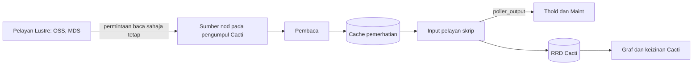

<!-- Source: README.md; SHA256: e88d6875d113220a91cfc0a9d230c829a78477b17e6aa7e44dda38c9591c86ad -->

<!-- translations:start -->
[English](../../../README.md) | [简体中文](../zh-CN/README.md) | [हिन्दी](../hi-IN/README.md) | [Español (España)](../es-ES/README.md) | [Español (Latinoamérica)](../es-419/README.md) | [العربية (السعودية)](../ar-SA/README.md) | [Afrikaans](../af-ZA/README.md) | [አማርኛ](../am-ET/README.md) | [العربية (مصر)](../ar-EG/README.md) | [العربية (المغرب)](../ar-MA/README.md) | [বাংলা](../bn-BD/README.md) | [Bosanski](../bs-BA/README.md) | [Deutsch](../de-DE/README.md) | [فارسی](../fa-IR/README.md) | [Filipino](../fil-PH/README.md) | [Français](../fr-FR/README.md) | [Français (Maroc)](../fr-MA/README.md) | [Français (Sénégal)](../fr-SN/README.md) | [Hausa](../ha-NG/README.md) | [עברית](../he-IL/README.md) | [Hrvatski](../hr-HR/README.md) | [Bahasa Indonesia](../id-ID/README.md) | [Igbo](../ig-NG/README.md) | [Italiano](../it-IT/README.md) | [日本語](../ja-JP/README.md) | [한국어](../ko-KR/README.md) | [Malagasy](../mg-MG/README.md) | [मराठी](../mr-IN/README.md) | [Bahasa Melayu](README.md) | [Nederlands](../nl-NL/README.md) | [Polski](../pl-PL/README.md) | [Português (Brasil)](../pt-BR/README.md) | [Русский](../ru-RU/README.md) | [Kinyarwanda](../rw-RW/README.md) | [Soomaali](../so-SO/README.md) | [Српски](../sr-RS/README.md) | [Svenska](../sv-SE/README.md) | [Kiswahili](../sw-KE/README.md) | [தமிழ்](../ta-IN/README.md) | [తెలుగు](../te-IN/README.md) | [ไทย](../th-TH/README.md) | [Türkçe](../tr-TR/README.md) | [Українська](../uk-UA/README.md) | [اردو](../ur-PK/README.md) | [Tiếng Việt](../vi-VN/README.md) | [isiXhosa](../xh-ZA/README.md) | [Yorùbá](../yo-NG/README.md) | [繁體中文](../zh-TW/README.md) | [isiZulu](../zu-ZA/README.md)
<!-- translations:end -->

# plugin_pfs

Pemalam Cacti 1.2 yang membawa kesihatan dan beban sistem fail selari ke dalam Cacti: kapasiti dan ketidakseimbangan isian merentas sasaran, pemprosesan per sasaran, serta kadar operasi metadata. Lustre ialah bahagian belakang yang pertama. GPFS (IBM Storage Scale) dan BeeGFS menyusul di sebalik antara muka bahagian belakang. Data dimasukkan ke dalam peranti, sumber data, dan graf Cacti biasa, supaya Thold dan Maint dapat memberi amaran dan menyekatnya tanpa sebarang perubahan.

> **Status: pencapaian 4, kod lengkap untuk fasa 1, belum dikeluarkan.** Pencapaian 2 (asas), 3 (pemerhatian Lustre), dan 4 (makluman dan penyediaan keluaran) telah selesai pada `main` atau sedang dalam semakan. Pemalam ini dipasang, dinaik taraf, dan dinyahpasang melalui API pemalam Cacti serta menolak PHP di bawah versi 8.2. Pembaca latar belakang pada setiap pengumpul membaca pelayan Lustre melalui SSH menerusi skrip perintah paksa tetap ([node/pfs-read.sh](../../../node/pfs-read.sh)) dan menyimpan cache inventori, keadaan, kapasiti, dan pembilang berserta kesegarannya. Setiap sistem fail menjadi satu peranti Cacti dengan pertanyaan data OST dan MDT, lima graf gambaran keseluruhan, graf per sasaran atas permintaan, dan satu sumber data ringkasan untuk Thold. Thold v1.8.2 dan Maint v1.3, tanpa diubah suai, memberi amaran dan menyekat tolok ringkasan dalam larian hujung ke hujung; ambang Thold pada pembilang tidak disokong dengan Thold 1.8.2 ([docs/alerting.md](../../alerting.md)). Setiap ujian setakat ini dijalankan menggunakan output nod lekapan dalam persekitaran Cacti pakai buang: pemalam ini belum dijalankan pada nod Lustre sebenar. Masih terbuka sebelum keluaran: rintis pada sistem fail sebenar ([pelan rintis](../../pilot-plan.md)), semakan keselamatan luaran ([semakan kendiri](../../security-review.md)), dan pengukuran skala pada perkakasan yang didokumenkan ([skala](../../research/scale.md)). Versi 0.1.0 telah disediakan dalam `INFO` dan [CHANGELOG.md](../../../CHANGELOG.md) tetapi belum ditandakan dengan tag.

## Peranan akses

| Alam | Akses |
| --- | --- |
| Parallel Filesystem View | Halaman pemantauan sedia ada. |
| Parallel Filesystem Operator | Pemantauan serta halaman Operasi dan pengakuan triaj peribadi. |
| Parallel Filesystem Admin | Akses Operator serta konfigurasi sedia ada dan tindakan pentadbiran. |

Selepas menyalin fail naik taraf, buka halaman Plugins sebagai pentadbir untuk mendaftarkan
alam baharu. Tetapkan alam Operator secara eksplisit di bawah **Configuration > Users** atau kumpulan pengguna.
Naik taraf mengekalkan ID alam dan pemberian kebenaran View serta Admin yang sedia ada. Akses Admin
mewarisi akses Operator, dan akses Operator mewarisi akses View pada setiap permintaan;
ini tidak menambah pemberian kebenaran yang disimpan kepada pengguna atau kumpulan. Tetapan pemalam juga memerlukan
akses Parallel Filesystem Admin selain keizinan Settings Cacti.

Keizinan peranti Cacti masih mengehadkan baris dan tindakan yang tersedia kepada setiap pengguna; objek yang tidak dipetakan memerlukan pentadbir.
Bukti kelayakan, konfigurasi, pemetaan, pemadaman, dan perubahan pentadbiran lain
kekal dalam halaman pentadbiran. Pengakuan hanya bertahan dalam sesi pengguna
semasa, untuk maksimum satu jam dan hanya selagi pemerhatian yang sama kekal
segar. Pemerhatian baharu atau yang berubah akan membatalkannya. Pengakuan tidak sekali-kali menandakan pengukuran
yang gagal sebagai sihat atau menyekat makluman.

## Mengapa

Apabila sistem fail kongsi menjadi perlahan, buktinya tersebar merentas pelayan. Lustre menyimpan pembilangnya bagi setiap nod: `lctl get_param` melaporkan nilai "pada nod setempat", jadi setiap pelayan storan objek (OSS) dan pelayan metadata (MDS) hanya memegang angka bagi sasarannya sendiri. Pengendali yang menyiasat sistem fail yang perlahan memerlukan tiga jawapan daripada tempat yang berbeza:

- **Adakah satu sasaran sedang penuh manakala yang lain kosong?** Ketidakseimbangan isian mengubah tempat fail baharu disimpan dan masa sesuatu sasaran kehabisan ruang.
- **Sasaran atau operasi manakah yang sibuk?** Pembilang bait per sasaran dan pembilang operasi per MDT menunjukkan sama ada beban terikat kepada data atau terikat kepada metadata.
- **Adakah pemantauan itu sendiri terkini?** Graf yang mendatar hanya meyakinkan jika pemalam dapat melihat pelayan tersebut.

Cacti memgrafkan hos dan menetapkan ambang nilai dengan Thold, dan organisasi GitHub Cacti tidak mempunyai repositori untuk pemantauan Lustre, GPFS, atau BeeGFS (dicari pada 2026-11-14). Pemalam ini merapatkan jurang tersebut dengan membaca nilai baca sahaja yang dibenarkan daripada nod storan dan mewakili setiap sistem fail sebagai peranti Cacti yang sasarannya merupakan indeks bagi satu pertanyaan data. Ia menggunakan semula penggrafan, keizinan, pengumpul data jauh, Thold, dan Maint milik Cacti berbanding membina versi selari baginya.

## Skop yang dirancang

| Fasa | Skop | Pencapaian |
|---|---|---|
| 0, penyelidikan | Matriks keluaran, keputusan akses nod, pengesahan kelakuan huluan, kelakuan pembilang dan ambil alih kegagalan, pengukuran skala | [M1](https://github.com/somethingwithproof/plugin_pfs/milestone/1) |
| 1, pemerhatian | Inventori Lustre, kapasiti dan isian, pemprosesan OST, kadar operasi MDT, graf, makluman Thold, sekatan Maint, halaman kesihatan | [M2](https://github.com/somethingwithproof/plugin_pfs/milestone/2), [M3](https://github.com/somethingwithproof/plugin_pfs/milestone/3), [M4](https://github.com/somethingwithproof/plugin_pfs/milestone/4) |
| 2, kedalaman | Pengumpul data jauh Cacti, paparan peringkat tugas dan peringkat klien dalam bilangan objek yang terhad | [M5](https://github.com/somethingwithproof/plugin_pfs/milestone/5) |
| 3, bahagian belakang | Bahagian belakang GPFS (IBM Storage Scale) dan BeeGFS | [M6](https://github.com/somethingwithproof/plugin_pfs/milestone/6) |

Di luar skop: sebarang operasi tulis, kosongkan, tetapkan semula, atau penalaan pada nod atau sistem fail; enjin makluman milik pemalam; daemon atau protokol rangkaian tersuai; sumber data per tugas; perubahan pada teras Cacti, Thold, atau Maint.

## Sasaran keserasian

| Komponen | Sasaran |
|---|---|
| Cacti | 1.2.31 atau lebih baharu, tanpa tampalan teras |
| PHP | 8.2 atau lebih baharu; `setup.php` kekal boleh dihuraikan pada 8.0 supaya masa jalan yang tidak disokong mendapat penolakan dan bukannya UI Cacti yang rosak |
| Lustre | Barisan keluaran akan ditetapkan oleh pencapaian 1; sumber dan manual yang disemak setakat ini berada pada 2.17.0 |
| GPFS, BeeGFS | Fasa 3; keluaran akan ditetapkan oleh penyelidikan |
| Thold, Maint | Tiada perubahan diperlukan |

## Reka bentuk

- [docs/PLAN.md](../../PLAN.md) ialah pelan penuh: seni bina, fakta huluan yang menjadi sandarannya (dengan sumber dan perkara yang masih belum disahkan), semantik pembilang, model keadaan, sempadan keselamatan, aritmetik prestasi, pengujian, dan risiko.
- [docs/operator-guide.md](../../operator-guide.md) merangkumi pemasangan, graf dan nilai, naik taraf, sandaran dan pemulihan, nyahpasang, serta penyelesaian masalah; [docs/alerting.md](../../alerting.md) merangkumi Thold dan Maint.
- [docs/node-setup.md](../../node-setup.md) menerangkan cara menyediakan pelayan Lustre dan pengumpul untuk pembaca.
- [docs/decisions/](../../decisions) menyimpan rekod keputusan seni bina bagi pilihan yang telah dibuat.
- [docs/REQUIREMENTS.md](../../REQUIREMENTS.md) memetakan setiap ID keperluan kepada isunya.

## Cara kerja dijejaki

- **Pencapaian** mengikut pencapaian pelan. Setiap satunya mempunyai isu epik yang menyenaraikan sub-isu dan bukti keluarannya.
- **Isu** dikelaskan mengikut label: `type: requirement`, `type: research`, `type: decision`, `type: epic`. Isu keperluan menyatakan keperluan bernombor yang boleh diuji (`REQ-AREA-NNN`) dan kriteria penerimaan.
- **Label** juga membawa `area:`, `phase:`, `priority:`, dan `status:`. Lihat [CONTRIBUTING.md](../../../CONTRIBUTING.md#labels).
- [Papan projek](https://github.com/users/somethingwithproof/projects/11) menunjukkan semua isu merentas pencapaian.

## Sumbangan

Baca [CONTRIBUTING.md](../../../CONTRIBUTING.md). Komit memerlukan pengesahan tandatangan DCO. Perbincangan reka bentuk berlaku pada isu; keputusan terbuka membawa label `type: decision`.

## Keselamatan

Laporkan kerentanan secara peribadi; lihat [SECURITY.md](../../../SECURITY.md).

## Lesen

GNU General Public License v2.0, lesen yang sama seperti Cacti dan pemalamnya. Lihat [LICENSE](../../../LICENSE).
