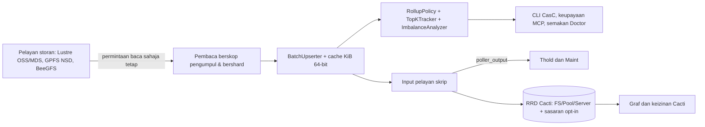

<!-- Source: README.md; SHA256: e88d6875d113220a91cfc0a9d230c829a78477b17e6aa7e44dda38c9591c86ad -->

<!-- translations:start -->
[English](../../../README.md) | [简体中文](../zh-CN/README.md) | [हिन्दी](../hi-IN/README.md) | [Español (España)](../es-ES/README.md) | [Español (Latinoamérica)](../es-419/README.md) | [العربية (السعودية)](../ar-SA/README.md) | [Afrikaans](../af-ZA/README.md) | [አማርኛ](../am-ET/README.md) | [العربية (مصر)](../ar-EG/README.md) | [العربية (المغرب)](../ar-MA/README.md) | [Български](../bg-BG/README.md) | [বাংলা](../bn-BD/README.md) | [Bosanski](../bs-BA/README.md) | [Deutsch](../de-DE/README.md) | [Ελληνικά](../el-GR/README.md) | [فارسی](../fa-IR/README.md) | [Filipino](../fil-PH/README.md) | [Français](../fr-FR/README.md) | [Français (Maroc)](../fr-MA/README.md) | [Français (Sénégal)](../fr-SN/README.md) | [Hausa](../ha-NG/README.md) | [עברית](../he-IL/README.md) | [Hrvatski](../hr-HR/README.md) | [Bahasa Indonesia](../id-ID/README.md) | [Igbo](../ig-NG/README.md) | [Italiano](../it-IT/README.md) | [日本語](../ja-JP/README.md) | [ქართული](../ka-GE/README.md) | [한국어](../ko-KR/README.md) | [Latviešu](../lv-LV/README.md) | [Malagasy](../mg-MG/README.md) | [मराठी](../mr-IN/README.md) | [Bahasa Melayu](README.md) | [Nederlands](../nl-NL/README.md) | [Polski](../pl-PL/README.md) | [Português (Brasil)](../pt-BR/README.md) | [Português (Portugal)](../pt-PT/README.md) | [Русский](../ru-RU/README.md) | [Kinyarwanda](../rw-RW/README.md) | [Soomaali](../so-SO/README.md) | [Српски](../sr-RS/README.md) | [Svenska](../sv-SE/README.md) | [Kiswahili](../sw-KE/README.md) | [தமிழ்](../ta-IN/README.md) | [తెలుగు](../te-IN/README.md) | [ไทย](../th-TH/README.md) | [Türkçe](../tr-TR/README.md) | [Українська](../uk-UA/README.md) | [اردو](../ur-PK/README.md) | [Tiếng Việt](../vi-VN/README.md) | [isiXhosa](../xh-ZA/README.md) | [Yorùbá](../yo-NG/README.md) | [繁體中文](../zh-TW/README.md) | [isiZulu](../zu-ZA/README.md)
<!-- translations:end -->

# plugin_pfs

Pemalam Cacti 1.2 yang membawa kesihatan, kapasiti, ketidakseimbangan isian, pemprosesan per sasaran, dan kadar operasi metadata sistem fail selari ke dalam Cacti merentasi Lustre, IBM Storage Scale (GPFS), dan BeeGFS di sebalik antara muka `Backend` bersepadu. Setiap sistem fail dipetakan kepada peranti Cacti biasa dengan pertanyaan data, graf gambaran keseluruhan dan graf sasaran atas permintaan, serta tolok ringkasan supaya Thold dan Maint memberi amaran dan menyekatnya tanpa perubahan.

> **Status: fasa 1 hingga 3 dan primitif penskalaan exascale dilaksanakan dalam kod, belum dikeluarkan.** Asas, pemerhatian Lustre, makluman dan sekatan Maint, pemacu baca sahaja GPFS dan BeeGFS, analisis ketidakseimbangan OST/MDT dengan integrasi Maint, penskopan pengumpul data jauh (`replicate_out`, `remote_agent`), primitif penskalaan 100+ PB / exascale (`FramedReportParser`, Skema v4 `value_kib`, `RollupPolicy`, `TopKTracker`, `ShardAssigner`, `BatchUpserter`), CLI pengendali CasC (`cli/pfs.php`), dan cangkuk ekosistem (`abilities_register`, `doctor_register_checks`, `casc_register_providers`) telah dilaksanakan serta disahkan melalui ujian unit, keselamatan, dan integrasi Cacti pakai buang. Semua larian setakat ini menggunakan output nod lekapan berbanding perkakasan Lustre, GPFS, atau BeeGFS sebenar. Masih terbuka sebelum menandakan keluaran: rintis pada sistem fail sebenar ([pelan rintis](../../pilot-plan.md)), semakan keselamatan luaran ([semakan kendiri](../../security-review.md)), dan pengukuran skala pada perkakasan yang didokumenkan ([skala](../../research/scale.md)). Versi 0.1.0 telah disediakan dalam `INFO` dan [CHANGELOG.md](../../../CHANGELOG.md) tetapi belum ditandakan dengan tag.

## Peranan akses

| Alam | Akses |
| --- | --- |
| Parallel Filesystem View | Halaman pemantauan sedia ada. |
| Parallel Filesystem Operator | Pemantauan serta halaman Operasi dan pengakuan triaj peribadi. |
| Parallel Filesystem Admin | Akses Operator serta konfigurasi sedia ada dan tindakan pentadbiran. |

Selepas menyalin fail naik taraf, buka halaman Plugins sebagai pentadbir untuk mendaftarkan
alam baharu. Tetapkan alam Operator secara eksplisit di bawah **Configuration > Users** atau kumpulan pengguna.
Naik taraf mengekalkan ID alam dan pemberian kebenaran View serta Admin yang sedia ada. Akses Admin
mewarisi akses Operator, dan akses Operator mewarisi akses View pada setiap permintaan;
ini tidak menambah pemberian kebenaran yang disimpan kepada pengguna atau kumpulan. Tetapan pemalam juga memerlukan
akses Parallel Filesystem Admin selain keizinan Settings Cacti.

Keizinan peranti Cacti masih mengehadkan baris dan tindakan yang tersedia kepada setiap pengguna; objek yang tidak dipetakan memerlukan pentadbir.
Bukti kelayakan, konfigurasi, pemetaan, pemadaman, dan perubahan pentadbiran lain
kekal dalam halaman pentadbiran. Pengakuan hanya bertahan dalam sesi pengguna
semasa, untuk maksimum satu jam dan hanya selagi pemerhatian yang sama kekal
segar. Pemerhatian baharu atau yang berubah akan membatalkannya. Pengakuan tidak sekali-kali menandakan pengukuran
yang gagal sebagai sihat atau menyekat makluman.

## Mengapa

Apabila sistem fail kongsi menjadi perlahan, buktinya tersebar merentas pelayan. Lustre menyimpan pembilangnya bagi setiap nod: `lctl get_param` melaporkan nilai "pada nod setempat", jadi setiap pelayan storan objek (OSS) dan pelayan metadata (MDS) hanya memegang angka bagi sasarannya sendiri. Pengendali yang menyiasat sistem fail yang perlahan memerlukan tiga jawapan daripada tempat yang berbeza:

- **Adakah satu sasaran sedang penuh manakala yang lain kosong?** Ketidakseimbangan isian mengubah tempat fail baharu disimpan dan masa sesuatu sasaran kehabisan ruang.
- **Sasaran atau operasi manakah yang sibuk?** Pembilang bait per sasaran dan pembilang operasi per MDT menunjukkan sama ada beban terikat kepada data atau terikat kepada metadata.
- **Adakah pemantauan itu sendiri terkini?** Graf yang mendatar hanya meyakinkan jika pemalam dapat melihat pelayan tersebut.

Cacti memgrafkan hos dan menetapkan ambang nilai dengan Thold, dan organisasi GitHub Cacti tidak mempunyai repositori untuk pemantauan Lustre, GPFS, atau BeeGFS (dicari pada 2026-11-14). Pemalam ini merapatkan jurang tersebut dengan membaca nilai baca sahaja yang dibenarkan daripada nod storan dan mewakili setiap sistem fail sebagai peranti Cacti yang sasarannya merupakan indeks bagi satu pertanyaan data. Ia menggunakan semula penggrafan, keizinan, pengumpul data jauh, Thold, dan Maint milik Cacti berbanding membina versi selari baginya.

## Skop yang dirancang

| Fasa | Skop | Status | Pencapaian |
|---|---|---|---|
| 0, penyelidikan | Matriks keluaran, keputusan akses nod, pengesahan kelakuan huluan, kelakuan pembilang dan ambil alih kegagalan, pengukuran skala | Selesai | [M1](https://github.com/somethingwithproof/plugin_pfs/milestone/1) |
| 1, pemerhatian | Inventori Lustre, kapasiti dan isian, ketidakseimbangan OST/MDT (`lib/ImbalanceAnalyzer.php`), integrasi Maint (`lib/HealthPage.php`), pemprosesan OST, kadar operasi MDT, graf, makluman Thold, halaman kesihatan | Dilaksanakan (diuji dengan lekapan) | [M2](https://github.com/somethingwithproof/plugin_pfs/milestone/2), [M3](https://github.com/somethingwithproof/plugin_pfs/milestone/3), [M4](https://github.com/somethingwithproof/plugin_pfs/milestone/4) |
| 2, jauh dan skala | Pengumpulan jauh berskop pengumpul (`lib/Reader.php`, `lib/ReplicationRepository.php`, `replicate_out`, `remote_agent`), primitif penskalaan 100+ PB (kebersihan KiB 64-bit + Skema v4 `value_kib`, `lib/RollupPolicy.php`, `lib/TopKTracker.php`, `lib/ShardAssigner.php` + `poller_pfs.php --shard=K/N`, `lib/BatchUpserter.php`), CLI CasC (`cli/pfs.php`), cangkuk MCP/Doctor/CasC | Dilaksanakan (diuji unit dan integrasi CI) | [M5](https://github.com/somethingwithproof/plugin_pfs/milestone/5) |
| 3, bahagian belakang | Pemacu baca sahaja IBM Storage Scale (GPFS) (`lib/GpfsBackend.php`) dan BeeGFS (`lib/BeegfsBackend.php`) yang didaftarkan dalam `BackendRegistry::production()` | Dilaksanakan (diuji unit) | [M6](https://github.com/somethingwithproof/plugin_pfs/milestone/6) |

Primitif pengendali dan penskalaan utama yang telah dilaksanakan:

- **Pemacu baca sahaja berbilang sistem fail:** `LustreBackend`, `GpfsBackend` (`mmpmon` berbingkai `fs_io_s`/`io_s` sahaja dengan `reset` diharamkan, kapasiti/keadaan kolam `mmdf`, dan ringkasan penunggu), dan `BeegfsBackend` (sasaran storan/metadata BeeGFS 7.4 dan 8.x dengan penukaran bait-ke-KiB yang tepat, pemetaan keadaan kebolehcapaian/ketekalan, dan semantik tolok per selang) yang berkongsi `lib/FramedReportParser.php`.
- **Kesedaran ketidakseimbangan, ruang kosong, dan Maint:** `lib/ImbalanceAnalyzer.php` mengira nisbah isian OST/MDT, sebaran, indeks ketidakseimbangan sisihan piawai populasi, ruang kosong, penguatkuasaan kesegaran 1-selang (`missing_targets`), bendera status per sasaran, dan sasaran condong Top-K terhad. `HealthPage` (`pfs_health.php`) dan `CascProvider::health()` memaparkan tetingkap penyelenggaraan `Maint` Cacti serta menyekat amaran kegagalan aktif semasa penyelenggaraan berjadual.
- **Penskalaan 100+ PB dan exascale** ([docs/architecture/exascale-scaling.md](../../architecture/exascale-scaling.md)): penukaran bait-ke-KiB perpuluhan yang tepat (`FramedReportParser::bytesToKibInt()`) disahkan pada 500 PB dan 2 EB bersama lajur `BIGINT UNSIGNED value_kib` (Skema v4); penggulungan RRD berhierarki `Filesystem -> Pool -> Storage Server` dengan kenaikan sasaran opt-in/panas/condong terhad (`lib/RollupPolicy.php`); sasaran condong Top-K $O(K)$ terhad dan ringkasan tugas/klien berat pra-agregat (`lib/TopKTracker.php`, tidak sekali-kali mencipta peranti atau RRD per klien); pengshardingan pengumpul CRC32 deterministik (`lib/ShardAssigner.php`, `php plugins/pfs/poller_pfs.php [--poller=N] [--shard=K/N] [--force] [--debug]`); serta upsert SQL berkelompok 500 baris bersama penomboran halaman keyset (`lib/BatchUpserter.php`, `CacheRepository::upsertObservationsBatch()`, `TargetRepository::forFilesystemPage()`).
- **CLI CasC pengendali dan cangkuk ekosistem:** `cli/pfs.php` menyokong `export [--format=yaml|xml]`, `validate <file> [--format=yaml|xml]`, `plan <file> [--format=yaml|xml] [--output=text|json]`, `apply <file> --confirm=<PLAN_HASH> [--format=yaml|xml]`, dan `health [--format=text|json]` tanpa kebergantungan Composer luaran. `setup.php` dan `lib/EcosystemIntegration.php` mendaftarkan `abilities_register` (`pfs-list-filesystems`, `pfs-get-imbalance`, `pfs-get-health`; baca sahaja, dikawal oleh `Parallel Filesystem View` dan keizinan peranti Cacti), `doctor_register_checks` (`pfs_schema`, `pfs_reader_freshness`, `pfs_capacity_imbalance`), `casc_register_providers`, `replicate_out`, dan `remote_agent`.

Di luar skop: sebarang operasi tulis, kosongkan, tetapkan semula, atau penalaan pada nod atau sistem fail; enjin makluman milik pemalam; daemon atau protokol rangkaian tersuai; peranti/RRD Cacti per tugas atau per klien; perubahan pada teras Cacti, Thold, atau Maint.

## Sasaran keserasian

| Komponen | Sasaran |
|---|---|
| Cacti | 1.2.31 atau lebih baharu, tanpa tampalan teras |
| PHP | 8.2 atau lebih baharu; `setup.php`, `poller_pfs.php`, dan `cli/pfs.php` kekal boleh dihuraikan pada 8.0 supaya masa jalan yang tidak disokong mendapat penolakan dan bukannya UI Cacti yang rosak |
| Lustre | Sumber dan manual disemak pada 2.17.0; diuji dengan lekapan |
| GPFS, BeeGFS | Pemacu baca sahaja IBM Storage Scale (GPFS) 5.x `mmpmon`/`mmdf` dan BeeGFS 7.4 / 8.x dilaksanakan dan diuji dengan lekapan |
| Thold, Maint | Thold 1.8.2 dan Maint 1.3, tidak diubah |

## Reka bentuk

- [docs/architecture/exascale-scaling.md](../../architecture/exascale-scaling.md) mendokumenkan seni bina telemetri dua peringkat 100+ PB / exascale (pelayan Cacti/`plugin_pfs` + penggulungan + peringkat Top-K digandingkan dengan telemetri klien LDMS/Darshan/TOKIO luar jalur) dan konteks kesusasteraan akademiknya.
- [docs/PLAN.md](../../PLAN.md) ialah pelan penuh: seni bina, fakta huluan yang menjadi sandarannya (dengan sumber dan perkara yang masih belum disahkan), semantik pembilang, model keadaan, sempadan keselamatan, aritmetik prestasi, pengujian, dan risiko.
- [docs/operator-guide.md](../../operator-guide.md) merangkumi pemasangan, graf dan nilai, naik taraf, sandaran dan pemulihan, nyahpasang, serta penyelesaian masalah; [docs/alerting.md](../../alerting.md) merangkumi Thold dan Maint.
- [docs/node-setup.md](../../node-setup.md) menerangkan cara menyediakan pelayan Lustre dan pengumpul untuk pembaca.
- [docs/decisions/](../../decisions) menyimpan rekod keputusan seni bina bagi pilihan yang telah dibuat.
- [docs/REQUIREMENTS.md](../../REQUIREMENTS.md) memetakan setiap ID keperluan kepada isunya.

## Cara kerja dijejaki

- **Pencapaian** mengikut pencapaian pelan. Setiap satunya mempunyai isu epik yang menyenaraikan sub-isu dan bukti keluarannya.
- **Isu** dikelaskan mengikut label: `type: requirement`, `type: research`, `type: decision`, `type: epic`. Isu keperluan menyatakan keperluan bernombor yang boleh diuji (`REQ-AREA-NNN`) dan kriteria penerimaan.
- **Label** juga membawa `area:`, `phase:`, `priority:`, dan `status:`. Lihat [CONTRIBUTING.md](../../../CONTRIBUTING.md#labels).
- [Papan projek](https://github.com/users/somethingwithproof/projects/11) menunjukkan semua isu merentas pencapaian.

## Sumbangan

Baca [CONTRIBUTING.md](../../../CONTRIBUTING.md). Komit memerlukan pengesahan tandatangan DCO. Perbincangan reka bentuk berlaku pada isu; keputusan terbuka membawa label `type: decision`.

## Keselamatan

Laporkan kerentanan secara peribadi; lihat [SECURITY.md](../../../SECURITY.md).

## Lesen

GNU General Public License v2.0, lesen yang sama seperti Cacti dan pemalamnya. Lihat [LICENSE](../../../LICENSE).
