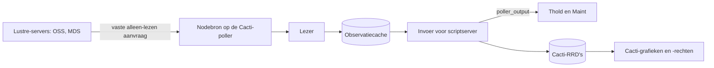

<!-- Source: README.md; SHA256: 40f2c5a5e9be97e4bd2b05a9ebab2a77de51de3af1b1c21dbeb5ee7f936cdd3b -->

<!-- translations:start -->
[English](../../../README.md) | [简体中文](../zh-CN/README.md) | [हिन्दी](../hi-IN/README.md) | [Español (España)](../es-ES/README.md) | [Español (Latinoamérica)](../es-419/README.md) | [العربية (السعودية)](../ar-SA/README.md) | [Afrikaans](../af-ZA/README.md) | [አማርኛ](../am-ET/README.md) | [العربية (مصر)](../ar-EG/README.md) | [العربية (المغرب)](../ar-MA/README.md) | [বাংলা](../bn-BD/README.md) | [Deutsch](../de-DE/README.md) | [فارسی](../fa-IR/README.md) | [Filipino](../fil-PH/README.md) | [Français](../fr-FR/README.md) | [Français (Maroc)](../fr-MA/README.md) | [Français (Sénégal)](../fr-SN/README.md) | [Hausa](../ha-NG/README.md) | [עברית](../he-IL/README.md) | [Bahasa Indonesia](../id-ID/README.md) | [Igbo](../ig-NG/README.md) | [Italiano](../it-IT/README.md) | [日本語](../ja-JP/README.md) | [한국어](../ko-KR/README.md) | [Malagasy](../mg-MG/README.md) | [मराठी](../mr-IN/README.md) | [Bahasa Melayu](../ms-MY/README.md) | [Nederlands](README.md) | [Polski](../pl-PL/README.md) | [Português (Brasil)](../pt-BR/README.md) | [Русский](../ru-RU/README.md) | [Kinyarwanda](../rw-RW/README.md) | [Soomaali](../so-SO/README.md) | [Svenska](../sv-SE/README.md) | [Kiswahili](../sw-KE/README.md) | [தமிழ்](../ta-IN/README.md) | [తెలుగు](../te-IN/README.md) | [ไทย](../th-TH/README.md) | [Türkçe](../tr-TR/README.md) | [Українська](../uk-UA/README.md) | [اردو](../ur-PK/README.md) | [Tiếng Việt](../vi-VN/README.md) | [isiXhosa](../xh-ZA/README.md) | [Yorùbá](../yo-NG/README.md) | [繁體中文](../zh-TW/README.md) | [isiZulu](../zu-ZA/README.md)
<!-- translations:end -->

# plugin_pfs

Een Cacti 1.2-plug-in die de status en belasting van parallelle bestandssystemen naar Cacti brengt: capaciteit en vullingsonbalans tussen targets, doorvoer per target en het aantal metadatabewerkingen per seconde. Lustre is de eerste backend. GPFS (IBM Storage Scale) en BeeGFS volgen achter een backendinterface. De gegevens komen terecht in gewone Cacti-apparaten, databronnen en grafieken, zodat Thold en Maint er ongewijzigd meldingen voor kunnen genereren en onderdrukken.

> **Status: mijlpaal 4, code voor fase 1 voltooid, nog niet uitgebracht.** Mijlpalen 2 (basis), 3 (Lustre-observatie) en 4 (meldingen en releasevoorbereiding) zijn afgerond op `main` of in review. De plug-in wordt geïnstalleerd, bijgewerkt en verwijderd via de plug-in-API van Cacti en weigert PHP-versies lager dan 8.2. Een achtergrondlezer op elke poller leest Lustre-servers uit via SSH met een vast forced-command-script ([node/pfs-read.sh](../../../node/pfs-read.sh)) en slaat de inventarisatie, conditie, capaciteit en tellers inclusief hun actualiteit op in de cache. Elk bestandssysteem wordt een Cacti-apparaat met OST- en MDT-dataquery's, vijf overzichtsgrafieken, grafieken per target op aanvraag en een samenvattende databron voor Thold. Ongewijzigde versies van Thold v1.8.2 en Maint v1.3 genereren en onderdrukken meldingen op de samenvattende meters in de end-to-end-run; Thold-drempelwaarden op tellers worden niet ondersteund met Thold 1.8.2 ([docs/alerting.md](../../alerting.md)). Alle tests tot nu toe draaien op fixture-uitvoer van nodes in een tijdelijke Cacti-omgeving: de plug-in heeft nog niet tegen een echte Lustre-node gedraaid. Nog open voor een release: pilots op echte bestandssystemen ([pilotplan](../../pilot-plan.md)), de externe beveiligingsreview ([zelfevaluatie](../../security-review.md)) en schaalmetingen op gedocumenteerde hardware ([schaalmetingen](../../research/scale.md)). Versie 0.1.0 is voorbereid in `INFO` en [CHANGELOG.md](../../../CHANGELOG.md), maar nog niet getagd.

## Toegangsrollen

| Realm | Toegang |
| --- | --- |
| Parallel Filesystem View | Bestaande monitoringpagina's. |
| Parallel Filesystem Operator | Monitoring plus de pagina Operations en persoonlijke triagebevestigingen. |
| Parallel Filesystem Admin | Operator-toegang plus de bestaande configuratie- en beheeracties. |

Na het kopiëren van de upgradebestanden opent u als beheerder de pagina Plugins om het
nieuwe realm te registreren. Wijs het Operator-realm expliciet toe onder **Configuration > Users** of gebruikersgroepen.
Upgrades behouden de bestaande realm-ID's en machtigingen voor View en Admin. Admin-toegang
erft Operator-toegang en Operator-toegang erft View-toegang bij elke aanvraag;
dit voegt geen opgeslagen machtigingen toe aan gebruikers of groepen. Voor plug-ininstellingen is naast
het Cacti-recht Settings ook toegang tot Parallel Filesystem Admin vereist.

De apparaatmachtigingen van Cacti blijven de rijen en acties beperken die voor elke gebruiker beschikbaar zijn; voor niet-gekoppelde objecten is een beheerder vereist.
Inloggegevens, configuratie, koppelingen, verwijdering en andere beheerwijzigingen
blijven op de beheerpagina's. Bevestigingen blijven alleen behouden in de huidige
gebruikerssessie, voor maximaal één uur en alleen zolang dezelfde observatie actueel
blijft. Nieuwe of gewijzigde observaties maken ze ongeldig. Ze markeren een mislukte
meting nooit als gezond en onderdrukken geen meldingen.

## Waarom

Wanneer een gedeeld bestandssysteem traag is, is het bewijs verspreid over meerdere servers. Lustre houdt zijn tellers per node bij: `lctl get_param` rapporteert waarden "on the local node", waardoor elke object storage server (OSS) en metadata server (MDS) alleen de cijfers van zijn eigen targets bevat. Een beheerder die een traag bestandssysteem onderzoekt, heeft drie antwoorden van verschillende plekken nodig:

- **Loopt één target vol terwijl andere leeg zijn?** Vullingsonbalans beïnvloedt waar nieuwe bestanden terechtkomen en wanneer één enkel target zonder schijfruimte komt te zitten.
- **Welke targets of bewerkingen zijn druk?** Bytetellers per target en bewerkingstellers per MDT laten zien of de belasting wordt veroorzaakt door data of door metadata.
- **Is de monitoring zelf actueel?** Een vlakke grafiek is alleen geruststellend als de plug-in de servers daadwerkelijk kon bereiken.

Cacti maakt grafieken van hosts en bewaakt drempelwaarden met Thold, en de GitHub-organisatie van Cacti heeft geen repository voor het monitoren van Lustre, GPFS of BeeGFS (gezocht op 2026-11-14). De plug-in dicht die kloof door op de allowlist geplaatste, alleen-lezen waarden van de opslagnodes op te halen en elk bestandssysteem weer te geven als een Cacti-apparaat waarvan de targets de indexen van een dataquery zijn. De plug-in hergebruikt de grafieken, machtigingen, externe dataverzamelaars, Thold en Maint van Cacti in plaats van daar parallelle versies voor te bouwen.

## Geplande scope

| Fase | Scope | Mijlpalen |
|---|---|---|
| 0, onderzoek | Releasematrix, beslissing over nodetoegang, bevestiging van upstream-gedrag, teller- en failover-gedrag, schaalmetingen | [M1](https://github.com/somethingwithproof/plugin_pfs/milestone/1) |
| 1, observatie | Lustre-inventarisatie, capaciteit en vulling, OST-doorvoer, aantallen MDT-bewerkingen per seconde, grafieken, Thold-meldingen, Maint-onderdrukking, statuspagina | [M2](https://github.com/somethingwithproof/plugin_pfs/milestone/2), [M3](https://github.com/somethingwithproof/plugin_pfs/milestone/3), [M4](https://github.com/somethingwithproof/plugin_pfs/milestone/4) |
| 2, verdieping | Externe Cacti-dataverzamelaars, weergaven op taak- en clientniveau binnen een begrensd aantal objecten | [M5](https://github.com/somethingwithproof/plugin_pfs/milestone/5) |
| 3, backends | GPFS- (IBM Storage Scale) en BeeGFS-backends | [M6](https://github.com/somethingwithproof/plugin_pfs/milestone/6) |

Buiten scope: elke schrijf-, wis-, reset- of afstemmingsbewerking op een node of bestandssysteem; een eigen meldingsengine in de plug-in; een aangepaste daemon of netwerkprotocol; databronnen per taak; wijzigingen aan Cacti-core, Thold of Maint.

## Compatibiliteitsdoelen

| Component | Doel |
|---|---|
| Cacti | 1.2.31 of nieuwer, geen core-patches |
| PHP | 8.2 of nieuwer; `setup.php` blijft parseerbaar op 8.0 zodat een niet-ondersteunde runtime een weigering krijgt in plaats van een defecte Cacti-interface |
| Lustre | Releaselijnen worden vastgesteld bij mijlpaal 1; gecontroleerde broncode en handleidingen zijn tot nu toe versie 2.17.0 |
| GPFS, BeeGFS | Fase 3; releases worden vastgesteld na onderzoek |
| Thold, Maint | Geen wijzigingen vereist |

## Ontwerp

- [docs/PLAN.md](../../PLAN.md) is het volledige plan: architectuur, upstream-feiten waarop het steunt (met bronnen en wat nog niet is geverifieerd), tellersemantiek, toestandsmodel, beveiligingsgrenzen, prestatierekenwerk, testen en risico's.
- [docs/operator-guide.md](../../operator-guide.md) behandelt installatie, de grafieken en waarden, upgraden, back-up en herstel, verwijderen en probleemoplossing; [docs/alerting.md](../../alerting.md) behandelt Thold en Maint.
- [docs/node-setup.md](../../node-setup.md) beschrijft hoe een Lustre-server en een poller voor de lezer worden ingericht.
- [docs/decisions/](../../decisions) bevat Architecture Decision Records voor reeds gemaakte keuzes.
- [docs/REQUIREMENTS.md](../../REQUIREMENTS.md) koppelt elke vereiste-ID aan het bijbehorende issue.

## Hoe het werk wordt bijgehouden

- **Mijlpalen** volgen de mijlpalen van het plan. Elke mijlpaal heeft een epic-issue met daarin de sub-issues en het opleverbewijs.
- **Issues** worden ingedeeld via labels: `type: requirement`, `type: research`, `type: decision`, `type: epic`. Vereiste-issues vermelden genummerde, testbare vereisten (`REQ-AREA-NNN`) en acceptatiecriteria.
- **Labels** bevatten ook `area:`, `phase:`, `priority:` en `status:`. Zie [CONTRIBUTING.md](../../../CONTRIBUTING.md#labels).
- Het [projectbord](https://github.com/users/somethingwithproof/projects/11) toont alle issues over alle mijlpalen heen.

## Bijdragen

Lees [CONTRIBUTING.md](../../../CONTRIBUTING.md). Commits vereisen een DCO sign-off. Ontwerpdiscussies vinden plaats in issues; openstaande beslissingen dragen het label `type: decision`.

## Beveiliging

Meld kwetsbaarheden privé; zie [SECURITY.md](../../../SECURITY.md).

## Licentie

GNU General Public License v2.0, dezelfde licentie als Cacti en de bijbehorende plug-ins. Zie [LICENSE](../../../LICENSE).
