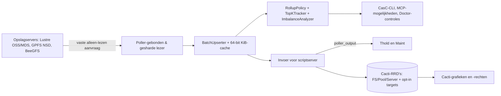

<!-- Source: README.md; SHA256: e88d6875d113220a91cfc0a9d230c829a78477b17e6aa7e44dda38c9591c86ad -->

<!-- translations:start -->
[English](../../../README.md) | [简体中文](../zh-CN/README.md) | [हिन्दी](../hi-IN/README.md) | [Español (España)](../es-ES/README.md) | [Español (Latinoamérica)](../es-419/README.md) | [العربية (السعودية)](../ar-SA/README.md) | [Afrikaans](../af-ZA/README.md) | [አማርኛ](../am-ET/README.md) | [العربية (مصر)](../ar-EG/README.md) | [العربية (المغرب)](../ar-MA/README.md) | [বাংলা](../bn-BD/README.md) | [Bosanski](../bs-BA/README.md) | [Deutsch](../de-DE/README.md) | [فارسی](../fa-IR/README.md) | [Filipino](../fil-PH/README.md) | [Français](../fr-FR/README.md) | [Français (Maroc)](../fr-MA/README.md) | [Français (Sénégal)](../fr-SN/README.md) | [Hausa](../ha-NG/README.md) | [עברית](../he-IL/README.md) | [Hrvatski](../hr-HR/README.md) | [Bahasa Indonesia](../id-ID/README.md) | [Igbo](../ig-NG/README.md) | [Italiano](../it-IT/README.md) | [日本語](../ja-JP/README.md) | [한국어](../ko-KR/README.md) | [Malagasy](../mg-MG/README.md) | [मराठी](../mr-IN/README.md) | [Bahasa Melayu](../ms-MY/README.md) | [Nederlands](README.md) | [Polski](../pl-PL/README.md) | [Português (Brasil)](../pt-BR/README.md) | [Русский](../ru-RU/README.md) | [Kinyarwanda](../rw-RW/README.md) | [Soomaali](../so-SO/README.md) | [Српски](../sr-RS/README.md) | [Svenska](../sv-SE/README.md) | [Kiswahili](../sw-KE/README.md) | [தமிழ்](../ta-IN/README.md) | [తెలుగు](../te-IN/README.md) | [ไทย](../th-TH/README.md) | [Türkçe](../tr-TR/README.md) | [Українська](../uk-UA/README.md) | [اردو](../ur-PK/README.md) | [Tiếng Việt](../vi-VN/README.md) | [isiXhosa](../xh-ZA/README.md) | [Yorùbá](../yo-NG/README.md) | [繁體中文](../zh-TW/README.md) | [isiZulu](../zu-ZA/README.md)
<!-- translations:end -->

# plugin_pfs

Een Cacti 1.2-plug-in die status, capaciteit, vullingsonbalans, doorvoer per target en het aantal metadatabewerkingen per seconde van parallelle bestandssystemen voor Lustre, IBM Storage Scale (GPFS) en BeeGFS naar Cacti brengt achter een uniforme `Backend`-interface. Elk bestandssysteem wordt gekoppeld aan een gewoon Cacti-apparaat met dataquery's, overzichts- en on-demand targetgrafieken en samenvattende meters, zodat Thold en Maint er ongewijzigd meldingen voor kunnen genereren en onderdrukken.

> **Status: fasen 1 tot en met 3 en primitieve functies voor exascale-schaling in code geïmplementeerd, nog niet uitgebracht.** De basis, Lustre-observatie, meldingen en Maint-onderdrukking, alleen-lezen drivers voor GPFS en BeeGFS, OST/MDT-onbalansanalyse met Maint-integratie, scoping voor externe dataverzamelaars (`replicate_out`, `remote_agent`), schalingsprimitieven voor 100+ PB / exascale (`FramedReportParser`, Schema v4 `value_kib`, `RollupPolicy`, `TopKTracker`, `ShardAssigner`, `BatchUpserter`), de CasC-beheerders-CLI (`cli/pfs.php`) en ecosysteemhooks (`abilities_register`, `doctor_register_checks`, `casc_register_providers`) zijn geïmplementeerd en geverifieerd met unit-, beveiligings- en integratietests in een tijdelijke Cacti-omgeving. Alle runs tot nu toe gebruiken fixture-uitvoer van nodes in plaats van echte Lustre-, GPFS- of BeeGFS-hardware. Nog open vóór het taggen van een release: pilots op echte bestandssystemen ([pilotplan](../../pilot-plan.md)), een externe beveiligingsreview ([zelfevaluatie](../../security-review.md)) en schaalmetingen op gedocumenteerde hardware ([schaalmetingen](../../research/scale.md)). Versie 0.1.0 is voorbereid in `INFO` en [CHANGELOG.md](../../../CHANGELOG.md), maar nog niet getagd.

## Toegangsrollen

| Realm | Toegang |
| --- | --- |
| Parallel Filesystem View | Bestaande monitoringpagina's. |
| Parallel Filesystem Operator | Monitoring plus de pagina Operations en persoonlijke triagebevestigingen. |
| Parallel Filesystem Admin | Operator-toegang plus de bestaande configuratie- en beheeracties. |

Na het kopiëren van de upgradebestanden opent u als beheerder de pagina Plugins om het
nieuwe realm te registreren. Wijs het Operator-realm expliciet toe onder **Configuration > Users** of gebruikersgroepen.
Upgrades behouden de bestaande realm-ID's en machtigingen voor View en Admin. Admin-toegang
erft Operator-toegang en Operator-toegang erft View-toegang bij elke aanvraag;
dit voegt geen opgeslagen machtigingen toe aan gebruikers of groepen. Voor plug-ininstellingen is naast
het Cacti-recht Settings ook toegang tot Parallel Filesystem Admin vereist.

De apparaatmachtigingen van Cacti blijven de rijen en acties beperken die voor elke gebruiker beschikbaar zijn; voor niet-gekoppelde objecten is een beheerder vereist.
Inloggegevens, configuratie, koppelingen, verwijdering en andere beheerwijzigingen
blijven op de beheerpagina's. Bevestigingen blijven alleen behouden in de huidige
gebruikerssessie, voor maximaal één uur en alleen zolang dezelfde observatie actueel
blijft. Nieuwe of gewijzigde observaties maken ze ongeldig. Ze markeren een mislukte
meting nooit als gezond en onderdrukken geen meldingen.

## Waarom

Wanneer een gedeeld bestandssysteem traag is, is het bewijs verspreid over meerdere servers. Lustre houdt zijn tellers per node bij: `lctl get_param` rapporteert waarden "on the local node", waardoor elke object storage server (OSS) en metadata server (MDS) alleen de cijfers van zijn eigen targets bevat. Een beheerder die een traag bestandssysteem onderzoekt, heeft drie antwoorden van verschillende plekken nodig:

- **Loopt één target vol terwijl andere leeg zijn?** Vullingsonbalans beïnvloedt waar nieuwe bestanden terechtkomen en wanneer één enkel target zonder schijfruimte komt te zitten.
- **Welke targets of bewerkingen zijn druk?** Bytetellers per target en bewerkingstellers per MDT laten zien of de belasting wordt veroorzaakt door data of door metadata.
- **Is de monitoring zelf actueel?** Een vlakke grafiek is alleen geruststellend als de plug-in de servers daadwerkelijk kon bereiken.

Cacti maakt grafieken van hosts en bewaakt drempelwaarden met Thold, en de GitHub-organisatie van Cacti heeft geen repository voor het monitoren van Lustre, GPFS of BeeGFS (gezocht op 2026-11-14). De plug-in dicht die kloof door op de allowlist geplaatste, alleen-lezen waarden van de opslagnodes op te halen en elk bestandssysteem weer te geven als een Cacti-apparaat waarvan de targets de indexen van een dataquery zijn. De plug-in hergebruikt de grafieken, machtigingen, externe dataverzamelaars, Thold en Maint van Cacti in plaats van daar parallelle versies voor te bouwen.

## Geplande scope

| Fase | Scope | Status | Mijlpalen |
|---|---|---|---|
| 0, onderzoek | Releasematrix, beslissing over nodetoegang, bevestiging van upstream-gedrag, teller- en failover-gedrag, schaalmetingen | Voltooid | [M1](https://github.com/somethingwithproof/plugin_pfs/milestone/1) |
| 1, observatie | Lustre-inventarisatie, capaciteit en vulling, OST/MDT-onbalans (`lib/ImbalanceAnalyzer.php`), Maint-integratie (`lib/HealthPage.php`), OST-doorvoer, aantallen MDT-bewerkingen per seconde, grafieken, Thold-meldingen, statuspagina | Geïmplementeerd (fixture-getest) | [M2](https://github.com/somethingwithproof/plugin_pfs/milestone/2), [M3](https://github.com/somethingwithproof/plugin_pfs/milestone/3), [M4](https://github.com/somethingwithproof/plugin_pfs/milestone/4) |
| 2, extern en schaal | Poller-gebonden externe verzameling (`lib/Reader.php`, `lib/ReplicationRepository.php`, `replicate_out`, `remote_agent`), schalingsprimitieven voor 100+ PB (64-bit KiB-hygiëne + Schema v4 `value_kib`, `lib/RollupPolicy.php`, `lib/TopKTracker.php`, `lib/ShardAssigner.php` + `poller_pfs.php --shard=K/N`, `lib/BatchUpserter.php`), CasC-CLI (`cli/pfs.php`), MCP/Doctor/CasC-hooks | Geïmplementeerd (unit- en CI-integratiegetest) | [M5](https://github.com/somethingwithproof/plugin_pfs/milestone/5) |
| 3, backends | Alleen-lezen drivers voor IBM Storage Scale (GPFS) (`lib/GpfsBackend.php`) en BeeGFS (`lib/BeegfsBackend.php`) geregistreerd in `BackendRegistry::production()` | Geïmplementeerd (unit-getest) | [M6](https://github.com/somethingwithproof/plugin_pfs/milestone/6) |

Belangrijkste geïmplementeerde beheerders- en schalingsprimitieven:

- **Alleen-lezen drivers voor meerdere bestandssystemen:** `LustreBackend`, `GpfsBackend` (uitsluitend geframede `mmpmon` `fs_io_s`/`io_s` met `reset` verboden, `mmdf`-poolcapaciteit/-statussen en waiter-samenvattingen) en `BeegfsBackend` (BeeGFS 7.4- en 8.x-opslag-/metadatatargets met exacte byte-naar-KiB-conversie, toewijzing van bereikbaarheids-/consistentiestatussen en metersemantiek per interval) die `lib/FramedReportParser.php` delen.
- **Onbalans-, headroom- en Maint-bewustzijn:** `lib/ImbalanceAnalyzer.php` berekent OST/MDT-vullingsratio's, spreiding, onbalansindex op basis van populatiestandaarddeviatie, headroom, actualiteitshandhaving over 1 interval (`missing_targets`), statusvlaggen per target en begrensde Top-K scheve targets. `HealthPage` (`pfs_health.php`) en `CascProvider::health()` tonen `Maint`-onderhoudsvensters van Cacti en onderdrukken actieve storingswaarschuwingen tijdens gepland onderhoud.
- **Schaling voor 100+ PB en exascale** ([docs/architecture/exascale-scaling.md](../../architecture/exascale-scaling.md)): exacte decimale byte-naar-KiB-conversie (`FramedReportParser::bytesToKibInt()`) geverifieerd op 500 PB en 2 EB naast `BIGINT UNSIGNED value_kib`-kolommen (Schema v4); hiërarchische `Filesystem -> Pool -> Storage Server` RRD-rollups met begrensde promotie van opt-in/drukke/scheve targets (`lib/RollupPolicy.php`); begrensde $O(K)$ Top-K scheve targets en vooraf geaggregeerde samenvattingen van zware taken/clients (`lib/TopKTracker.php`, zonder ooit apparaten of RRD's per client aan te maken); deterministische CRC32-verzamelaarsharding (`lib/ShardAssigner.php`, `php plugins/pfs/poller_pfs.php [--poller=N] [--shard=K/N] [--force] [--debug]`); en batched SQL-upserts van 500 rijen plus keyset-paginering (`lib/BatchUpserter.php`, `CacheRepository::upsertObservationsBatch()`, `TargetRepository::forFilesystemPage()`).
- **CasC-CLI voor beheerders en ecosysteemhooks:** `cli/pfs.php` ondersteunt `export [--format=yaml|xml]`, `validate <file> [--format=yaml|xml]`, `plan <file> [--format=yaml|xml] [--output=text|json]`, `apply <file> --confirm=<PLAN_HASH> [--format=yaml|xml]` en `health [--format=text|json]` zonder externe Composer-afhankelijkheden. `setup.php` en `lib/EcosystemIntegration.php` registreren `abilities_register` (`pfs-list-filesystems`, `pfs-get-imbalance`, `pfs-get-health`; alleen-lezen, afgeschermd met `Parallel Filesystem View` en Cacti-apparaatmachtigingen), `doctor_register_checks` (`pfs_schema`, `pfs_reader_freshness`, `pfs_capacity_imbalance`), `casc_register_providers`, `replicate_out` en `remote_agent`.

Buiten scope: elke schrijf-, wis-, reset- of afstemmingsbewerking op een node of bestandssysteem; een eigen meldingsengine in de plug-in; een aangepaste daemon of netwerkprotocol; Cacti-apparaten of RRD's per taak of per client; wijzigingen aan Cacti-core, Thold of Maint.

## Compatibiliteitsdoelen

| Component | Doel |
|---|---|
| Cacti | 1.2.31 of nieuwer, geen core-patches |
| PHP | 8.2 of nieuwer; `setup.php`, `poller_pfs.php` en `cli/pfs.php` blijven parseerbaar op 8.0 zodat een niet-ondersteunde runtime een weigering krijgt in plaats van een defecte Cacti-interface |
| Lustre | Broncode en handleidingen gecontroleerd op 2.17.0; fixture-getest |
| GPFS, BeeGFS | Alleen-lezen drivers voor IBM Storage Scale (GPFS) 5.x `mmpmon`/`mmdf` en BeeGFS 7.4 / 8.x geïmplementeerd en fixture-getest |
| Thold, Maint | Thold 1.8.2 en Maint 1.3, ongewijzigd |

## Ontwerp

- [docs/architecture/exascale-scaling.md](../../architecture/exascale-scaling.md) documenteert de tweetraps 100+ PB / exascale-telemetriearchitectuur (Cacti/`plugin_pfs`-server + rollup + Top-K-laag gecombineerd met out-of-band LDMS/Darshan/TOKIO-clienttelemetrie) en de academische literatuurcontext.
- [docs/PLAN.md](../../PLAN.md) is het volledige plan: architectuur, upstream-feiten waarop het steunt (met bronnen en wat nog niet is geverifieerd), tellersemantiek, toestandsmodel, beveiligingsgrenzen, prestatierekenwerk, testen en risico's.
- [docs/operator-guide.md](../../operator-guide.md) behandelt installatie, de grafieken en waarden, upgraden, back-up en herstel, verwijderen en probleemoplossing; [docs/alerting.md](../../alerting.md) behandelt Thold en Maint.
- [docs/node-setup.md](../../node-setup.md) beschrijft hoe een Lustre-server en een poller voor de lezer worden ingericht.
- [docs/decisions/](../../decisions) bevat Architecture Decision Records voor reeds gemaakte keuzes.
- [docs/REQUIREMENTS.md](../../REQUIREMENTS.md) koppelt elke vereiste-ID aan het bijbehorende issue.

## Hoe het werk wordt bijgehouden

- **Mijlpalen** volgen de mijlpalen van het plan. Elke mijlpaal heeft een epic-issue met daarin de sub-issues en het opleverbewijs.
- **Issues** worden ingedeeld via labels: `type: requirement`, `type: research`, `type: decision`, `type: epic`. Vereiste-issues vermelden genummerde, testbare vereisten (`REQ-AREA-NNN`) en acceptatiecriteria.
- **Labels** bevatten ook `area:`, `phase:`, `priority:` en `status:`. Zie [CONTRIBUTING.md](../../../CONTRIBUTING.md#labels).
- Het [projectbord](https://github.com/users/somethingwithproof/projects/11) toont alle issues over alle mijlpalen heen.

## Bijdragen

Lees [CONTRIBUTING.md](../../../CONTRIBUTING.md). Commits vereisen een DCO sign-off. Ontwerpdiscussies vinden plaats in issues; openstaande beslissingen dragen het label `type: decision`.

## Beveiliging

Meld kwetsbaarheden privé; zie [SECURITY.md](../../../SECURITY.md).

## Licentie

GNU General Public License v2.0, dezelfde licentie als Cacti en de bijbehorende plug-ins. Zie [LICENSE](../../../LICENSE).
