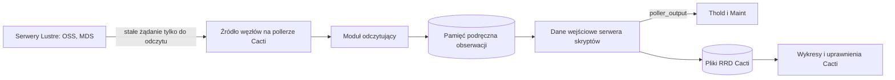

<!-- Source: README.md; SHA256: 40f2c5a5e9be97e4bd2b05a9ebab2a77de51de3af1b1c21dbeb5ee7f936cdd3b -->

<!-- translations:start -->
[English](../../../README.md) | [简体中文](../zh-CN/README.md) | [हिन्दी](../hi-IN/README.md) | [Español (España)](../es-ES/README.md) | [Español (Latinoamérica)](../es-419/README.md) | [العربية (السعودية)](../ar-SA/README.md) | [Afrikaans](../af-ZA/README.md) | [አማርኛ](../am-ET/README.md) | [العربية (مصر)](../ar-EG/README.md) | [العربية (المغرب)](../ar-MA/README.md) | [বাংলা](../bn-BD/README.md) | [Deutsch](../de-DE/README.md) | [فارسی](../fa-IR/README.md) | [Filipino](../fil-PH/README.md) | [Français](../fr-FR/README.md) | [Français (Maroc)](../fr-MA/README.md) | [Français (Sénégal)](../fr-SN/README.md) | [Hausa](../ha-NG/README.md) | [עברית](../he-IL/README.md) | [Bahasa Indonesia](../id-ID/README.md) | [Igbo](../ig-NG/README.md) | [Italiano](../it-IT/README.md) | [日本語](../ja-JP/README.md) | [한국어](../ko-KR/README.md) | [Malagasy](../mg-MG/README.md) | [मराठी](../mr-IN/README.md) | [Bahasa Melayu](../ms-MY/README.md) | [Nederlands](../nl-NL/README.md) | [Polski](README.md) | [Português (Brasil)](../pt-BR/README.md) | [Русский](../ru-RU/README.md) | [Kinyarwanda](../rw-RW/README.md) | [Soomaali](../so-SO/README.md) | [Svenska](../sv-SE/README.md) | [Kiswahili](../sw-KE/README.md) | [தமிழ்](../ta-IN/README.md) | [తెలుగు](../te-IN/README.md) | [ไทย](../th-TH/README.md) | [Türkçe](../tr-TR/README.md) | [Українська](../uk-UA/README.md) | [اردو](../ur-PK/README.md) | [Tiếng Việt](../vi-VN/README.md) | [isiXhosa](../xh-ZA/README.md) | [Yorùbá](../yo-NG/README.md) | [繁體中文](../zh-TW/README.md) | [isiZulu](../zu-ZA/README.md)
<!-- translations:end -->

# plugin_pfs

Wtyczka dla Cacti 1.2 wprowadzająca monitorowanie stanu i obciążenia równoległych systemów plików do Cacti: pojemności oraz nierównomierności zapełnienia pomiędzy targetami, przepustowości poszczególnych targetów, a także częstości operacji na metadanych. Pierwszym zapleczem (backendem) jest Lustre. GPFS (IBM Storage Scale) oraz BeeGFS zostaną dodane w dalszej kolejności za pośrednictwem interfejsu backendu. Dane trafiają do standardowych urządzeń, źródeł danych i wykresów Cacti, dzięki czemu wtyczki Thold i Maint mogą generować alerty i wyciszać je bez żadnych modyfikacji.

> **Status: kamień milowy 4, kod ukończony dla fazy 1, wersja niewydana.** Kamienie milowe 2 (fundamenty), 3 (obserwacja Lustre) oraz 4 (alertowanie i przygotowanie wydania) zostały ukończone na gałęzi `main` lub są w trakcie przeglądu. Wtyczka instaluje się, aktualizuje i odinstalowuje poprzez API wtyczek Cacti oraz odrzuca wersje PHP starsze niż 8.2. Działający w tle moduł odczytujący na każdym pollerze odpytuje serwery Lustre przez SSH za pomocą stałego skryptu wymuszonego polecenia ([node/pfs-read.sh](../../../node/pfs-read.sh)) i buforuje inwentarz, stan, pojemność oraz liczniki wraz z ich aktualnością. Każdy system plików staje się urządzeniem Cacti z zapytaniami danych OST i MDT, pięcioma wykresami przeglądowymi, wykresami dla poszczególnych targetów tworzonymi na żądanie oraz zbiorczym źródłem danych dla Thold. Niezmodyfikowane wtyczki Thold v1.8.2 i Maint v1.3 obsługują alerty oraz ich wyciszanie dla zbiorczych wskaźników typu gauge w testach end-to-end; progi Thold dla liczników nie są obsługiwane w Thold 1.8.2 ([docs/alerting.md](../../alerting.md)). Wszystkie dotychczasowe testy korzystają z danych przykładowych (fixture) z węzłów w tymczasowej instancji Cacti: wtyczka nie była jeszcze uruchamiana na rzeczywistym węźle Lustre. Przed wydaniem pozostają do zrealizowania: pilotaże na rzeczywistych systemach plików ([plan pilotażu](../../pilot-plan.md)), zewnętrzny przegląd bezpieczeństwa ([przegląd własny](../../security-review.md)) oraz pomiary wydajności i skalowalności na udokumentowanym sprzęcie ([skalowanie](../../research/scale.md)). Wersja 0.1.0 została przygotowana w pliku `INFO` oraz [CHANGELOG.md](../../../CHANGELOG.md), ale nie została jeszcze otagowana.

## Role dostępu

| Uprawnienie (Realm) | Dostęp |
| --- | --- |
| Parallel Filesystem View | Istniejące strony monitorowania. |
| Parallel Filesystem Operator | Monitorowanie oraz strona Operations i osobiste potwierdzenia w ramach triażu. |
| Parallel Filesystem Admin | Dostęp Operator oraz istniejące strony konfiguracji i akcje administracyjne. |

Po skopiowaniu plików aktualizacji należy otworzyć stronę Plugins jako administrator, aby zarejestrować nowe uprawnienie (realm). Uprawnienie Operator należy przypisać jawnie w sekcji **Configuration > Users** lub dla grup użytkowników. Aktualizacje zachowują istniejące identyfikatory i nadania uprawnień View oraz Admin. Dostęp Admin dziedziczy dostęp Operator, a dostęp Operator dziedziczy dostęp View przy każdym żądaniu; nie dodaje to zapisanych na stałe nadań dla użytkowników ani grup. Ustawienia wtyczki wymagają również uprawnienia Parallel Filesystem Admin oprócz uprawnienia Settings w Cacti.

Uprawnienia do urządzeń w Cacti nadal ograniczają wiersze i akcje dostępne dla każdego użytkownika; niezmapowane obiekty wymagają administratora. Poświadczenia, konfiguracja, mapowanie, usuwanie oraz inne zmiany administracyjne pozostają na stronach administracyjnych. Potwierdzenia obowiązują wyłącznie w bieżącej sesji użytkownika, maksymalnie przez jedną godzinę i tylko tak długo, jak długo ta sama obserwacja pozostaje aktualna. Nowe lub zmienione obserwacje unieważniają je. Nigdy nie oznaczają one nieudanego pomiaru jako prawidłowego ani nie wyciszają alertów.

## Dlaczego

Gdy współdzielony system plików działa wolno, przyczyny są rozproszone na wielu serwerach. Lustre utrzymuje liczniki per węzeł: `lctl get_param` zwraca wartości „na lokalnym węźle”, więc każdy serwer pamięci obiektowej (OSS) i serwer metadanych (MDS) przechowuje wyłącznie dane dotyczące własnych targetów. Operator analizujący powolne działanie systemu plików potrzebuje trzech odpowiedzi z różnych źródeł:

- **Czy jeden target zapełnia się, podczas gdy inne są puste?** Nierównomierność zapełnienia wpływa na to, gdzie trafiają nowe pliki oraz kiedy pojedynczemu targetowi zabraknie miejsca.
- **Które targety lub operacje są obciążone?** Liczniki bajtów dla poszczególnych targetów oraz liczniki operacji dla poszczególnych MDT pokazują, czy obciążenie wynika z operacji na danych, czy na metadanych.
- **Czy samo monitorowanie jest aktualne?** Płaski wykres daje pewność tylko wtedy, gdy wtyczka miała dostęp do serwerów.

Cacti tworzy wykresy dla hostów i sprawdza progi za pomocą Thold, natomiast w organizacji Cacti na GitHubie nie ma repozytorium do monitorowania Lustre, GPFS ani BeeGFS (stan wyszukiwania na 2026-11-14). Wtyczka wypełnia tę lukę, odczytując z węzłów pamięci masowej wyłącznie dozwolone wartości w trybie tylko do odczytu i reprezentując każdy system plików jako urządzenie Cacti, którego targety stanowią indeksy zapytania danych. Ponownie wykorzystuje mechanizmy Cacti: wykresy, uprawnienia, zdalne kolektory danych, Thold oraz Maint, zamiast tworzyć ich równoległe odpowiedniki.

## Planowany zakres

| Faza | Zakres | Kamienie milowe |
|---|---|---|
| 0, badania | Macierz wydań, decyzja o sposobie dostępu do węzłów, potwierdzenie zachowania narzędzi nadrzędnych (upstream), zachowanie liczników i przełączania awaryjnego (failover), pomiary skalowalności | [M1](https://github.com/somethingwithproof/plugin_pfs/milestone/1) |
| 1, obserwacja | Inwentarz Lustre, pojemność i zapełnienie, przepustowość OST, częstość operacji MDT, wykresy, alertowanie Thold, wyciszanie Maint, strona stanu | [M2](https://github.com/somethingwithproof/plugin_pfs/milestone/2), [M3](https://github.com/somethingwithproof/plugin_pfs/milestone/3), [M4](https://github.com/somethingwithproof/plugin_pfs/milestone/4) |
| 2, pogłębienie | Zdalne kolektory danych Cacti, widoki na poziomie zadań i klientów przy ograniczonej liczbie obiektów | [M5](https://github.com/somethingwithproof/plugin_pfs/milestone/5) |
| 3, backendy | Backendy GPFS (IBM Storage Scale) oraz BeeGFS | [M6](https://github.com/somethingwithproof/plugin_pfs/milestone/6) |

Poza zakresem: wszelkie operacje zapisu, czyszczenia, resetowania lub dostrajania na węźle lub systemie plików; własny silnik alertowania wtyczki; niestandardowy demon lub protokół sieciowy; źródła danych na poziomie poszczególnych zadań; zmiany w rdzeniu Cacti, Thold lub Maint.

## Docelowa kompatybilność

| Komponent | Wymagania docelowe |
|---|---|
| Cacti | 1.2.31 lub nowsza, bez łatek dla rdzenia |
| PHP | 8.2 lub nowsza; `setup.php` pozostaje poprawny składniowo w PHP 8.0, dzięki czemu nieobsługiwane środowisko wykonawcze otrzymuje odmowę uruchomienia zamiast uszkodzenia interfejsu Cacti |
| Lustre | Linie wydań do ustalenia w kamieniu milowym 1; dotychczas sprawdzone źródła i podręczniki dotyczą wersji 2.17.0 |
| GPFS, BeeGFS | Faza 3; obsługiwane wydania do ustalenia w ramach prac badawczych |
| Thold, Maint | Brak wymaganych zmian |

## Projekt

- [docs/PLAN.md](../../PLAN.md) zawiera pełny plan: architekturę, założenia oparte na dokumentacji nadrzędnej (wraz ze źródłami oraz elementami wciąż niezweryfikowanymi), semantykę liczników, model stanów, granice bezpieczeństwa, obliczenia wydajnościowe, testowanie i ryzyka.
- [docs/operator-guide.md](../../operator-guide.md) opisuje instalację, wykresy i wartości, aktualizację, kopię zapasową i odtwarzanie, odinstalowanie oraz rozwiązywanie problemów; [docs/alerting.md](../../alerting.md) opisuje integrację z Thold i Maint.
- [docs/node-setup.md](../../node-setup.md) opisuje sposób przygotowania serwera Lustre oraz pollera dla modułu odczytującego.
- [docs/decisions/](../../decisions) zawiera rekordy decyzji architektonicznych (ADR) dla podjętych już wyborów.
- [docs/REQUIREMENTS.md](../../REQUIREMENTS.md) mapuje każdy identyfikator wymagania na odpowiadające mu zgłoszenie.

## Sposób śledzenia prac

- **Kamienie milowe (Milestones)** odpowiadają kamieniom milowym planu. Każdy ma zgłoszenie nadrzędne (epic) zawierające listę podzgłoszeń oraz dowody ukończenia.
- **Zgłoszenia (Issues)** są kategoryzowane etykietami: `type: requirement`, `type: research`, `type: decision`, `type: epic`. Zgłoszenia wymagań określają numerowane, testowalne wymagania (`REQ-AREA-NNN`) oraz kryteria akceptacji.
- **Etykiety (Labels)** zawierają również prefiksy `area:`, `phase:`, `priority:` oraz `status:`. Zobacz [CONTRIBUTING.md](../../../CONTRIBUTING.md#labels).
- [Tablica projektu](https://github.com/users/somethingwithproof/projects/11) prezentuje wszystkie zgłoszenia w podziale na kamienie milowe.

## Współpraca

Zapoznaj się z [CONTRIBUTING.md](../../../CONTRIBUTING.md). Commity wymagają podpisu DCO (sign-off). Dyskusje projektowe odbywają się w zgłoszeniach; otwarte decyzje są oznaczone etykietą `type: decision`.

## Bezpieczeństwo

Podatności należy zgłaszać prywatnie; zobacz [SECURITY.md](../../../SECURITY.md).

## Licencja

GNU General Public License v2.0, ta sama licencja co w przypadku Cacti i jego wtyczek. Zobacz [LICENSE](../../../LICENSE).
